<div align="right">

[English](./README.md) | 简体中文

</div>

<div align="center">

<picture>
  <source media="(prefers-color-scheme: dark)" srcset="./assets/dark/readme-banner.png">
  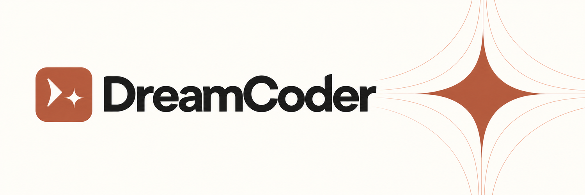
</picture>

**本地运行的多模型 AI 编程工作台**

*在桌面管理 Claude Code 工作流，也能在局域网内从手机接续会话。*

[**⬇️ 下载 macOS 版（Apple Silicon）**](https://github.com/GoDiao/dreamcoder/releases/latest) · [**⬇️ 下载 Windows 版（x64）**](https://github.com/GoDiao/dreamcoder/releases/latest)

[](https://www.electronjs.org/)
[](https://react.dev/)
[](https://bun.sh/)
[](./LICENSE)
[](https://github.com/GoDiao/dreamcoder/issues?q=is%3Aopen+is%3Aissue+label%3A%22good+first+issue%22)
[](https://github.com/GoDiao/dreamcoder/issues?q=is%3Aopen+is%3Aissue+label%3A%22help+wanted%22)

[](https://atomgit.com/GoDiao/DreamCoder)

国内 AtomGit 托管：[atomgit.com/GoDiao/DreamCoder](https://atomgit.com/GoDiao/DreamCoder)（镜像仓库；issue 和 PR 请提交到 [GitHub](https://github.com/GoDiao/dreamcoder)）

</div>

> 🎉 **500 Star 了！** 感谢每一位点 Star、试用、提 issue 和贡献代码的朋友。DreamCoder 才五个月大，是你们让它一点点长起来的。我们接下来会更进一步跟进前沿 coding agent 的最佳实践，完成一切可以提升用户体验的尝试和崭新的功能，我们的目标一直会是**星辰大海**。

> 🌱 **欢迎贡献！** 可以从 [good first issue](https://github.com/GoDiao/dreamcoder/issues?q=is%3Aopen+is%3Aissue+label%3A%22good+first+issue%22) 和 [help wanted](https://github.com/GoDiao/dreamcoder/issues?q=is%3Aopen+is%3Aissue+label%3A%22help+wanted%22) 开始；动手前请阅读 [贡献指南](docs/general/CONTRIBUTING_zh.md)。

---

## ✨ 为什么选择 DreamCoder？

DreamCoder 在本机运行桌面应用与会话服务，把模型配置、编程会话、终端和工具调用放在同一个工作台。

*   **选择模型服务**：配置 Anthropic 或 OpenAI 兼容接口；提供 DeepSeek、通义千问、Kimi、智谱 GLM、LM Studio、Ollama 等预设，也支持自定义端点。具体模型能否使用取决于服务商与配置。
*   **看清编程过程**：在桌面查看会话、文件变更、终端和工具调用。
*   **不只是文字**：AI 可以直接在对话里给出可交互的页面，如图表、示意图、分步演示；内置浏览器能在对话旁边打开你的开发服务器。
*   **设计与复刻**：用 `/design` 从 60+ 个模板和 156+ 套设计系统出发，Agent 先访谈再动手，做出网页或应用原型；也能复刻网站。成果保存在项目的 `dc_artifacts/` 里，可导出、可继续改、可在画布上并排比较。
*   **在看板上安排工作**：项目看板为你和会话记录任务、负责人、审核人和进展，跨会话、跨 worktree 保留。
*   **从手机接续**：启用 H5 接入后，可在同一局域网内通过手机浏览器访问桌面会话；跨网络访问需要自行配置反向代理。
*   **读懂编程智能体**：附带七篇源码导读，沿一次代码修改讲解执行循环、工具、权限、会话与桌面集成，见[《编程智能体实现指南》](docs/tutorial/README.md)。

Provider 配置和 API Key 保存在本机文件中。使用云端模型时，请求数据会发送给你选择的服务商；详见 [隐私说明](PRIVACY.md)。

---

## 🚀 核心功能

### 1. 原生桌面体验
*   **会话管理更顺手**：可视化历史、可按多种方式整理会话的侧边栏，每个会话都有自己的通高侧栏。
*   **标签页式侧栏**：变更、文件树、单个文件、网页、终端和页面都以标签页打开，可从新标签页选择。每个会话有自己的一组标签，重启后会恢复（终端除外）。
*   **终端无缝融入工作流**：内置 PTY (PowerShell/Bash/Zsh)，集成 xterm.js。
*   **设置项可视化**：无需手动编辑 JSON，直接在 UI 中管理 Provider 和 API Key。

<picture>
  <source media="(prefers-color-scheme: dark)" srcset="./assets/dark/main.png">
  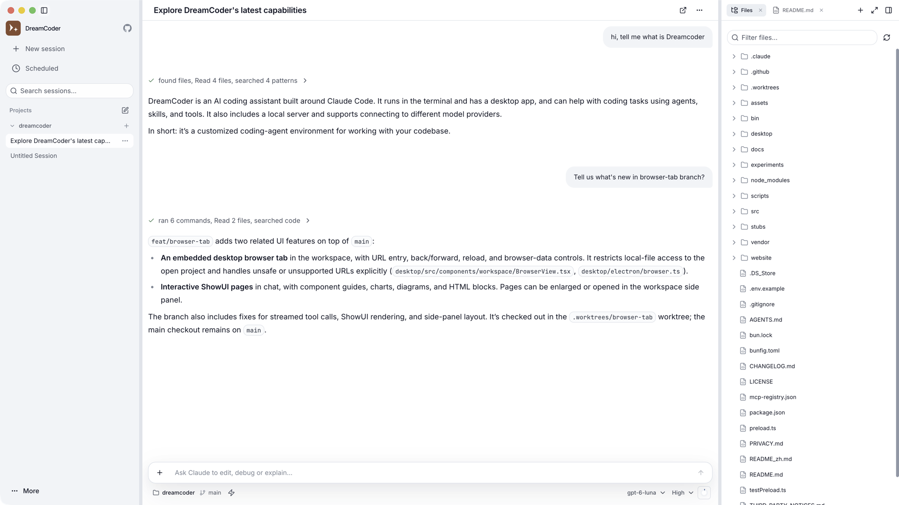
</picture>

### 2. 页面与内置浏览器
*   **对话里的页面**：当图表、示意图或分步讲解比文字更清楚时，AI 会用组件搭出页面：图表与四十多种 G2 图表、流程图、时序图与架构图、思维导图、分步演示、对比矩阵、路线图、3D 场景等，直接显示在对话中。每次修改都是新的版本，可放大查看或在侧栏打开。

<picture>
  <source media="(prefers-color-scheme: dark)" srcset="./assets/dark/pages-3.png">
  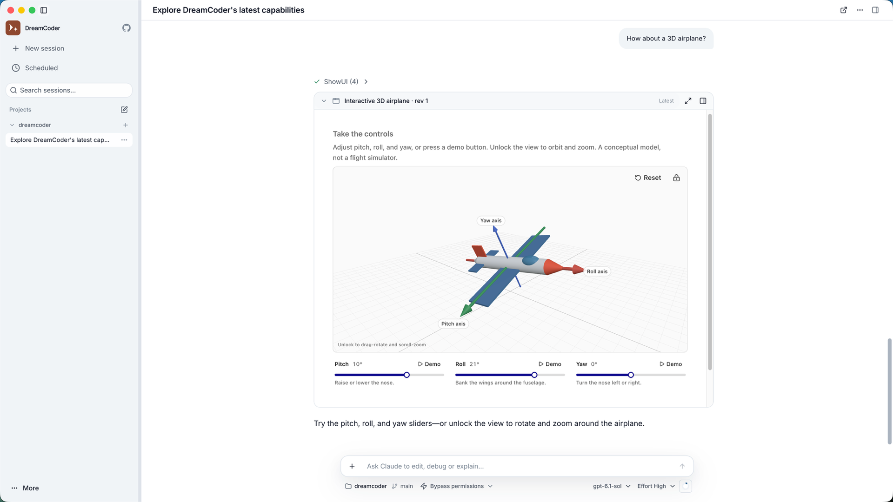
</picture>

<picture>
  <source media="(prefers-color-scheme: dark)" srcset="./assets/dark/pages-2.png">
  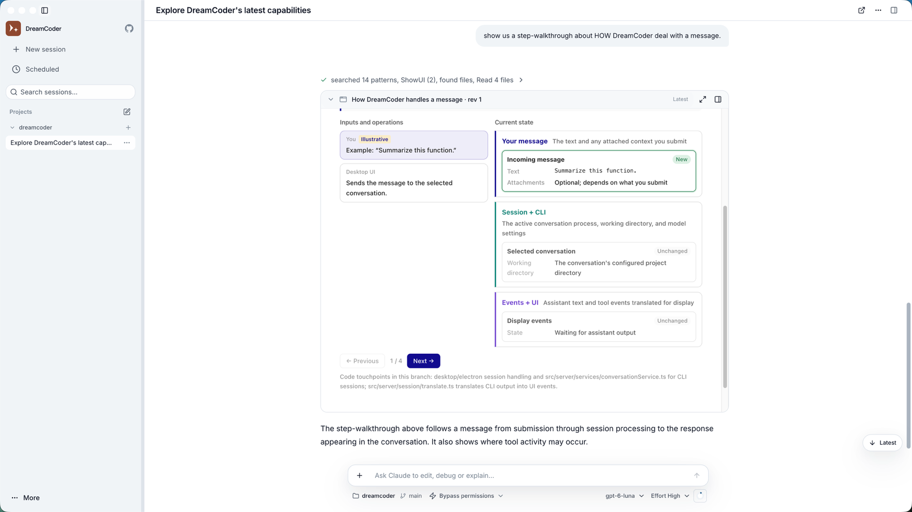
</picture>
<picture>
  <source media="(prefers-color-scheme: dark)" srcset="./assets/dark/pages-1.png">
  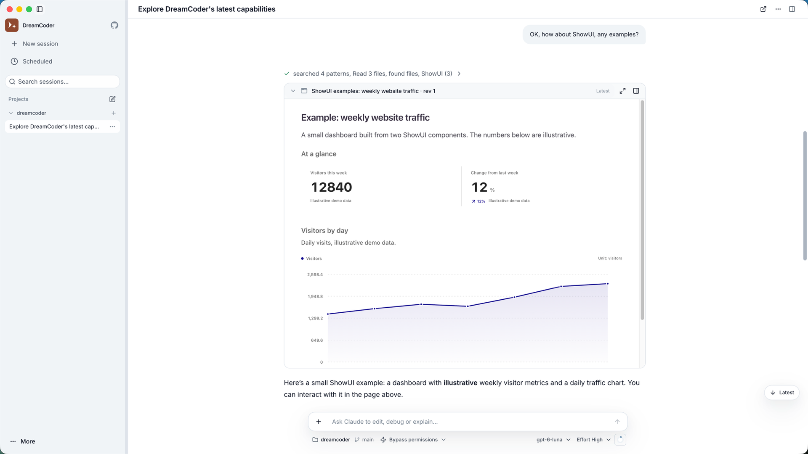
</picture>

*   **内置浏览器**：在侧栏标签页中打开本地开发服务器、项目里的 HTML 文件或 https 网站，与对话并排。登录状态在重启后保留。Agent 能自己操作页面（读取、点击、输入、截图、查看控制台和网络），只在它所属会话的浏览器里操作；在外部网站上操作前会先征求你的同意，常用站点可在设置 → 权限里设为信任。你也可以在页面上选中文字或点选元素，加到对话里。仅桌面应用可用。

<picture>
  <source media="(prefers-color-scheme: dark)" srcset="./assets/dark/browser.png">
  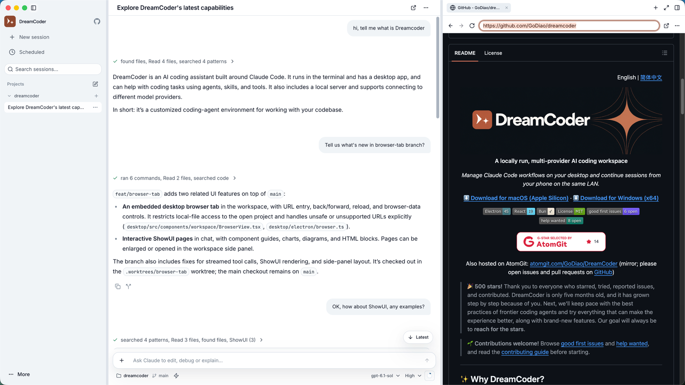
</picture>

### 3. 产物与设计模式
*   **产物**：Agent 做的页面、原型和画布保存成项目里的文件夹，不再埋在对话里。侧栏的 Artifacts 页跨项目列出所有产物，带缩略图、搜索和项目筛选；可以全屏打开、在新对话里接着改，也能导出 PDF、PNG 或独立 HTML。删除 worktree 时，其中的产物会连同用到的设计系统一起移到全局文件夹，不会丢。

<picture>
  <source media="(prefers-color-scheme: dark)" srcset="./assets/dark/artifacts.png">
  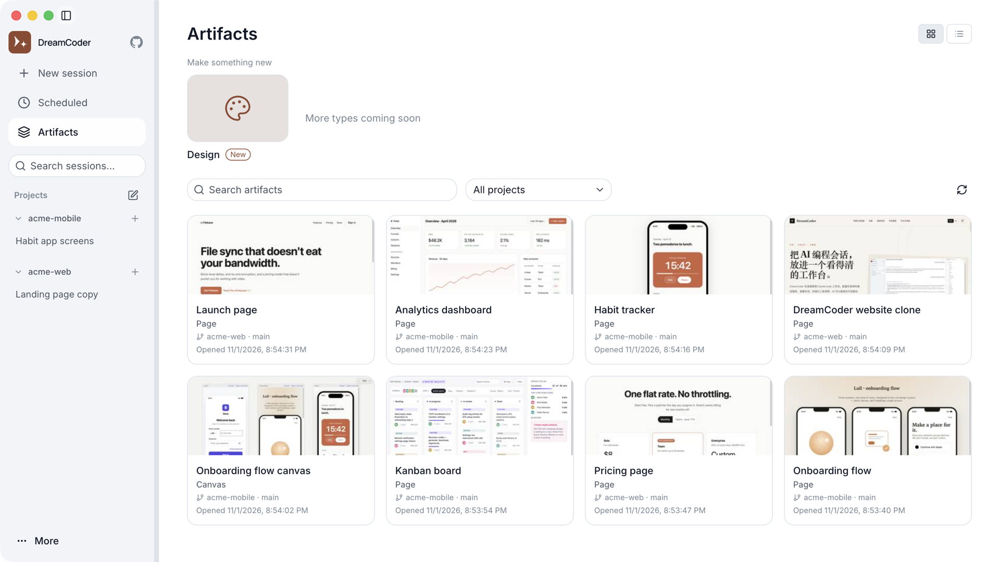
</picture>

*   **设计模式**：点 Artifacts 页的 Design 入口，或输入 `/design`。Agent 先问清需求，由你选模板，再生成网页或应用原型，最后在内置浏览器里自查。内置 60+ 个页面和原型模板（可按标题、描述、标签搜索）和 156+ 套设计系统（颜色、字体、间距），既能套用到模板，也能用于从零开始的页面。

<picture>
  <source media="(prefers-color-scheme: dark)" srcset="./assets/dark/design.png">
  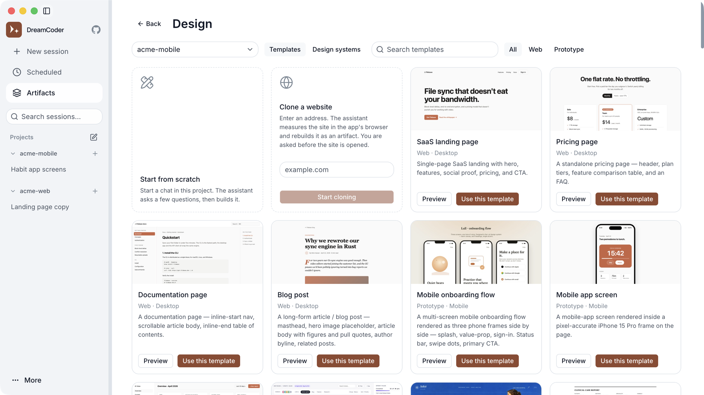
</picture>
<picture>
  <source media="(prefers-color-scheme: dark)" srcset="./assets/dark/template-choice.png">
  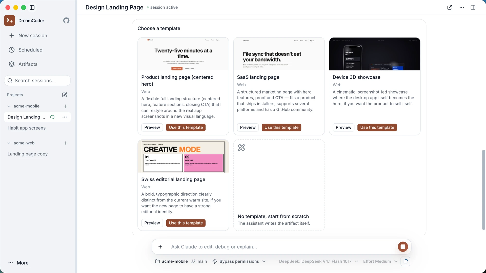
</picture>

*   **画布**：多个页面作为画板铺在同一个平面上，可缩放、平移、拖动和调整大小，位置会保存。鼠标放在画板上也能平移和缩放，点画板上的「Interact」才进入画板内操作。
*   **复刻网站**：给一个网址，Agent 在后台浏览器里读取页面的结构和样式，在项目里重建成页面，视频也能播放和拖动。访问外部网站前需要你先授权。

<picture>
  <source media="(prefers-color-scheme: dark)" srcset="./assets/dark/canvas.png">
  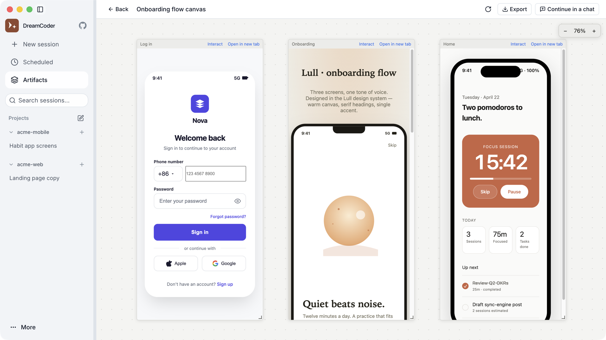
</picture>
<picture>
  <source media="(prefers-color-scheme: dark)" srcset="./assets/dark/clone.png">
  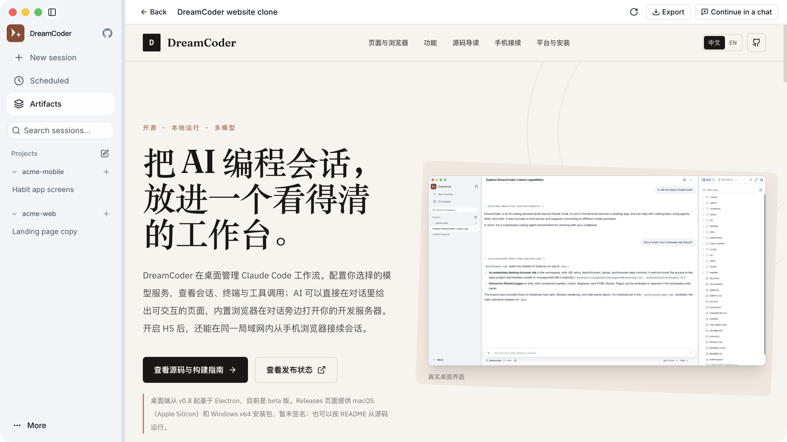
</picture>

模板和大部分设计系统转换自 [Open Design](https://github.com/nexu-io/open-design)（Apache-2.0），详见 [THIRD_PARTY_NOTICES.md](THIRD_PARTY_NOTICES.md)。

### 4. 项目看板
*   **你和会话共用一块看板**：每个项目一块持久的看板，记录任务和子任务。你在看板上建任务、分配给会话；会话读看板，把工作拆成子任务，记录进展，做完提交交付报告。会话结束了看板还在，同一项目的各个 worktree 共用同一块看板。
*   **负责人、审核人和创建者**：每个任务记着谁来做、谁来审、谁建的。审核人对照验收要点检查交付，接受或退回；没有审核人时由你验收。层级视图展示整棵任务树，"待我处理" 汇总等你处理的事：带着会话提问的阻塞任务，和等你验收的交付。
*   **由你把关**：验收要点由任务的创建者定。其他会话要改时每次都要你确认，确认卡片列出新增和删除的要点。会话建看板、开新会话做任务、取消任务、把自己设为审核人之前，也都会先问你。

<picture>
  <source media="(prefers-color-scheme: dark)" srcset="./assets/dark/kanban.png">
  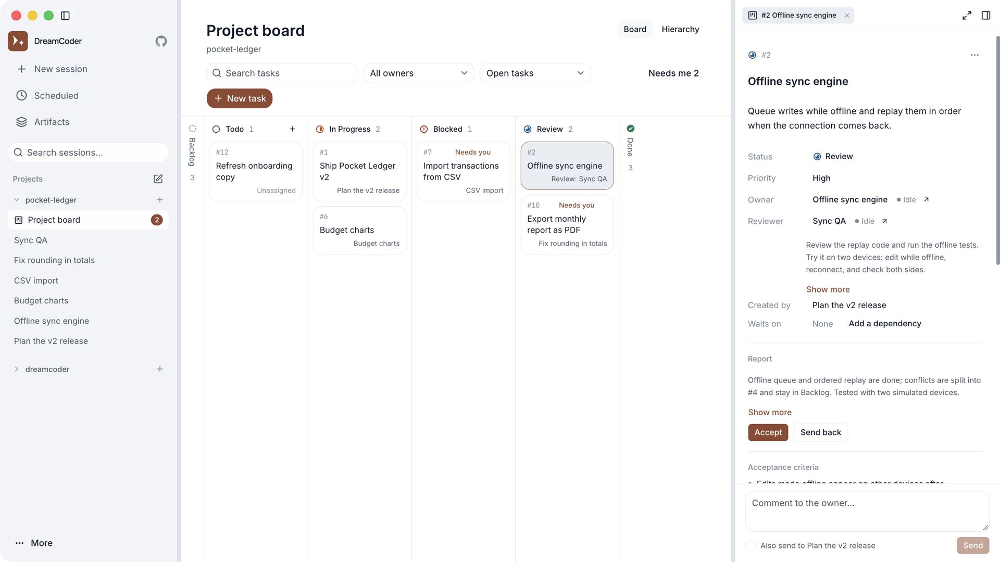
</picture>
<picture>
  <source media="(prefers-color-scheme: dark)" srcset="./assets/dark/kanban-approval.png">
  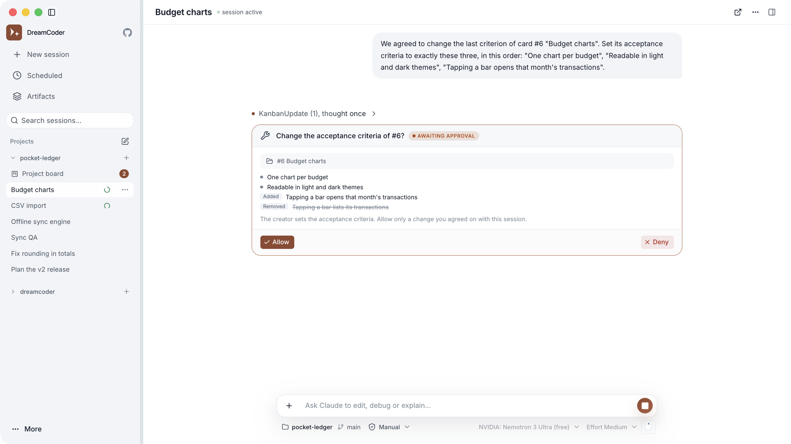
</picture>

<picture>
  <source media="(prefers-color-scheme: dark)" srcset="./assets/dark/kanban-tree.png">
  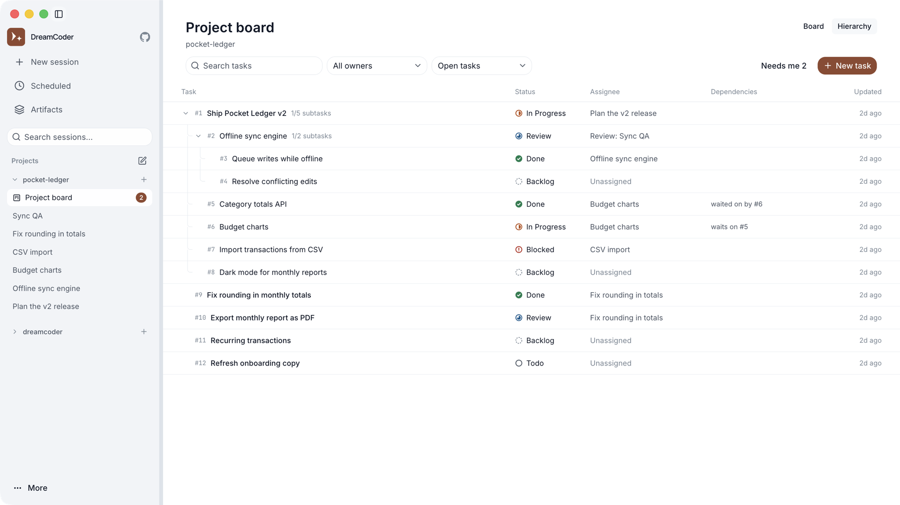
</picture>
<picture>
  <source media="(prefers-color-scheme: dark)" srcset="./assets/dark/kanban-inbox.png">
  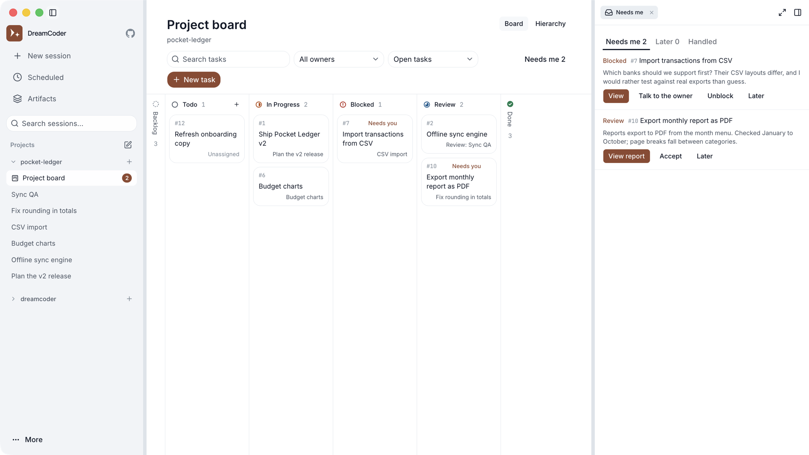
</picture>

### 5. 多模型配置
*   **Provider 预设与自定义端点**：按所选服务商配置 API Key、地址与模型映射。
*   **连接检查**：在设置界面测试已配置端点的可用性与延迟。

<picture>
  <source media="(prefers-color-scheme: dark)" srcset="./assets/dark/setting_provider.png">
  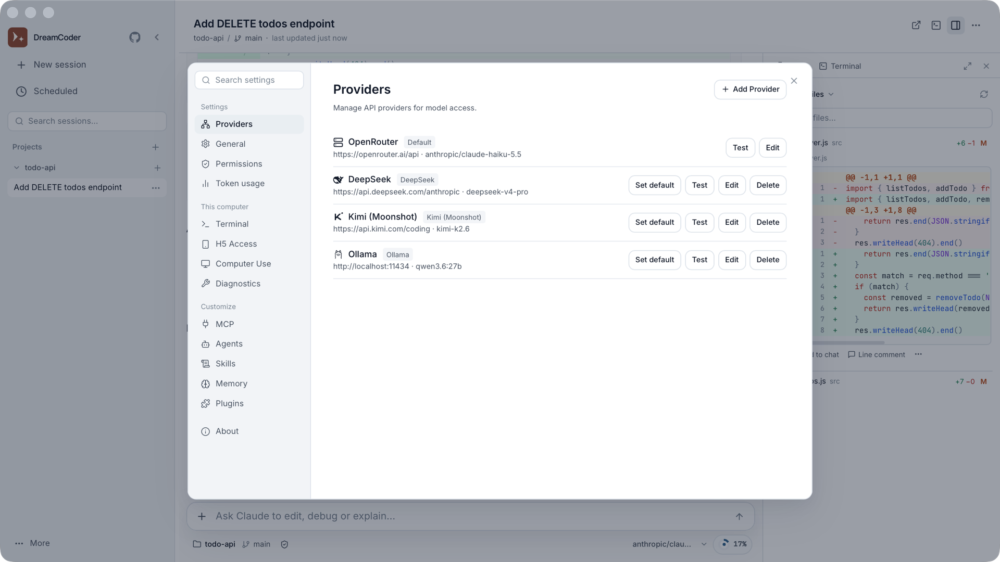
</picture>

### 6. Claude Code 工作流
*   **Computer Use**：在后台按界面元素操作桌面应用和浏览器，由 [cua-driver](https://github.com/trycua/cua)（MIT）驱动。开启时 DreamCoder 自动下载，不需要 Python。macOS 已验证；Windows 有待社区实测，Linux 为预览。
*   **工具调用全程可见**：AI 读写文件、执行终端命令的过程透明呈现，便于理解与审查。
*   **MCP 扩展能力**：通过 Model Context Protocol 持续扩展 AI 的上下文与工具能力。

<picture>
  <source media="(prefers-color-scheme: dark)" srcset="./assets/dark/setting_computeruse.png">
  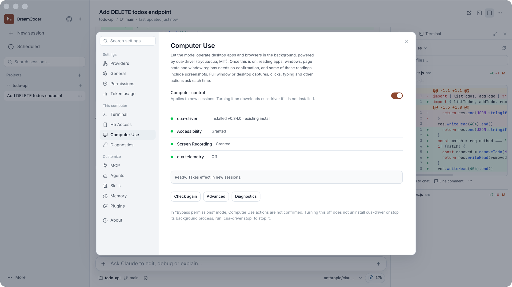
</picture>

### 7. 局域网内手机接续
*   **H5 接入**：在设置中开启访问、管理 Token，并使用二维码从同一局域网内的手机连接。
*   **访问范围**：桌面端需保持运行；跨网络访问需要自行配置反向代理，相关部署指南仍在编写。

---

### 8. MCP 扩展
*   **支持 MCP**：通过 Model Context Protocol 接入外部工具。
*   **配置过程图形化**：不再手写 JSON，通过界面管理 MCP 服务器。

<picture>
  <source media="(prefers-color-scheme: dark)" srcset="./assets/dark/setting_skills.png">
  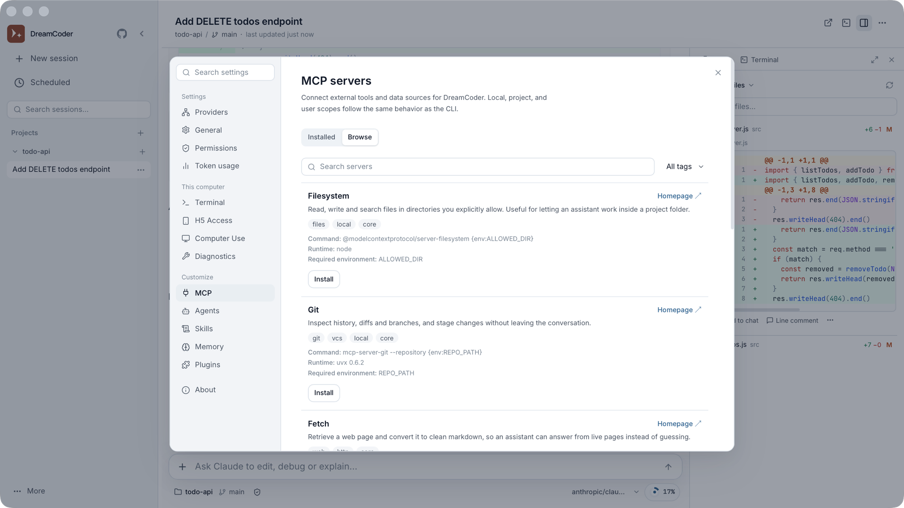
</picture>

---

## 📖 源码导读

想了解编程智能体内部怎样工作，可以读[《编程智能体实现指南》](docs/tutorial/README.md)。系列共七篇，沿一次小的代码修改，依次讲解执行循环、代码工具、权限控制、会话与上下文、流式响应与故障恢复，以及桌面端集成，文中结论都附有源码链接。

---

## 🛠️ 技术栈

| 组件 | 技术选型 |
|------|----------|
| 桌面外壳 | [Electron](https://www.electronjs.org/) |
| 前端 UI | React 19 + Vite + TailwindCSS 4 |
| 后端运行时 | Bun (Node.js 兼容) |
| 终端 | sidecar 内的 Bun PTY + xterm.js |
| 页面 | [ShowAI](https://github.com/Renaissance-Mind/ShowAI) 页面格式与阅读器 |
| 状态管理 | Zustand |
| 协议 | WebSocket, MCP, LSP |

---

## 💻 平台支持现状

| 平台          | 状态                                          | 预编译安装包                                          |
|---------------|-----------------------------------------------|-------------------------------------------------------|
| Windows x64   | ✅ 长期实测（维护者此前的主力平台）            | ✅ [`-setup.exe`](https://github.com/GoDiao/dreamcoder/releases/latest)（未签名）  |
| macOS arm64   | ✅ 维护者日常开发平台                          | ✅ [`.dmg`](https://github.com/GoDiao/dreamcoder/releases/latest)（未签名）        |
| Linux x64     | ⚠️ 暂未日常验证                                | ❌ 欢迎社区共同补齐                                    |

> 维护者目前主要在 **macOS（Apple Silicon）** 上开发，从源码运行（`bun run electron:dev`），自 v0.5.0 起提供 `.dmg` 安装包。
> **Windows x64** 是此前的主力平台，经过长期实测；维护者现在不在 Windows 上日常开发，新改动在 Windows 上的表现尤其欢迎反馈。
> **Linux** 暂不构建安装包；从源码运行桌面端或许可行，但维护者并不日常使用，仍属于尽力支持的状态。
> Ubuntu 浏览器版的验证范围、exFAT 依赖安装问题及本地 Ollama 调用结果见[Linux 验证报告](docs/general/LINUX_BROWSER_VALIDATION_zh.md)；启动、关闭和按 PID 终止进程的方法见[浏览器版使用指南](docs/general/WEB_USAGE_zh.md)。
> 如果你正在使用 Windows 或 Linux，欢迎通过 issue 或 PR 一起把这部分体验补完整；
> Linux 内存问题可关注 [#25](https://github.com/GoDiao/dreamcoder/issues/25)。
> 安装包供应情况以 [GitHub Releases](https://github.com/GoDiao/dreamcoder/releases) 页面中的实际附件为准。

---

## 📅 路线图

- [x] **Phase 1**: 桌面端 GUI + 多模型支持 + 项目工作台
- [x] **Phase 2**: CLI 后端集成 + Computer Use + MCP + Skills + Agent Teams
- [x] **Phase 2.5**: 性能优化 — bundle 拆分、轮询节流、终端 LRU、sessionStore 重构
- [x] **Phase 3**: H5 局域网访问 (启用后从手机/浏览器接入桌面端会话)
- [ ] **Phase 4**: Release 自动化 + 自动更新
- [ ] **Phase 5**: 远程 Agent 后端 (通过 SSH / WebSocket 在远程主机运行 Agent)

详见 [ROADMAP](docs/general/ROADMAP_zh.md)

---

## 🏁 快速开始

### 环境要求
*   [Bun](https://bun.sh/) >= 1.0
*   Node.js >= 18（部分依赖仍会用到）

### 安装与运行

> macOS（Apple Silicon）和 Windows x64 的安装包在 [Releases](https://github.com/GoDiao/dreamcoder/releases/latest) 下载。安装包暂未签名，首次打开的方法见发布说明。下面是从源码运行开发版的方法。这是一个 Bun monorepo（根目录与 `desktop/` 各自维护依赖）；**以下步骤请完整执行**，缺少 Electron 本体或 sidecar 二进制时 `electron:dev` 无法启动。

```bash
# 0. 克隆仓库
git clone https://github.com/GoDiao/dreamcoder.git
cd dreamcoder

# 1. 安装根工作区依赖（sidecar 运行时：Anthropic SDK / AWS SDK / ink 等）
bun install

# ShowAI 页面阅读器及其依赖（vendor/showai）
(cd vendor/showai && bun install)

# 2. 安装桌面端依赖（Electron + React 前端）
cd desktop && bun install

# 3. 下载 Electron 本体（Bun 不会运行 Electron 的安装脚本）
bun run electron:install

# 4. 编译 sidecar 二进制
bun run build:sidecars

# 5. 启动桌面端开发模式（同时启动 Vite 和 Electron）
bun run electron:dev
```

> 构建当前平台的安装包：`bun run electron:pack`，产物在 `desktop/electron-release/`。

### 配置 AI 模型

1. 打开 DreamCoder，进入 **设置 -> Provider（模型供应商）**。
2. 添加你的 API Key（例如 Anthropic、OpenAI 或 DeepSeek）。
3. 选择默认模型后即可开始使用。

### 界面语言

首次启动时，DreamCoder 会根据系统语言自动选择界面语言：系统语言为中文（`zh-*`）时使用中文界面，其他语言默认使用英文界面。你随时可以在 **设置** 中手动切换，手动选择会被保存，并在之后始终优先生效。

---

## 💝 赞助与合作

DreamCoder 由个人利用业余时间维护。欢迎企业和个人赞助，支持项目持续开发。档位和规则见 [赞助政策](docs/general/SPONSORS_zh.md)，合作请发邮件到 diaoshengjia@gmail.com。

## 🤝 贡献指南

欢迎提交 Issue 和 PR。若你准备参与改进 DreamCoder，建议先阅读 [贡献指南](docs/general/CONTRIBUTING_zh.md)，可以更快熟悉开发流程与协作方式。

## 📝 更新日志

版本演进与重要变更见 [CHANGELOG.md](CHANGELOG.md)。

## 📄 许可证

[MIT](./LICENSE) &copy; 2024-2026 GoDiao & DreamCoder Contributors
