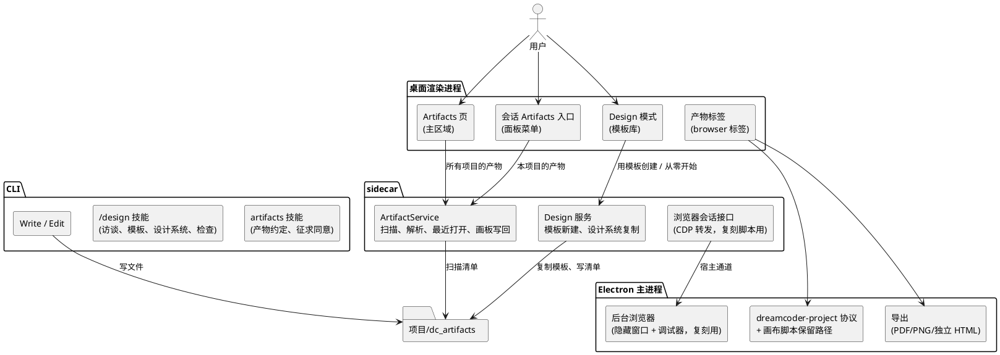
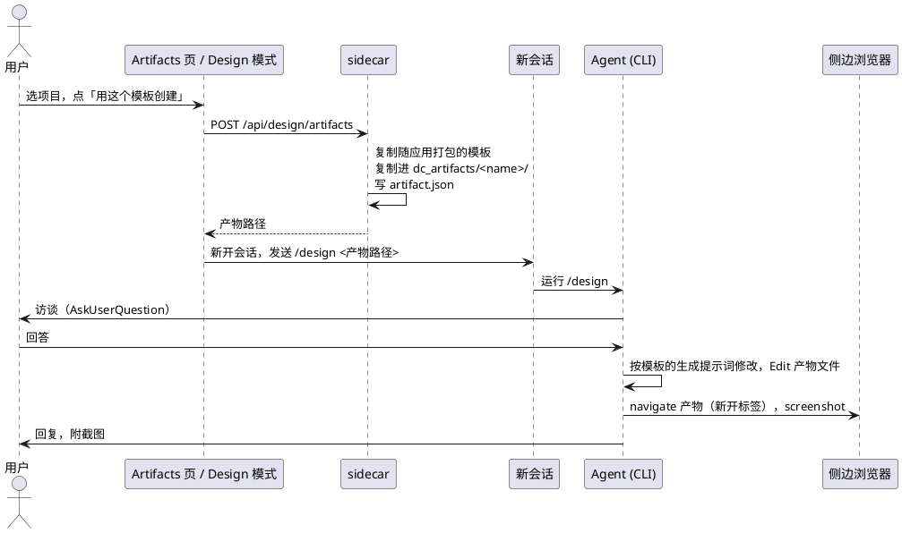

# Artifacts 与 Design 模式技术设计

状态：草案，2026-10-31 维护者已逐条确认各项决定，并按源码审查和只读学习报告修订，待最终审阅。分支 `docs/design-system-tech-design`。基线：`main` 的 `f64913b`，文中代码位置以这个提交为准，实现前需要重新核对。没有 PRD，目标和取舍来自维护者在对话里逐条确认的决定。标 `[假设]` 的是推断，标 `[待验证]` 的需要在真实 Electron 里试过才算定稿。

## 背景

DreamCoder 已经有会话自己的侧边浏览器（#207）、Agent 操作它的工具和用户点选元素（#219、#225）、对话里的 ShowUI 页面。缺的是一种能留下来的产物：用户让 Agent 做的网页、画布，能在一个地方快速找到并查看，当作笔记长期保存，并能交给别的会话继续。

本设计分两层：

- **Artifacts**：底层概念。一个产物是项目里的一个文件夹（HTML 加清单）。应用有全局的 Artifacts 页和会话里的 Artifacts 入口，用来查找、查看、交接。
- **Design 模式**：在 Artifacts 之上的一种正式创作方式。用户从模板库里选一个模板「用这个模板创建」，或「从零开始」；会话开始后 Agent 先访谈，再做。

参考了 Claude 的 Artifacts 页、Claude Design、open-design、baoyu-design、taste-skill。调研笔记在维护者本地，不在仓库。

## 目标与非目标

**目标**
- 产物：`dc_artifacts/` 下带清单的文件夹，类型有网页、画布。
- 全局 Artifacts 页：左侧栏入口，列出所有项目的产物，可搜索、按项目筛选，点开查看。
- 会话里的 Artifacts 入口：面板菜单里，列出本项目的产物，在侧边面板打开，可以加进对话交给 Agent。
- Agent 只在用户要求或同意时创建产物，其余场景用 ShowUI。
- Design 模式：模板库、用模板创建、从零开始、会话开头的访谈、设计系统、检查回路。
- 画布：一个产物里摆多张画板，可平移、缩放、移动、调整大小；单张画板能单独打开。
- 评论复用现有点选，并标明属于哪个产物、哪张画板。
- 版本复用现有的文件历史和回退。
- 导出：独立 HTML、PDF、PNG。
- 网站复刻：用户明确要求才做，忠实复刻，包括批量下载站点的图片、字体和媒体，附替换清单；用 open-design 的 web-clone 脚本，浏览器由应用自己提供。

**非目标**
- 第一版不做编辑器（拖动、改文字、改样式）。以后要做，见「以后的编辑器」。
- 多人协作、分享、类似 `/design-sync` 的镜像。Artifacts 页没有「Yours / Shared」。
- 导出到第三方（Figma、Canva 等）。
- 自有渲染格式。产物就是浏览器能直接打开的 HTML。
- 把 ShowUI 页面并进 Artifacts。
- 视频、音频、图片类模板。
- 画布里直接嵌外部网站的实时页面。
- H5 页面里的预览，以后有需要再议。
- 新的版本管理机制、项目文件监视器。

## 现状

- **项目 HTML 的展示**：`desktop/electron/browser.ts` 注册 `dreamcoder-project://` 协议，只在侧边浏览器的分区上处理（`browser.ts:386`），协议有 `supportFetchAPI`（`desktop/electron/main.ts:77`）。`ProjectRoots`（`browser.ts:61`）给每个项目根目录分配一个随机 id，同一项目的文件彼此同源；id 每次启动重新生成。协议支持字节范围（`Range` 请求返回 206 或 416），视频和音频可以播放和拖动。`resolveBrowserInput`（`browser.ts:179`）只把项目内已存在的 HTML 文件解析成协议地址（`browser.ts:149` 起）。
- **浏览器标签的持久化**：`browser` 标签只存解析后的地址（`desktop/src/stores/workspacePanelStore.ts:233`，`BrowserView.tsx:98`），地址里有随机 id，重启后 id 变了，挂载规则直接拒绝挂载这个标签（`desktop/electron/browser.ts:236`），标签空白。
- **侧边浏览器页面的权限**：webview 的 preload 被拿掉（`browser.ts:38`），强制 `contextIsolation`、`sandbox`（`browser.ts:239`）。页面没有通道把消息发给渲染进程，渲染进程里也没有监听页面消息的代码。
- **同源 iframe 已验证可用**（2026-10-31，真实 Electron）：同一 root id 下的 iframe 里快照、点击、输入、点选都能用。#225 之后，缩放后的 iframe 坐标正确换算，快照按 iframe 分段，段头名字取 iframe 的 `title` 或 `name`。在 iframe 里选中文字不能「添加到对话」（`CHANGELOG.md` 已写明）。每个 webview 一个渲染进程。这一条是实测记录，代码侧佐证见 `CHANGELOG.md:24`。
- **主区域页面**：`desktop/src/stores/tabStore.ts:17` 的 `TabType` 只有 `session` 和 `scheduled`，`ContentRouter.tsx` 按它切换。左侧栏在 `desktop/src/components/layout/Sidebar.tsx`。
- **面板标签**：`workspacePanelStore.ts:40` 的 `WorkspaceTab` 有七种。面板在会话从运行变成空闲时刷新文件状态（`WorkspacePanel.tsx:1099` 起），面板关着时不执行。
- **项目列表**：sidecar 的 `GET /api/sessions/recent-projects`（`src/server/api/sessions.ts:78`，实现约在 `sessions.ts:836`）从最近 200 个会话里汇总项目，默认返回 10 个，带缓存；worktree 会话的路径被折叠回原仓库根（`sessions.ts:865` 取 `projectRoot`，来自 `sessionService.ts:509` 的 `resolveProjectRootFromEntries`）。
- **工作区接口**：`/api/sessions/:id/workspace/{status,tree,file,diff}`（`sessions.ts:231`），由 `WorkspaceService` 实现，路径限制在会话工作目录内。工作区路由对非 GET 请求一律返回 405（`sessions.ts:169`）。
- **ShowUI**：对话里的只读页面，存在会话数据目录，sidecar 以严格 CSP 提供（`src/server/uiPageHost.ts`）。它的提示词已经要求：除非用户明确要文件，不生成 HTML 文件（`src/tools/ShowUITool/prompt.ts`）。
- **浏览器工具**：`navigate` 不带 `tabId` 时，没有标签才新开，已有标签就在当前标签里跳转（`src/server/browserHost/service.ts:384`）。主进程的 `desktop/electron/browserHost.ts` 给每个 view 挂了 `webContents.debugger`。
- **点选**：点选结果的 `url`、`title` 取顶层页面（`src/server/browserHost/snapshot/pageProgram.ts:1300`），选择器却相对元素所在的文档。
- **写盘**：主进程唯一的写文件命令只收文本，扩展名只允许 `.md`、`.json`（`desktop/electron/sessionExport.ts:5`）。
- **技能**：内置技能用 `registerBundledSkill`（`src/skills/bundledSkills.ts:53`）注册，可带 `files`，解压到的目录 Agent 读时不弹权限（`src/utils/permissions/filesystem.ts:1801`）。技能在列表里只占一行描述，正文在模型调用时才加载。
- **版本**：`src/utils/fileHistory.ts` 给 Agent 用 Write/Edit 改过的文件做备份（最多 100 个快照），sidecar 启动 CLI 时开启（`src/server/services/conversationService.ts:1004`）。Bash 写的文件不进文件历史（`sed -i` 的模拟编辑除外，`src/tools/BashTool/BashTool.tsx:389-393`）。
- **客户端可见的工具调用**：会话消息里的工具调用带输入（`desktop/src/types/chat.ts:98`）。

## 总体结构



磁盘上的文件是产物内容的唯一事实来源。sidecar 负责扫描、解析打开地址、记录最近打开和新建；渲染进程负责两个入口、标签和刷新时机；Electron 主进程负责协议和导出写盘；产物在现有的侧边浏览器里显示，所以 Agent 的浏览器工具、点选、截图全部直接可用。

# 第一部分：Artifacts

## 产物与清单

**做法**：产物是 Agent 当前工作目录下 `dc_artifacts/` 里的一个文件夹，含清单 `artifact.json`（存放位置的完整规则见下一节）。识别靠清单：`dc_artifacts/` 下直接一层的文件夹里有 `artifact.json` 的就是产物；`dc_artifacts/systems/` 保留给设计系统，产物不能叫 `systems`。

清单是契约，形状如下（字段名为草案）：

```ts
type ArtifactManifest = {
  version: 1
  id: string
  kind: 'page' | 'canvas'
  title: string
  entry?: string
  designSystem?: string
  template?: { id: string; commit: string }
  boards?: Array<{ id: string; file: string; title?: string; x: number; y: number; width: number; height: number }>
}
```

- `id` 是产物的身份，新建时生成（技能要求 Agent 写入，模板新建时由共用模块写入）。搬移（删除 worktree 时、从全局区复制进项目后删除来源）保留 `id`；从别的工作目录复制、来源仍保留时换新 `id`。「最近打开」、缩略图、「产物 → 会话」索引、标签的重开都以 `id` 为键，产物换了位置也不用迁移。缺 `id` 的产物标「清单有误」，以所在目录加产物名临时作键。
- `kind` 决定 Artifacts 页上的图标和打开方式。网页和原型都是 `page`；以后加文档等类型时扩展这里。
- `entry` 是相对产物文件夹的 HTML 路径，所有类型都必填。画布的入口是一个固定内容的小文件，只加载随应用发布的画布脚本（见「画布」）。
- `designSystem` 是相对 `dc_artifacts/` 的设计系统路径；`template` 记来源模板。两者只在 Design 模式里出现，普通产物可以没有。
- `boards` 只给 `canvas` 用，`file` 是产物文件夹内的相对路径。
- 解析宽松：未知字段忽略，缺必填字段的产物照样列出，但标为「清单有误」并给出原因。

## 存放位置与归属

**三种位置**
- **工作目录里的产物**：Agent 写在自己当前工作目录下的 `dc_artifacts/`。这是唯一的写入位置。
- **全局存放区**：应用数据目录下的一个文件夹，放不属于任何项目的产物，布局为 `<全局区>/dc_artifacts/<产物名>/`，这样「路径里有 `dc_artifacts` 段」的读写规则自然覆盖它。Artifacts 页照常显示它们，标为「未绑定项目」。

全局存放区的位置由一个 CLI 和 sidecar 共用的模块求出（放在 `src/utils/`，共用模块的先例是 `src/utils/uiPages.ts`，CLI 的 `ShowUITool.ts` 和 sidecar 的 `uiPageHost.ts` 都引用它；位置由 `getClaudeConfigHomeDir()` 派生，与 `sessionService.ts:404-409` 的 `projects` 目录同源），两边算出同一个目录；独立运行的 CLI 也用它，不依赖 sidecar 传环境变量。

**「当前工作目录」按 Agent 实际干活的位置算**：
- 会话里的 Agent 工具要求隔离到 worktree 时，子 Agent 在 worktree 里干活（`src/tools/AgentTool/AgentTool.tsx:99`），它的工作目录是那个 worktree，不是父会话的目录。
- Agent 工具的 `cwd` 参数可以把子 Agent 派到任意目录（`AgentTool.tsx:100`），它的工作目录就是那个目录。
- EnterWorktree 让会话中途切进 worktree（`src/tools/EnterWorktreeTool/EnterWorktreeTool.ts:94-96`：`chdir`、`setCwd`、`setOriginalCwd`），ExitWorktree 切回（`ExitWorktreeTool.ts:129`）。CLI 每一轮都发一次初始化消息（`src/QueryEngine.ts:542`），其中的 `cwd` 取 `getCwd()`（`src/utils/messages/systemInit.ts:60`），会跟着 Bash 的 `cd` 变；sidecar 收到后报告工作目录（`translate.ts:480-481`），但不能用它判断工作根。工作根只在 CLI 里取，见「只读规则」。
- 桌面端新建的 worktree 会话从一开始就在 worktree 里。团队配置里有可选的 `worktreePath` 字段（`teamHelpers.ts:84`）和销毁逻辑（`teamHelpers.ts:532`），但创建成员 worktree 的代码不在 main 上 [假设]。
- **sidecar 的已知工作目录**只有三个来源，不单独追踪 EnterWorktree 和 `cwd` 参数：会话记录里的工作目录；各项目的 `git worktree list`（解析已有，`repositoryLaunchService.ts:370`），覆盖被保留下来的子 Agent worktree 和团队成员的 worktree；「产物写入」事件里出现过的 `dc_artifacts/` 所在目录（持久化），覆盖中途切进的 worktree 和子 Agent 被派去的目录。
`artifacts` 技能一律写相对当前工作目录的 `dc_artifacts/`。

**只读规则**：不在 Agent 当前工作目录下的产物，对 Agent 一律只读。包括全局存放区里的、别的 worktree 或别的项目里的。
- **一个共用的检查函数**：在 `src/utils/permissions/filesystem.ts` 新增产物位置检查，由四处调用，放在用户的 deny 规则之后：
  - Write、Edit、NotebookEdit：`checkWritePermissionForTool`（`filesystem.ts:1243`）。
  - Bash 的固定命令表和重定向：`isPathAllowed`（`src/utils/permissions/pathValidation.ts:141`），它是和上面并行的另一套实现。
  - PowerShell：`PowerShellTool/pathValidation.ts:863` 的同名函数。Windows 另行实测。
  - 读取：`checkReadableInternalPath`（`filesystem.ts:1648`），Read、Glob、Grep 和 Bash 的读命令都经过它。
  工具自己返回的拒绝先于 bypass 模式处理（`src/utils/permissions/permissions.ts:1226`），所以 bypass 下同样生效。路径比较用真实路径（`getPathsForPermissionCheck`）。
- **写**：路径里有一段叫 `dc_artifacts`，且不在 Agent 工作根的 `dc_artifacts/` 下，拒绝；拒绝放在用户的 deny 规则之后。工作根的 `dc_artifacts/` 下的写入直接允许，不再弹确认，因为创建产物时用户已经同意过。放行在 `checkWritePermissionForTool` 里放在 deny 规则、安全检查（`.git`、`.bashrc` 等受保护文件名仍询问）和 ask 规则之后，acceptEdits 判断之前；`isPathAllowed` 和 PowerShell 里放在安全检查之后。两个例外：plan 模式不放行，照常询问；免询问只对 Write、Edit、NotebookEdit 成立，Bash 命令本身仍按 Bash 规则询问，技能要求写产物用 Write 或 Edit。项目深处碰巧也叫 `dc_artifacts` 的目录会被当成产物目录，这种情况等有人报告再处理。拒绝信息写明产物只读、可以调用「复制进项目」，不依赖技能是否已加载。
- **工作根**：子 Agent 的目录覆盖值，没有时取会话目录（`cwdOverride ?? getOriginalCwd()`，`src/utils/cwd.ts` 导出读取覆盖值的函数）。不用 `getCwd()`，因为它跟着 Bash 的 `cd` 走，Agent 先 `cd` 进别的 worktree 再写就绕过了只读。EnterWorktree 和 ExitWorktree 都会更新会话目录（`EnterWorktreeTool.ts:96`、`ExitWorktreeTool.ts:129`）。
- **读**：同样只看路径形状，路径里有一段叫 `dc_artifacts` 的读取都不弹确认，包括全局存放区和任意项目里的产物。
- 不用启动时生成的静态规则：静态列表管不到之后新建的 worktree，而 EnterWorktree 进入启动时已列出的 worktree 后，又会把 Agent 自己目录里的产物也拒掉。
- **Bash 的覆盖范围**：Bash 只对固定命令表里的命令做路径检查（`src/tools/BashTool/pathValidation.ts:27`，`rm`、`mv`、`cp`、`sed` 等）和输出重定向，`tee`、`python -c`、`node -e` 这类写入拦不住。Agent 被拒后特意用这类程序去改别处的产物很少见，不做事后发现；要当场拦住需要沙箱一类的另一层，不在本设计内。

**复制进项目**：把一个产物复制到 Agent 当前工作目录的 `dc_artifacts/`。
- 纯 CLI 工具：工具的权限检查返回询问，桌面端把这个工具的权限请求渲染成卡片（和 `AskUserQuestion` 同一做法：`AskUserQuestionTool.tsx:182-186` 的权限检查返回询问；`chatStore.ts:1768` 对该工具名不生成通用权限消息；`MessageList.tsx:504` 按工具名渲染卡片；`AskUserQuestion.tsx:190` 用 `respondToPermission` 带 `updatedInput` 回传选择；这三处目前都写死一个工具名，第二个卡片工具要先改成一组工具名），用户点了才执行；复制由 CLI 和 sidecar 共用的模块完成，不经 sidecar。和选模板的交互相同。界面上也有同一个动作：在查看页点「在会话里继续」并选定会话时执行。
- 来源在全局存放区：复制完成并校验后再删除全局那份，复制失败不删。来源仍在别的工作目录里：只复制，原来那份留给原来的会话。
- 名字冲突时自动加后缀。来源已不在时报「已被搬走」。
- 搬移保留 `id`，复制换新 `id`，见「产物与清单」。

**worktree 被删时**：
- 统一的删除入口放在 `removeAgentWorktree`（`src/utils/worktree.ts:994`）和 `cleanupWorktree`（`:846`）里：先把其中 `dc_artifacts/` 的产物搬到全局存放区，再删目录。所有会删掉含产物 worktree 的路径都经过它们：
  - `ExitWorktree` 选删除（`ExitWorktreeTool.ts:290`）和 TUI 的退出对话框（`WorktreeExitDialog.tsx:59`、`:143`），都调 `cleanupWorktree`（git 路径 `:877`，WorktreeRemove 钩子路径 `:860`）。桌面的无头会话结束不走它。
  - 子 Agent 结束后被判定无改动而自动删除（`AgentTool.tsx:669` 调 `removeAgentWorktree`）。产物被 `.git/info/exclude` 排除，`hasWorktreeChanges` 看不到，只写了产物的子 Agent 的 worktree 一定会走这里。
  - 每 30 天清理过期的子 Agent worktree（`src/utils/cleanup.ts:595` → `cleanupStaleAgentWorktrees`，`worktree.ts:1091`），它的改动判断同样忽略未跟踪文件。
  - `removeAgentWorktree` 自己的 git 路径（`:1024`）和钩子路径（`:1000` 起）。
  - Agent 团队成员的 worktree（`src/utils/swarm/teamHelpers.ts:532` 的 `destroyWorktree`，git 删除 `:556`），以及它在 git 删除失败后的 `rm` 兜底（`:582`）。
  - `worktree.ts:377` 是创建时 sparse-checkout 失败的拆除，worktree 刚建出来是空的，不经过搬移。
- 搬移规则：三处调用求主仓库根的方式不同，统一函数只收 worktree 路径和可选的仓库根，内部用 `findCanonicalGitRoot`（`src/utils/git.ts:195`）求项目归属；搬移用复制后删除；重名加后缀，规则与「复制进项目」相同；搬移失败时不删 worktree，保留并报错。搬进全局区的产物记下原项目路径和分支。产物引用的设计系统（清单里的 `designSystem`，`systems/<名字>`）随产物一起复制进目标位置的 `systems/`：已有的同名文件不覆盖，来源里的系统不动；删除 worktree 时搬移、「复制进项目」和「在会话里继续」都走同一个复制函数，所以都带上它，搬走后产物仍链得到令牌样式表。
- 子 Agent 的 worktree 因此被删时，工具结果文本加一句「产物已转入全局存放区：<名字>，路径 <新路径>」，父 Agent 要继续改就调用「复制进项目」。

**在应用外删除 worktree**（`git worktree remove`、手动删目录、合并 PR 时删分支）：产物随目录一起丢失，不做备份和恢复。应用自己删 worktree 的地方都已先搬走产物；产品还没上线，等有人反馈再做。

**git**：
- 第一次在某个工作目录建产物时，sidecar 把 `dc_artifacts/` 写进该仓库共用的 `info/exclude`（不进仓库、不改工作区文件；和 `ensureWorktreesDirExcluded`，`src/utils/worktree.ts:209`，一样用 `resolveGitDir` 和 `getCommonDir`，对所有 worktree 生效；模式不带前导斜杠，子目录里的也命中），避免主检出目录被判为不干净而不能切分支。第一次建产物时由 `artifacts` 技能让 Agent 在对话里告诉用户一次：已设为不跟踪，要纳入 git 就删掉那一行。非 git 目录不写。
- 正因为被排除，git 看不到产物，判断 worktree「有无改动」时不会算上它们；所以删 worktree 前的搬移不能依赖「有改动就保留」的判断，必须由统一的删除函数做。
- 用户把 `dc_artifacts/` 纳入 git 后，切分支时产物随之变化，这是用户的选择；技能在用户第一次纳入时提醒一句。

**协议根目录**：产物在侧边浏览器里打开时，协议的根目录登记为产物所在的 `dc_artifacts/`（全局存放区的产物则是它在全局区的目录），不是整个项目根目录。页面同源 `fetch` 只能读到产物目录，读不到 `.env` 等项目文件。产物页面因此不能引用 `dc_artifacts/` 之外的文件（例如 `../../logo.png`）；`ArtifactCheck` 把这种引用报为错误，技能要求先把文件复制进产物文件夹。

## 什么时候创建产物

ShowUI 和产物分开：

- **ShowUI**：对话里的展示和可视化，用完即走。这是默认。
- **产物**：要留下来查看、当笔记、交给别的会话的东西。只有两种情况才创建：用户明确要求（说了「做成 artifact」或从 Design 模式进入），或者 Agent 认为该留下来时先用 `AskUserQuestion` 征求用户同意，用户同意后才写。

Agent 做一个服务页面放在侧边栏展示，不算产物，不进 Artifacts。

这条规则由一个内置技能 `artifacts` 承载：它在技能列表里常驻（只占一行描述），正文写产物的目录和清单约定、何时创建、征求同意的方式、创建后用 `navigate` 在新标签打开给用户看。ShowUI 的提示词加一句：用户要求把内容保留为产物时，改用 `artifacts` 技能。

## 打开地址

产物的打开地址由 sidecar 解析，Electron 主进程照旧只解析文件路径，根目录按「协议根目录」一节传 `dc_artifacts/`。

- sidecar 读清单，映射成入口文件的项目内路径（画布也一样，它的入口是那个小文件）。
- 渲染进程打开产物时，先向 sidecar 要这个路径，再交给现有的 `resolveBrowserInput`。主进程不读清单。
- Agent 的 `navigate` 本来就经过 sidecar：输入是产物文件夹或它的清单时，sidecar 先做同样的映射。
- `navigate` 加「新开标签」参数。Agent 打开产物给用户看或检查时在新标签里打开，不替换用户正看着的标签。

**为什么不在主进程读清单**：主进程只做系统级的事（AGENTS.md「One place per concern」），清单属于业务数据。

## 标签重启后重开

项目页面的地址 `dreamcoder-project://<id>/<相对路径>` 里的 id 重启后失效。重启后，标签的地址若是 `dreamcoder-project`，取出相对路径，按标签记下的根目录重新解析出新地址再打开：
- 产物标签新增一个「根目录」字段：全局存放区的产物记一个固定标记，其他产物记所在 `dc_artifacts/` 的绝对路径。只按会话当前工作目录解析不够：别的 worktree、别的项目里的只读产物不在当前工作目录下，EnterWorktree 切换过的会话「当前」也和打开时不同。标签同时记产物 `id`；根目录已不在（worktree 经应用删除、产物已转进全局区）时，按 `id` 在全局区找到它。`isStoredTab`、`createTab`、`WorkspaceTabTarget`（`workspacePanelStore.ts`）同步加这两个字段。
- 其余项目页按会话的工作目录解析；外部网址照旧。
协议不变。这同时修好了所有项目 HTML 标签重启后空白的现有问题，不新增标签种类。

模板预览标签的根目录是应用自带的模板文件夹，不是工作目录，所以预览标签记一个模板 id，重启后按 id 找到文件夹重新解析。

## 全局 Artifacts 页

**入口**：左侧栏加「Artifacts」，在主区域打开，`TabType` 加一种 `artifacts`。

**页面内容**（参照 Claude 的 Artifacts 页，去掉分享相关）：
- 顶部：标题、搜索、按项目筛选、卡片和列表两种视图。
- 「新建」：类型色块。Design 模式做好后加入「Design」色块，点开进入 Design 模式（见第二部分）；在那之前不显示「新建」这一栏，不放占位。以后加别的创作方式时往这里加。
- 卡片网格：所有项目的产物，按最近打开排序。卡片显示缩略图（没有时显示类型图标）、类型图标、标题、所属项目、最近打开时间。清单有误的卡片标出原因。

**点开卡片**：在主区域全屏查看产物，不绑定会话（第一阶段就做）。重启后恢复上次的全屏查看：主区域标签以 `sessionId` 为键（`tabStore.ts:19-24`），`restoreTabs` 对 `scheduled` 以外的标签按会话列表过滤（`:167`、`:183-186`）；`TabType` 加单例的 `artifacts`（仿 `scheduled` 的固定 id，`:14`），`restoreTabs` 两处加分支，持久化迁移（`persistenceMigrations.ts`）归一旧标签类型时也放过 `artifacts`，不然重启时这个标签会被改成会话标签丢掉；「查看中的产物」（`id`、名字、标题）记在页面自己的存储里，重启后按 `id` 重新解析打开。查看页上有「在会话里继续」：选任一会话或新开一个。产物不在那个会话的工作目录下时，先执行「复制进项目」（见「存放位置与归属」），再在那个会话的侧边面板打开，并作为引用加进输入框。

**全屏查看怎么显示**：主区域查看也要用侧边浏览器同一个分区的 webview，因为协议只在那个分区上处理。[假设] 复用 `browserGuests` 的 webview 创建方式，标签不属于任何会话，Agent 工具不作用于它。

**数据来源**：sidecar 取全部会话记录里出现过的工作目录，加上各项目 `git worktree list` 补全的 worktree 和产物写入事件登记过的目录，去重后逐个扫描 `dc_artifacts/`，再加上全局存放区。工作目录从每个会话记录里的 `session-meta`、CLI 报告的 `cwd`（`src/server/services/sessionService.ts:465`）读，项目归属用 `resolveProjectRootFromEntries`（`sessionService.ts:509`）；不用 `desanitizePath`（从目录名还原路径会丢信息），也不用 `recent-projects`（只看最近 200 个会话、默认 10 个项目）。`sessionService` 新增一个按项目目录各取一个会话读 `session-meta` 的方法，不逐个读全部会话。

**速度**：进入页面先立刻显示上次的缓存（目标 100 毫秒内），后台重新扫描，扫描完返回结果，变了的卡片原地更新。页面开着时，客户端从任一已连接的会话收到「产物写入」事件，就重新拉一次列表。现有 WebSocket 只有按会话的广播（`src/server/ws/handler.ts:234`、`:310`），不新增全局通道。卡片标出所属项目，在 worktree 里的再标分支。

**目录已不存在**：经应用删除 worktree 时，产物已转进全局存放区，卡片显示「未绑定项目」和原项目、分支。扫描不到的产物不显示。

**会话被删**：产物不依附于会话，照常显示。

**排序**：按最近打开；从没打开过的按清单修改时间。

## 会话里的 Artifacts 入口

**入口**：会话面板菜单里加「Artifacts」，打开面板里的一个列表视图（面板标签种类 `artifacts`）。

**列表**：会话当前工作目录下的产物，其次是同一项目其他工作目录里的和全局存放区的（只读，标出位置），每个产物一行文字（图标、标题、种类或出错原因、所在位置或分支），没有缩略图。本会话建过或改过的排在前面并标记。

**怎么知道哪个会话建过或改过**：两个来源合起来，不漏 Bash 写的文件。
- 写入事件：sidecar 收到的「产物写入」事件（见「刷新」）记下产物和会话。事件来自发起会话的 CLI 进程，主线程、前台和后台子 Agent、进程内团队成员的写入都归到发起会话；窗格成员（tmux、iTerm 里的独立进程）的写入不在其中，桌面端是无头模式，基本不用窗格成员。sidecar 持久化这份索引，不再扫描会话记录里的工具调用。
- 轮次快照：sidecar 在每个会话每一轮开始和结束时，各记一次这个会话涉及的 `dc_artifacts/` 下文件的修改时间和文件集合，包括这一轮里子 Agent 用的 worktree；这一轮里变了的产物算这个会话改的，Bash 写的也包括在内。同一目录两个会话的轮次时间重叠时，变化归给两个会话。
- 标记分两档（快照范围：会话工作目录，加上写入索引里这个会话以前写过的目录；只被 Bash 写过的子 Agent worktree 不在内）：由工具调用得出的标「本会话改过」；只由轮次快照得出的标得淡一些，写「可能包含其他修改」，因为这段时间里外部编辑器的修改也会被算进去。

**操作**：
- 点卡片：在侧边面板的 `browser` 标签里打开，Agent 的工具、点选、评论直接可用。
- 「添加到对话」：把产物作为引用（路径、标题、类型）放进输入框。这是交接的主要方式：在另一个会话里加进对话，Agent 读文件夹就能接着做。

## 最近打开时间与缩略图

- **最近打开时间**：是应用的状态，不属于项目文件。渲染进程打开产物后单独通知 sidecar（「已打开」接口），和解析打开路径的接口分开，解析不带副作用。存在应用数据目录的 JSON 里（和 ShowUI 数据同级），以产物 `id` 为键。
- **缩略图**：产物在任一标签（会话面板里的标签或全屏查看）里加载完成、停一秒后，渲染进程请主进程截一张小图（`webContents.capturePage`，缩到宽 320、JPEG），再上传给 sidecar 存在应用数据目录，按产物 `id` 和文件夹里文件的最新修改时间作键；同一版本只截一次。没显示过的显示类型图标。

## 刷新

由 CLI 发的实时「产物写入」事件驱动，事件不进会话记录，不新增会话状态。触发逻辑放在 store 层订阅里，不挂在面板组件上，面板关着也照常工作。

- **即时刷新**：靠一个新的「产物写入」事件。
  - 后台子 Agent 和进程内团队成员的工具调用不在发起会话的消息流里（后台子 Agent 只发 `task_progress`，`agentToolUtils.ts:563`；成员只在结束时发 `emitTaskTerminatedSdk`，`inProcessRunner.ts:1497`），只有前台子 Agent 在。所以不能靠客户端从工具输入推路径。
  - CLI 在工具执行的公共入口（`src/services/tools/toolExecution.ts`，`tool.call` 之后）判断：写入类工具成功、路径含 `dc_artifacts` 段，就经 `sdkEventQueue` 发一条 `system/artifact_written`（绝对路径、工具名、agent id）。所有执行者都经过这里，一处覆盖。
  - `translate.ts` 加分支转成服务端消息，sidecar 用它驱动「产物 → 会话」索引，再推给客户端；客户端 store 订阅它重拉列表、重载属于该产物的标签。
  - 事件只在实时流里出现，不写进会话记录，切换会话、重连、加载历史都不会重复触发。
  - 协议变化同时更新服务端、桌面、H5 和类型。
- **一轮结束**：会话从运行变成空闲时再检查一次，覆盖 Bash 写的文件。
- **只重载变了的**：sidecar 的列表带每个产物文件夹里文件的最新修改时间。标签记住载入时的这个时间，只有变了才重载，用户正在看的没变的页面不会被打断。画布标签不整页重载，改让脚本重读清单、重载所有画板，保留平移和缩放（见「画布」）。
- **手动**：两个入口和产物标签都有刷新按钮，覆盖外部编辑器的改动。

**为什么不放进会话状态**：刷新是一次性的动作，不是要镜像到各客户端的状态；列表永远从磁盘读。

## 评论

复用现有点选。点选结果的 `url`、`title` 改为取元素所在文档（`pageProgram.ts:1300` 处由 `location` 改为元素的 `ownerDocument`），和选择器指向同一个文档。这是现有的 bug，修了对所有页面的 iframe 点选都生效，不改点选协议。

地址在 `dc_artifacts/` 下时，客户端从路径推出属于哪个产物、哪张画板，附件卡片显示「产物名 / 画板名」，发给 Agent 的文本里写明文件路径。画板里选中文字现在不能「添加到对话」：右键菜单只在顶层文档放行（`desktop/electron/browser.ts:324` 的 `inMainFrame`），敏感字段检测也只在顶层跑。放开时，只放行和页面同源的 iframe：敏感字段检测在主文档里递归进同源 iframe 跑，引用的地址取那个 iframe 的 `url`，标题用 `executeJavaScript('document.title')` 读（跑在页面的主环境里，页面可以改写返回值，标题本来就是页面自己定的，可以接受），这样选区能归到所在画板；跨源的 iframe 仍不放行。

## 版本

不做新机制。Agent 经 Write/Edit 改的产物文件进入文件历史，可以用现有的回退功能回到某一轮。不进文件历史的：Bash 写的文件、新建时复制的模板文件、画板位置写回；超过 100 个快照的旧版本会被丢弃。第一版不加「版本」视图。

## 导出

导出在已经打开的产物标签上进行，由 Electron 主进程完成：渲染进程发导出请求（标签、格式），主进程弹系统保存对话框，生成文件，直接写到用户选的位置。sidecar 不经手导出。

- **PDF**：`webContents.printToPDF`，带背景、按页面自己的 `@page` 尺寸。
- **PNG**：主进程对页面自己的 `webContents.debugger` 用 `Page.captureScreenshot` 带 `captureBeyondViewport` 截整页（先取 `Page.getLayoutMetrics` 的内容尺寸作截取范围）。别人已经挂着 debugger 就直接用、不 detach；自己挂的，导出完（包括失败）一定 detach，免得 browser host 之后挂不上。页面高度超过 16384 像素时报错。
- **独立 HTML**：在页面的独立执行环境里，按已解析的 DOM 收集样式表（含 `@import`、`url()`）、`<script src>`、图片（含 `srcset`）、字体，同源的用 `fetch` 取来转成 data URI，再把文档序列化成一个文件。不需要 HTML 解析库。外部网址保留外链，有外链时先用系统对话框提示数量、用户确认后才弹保存对话框。字体不做子集，zip 不做。已解析的 DOM 里脚本改过的内容，加上内联回来的脚本，打开独立文件时脚本会再跑一遍，页面靠脚本整页生成时可能重复，技能要求页面内容写在 HTML 里。
- **上限**：参考 open-design（`apps/daemon/src/artifacts/standalone-html.ts`）的量级：入口文档 5 MB、单个资源 32 MB、导出结果 100 MB。超过时报错，写明超的是哪一项，并列出最大的五个资源。
- **画布**：只能导出单张画板，先单独打开画板再导出。
- **页面状态**：Agent 用 `emulate` 改过的尺寸或配色不应带进导出（PDF 和 PNG；独立 HTML 取自页面本身，不受影响）。模拟状态记在 sidecar（`src/server/browserHost/service.ts`），主进程没有。现有的 `resetEmulation` 会丢掉记录（每轮结束时调用），不能还原，所以 sidecar 新增「暂停」和「恢复」：暂停清掉页面上的模拟但保留记录，恢复按记录重新设置。渲染进程在导出前后调用 sidecar 的接口（主进程不和 sidecar 通信），导出失败或取消也要恢复；不属于会话的页面（全屏查看）没有模拟，不调用。

## 画布

**做法**：画布是一种产物（`kind: 'canvas'`），清单的 `boards` 列出画板，每张画板是一个 HTML 文件加位置和大小。画布和别的产物一样有 `entry`，指向产物文件夹里一个几行的 `index.html`，它只加载随应用发布的画布脚本（`<script src="/__dreamcoder__/canvas.js">`）。画布脚本用 `fetch` 读相邻的清单，把每张画板放进同源 iframe，提供平移、缩放、移动、调整大小，并从自己的地址推出产物文件夹。入口小文件的内容固定，由 `artifacts` 技能给出原文，`ArtifactCheck` 核对；升级只换应用里的脚本，不动用户的产物。

- **为什么用入口小文件，不让 sidecar 把画布映射成保留路径上的外壳页**：现有的打开路径只认磁盘上真实存在的 HTML 文件（`resolveProjectFile`，`browser.ts:158-168`，`realpath` 失败即 `notFound`）；标签重启重开只取地址的路径部分再按文件解析，丢掉查询串（`browserGuests.ts` 的 `resolveStoredBrowserUrl`）；`resolveOpen` 对画布直接抛错（`artifactService.ts:377`）。入口是普通 HTML 之后，打开、重开、缩略图、导出、`navigate` 的产物映射、`ArtifactCheck` 都走现有路径，不需要查询串、特殊解析或画布专用分支。
- **为什么脚本必须和画板同源**：同源 iframe 里快照、点击、点选都能用（快照读 iframe 要 `contentDocument`，`pageProgram.ts:660-662`）。由 sidecar 的 http 地址或另一个主机名提供，就跨源了。
- **保留路径**：`serveProjectRequest`（`browser.ts:212`）在 `roots.fileFor` 之前判断 `/__dreamcoder__/`，只返回应用 `dist` 里 `canvas-shell/` 下的固定文件，目录由主进程已有的 `webDist` 传入（`main.ts` 的 `serveDist` 用的同一个目录；`desktop/public/` 随 `dist` 打包，`electron-builder.json` 的 `extraResources` 已含 `dist`）。代价：用户 `dc_artifacts/` 里真有 `__dreamcoder__` 目录时被它遮住。
- **画板文件的规则**：`board.file` 只能是产物文件夹内的相对路径。脚本拒绝绝对路径、带协议的地址和 `..`，`ArtifactCheck` 同样报错。外部网站不作画板：参考外部网站时截图存成图片画板，或在用户同意下重建本地副本。
- **页面和渲染进程的通道**：页面没有 preload（`browser.ts:38`），只能借 webview 自带的两样东西，类型上都有（`electron.d.ts` 的 `WebviewTag`：`console-message` 事件带 `message`，`executeJavaScript` 方法）。
  - 页面到渲染进程：`console-message`，带固定前缀的 JSON，两种消息。`move`：画板 id 和新的 x、y、width、height，拖动或缩放结束时发。`open`：画板 id，用户点画板上的「在新标签打开」时发。`open` 不能让页面自己 `window.open`：`guardGuest` 的 `setWindowOpenHandler` 把地址加载进当前 webview（`browser.ts:374-377`），会替换掉画布。渲染进程在 `createGuest`（`browserGuests.ts`）里监听，只接受当前标签的、格式正确的、画板 id 在清单里的消息：`move` 调写回接口，`open` 新开标签。
  - 渲染进程到页面：`webview.executeJavaScript` 调脚本暴露的 `refresh()`。渲染进程里现在没有这两种用法，`WebviewElement` 类型（`browserGuests.ts:13-25`）要补方法。
  - 已验证（2026-11-01，真实 Electron 45，webview 用和应用相同的策略：沙箱、`contextIsolation`、无 preload、自定义协议页面）：顶层页面和同源 iframe 里的 `console.log` 都触发 webview 的 `console-message`，`sourceId` 区分来源；`webview.executeJavaScript` 能调页面里的函数并拿到返回值。
- **位置写回**：`PATCH /api/artifacts/boards`，参数 `dir`、`name`、画板 id、x、y、width、height。目录用 `resolveArtifactsDir` 校验（和 `GET /api/artifacts/open` 同一套），不依赖会话，全局区的产物和全屏查看也能用，也就不必放开工作区路由的非 GET 限制（`sessions.ts:169`）。sidecar 读-改-写，只改这四个字段，返回产物文件夹新的最新修改时间。
- **刷新**：现在的 `reloadChangedArtifactTabs` 对任何变了的产物标签都调 `browserReload`（`artifactStore.ts:34-50`）。画布标签改为调 `refresh()`：脚本重读清单、重载所有画板，保留平移和缩放（sidecar 的列表只有文件夹级的修改时间，不做逐板判断）。位置写回会改 `artifact.json`，写回成功后渲染进程用接口返回的修改时间更新标签记的时间，否则下一次「一轮结束」检查会把用户自己的拖动当成外部改动。用户和 Agent 同时改同一个产物时，这个更新可能吞掉一次刷新，可以接受。
- **画板 iframe 的标题**：脚本给每个 iframe 设 `title`（画板的 `title`，没有则用 `id`），快照的段头取它（`pageProgram.ts:788`），段头编号可以作为 `region` 参数只读那一张。
- **快照额度**：一次快照最多 150 个元素（`snapshot/types.ts:101`），在各 iframe 之间均分，屏外的排在最后（`pageProgram.ts:687-720`），所以移出视口的画板可能分不到。技能规定这时用 `region` 读那张画板，或单独打开它。
- **工具栏**：画布脚本在右上角固定一条工具栏：缩小、放大（以视口中心为锚点，每次 1.25 倍）、当前缩放百分比；点百分比展开菜单：25%、50%、75%、100%、150%、200% 和「适应全部画板」。百分比随按钮、滚轮、捏合、适应实时更新，范围仍是 0.1 到 4。工具栏是视口的兄弟节点，指针事件不会触发平移和画板拖动。不做快捷键、撤销重做、辅助线、记住视图。
- **取整**：拖动或调整大小结束时，`x`、`y`、`width`、`height` 先取整再更新页面内的画板、再发 `move`；「没变化就不发」按取整后的值比较。
- **主题通道**：画布配色由根元素的 `data-scheme` 决定，脚本不再用 `prefers-color-scheme`（webview 里它取自系统外观，不是应用主题）。脚本暴露 `setScheme('light' | 'dark')`，其它值忽略。渲染进程在画布标签每次 `dom-ready` 和应用主题变化时，用 `themeColorScheme(theme)` 经 `executeJavaScript` 调它（调用串 `canvasSchemeCall` 在 `canvasBridge.ts`）。画板 iframe 里的页面不变，仍取自己的 `prefers-color-scheme`；普通页面不动。
- **缩放手势**：Electron 默认关闭视觉缩放（`electron.d.ts` 里 `setVisualZoomLevelLimits` 的说明），应用里也没有调用它；合成的 ctrl+滚轮到达页面时 `ctrlKey` 为真，`visualViewport.scale` 和缩放系数都不变。脚本仍要对 ctrl+滚轮 `preventDefault`，否则页面会跟着滚动（实测不拦时滚动了、拦住后基本不滚）。真实触控板捏合没有测，合成事件不等同于手势。
- **画板交互**：画板里的 iframe 默认不接收指针事件（`.board-frame{pointer-events:none}`），所以鼠标在画板上时，拖背景平移、滚轮和触控板双指平移、ctrl/⌘+滚轮缩放都照常作用在画布上。要在画板页面里点击、输入、滚动，先让这块画板进入交互状态：点标题栏里的「交互」按钮（无障碍名称是「交互: 画板标题」，英文页面是「Interact: 画板标题」）或双击画板页面区域；进入后画板描边高亮，按钮变成「退出交互」，iframe 接收指针事件。画布文档本身不允许选中文字（`#viewport{user-select:none}`）：否则双击画板页面区域会在画布文档里选中 iframe，选区高亮把整块画板盖成深色（真实 Electron 探针量到进入交互状态后页面像素从 (246,244,238) 变成 (67,66,65)，加这条规则后不变）；画板页面自己的文字选中不受影响。点画板外面、按 Escape（焦点在画板页面里也有效，脚本给同源 iframe 的文档挂了 keydown）或再点按钮退出；同一时刻只有一块画板处于交互状态；拖动画板或平移时，处于交互状态的画板的 iframe 临时不接收指针事件，避免平移被它吞掉。Agent 的点击是 CDP 在屏幕坐标上发的真实鼠标事件（`src/server/browserHost/service.ts` 的 `mouseClick`，只有单击），所以对没进入交互状态的画板里的元素点击会落在画布上、没有任何效果；快照、截图和 `evaluate` 读文档，不需要进入交互状态。这条规则写在 `artifacts` 技能的画布一节和 `design` 技能的画布参考文件里，按钮名称在快照里可见。

**代价**：每个画布标签一个 webview、一个渲染进程，画板多时内存增长，[假设] 第一版不限画板数，先测量。位置写回是程序改写 JSON，不保留原格式，也不进文件历史。刷新重载所有画板，画板里的临时状态（滚动位置、动画进度）会丢。

# 第二部分：Design 模式

## 幻灯片（以后再做）

幻灯片不在当前范围：清单种类、模板类别、Design 页和技能里都没有它。下面是已经做过的调研，以后再做时不必重来。

- **`deck` 只是一个标签。** 从模板建出的幻灯片产物，清单里 `kind` 是 `deck`，卡片上显示种类标签，但在应用里和普通页面完全一样：没有翻页控件、大纲或演示模式。
- **按设计的导出方式只出一页。** 对 `simple-deck`（6 页）和 `html-ppt-zhangzara-raw-grid`（10 页）用导出的真实参数（`printBackground: true, preferCSSPageSize: true`）做 `printToPDF`：两个都只输出 1 页 Letter 竖版，只有第一张幻灯片的内容（PDF 里 `/Count 1`，`pdfinfo` 也是 1 页）。「幻灯片按页分页靠产物自己的打印样式」这个假设不成立。
- **open-design 的幻灯片模板翻页写法不统一。** 一种是 `section.slide` 横向滚动加脚本翻页，另一种是 `div.slide` 加 `active` 类，并靠 `@media print` 打印；各模板自带一套，没有共同结构。
- **参考做法：** Claude Code 把 Slides 做成「新建」里的独立入口，不混在通用产物里。

## 入口与流程

- **从 Artifacts 页**：点「新建」一栏里的「Design」方块（调色板图标，带「New」角标；右边写「更多类型敬请期待」，不点名具体类型），进入 Design 模式页面：上方选项目，下面是模板库（缩略图、标题、类型、标签）和「从零开始」。模板可搜索：搜索框在模板页签的工具栏，搜索词去首尾空格、不分大小写，在 `id`、中英文标题、中英文简介、`tags` 里做包含匹配，任一命中即算命中，和类别筛选同时生效；「从零开始」「复刻网站」两张入口卡不受搜索影响，没有匹配时显示「没有匹配的模板」。
  - 「从零开始」：在这个项目里新开会话，发出 `/design`。
  - 「用这个模板创建」：sidecar 把随应用打包的模板复制进 `dc_artifacts/<name>/` 并写清单，然后新开会话，发出 `/design <产物路径>`。
- **在会话里输入 `/design`**：不弹对话框，当前会话直接进入设计模式。Agent 先访谈，再按需要推荐模板（见「在会话里选模板」）。

## 在会话里选模板

- **推荐依据**：Agent 读模板目录的索引（技能的参考文件，随应用发布，不联网、不弹权限），按访谈结果从文字字段里筛出 2 到 4 个候选，写明理由。它看不到模板长什么样，观感由用户判断。
- **选模板工具**：推荐和使用合成一个工具。Agent 传入候选模板 id 和理由；对话里显示一组模板卡片：缩略图、标题、类型、推荐理由，最后固定一项「不用模板，从零开始」。用户点一张卡片就是确认，不再另弹确认。工具是纯 CLI 工具：权限检查返回询问，桌面端把权限请求渲染成模板卡片（做法和实现点同上一节「复制进项目」）；用户点选后，CLI 用和 sidecar 共用的模块把随应用打包的模板复制进当前工作目录的 `dc_artifacts/<name>/`，写好清单，把产物路径（或「从零开始」）返回给 Agent。H5 用同一套前端构建（`src/server/staticH5.ts:27`），同样显示带缩略图的卡片；缩略图是 `desktop/public/` 下的静态文件，打包进 `dist` 后，桌面端由 `desktop/electron/main.ts:136-145` 的 `serveDist` 提供，H5 由 `src/server/staticH5.ts:80-90` 提供，不需要 sidecar 另开接口。
- **完整预览**：卡片和 Design 模式的模板库上都有「预览」。点了以后 sidecar 返回这个模板在应用自带资源里的文件夹；渲染进程把这个文件夹当作根目录交给现有的地址解析（`browser_resolve` 的根目录由调用方传入，`desktop/electron/main.ts:400-405`），在新标签里打开示例页。预览标签工具栏上也有「用这个模板」。
  - 模板文件夹分到独立的根 id，和项目页面不同源；预览只是查看，没有影响。
  - 预览标签的来源记模板 id，重启后按 id 找文件夹。
  - 模板里的脚本在侧边浏览器的沙箱里运行，和产物同等对待。
- **没有描述表单**：需求在会话里由访谈收集。

## 访谈

`/design` 开始后，Agent 先读用户已经给的材料（消息、引用的产物、点选），用 `AskUserQuestion` 问一次，最多 4 个问题，问会改变结果的决定：用途和受众、要做成哪种产物、内容从哪来、风格或设计系统、要不要用模板。问题要从用户的材料里提，不照固定表格问；材料已经足够就不问，直接做并说明假设。参考 baoyu-design 的 `questions.md` 和 open-design 的首轮问卷做法，文字自己写。

## 模板

**做法**：模板是数据，不是技能。来自 open-design 的 `design-templates/` 和 `skills/` 两个目录（固定在提交 `12d970e`），只收网页、原型两类，共 60 个（网页 34、原型 26；44 个来自 `design-templates/`，16 个来自 `skills/`），全部随应用打包。open-design 的 116 个模板里，单个模板的体积中位数约 40 KB，只有个别特别大，不收那样的。模板库大到需要在线更新时，再加拉取，那时再加拉取，逐个文件校验 sha256 后再放进缓存。

**收录规则和风格描述的生成**
- 候选：open-design 里有 `SKILL.md` 和 `example.html`、`od.mode` 为 `prototype` 或 `template` 的目录，共 72 个。`mode` 不可靠（`template` 里混着幻灯片和视频），所以每个候选都由模型判断 `fit`（`page`、`slides`、`video`、`audio`、`image`、`not-a-template`），只收 `page`。
- 一次性生成：2026-11-01，用 `scripts/design-templates/describe.ts` 调 OpenRouter 的 `deepseek/deepseek-v4.1-flash-1017`，对 72 个候选一次性生成标题、简介、标签、生成提示词、风格描述、类别和「接不接受设计系统」的草稿（0 个失败，约 0.17 美元）；指令原文在 `scripts/design-templates/describe-instructions.md`。草稿由用户逐个抽查，通过的 60 个（原有 8 个加新增 52 个）经 `apply.ts` 并入 `curation.json`，再由 `convert.ts` 转成目录。原有 8 个模板的提示词和简介保持手写，风格描述是手写的；新增 52 个的内容来自模型草稿，仅改了 `web-prototype` 和 `social-media-matrix-tracker-template` 两个标题（和别的模板重名）。
- 排除的 12 个：iframe 外壳 5 个（`flowai-live-dashboard-template`、`trading-analysis-dashboard-template`、`8-bit-orbit-video-template`、`after-hours-editorial-template`、`weread-year-in-review-video-template`，入口页只加载 `./assets/template.html`，转换只带入口页，打开是空的）；幻灯片 4 个（`digits-fintech-swiss-template`、`editorial-burgundy-principles-template`、`html-ppt-retro-quarterly-review`、`swiss-user-research-video-template`，见「幻灯片（以后再做）」）；视频循环动画 2 个（`motion-frames`、`sprite-animation`）；`card-twitter`（只用于截图发推的固定 16:9 卡片）。
- 风格描述每条一句，英文不超过 30 词、中文不超过 60 字，会进 `/design` 的模板索引；索引现在共约 3.2 万字符（见代码证据里的预算测试）。
- 许可证：只有 `aster-atelier` 自带 MIT `LICENSE`（Copyright (c) 2026 Aster Atelier template contributors），随模板文件夹打包；其余 59 个是仓库根的 Apache-2.0，`LICENSE-open-design.txt` 一份。
- 缩略图：60 张，合计约 2.1 MB。无头 Chrome 里 WebGL 不可用，`webgl-experience` 的缩略图显示「WEBGL2 UNAVAILABLE」的状态，`worker-visualizer` 的画面是空的。

**模板和设计系统的关系**：模板管「做什么」（骨架、版块、交互、示例），设计系统管「长什么样」。不少模板自带强烈风格，所以模板声明接不接受换设计系统；不接受的，不让选设计系统。

**目录和内容分开**
- 目录随应用发布：每个模板一条记录加一张缩略图（`desktop/public/` 下的静态文件），模板库靠它显示，不需要联网。
- 内容随应用打包：模板文件夹放进资源目录（`desktop/electron-builder.json:15-19` 的 `extraResources`），sidecar 和 CLI 用 `CLAUDE_APP_ROOT` 找到它：sidecar 启动时带 `--app-root`（`desktop/electron/sidecar.ts:95`），启动 CLI 时再传下去（`src/utils/desktopBundledCli.ts:73-87`），入口里设成环境变量（`desktop/sidecars/dreamcoder-sidecar.ts:25`），`staticH5.ts:53-62` 找 `dist` 用的也是它。直接用 `bun` 跑脚本的开发方式不传 `--app-root`，靠继承服务端的环境变量 [assumption，实现时在 dev app 里确认]。
- 只做一次转换：挑选时用脚本把 open-design 的模板元数据转成我们的目录记录，提交进仓库，运行时不读它的格式。open-design 的模板元数据主要在每个模板 `SKILL.md` 开头的 frontmatter 里（只有极少数有 `open-design.json`），转换脚本以它为主；它的 `design_system.requires` 表示「必须有设计系统」，「接不接受换设计系统」由人工补。

**目录记录字段**（草案）：平台、场景、预览入口；是否接受换设计系统；参数（如品牌名）；生成提示词（以示例为种子，保留什么、替换什么、最后检查什么，中英文各一份）；上下文文件；中英文标题和简介、标签；风格描述（见下）；许可证、作者、来源仓库、提交。不转换 open-design 的 `pipeline`、`capabilities`、`compat`。

**风格描述**：Agent 按风格推荐时需要知道模板长什么样。open-design 的元数据里风格信息不统一：有的简介写了风格（如 `aster-atelier` 写了配色、衬线排版、电影感滚动），多数只写用途；`SKILL.md` 里只有 4 个模板有 `tone` 字段；另有 32 个模板带 `template.json`，其中有 mood、tone、palette、typography 等字段。转换时这些都作为风格描述的原料。所以转换时给每个模板补一段风格描述（版式、配色、字体气质、动效多少、信息密度），写进目录记录，人工核对。生成方式：用维护者提供的模型 API 批量处理模板内容，不在会话里做。这一步可以排在模板转换之后单独做；补上之前，推荐只用现有的简介和标签。

**许可**：open-design 根目录是 Apache-2.0，部分模板自带 MIT 的 `LICENSE`，没有自带的按根目录 Apache-2.0 收并署名。素材来源说不清的不收。

**模板怎么进项目**：由 sidecar 复制进新的产物文件夹，Agent 只在项目里改文件，不碰应用自带的模板文件夹。复制进来的文件不在文件历史里。

## 设计系统

**做法**：一个设计系统是 `dc_artifacts/systems/<name>/` 文件夹，含清单 `system.json`、`DESIGN.md`（用途、语气、排版、组件约定）和 `tokens.css`（CSS 变量），可选 `evidence.md`（提取时每个值的出处）。识别靠 `system.json`。`system.json` 记名称、来源（自带、Agent 提取；自带里转换来的另记上游仓库、提交）、许可证和作者。产物通过清单的 `designSystem` 引用，入口 HTML 用相对路径 `<link>` 引入 `tokens.css`。

**设计系统库**：随应用打包的一个目录，一条记录加一个文件夹（`DESIGN.md`、`tokens.css`），条目有两类：
- 起步包：我们自己写的少量通用系统，不用真实品牌名，来源记「自带」。
- 转换来的：open-design 的设计系统包（`refs/design-system/open-design/design-systems`，约 150 个）。用脚本一次性转换，提交进仓库，运行时不读它的格式：每个包只带 `DESIGN.md`、`tokens.css` 和 `manifest.json` 里的名称、类别、简介，不带 `components.html`、`design-tokens.json`、`tailwind-v4.css`、`preview/`、各语言的 `DESIGN-xx.md`。我数过，152 个包的这三类文件合计约 2.8 MB（整个目录 38 MB 大部分是不要的文件），所以全部随应用打包，不需要联网拉取。
- 许可：大多数包的来源写的是「OpenDesign curated bundled fixture」，随仓库根目录的 Apache-2.0 并署名；`cloudflare-kumo` 和 `tom-modern` 来自别的上游，单独核对许可，不明确就不收。包里没有逐包的许可证字段 [assumption：这些包是 open-design 自己写的说明文字和 CSS，不含品牌的字体、图片等资产，实现时抽样核对]。包名是真实品牌，界面说明这些是「风格参考，不是官方资产」。

**Agent 提取**：参考文件指导 Agent 用侧边浏览器打开网站（或读项目代码），先测量再写，值必须来自页面，出处写进 `evidence.md`。站点的 logo、图片、字体文件可以一并下载进设计系统文件夹，不设限制，`evidence.md` 记来源地址。方法参考 open-design 的 brand-extract，文字自己写。提取的结果直接写在项目的 `dc_artifacts/systems/<name>/`，不进库。

**怎么用**
- Design 模式页面：浏览库（名称、类别、简介、色板预览），创建模板产物时可以选一个设计系统（模板接受时）；sidecar 把它复制进 `dc_artifacts/systems/<name>/` 并写 `system.json`，产物清单的 `designSystem` 指向它。
- 会话里：`/design` 技能的提示词里有设计系统目录索引（和模板索引一样，调用时从目录生成）；Agent 用 `UseDesignSystem` 工具把选中的系统复制进当前工作目录（纯 CLI 工具，权限检查返回询问，写法同 `ArtifactCopy`；用共用模块，不经 sidecar），返回路径；Agent 在入口 HTML 里用相对路径 `<link>` 引入 `tokens.css`。

**入口**：Design 模式页面能浏览设计系统库并选用；会话里由访谈决定用哪个。

## 技能

两个内置技能，全部用我们自己的措辞写，不复制 baoyu-design 的文本（它自述几乎逐字搬自 claude.ai，来源有风险）；open-design 和 taste-skill 的方法可以参考。

- **`artifacts`**：见「什么时候创建产物」。
- **`/design`**：用户可调用，模型也可自行调用。正文短，讲设计模式的总流程：访谈、选模板或从零开始、设计系统、制作、检查。具体做法放在参考文件（`registerBundledSkill` 的 `files`）里按需读取：访谈、模板目录索引、设计系统的提取与套用、画布、检查回路、网站复刻。复刻参考文件只在用户明确要求复刻某个网站时才读，触发靠技能正文里的一句话，不靠参数标记（见「网站复刻」）。

**为什么不用条件技能（`paths`）**：条件技能被激活后只是出现在技能列表里，正文仍要等模型调用时才加载，省下的只是几行描述；要让内置技能支持 `paths` 还得改 CLI 的技能加载。

## 检查回路

参考文件规定：Agent 改完产物后，先做静态检查（清单是否完整、入口和 `tokens.css` 是否存在、HTML 引用的本地文件是否存在），再用 `navigate` 在新标签打开产物截一张图。不跑多宽度、多轮评分：taste-skill 带最多三轮看图修正（`README.md:132`），它的盲测里整套技能与不用技能总分相当（`CHANGELOG.md:150`），没有单独测多轮的收益。静态检查是 CLI 的一个内置工具：检查清单字段、入口和引用的本地文件（含 `tokens.css`、图片、样式里的 `url()`）是否存在，返回问题列表。做成 CLI 工具而不是 sidecar 接口，是因为 Agent 只能调用自己的工具；浏览器 MCP 那条路要桌面端在线。参考文件让 Agent 调用它，而不是自己逐个读文件判断。检查逻辑放在一个模块里，sidecar 给卡片标「清单有误」时复用同一个模块。

## 网站复刻

复刻是 Design 模式里一条独立的流程，不是限制：用户要复刻某个网站，就按「忠实复刻」做，包括把站点的图片、字体、媒体批量下载到本地；不因为站点是商业站或有版权内容而降级（上游的 web-clone 也是这条纪律）。`/design` 在用户明确要求复刻某个网站时才读复刻参考文件。入口有两个：Design 模式页上的「复刻网站」（填网址，发 `/design <「复刻网站」的本地化标题> <网址>`（中文是 `复刻网站`，英文是 `Clone a website`），`startDesignSession.ts:20` 已经是 `/design` 加参数的形状），或用户在会话里直接说。不设「复刻标记」：模型自己调用 `/design` 时没有参数，参数也只是原文追加到用户请求（`design.ts:189-191`）。

**直接用 open-design 的 web-clone**（MIT，`refs/design-system/open-design/skills/web-clone`）：一套方法加 12 个脚本，分四类：侦察（`recon-site`、`route-crawl`、`interaction-probe`、`network-capture`、`sourcemap-hunt`）、取资源（`asset-harvest` 下载页面实际用到的图片、字体、媒体并生成自托管的 `fonts.css`，`mirror-site` 整套镜像静态构建站）、验收（`visual-diff`、`compare-recon`、`audit-clone`）、辅助（`init-clone`、`od-preview-rewrite`）。

- **脚本随应用打包**：放 `desktop/web-clone/`（`scripts/` 和上游 `LICENSE`），进 `electron-builder.json` 的 `extraResources`，用 `bundledDirCandidates`、`resolveBundledDir`（`src/utils/bundledContent.ts`，和模板、设计系统库同一套）找到，技能把绝对路径告诉 Agent。上游脚本只改浏览器适配器（见下），其余原样，以后好同步。
- **怎么运行**：Agent 经 Bash 执行 `BUN_BE_BUN=1 <CLI 可执行文件> <脚本>.mjs ...`。实测（2026-11-01，macOS）：本机构建的 sidecar 加这个环境变量就以 Bun 1.4.2 运行脚本，`WebSocket`、`fetch`、`spawn`、`fs` 都可用；用它对一个网页跑通了 `recon-site`，产出侦察 JSON、摘要和截图。技能里写 `process.execPath`。用无头 Chrome 对真实站点跑过：`asset-harvest` 对 stripe.com 下载 231 个资源（含字体、图片、样式）全部成功，`mirror-site` 对 astro.build 镜像 32 个同源资源全部成功。[待验证] Windows 上 `BUN_BE_BUN` 和脚本的表现（没有 Windows 环境，未测）；Bash 里 `process.execPath` 取到的路径。
- **`od-preview-rewrite` 需要保留**：协议根目录是 `dc_artifacts/`，不是产物文件夹（见「协议根目录」），镜像下来的 `/assets/x` 这类根绝对地址会解析成 `dc_artifacts/assets/x`；这个脚本把它们改成相对路径。`ArtifactCheck` 本来就把越出产物文件夹的引用报为错误。
- **方法文字**：参考文件按上游方法用自己的话写（侦察、定级、选路径、保真门槛、替换），命令按我们的脚本路径和浏览器会话写。产物里按上游规范放 `NOTES.md`，并生成 `REPLACE.md` 列出要替换的商标、文案、图片，用于用户要把复刻结果改成自己站点的情形。
- **许可**：MIT，随脚本带上游 `LICENSE` 和版权声明。

**浏览器会话**：上游脚本要一个能说 CDP 的浏览器。它的适配器有两种来源：启动本机的 Chrome、Edge 或 Chromium（`scripts/lib/playwright-loader.mjs` 里找固定安装路径），或向一个守护进程要浏览器会话（`scripts/lib/system-browser.mjs` 的 `connectOverDaemon`：`POST` 创建会话，返回浏览器的 WebSocket 地址；之后对同一主机 `PUT /json/new` 建页面、`/json/close/<id>` 关页面，页面目标的 WebSocket 里说 CDP，用到 Page、Runtime、Network、Emulation、Input 这几个域）。我们只做第二种，由应用自己提供浏览器：macOS 不保证装了 Chrome，不依赖用户环境；不做「要求系统浏览器」的方式，也不留兜底，脚本只有一个入口，适配器里启动系统浏览器和查找安装路径的代码删掉。

- **sidecar**：在自己的 http 服务上提供上面那组接口（做法同 `BROWSER_MCP_PATH`，`src/server/index.ts:203`），路径带前缀，适配器的地址拼接相应改一处。鉴权用每会话令牌（`BrowserSessionTokens`，`sessionTokens.ts`；校验同 MCP 端点，`mcpEndpoint.ts:41-44`），适配器请求带 `Authorization: Bearer`。地址和令牌经子进程环境传给 CLI，做法同 `browserMcpChildEnv`（`childEnv.ts`），但不能复用它的两个变量：CLI 启动时把它们读走并从环境里删掉（`src/main.tsx:1599` 调 `setupBrowserControlMCP(process.env)`，`setup.ts:20-21` 里 `delete`），Bash 子进程的环境来自 `subprocessEnv()`，即 `process.env`（`Shell.ts:318`），所以取不到。复刻用另一份 `BrowserSessionTokens` 发令牌、另取两个环境变量名，不在被删之列；这个令牌只能建后台会话，不能操作用户的标签，被 Bash 子进程拿到的后果有限，脚本对外部来源的导航仍要用户授权。桌面端未连接时这个函数返回空，没有环境变量，脚本报错退出，技能让 Agent 告诉用户复刻需要桌面端。
- **主进程**：新模块 `desktop/electron/backgroundBrowser.ts`，不并进 `browserHost.ts`（它围绕登记在主窗口下的 guest 视图，`browserHost.ts:504-521`）。每个目标一个隐藏的 `BrowserWindow`，用独立的内存分区，不用 `BROWSER_PARTITION`，所以看不到用户在侧边浏览器里的登录状态和 cookie；`sandbox`、`contextIsolation` 开启，`nodeIntegration` 关闭。页面里的主框架跳转沿用 `classifyUrl` 的规则（https 和回环 http 放行，其余拒绝，`browser.ts:110-122`），`window.open` 改为在当前目标里加载。用 `contents.debugger` 接 CDP，命令转进去，事件推出来。
- **宿主通道**：现有的 `cdp` 命令绑定已登记的标签（`protocol.ts:30`），不能直接用。通道新增后台会话的命令（创建目标、关闭目标、转发 CDP、销毁会话）和一种推送消息（CDP 事件，`Network.*` 量大，不能像 `events` 命令那样轮询）。协议改动同时更新 sidecar 和主进程两边的类型。
- **授权**：脚本对目标发 `Page.navigate` 时，sidecar 转发前对外部来源调用现有的 `grants.ensureOperation`，和 Agent 自己的 `navigate` 一样（`ensureDestinationGrant`，`service.ts:1038-1046`：回环和本地免问），用户看到同一张授权卡片，被拒或超时（`BROWSER_GRANT_TIMEOUT_MS`）就返回 CDP 错误。页面自己触发的跳转只按 `classifyUrl` 放行，不另问。脚本本身经 Bash 运行，走现有的 Bash 权限询问。
- **生命周期**：脚本删除会话、CLI 会话停止（`service.ts:328`、`service.ts:342` 处的 `cancelSession`、`endSession`）、宿主通道断开、应用退出时，销毁隐藏窗口和分区。
- **第一版不做**：用站点的已登录状态复刻（上游提到这个场景；我们的会话是干净分区）。
- **隐藏窗口已验证**（2026-11-01，真实 Electron 45）：`show: false` 的窗口里 `document.visibilityState` 是 `visible`，`Emulation.setDeviceMetricsOverride`、用 `window.scrollTo` 滚动触发的懒加载图和 `IntersectionObserver`、整页 `Page.captureScreenshot`（`captureBeyondViewport`，8400 像素高的页面首尾颜色正确）都正常，不需要离屏渲染，也不需要 `backgroundThrottling: false`。踩到的一点：窗口必须先加载一个页面（例如 `about:blank`）再挂调试器，否则第一条 CDP 命令一直不返回。
- **用我们自己的浏览器比系统 Chrome 好用**：对 apple.com 跑 `asset-harvest`，无头 Chrome（脚本的现有方式）下 7 个字体请求全部 404，其余 61 个资源成功；同一个页面在我们的隐藏窗口（`chromeUserAgent` 去掉 Electron 标记后的用户代理）里，7 个字体全部 200、没有失败请求。给脚本自己的下载补浏览器用户代理重跑仍是 404，原因没有查明（推测与无头 Chrome 的请求特征有关）。

**设计系统提取同步放开**：提取时可以把站点的 logo、图片、字体文件一并下载进 `dc_artifacts/systems/<name>/`，`evidence.md` 记来源地址；阶段 4 里「不复制 logo、图片、字体文件」和「告诉用户来自测量」两条（`design.ts:110-111`）删掉。

# 接口

| 接口 | 方向 | 说明 |
|---|---|---|
| `GET /api/artifacts` | 客户端 → sidecar | 所有会话工作目录里的产物（项目、工作目录、分支、路径、清单、错误、文件最新修改时间、最近打开、改过它的会话、缩略图地址） |
| 内置工具 `ArtifactCheck`（`src/tools/ArtifactCheckTool/`） | Agent（CLI） | 产物路径；返回问题列表；不依赖桌面端，H5 会话同样可用 |
| 内置工具「复制进项目」 | Agent（CLI）→ 客户端（权限请求卡片） | 产物位置；用户确认后 CLI 用共用模块复制，来源在全局区时校验后删除来源 |
| 产物位置检查 | CLI 内部，四处调用 | 写：工作根以外的 `dc_artifacts/` 拒绝，工作根下的直接允许；读：任何 `dc_artifacts/` 下免确认；拒绝信息提示「复制进项目」 |
| `system/artifact_written` 事件 | CLI → sidecar → 客户端 | 绝对路径、工具名、agent id；只在实时流里，不进会话记录 |
| 全局存放区位置 | CLI 与 sidecar 共用模块 | 两边求出同一个目录 |
| `GET /api/sessions/:id/workspace/artifacts` | 客户端 → sidecar | 会话入口的列表：当前工作目录的产物和设计系统，其次同一项目其他工作目录的和全局区的（只读，标出位置） |
| `GET /api/artifacts/open?dir=&name=` | 客户端 → sidecar | 按产物所在的 `dc_artifacts/` 绝对路径（全局存放区用固定标记 `global`）加产物名解析打开路径，返回协议根目录和入口文件，也可只给产物 `id`，在所有已知位置里按 `id` 找（标签重开用），无副作用，不依赖会话；全屏查看和会话面板共用 |
| `POST /api/artifacts/opened` | 客户端 → sidecar | 产物 `id`；记录最近打开 |
| `POST /api/artifacts/copy` | 客户端 → sidecar | 产物 `id`、会话 id；「在会话里继续」用它把产物复制进会话的工作目录（来源在全局区时搬进去），返回新位置和 `id` |
| `PATCH /api/artifacts/boards` | 客户端 → sidecar | `dir`、`name`、画板 id、x/y/width/height，只改这几个字段，返回产物文件夹新的最新修改时间；不依赖会话 |
| `PUT /api/artifacts/thumbnail` | 客户端 → sidecar | 产物 `id`、文件修改时间、图片（base64 的 JPEG，不超过 256 KB）；存缩略图 |
| `POST /api/browser/emulation/suspend`、`POST /api/browser/emulation/resume` | 客户端 → sidecar | 会话 id、标签 id；导出前后暂停和恢复页面上 Agent 设置的模拟，期间保留记录 |
| `GET /api/artifacts/thumbnail?id=` | 客户端 → sidecar | 返回该产物的缩略图 JPEG，没有则 404；`GET /api/artifacts` 的每项带缩略图的时间 |
| `POST /api/design/artifacts` | 客户端 → sidecar | 项目、模板 id、名称；复制模板，写清单，返回产物路径 |
| `POST /api/sessions/:id/workspace/artifacts/systems` | 客户端 → sidecar | 设计系统库条目 id；写入 `dc_artifacts/systems/<name>/` |
| `GET /api/design/templates`、`GET /api/design/systems/catalog` | 客户端 → sidecar | 随应用发布的模板目录和设计系统库目录 |
| 浏览器工具 `navigate` | Agent → sidecar | 新增「新开标签」；输入是产物时由 sidecar 映射 |
| 选模板工具 | Agent（CLI）→ 客户端（权限请求卡片） | 候选模板 id 和理由；等用户点选，CLI 用共用模块复制，返回产物路径或「从零开始」 |
| `GET /api/design/templates/:id/preview` | 客户端 → sidecar | 返回应用自带的模板文件夹路径 |
| `browser` 标签重启重开 | 渲染进程 | 项目页从地址取相对路径重新解析；模板预览标签记模板 id |
| 浏览器工具 `close_tab` | Agent → sidecar | 关闭 Agent 自己开的标签；`navigate` 的结果带标签 id，技能规定检查时复用同一个标签 |
| 导出请求 | 渲染进程 → Electron 主进程 | 页面的 webContents id、格式、建议文件名、对话框文字；主进程弹保存对话框、生成、写盘，只写用户选的位置 |
| 点选结果 `url`、`title` | 页面程序 → 客户端 | 改为元素所在文档，字段不变 |
| 画布脚本 ↔ 渲染进程 | `console-message` / `executeJavaScript` | 脚本发 `move`（画板位置）和 `open`（在新标签打开某张画板）；渲染进程调脚本的 `refresh()` 重读清单、重载画板 |
| 浏览器会话（`POST`、`DELETE`、`PUT /json/new`、`/json/close/<id>`、页面目标的 WebSocket） | 复刻脚本 → sidecar | 令牌鉴权，形状同上游适配器的 `connectOverDaemon`；sidecar 经宿主通道转给主进程的隐藏窗口 |
| 宿主通道的后台会话命令和 CDP 事件推送 | sidecar ↔ Electron 主进程 | 创建目标、关闭目标、转发 CDP、销毁会话；CDP 事件主动推送 |
| 复刻脚本 | Agent → Bash | `BUN_BE_BUN=1 <CLI 可执行文件> <脚本>.mjs`，脚本在 `desktop/web-clone/` |

画板写回放在 `/api/artifacts/` 下，不依赖会话，不走工作区路由。产物接口用新的专用路径校验：路径必须在一个已登记的 `dc_artifacts/`（已知工作目录下的，或全局存放区）内，含软链接的真实路径检查；`WorkspaceService.resolveWorkspacePath` 只认会话工作目录，不能直接用。`/api/artifacts` 的范围与「全局 Artifacts 页」的数据来源相同。协议变化按 AGENTS.md 同时更新服务端、桌面、H5 和类型。

# 主要流程

## 用户在对话里让 Agent 做一个产物

用户说「把这个整理成一个 artifact」→ Agent 调用 `artifacts` 技能 → 在 `dc_artifacts/<name>/` 写入口和清单 → `navigate` 在新标签打开给用户看 → 产物写入事件让两个入口立刻刷新出这张卡片。用户没要求时，Agent 先问「要不要保存成产物」，同意才写，否则用 ShowUI。

## 用模板创建



## 交给另一个会话

用户在会话 B 的 Artifacts 入口找到会话 A 做的产物 → 「添加到对话」→ 输入框里出现产物引用 → 用户写「接着改」发送 → Agent 读产物文件夹继续改。

## 导出 PDF

用户在产物标签点「导出 PDF」→ 渲染进程把标签和格式发给主进程 → 主进程弹保存对话框 → `printToPDF` → 写到用户选的位置 → 提示完成。

# 失败与边界

- 清单损坏或缺失字段：列出但标错，不阻塞其他产物。
- 入口文件不存在：打开时 404；卡片提前标出。
- 画板文件被删：画布脚本显示占位和文件名。
- 浏览器会话建不起来（桌面端未连接，例如只有 H5）：`browserMcpChildEnv` 没有环境变量（`childEnv.ts`），脚本报错退出，Agent 告诉用户复刻需要桌面端。
- 授权被拒或超时：脚本的 `Page.navigate` 返回 CDP 错误，脚本退出。
- worktree 经统一删除函数删掉：产物先搬进全局存放区，卡片显示「未绑定项目」。
- worktree 或项目在应用外被删：产物随之丢失，列表里不再出现。
- 搬进全局区失败（磁盘满、权限）：不删 worktree，报错。
- Agent 用 Write、Edit 或表内 Bash 命令写不在当前工作目录下的产物：当场拒绝，拒绝信息提示「复制进项目」。
- 两个会话同一项目：列表都从磁盘读；画板位置写回是读-改-写，同时拖动时后写的赢 [假设] 可接受。
- 外部编辑器改了文件：用刷新按钮。
- 新建时复制失败：不建文件夹，显示原因可重试，不开会话。
- 路径逃逸：产物接口用专用路径校验，扫描时对清单做 `realpath`；协议层已有 `realpath` 校验；保留路径只返回随应用发布的画布脚本。

# 安全

- 产物 HTML 是 Agent 写的任意页面，在侧边浏览器的沙箱分区里运行，和打开任何项目 HTML 一样。它可以联网，这与 ShowUI 不同，是有意的。
- 画布脚本上报的日志，同源页面都能伪造。渲染进程只接受当前标签的、格式正确的、画板 id 存在于清单的 `move`、`open` 消息，最坏结果是改动画板位置或多开一个标签。
- 复刻的后台浏览器：会话接口要令牌；隐藏窗口用独立的内存分区，看不到用户的登录状态；脚本对外部来源的 `Page.navigate` 要用户授权；会话结束销毁窗口和分区。脚本经 Bash 运行，走现有的 Bash 权限询问。
- 模板内容含 HTML 和脚本，与 Agent 写的产物同等对待。设计系统包是文本和 CSS。
- 导出只写用户在系统对话框里选的位置。

# 测试

- **sidecar**：产物扫描（有效、缺字段、`systems` 保留、软链接指出工作目录、目录不存在、中途切换的工作目录和子 Agent 的 worktree 都被扫描、全局存放区）；删除入口先搬产物再删目录（`ExitWorktree`、子 Agent 无改动自动删除、30 天清理、团队成员含 `rm` 兜底、钩子路径都走它），搬移失败不删、重名加后缀，子 Agent 结果带转入提示；`.git/info/exclude` 只写一次；产物位置检查（四处调用结果一致：Write、Edit、NotebookEdit、表内 Bash 命令、PowerShell 被拒，读取免确认；bypass 模式下同样拒绝；Bash `cd` 到别的 worktree 后写入仍被拒；EnterWorktree、ExitWorktree 之后按新工作根判断；工作根下 Write/Edit 不弹确认，plan 模式和受保护文件名仍询问，用户 deny/ask 规则优先；全局区产物读免确认、写被拒）；`id`（搬移保留、复制换新、缺失时标清单有误；最近打开、缩略图、索引、标签重开都按它找到搬移后的产物）；`artifact_written` 事件（主线程、前台和后台子 Agent、团队成员的写入都发出，失败和被拒的不发，不进会话记录）；「复制进项目」（全局来源校验后删除、复制失败不删、worktree 来源保留、重名加后缀）；已知工作目录（会话记录、`git worktree list`、事件登记）；「产物 → 会话」对应（写入事件、轮次快照里的变化含 Bash 写入、两个会话轮次重叠时都记）；「已打开」；打开路径解析（入口、清单有误）；最近打开记录；画板位置写回只改指定字段、目录校验含软链接；浏览器会话接口（令牌、授权转发、会话结束的清理）；`close_tab` 只关 Agent 自己开的标签；模板新建复制并写清单、复制失败不留文件夹；设计系统库的转换和复制（含失败不留文件夹）；`navigate` 的新开标签和产物映射。
- **Electron**：保留路径只返回画布脚本，其他路径照旧走项目文件；导出拒绝没有对话框结果的写入；后台浏览器（隐藏窗口的创建和销毁、分区隔离、跳转规则、调试器转发）。
- **页面程序**：画布脚本（拒绝画板文件的绝对路径、协议地址和 `..`，`move`、`open` 消息，`refresh()` 保留平移缩放）；iframe 里点选时 `url`、`title` 是元素所在文档的，顶层不变；同源 iframe 里的文字选区能「添加到对话」，并归到所在画板。
- **桌面**：Artifacts 页列表、筛选、清单有误、空状态、全屏查看；会话入口的排序、本会话标记和「添加到对话」；`browser` 标签重启重开（项目页、模板预览、别的 worktree 和全局区的产物、EnterWorktree 之后打开的产物）；即时刷新只认实时消息、回放不触发、只重载变了的标签、面板关着也工作；`console-message` 前缀消息的校验，画布标签的刷新走 `refresh()` 且自己的写回不触发刷新；点选附件显示产物和画板名；两种主题和两种语言。
- **CLI**：产物检查工具（缺字段、入口缺失、引用的本地文件缺失、引用了 `dc_artifacts/` 之外的文件、画布的入口小文件和画板文件），和 sidecar 共用的检查模块；全局存放区位置在 CLI 和 sidecar 两边一致。
- **真实模型**：写入被拒后，技能已加载和未加载两种情况下 Agent 都改走「复制进项目」，子 Agent 和团队成员的工具集里有这个工具；Agent 团队成员写产物后，发起会话即时刷新、归属正确。
- **技能**：`artifacts` 和 `/design` 的注册与参考文件解压；Agent 写到当前工作目录（含子 Agent 的 worktree）的 `dc_artifacts/`。「先征求同意」靠模型自己调用 `artifacts` 技能，要用真实模型验证：用户没要求时说「把这个整理一下」，Agent 先问再写；用户说「做成 artifact」，Agent 直接写；只要图表时，Agent 用 ShowUI。
- **转换脚本**：模板元数据转成目录记录，缺许可证的按根目录处理并署名，素材来源缺失的条目报错。
- **端到端**（真实 Electron）：Agent 建一个产物并在新标签打开；Artifacts 页看到它并全屏查看；另一个会话里「添加到对话」后 Agent 接着改；打开画布、拖动画板后清单更新且画布不重载；画布里「在新标签打开」；导出 PDF 和独立 HTML 各一次；快照段头显示画板名；复刻脚本经应用提供的浏览器会话跑完 `recon-site` 和 `asset-harvest`（本地起一个测试站）；Agent 复刻一个本地测试站。

# 分阶段

阶段按依赖排列。整个功能一个 PR，按阶段、阶段内按下面的分批顺序提交。

1. **Artifacts 基础**：做完后，Agent 在任何会话里经用户同意能做产物，用户能在两个入口找到、全屏查看或在会话里打开、交给别的会话，Agent 改了文件立刻看到。
   - 第一批：`dc_artifacts/` 约定和清单、产物专用路径校验、已知工作目录（会话记录、`git worktree list`、事件登记）、`.git/info/exclude`、协议根目录和标签的根目录字段、全局存放区位置的共用模块、sidecar 扫描（全部工作目录）和打开路径解析、`artifacts` 技能和 ShowUI 提示词的一句话、`ArtifactCheck`、`navigate` 新开标签和产物映射、`close_tab`、`browser` 标签重启重开、`artifact_written` 事件通路（CLI、`sdkEventQueue`、`translate.ts`、客户端、H5、类型）、刷新（即时、一轮结束、只重载变了的、手动）、会话 Artifacts 入口。
   - 第二批：全局存放区、删除入口先搬后删和子 Agent 转入提示、产物位置检查（四处调用、工作根、拒绝提示）、「复制进项目」工具（用通用的权限请求卡片确认）、「添加到对话」的产物引用、「产物 → 会话」对应和本会话标记（两档）、会话入口的只读区块。
   - 第三批：左侧栏 Artifacts 页（含缓存先行、收到产物写入事件后重拉、未绑定项目的卡片）、不依赖会话的打开解析接口、主区域全屏查看、「在会话里继续」、最近打开时间。
   - 清单里的 `canvas` 在画布阶段之前显示为「尚不支持」，不能打开。
2. **缩略图、点选与导出**：缩略图、点选地址修正和 iframe 里的文字选区、导出三种格式（含导出前恢复模拟设置）。
3. **Design 模式**：`/design` 和访谈、Design 模式页面和模板库、模板目录和打包、用模板创建、检查回路。
4. **设计系统**：文件夹约定、设计系统库（起步包加转换来的 open-design 包，随应用打包）、复制进项目（界面和 `UseDesignSystem` 工具）、提取的参考文件。
5. **画布与复刻**：
   - 第一批（画布）：入口小文件和画布脚本、保留路径、页面和渲染进程的通道（`move`、`open`、`refresh()`）、位置写回接口和刷新分支、`ArtifactCheck` 的画布检查和技能的画布参考文件、去掉「尚不支持」（两处界面、两种语言的文字、`utils/artifacts.ts:143` 的画布例外、`artifactCheck.ts:64` 的提前返回、`artifactService.ts:265`、`artifactService.ts:377` 的画布分支）、评论附件的「产物名 / 画板名」、导出单张画板（阶段 2 留下的）。
   - 第二批（复刻）：浏览器会话（sidecar 接口、令牌环境变量、主进程隐藏窗口、宿主通道命令和事件、授权）、脚本打包（`desktop/web-clone/`、适配器改动、`extraResources`、`LICENSE`）、复刻参考文件、Design 模式页的「复刻网站」入口、放开设计系统提取的素材规则（`design.ts:110-111`）。

# 备选方案

- **sidecar 用 http 提供产物**（类似 ShowUI）：H5 也能预览，但和画板跨源，Agent 工具和点选在画布里失效。放弃。
- **自有设计格式**：编辑器可以直接操作自己的数据，但 Agent 要学新格式，产物离开 DreamCoder 就打不开。放弃。
- **画布在渲染进程里用多个 webview**：画板之间不同源，Agent 无法在一个快照里看到全部。放弃。
- **把 ShowUI 并进 Artifacts**：ShowUI 是对话里的展示，存在会话数据里，只读且不能联网；和项目里的产物性质不同。放弃。
- **主进程读清单解析打开地址**：违背主进程只做系统级事情的约定。改由 sidecar 解析。放弃。
- **会话状态里记录变化**：刷新是一次性动作，不是要镜像的状态。改为 CLI 发实时事件。放弃。
- **只读规则用启动时生成的静态权限规则**（`--settings` 传 deny 列表）：管不到之后新建的 worktree，EnterWorktree 进入已列出的 worktree 后又会拒掉 Agent 自己的产物。改为写入检查里动态判断。放弃。
- **备份并恢复在应用外删除的 worktree 里的产物**：需要备份、外部删除检测和搬移记录，几乎是一个独立子系统，只为绕过应用的删除。产品未上线，暂不做。
- **搬移记录**：用于键迁移和标签重新定位；清单加 `id` 后键不随位置变，不再需要。
- **客户端从工具输入推出写入路径**：后台子 Agent 和团队成员的工具调用不在发起会话的消息流里，会漏。改为 CLI 在工具执行公共入口发专用事件。放弃。
- **条件技能**：见「技能」。放弃。
- **sidecar 解析 HTML 生成独立 HTML**：要自己处理各种引用，还要加依赖。放弃。
- **整包下载模板**：需要解压库。放弃。
- **画布外壳放在保留路径上，由 sidecar 映射成带查询串的地址**：现有的打开路径只认磁盘上的文件、标签重开会丢查询串，要新增解析入口和特殊分支。改为入口小文件加载保留路径上的脚本。放弃。
- **复刻要求用户装 Chrome、Edge 或 Chromium**：macOS 不保证有，失败时用户无从处理。改为应用自己提供浏览器会话，也不留这条兜底。放弃。
- **重写 web-clone 的脚本**：上游已经成熟，MIT 允许直接用；只改浏览器适配器。放弃。

# 以后的编辑器

以后要支持在画面上直接编辑，有自己的编辑器。源文件仍是 HTML：编辑器把用户的操作写回 HTML 文件，Agent 和用户改的始终是同一份文件，第一版的产物不需要迁移。编辑器需要把画面上的元素对应回源文件里的位置，到时可能要给元素加稳定的标识（例如 `data-dc-id`）。为了不留障碍，第一版的技能要求：页面内容写在 HTML 里，不由脚本整页生成；样式用 `tokens.css` 的变量和普通 CSS，不引入需要构建的框架；画板是独立的 HTML 文件，不另存平行数据。编辑器的设计另写文档。

# 待定问题

暂无。实现中遇到的问题记在这里，定了之后写回相应章节。

# 偏移

实现与本设计不一致的地方记在这里：日期、所在批次、设计原文的位置、实际做法、原因和代码证据（path:line）。设计随后按实际改写的，在条目里注明。

### 第一批（2026-10-31）

| 设计原文 | 实际做法 | 原因 | 代码证据 |
|---|---|---|---|
| 「存放位置与归属 → git」：sidecar 写入 `info/exclude` 后在对话里告诉用户 | sidecar 照常写入，告知改为 `artifacts` 技能要求 Agent 第一次建产物时说一句；设计已按此改写 | sidecar 处理事件时已在写入之后，没有向对话插话的通道，技能是现有的唯一影响 Agent 回复的位置 | `src/server/ws/handler.ts:277`、`src/server/services/artifactService.ts:99-108`、`src/skills/bundled/artifacts.ts:50` |
| 「打开地址」「接口」：`GET /api/artifacts/open?dir=&name=` 的 `dir` 为「产物所在目录」 | `dir` 取产物所在的 `dc_artifacts/` 绝对路径，全局存放区用固定标记 `global`；返回协议根目录和入口文件；设计已改写 | 与标签的根目录字段同一取值，客户端不用再换算；协议根目录要求是 `dc_artifacts/` | `src/server/services/artifactService.ts:189`、`desktop/src/stores/workspacePanelStore.ts`（`openArtifact`） |
| 「接口」：会话入口接口返回「当前工作目录的产物和设计系统」 | 第一批只返回产物，分 `current` 和 `others` 两组；设计系统在设计系统阶段加 | 设计系统阶段之前没有设计系统可列 | `src/server/api/sessions.ts:237`、`src/server/services/artifactService.ts:172` |
| 「刷新」：一轮结束时再检查一次 | 一轮结束和每次产物写入事件走同一个入口，`artifactStore` 防抖后对所有开着产物标签的会话拉列表，只重载最新修改时间变了的标签 | 一个函数覆盖两个触发，避免两套重载逻辑；事件可能来自别的会话，所以对全部有产物标签的会话比对 | `desktop/src/stores/chatStore.ts:1422`、`desktop/src/stores/chatStore.ts:1474`、`desktop/src/stores/artifactStore.ts` |
| 「刷新」：手动刷新按钮在两个入口和产物标签 | 产物标签用浏览器标签现有的刷新按钮，列表视图加了刷新按钮；全局页的刷新按钮在搜索栏右端（修正批加入） | 浏览器标签工具栏已有刷新，不重复加 | `desktop/src/components/workspace/ArtifactsView.tsx`、`desktop/src/components/workspace/BrowserView.tsx` |

### 第二批（2026-10-31）

| 设计原文 | 实际做法 | 原因 | 代码证据 |
|---|---|---|---|
| 「只读规则」：工具自己返回的拒绝在 Bash 里同样生效 | 产物位置的拒绝在决策原因里带 `hardDeny` 标记，Bash 和 PowerShell 的路径检查按这个标记返回 deny，不再只认用户的 deny 规则；设计未改 | Bash 和 PowerShell 的路径检查只把 `rule` 类原因映射成 deny，其余都是询问；加标记不用改七处按原因类型穷举的分支 | `src/types/permissions.ts:324`、`src/utils/permissions/artifactLocation.ts`、`src/tools/BashTool/pathValidation.ts`、`src/tools/PowerShellTool/pathValidation.ts` |
| 「只读规则」：工作根的 `dc_artifacts/` 下的写入放行 | 放行只认工作根自己的真实路径加 `dc_artifacts`，不认 `dc_artifacts` 本身的真实路径；设计未改 | 工作根里的 `dc_artifacts` 若是指向别处的软链接，按真实路径比较会把别处也当成自己的目录 | `src/utils/permissions/artifactLocation.ts:19` |
| 「复制进项目」：桌面端按工具名把权限请求渲染成卡片 | 第二批用现有的通用权限请求卡片确认，没有为该工具做专用卡片；设计已改写 | 通用卡片已显示工具名和确认文字，专用卡片没有额外信息要显示 | `src/tools/ArtifactCopyTool/ArtifactCopyTool.ts`（`checkPermissions`） |
| 「worktree 被删时」：搬进全局区的产物记下原项目路径和分支 | 原项目、原工作目录和分支写在被搬进全局区的产物文件夹里的 `.origin.json`，随文件夹一起走；从全局区复制回项目时不带这个文件。设计未规定记在哪里 | 去掉搬移记录后，只有产物文件夹自己能带着这份信息 | `src/utils/artifactTransfer.ts`（`copyArtifactFolder`）、`src/utils/artifacts.ts`（`readArtifactOrigin`） |
| 「复制进项目」：来源已不在时报「已被搬走」 | 报「已被搬走或删除」，并提示工作目录被应用删除时产物会在全局存放区 | 去掉搬移记录后无法知道搬到了哪里 | `src/tools/ArtifactCopyTool/ArtifactCopyTool.ts`（`validateInput`） |
| 「接口」：`GET /api/artifacts/open` | 加了只给产物 `id` 的形式，按 `id` 在所有已知位置里找；设计已改写 | 标签重开时根目录已不在，要按 `id` 在全局区找，设计没有写对应的接口 | `src/server/api/artifacts.ts`、`src/server/services/artifactService.ts`（`resolveOpenById`） |
| 「标签重启后重开」：根目录已不在时按 `id` 在全局区找 | 先按记下的根目录解析，失败再按 `id` 向 sidecar 查，路径里的产物文件夹名换成找到的那个（复制重名时文件夹名会加后缀） | `id` 找到的产物文件夹名可能与标签里记的不同 | `desktop/src/lib/browserGuests.ts`（`resolveStoredBrowserUrl`） |
| 「worktree 被删时」：搬移失败时不删 worktree，保留并报错 | 保留 worktree，原因写调试日志，和该处已有的 git 删除失败处理一致，没有向用户弹出错误 | 这几处删除函数没有向用户报错的通道，现有失败也只写日志 | `src/utils/worktree.ts:884`、`src/utils/worktree.ts:1031`、`src/utils/swarm/teamHelpers.ts:554` |
| 「会话里的 Artifacts 入口」：轮次快照包括这一轮里子 Agent 用的 worktree | 快照范围是会话工作目录加上写入索引里这个会话以前写过的目录；只被 Bash 写过的子 Agent worktree 不在内；设计已改写 | 开始时无法知道子 Agent 会用哪个 worktree，工具写入走事件已覆盖，只剩 Bash 写入这一种漏的 | `src/server/services/artifactService.ts`（`beginTurn`、`endTurn`） |
| 「添加到对话」：引用带路径、标题、类型 | 作为目录引用加入输入框：路径是产物文件夹，名称是标题，不带类型 | 现有引用只有文件和目录两种，加类型需要改引用的数据结构，Agent 读文件夹即可知道类型 | `desktop/src/components/workspace/ArtifactsView.tsx` |

### 第三批（2026-10-31）

| 设计原文 | 实际做法 | 原因 | 代码证据 |
|---|---|---|---|
| 「全局 Artifacts 页」：左侧栏加「Artifacts」 | 只在桌面应用的侧栏显示，H5 和手机侧栏不显示；设计未改 | 全屏查看要用侧边浏览器的 webview，H5 里没有 | `desktop/src/components/layout/Sidebar.tsx`、`desktop/src/components/artifacts/ArtifactViewer.tsx` |
| 「点开卡片」：主区域全屏查看、持久化「查看中的产物」 | 主区域显示什么仍只由 `tabStore` 的当前标签决定：`artifacts` 标签对应 `ArtifactsPage`，页面里「列表」和「查看」两种内容由 `artifactViewStore` 的 `viewing` 决定，它是这个页面自己的状态，不是覆盖层；切到会话标签时页面卸载、查看中的 webview 随之关闭，再点侧栏的 Artifacts 回到上次查看的产物。设计已改写 | 标签持久化结构以会话为键，加一个不属于会话的字段要改 `restoreTabs` 的会话过滤，页面内的状态单独存更简单 | `desktop/src/components/layout/ContentRouter.tsx`、`desktop/src/pages/ArtifactsPage.tsx`、`desktop/src/stores/artifactViewStore.ts` |
| 「全屏查看怎么显示」[假设]：复用 `browserGuests` 的 webview | 已验证可行：创建 webview 时会话 id 传 `null`，表示不属于任何会话；这样的 webview 不向主进程登记（Agent 的浏览器工具列不出它），不写任何会话的面板标签，选中文字也不会加进任何会话的输入框 | 用占位会话 id 会让「添加到对话」把引用写进一个不存在的会话 | `desktop/src/lib/browserGuests.ts`（`createGuest`、`addBrowserSelectionToChat`）、`desktop/src/components/artifacts/ArtifactViewer.tsx` |
| 「接口」：「在会话里继续」执行「复制进项目」 | 界面走 sidecar 的 `POST /api/artifacts/copy`，用和工具同一个共用模块；设计已加接口 | 界面不能调 CLI 工具，工具那条路经权限卡片 | `src/server/api/artifacts.ts`、`src/server/services/artifactService.ts`（`copyIntoWorkDir`） |
| 「在会话里继续」：选任一会话或新开一个 | 新开的会话建在产物所在项目目录（有原项目的全局产物用原项目），没有目录可用时只列已有会话 | 新会话需要一个工作目录 | `desktop/src/components/artifacts/ArtifactViewer.tsx` |

## 第二阶段（缩略图、点选与导出）

### 第一批：点选与 iframe 选区（2026-11-01）

核对结果：「评论」一节里 `pageProgram.ts:1300` 和 `browser.ts:324` 的说法都对得上。`pageProgram.ts` 里取 `location.href`、`document.title` 的地方有两处（敏感元素 `:1280`、普通元素 `:1300`），两处都改了。`WebFrameMain` 只有主世界的 `executeJavaScript`，没有隔离世界的版本（`desktop/node_modules/electron/electron.d.ts`），所以不能像主文档那样在 iframe 里用隔离世界跑检测。

| 设计原文 | 实际做法 | 原因 | 代码证据 |
|---|---|---|---|
| 「评论」：检测要在选区所在的 iframe 里跑 | 检测仍在主文档的隔离世界里跑，改成递归进同源 iframe（最多四层）；只放行与页面协议和主机相同的 iframe；设计已改写 | `WebFrameMain` 没有隔离世界的执行接口，主世界里跑检测会被页面改写 | `desktop/electron/selectionProbe.ts`、`desktop/electron/browser.ts`（`offerSelection`、`isSameOriginFrame`） |
| 「评论」：附件卡片显示「产物名 / 画板名」 | 本阶段不做；画板在画布阶段才有，产物名标签也留到那时一起做 | 点选地址里没有画板，画板信息来自画布清单 | `docs/artifacts-tech-design.md`「分阶段」第 5 项 |
| 「测试」：页面程序里点选的 `url`、`title` | 测试放在桌面的 electron 测试里，直接调用 `pageProgram`，用 jsdom 的 iframe；electron 的 tsconfig 加了 `DOM.Iterable` | 根目录没有 jsdom，桌面有；`pageProgram.ts` 被 electron 的类型检查带进来后要用到可迭代的 DOM 集合 | `desktop/electron/pageProgramPick.test.ts`、`desktop/electron/tsconfig.json` |

### 第二批：缩略图（2026-11-01）

| 设计原文 | 实际做法 | 原因 | 代码证据 |
|---|---|---|---|
| 「缩略图」：主进程截图后交给 sidecar | 主进程只截图并把 JPEG 的 base64 返回给渲染进程，由渲染进程上传给 sidecar；设计已改写 | 主进程不和 sidecar 直接通信，只做系统级的事 | `desktop/electron/browserCapture.ts`、`desktop/src/hooks/useArtifactThumbnail.ts` |
| 「缩略图」：按项目、产物和清单修改时间作键 | 按产物 `id` 和文件夹里文件的最新修改时间作键；设计已改写 | 页面内容改了清单不一定变，按清单时间会一直用旧图；清单加 `id` 后键不随位置变 | `src/server/services/artifactThumbnailService.ts`、`src/server/services/artifactService.ts`（`thumbnailMtimeMs`） |
| 「接口」：`PUT /api/artifacts/thumbnail` 的参数 | 参数是 `id`、`mtimeMs`、`data`；只收 JPEG，不超过 256 KB；加了读取的 `GET`；设计已改写 | 卡片用 `` 显示，要有一个能直接请求的地址；上传要有大小和格式的边界 | `src/server/api/artifacts.ts` |
| 「缩略图」：产物在任一标签里显示过后截图 | 只在页面加载完成且停一秒后截一次，页面可见时才截（标签和全屏查看里页面只在显示时才存在） | 加载完成前截到的是空白 | `desktop/src/hooks/useArtifactThumbnail.ts` |

### 第三批：导出（2026-11-01）

| 设计原文 | 实际做法 | 原因 | 代码证据 |
|---|---|---|---|
| 「导出 → 页面状态」[假设]：用现有的 `resetEmulation` 清除，导出后按记录还原 | 该假设不成立：`resetEmulation` 把 `state.emulation` 置为 `null`（`service.ts:355`），记录丢了无法还原；改为新增 `suspendEmulation`、`resumeEmulation`，保留记录；设计已改写 | 记录在清除时被丢掉 | `src/server/browserHost/service.ts`、`src/server/api/browser.ts` |
| 「导出 → 页面状态」：导出前后都由 sidecar 处理 | 渲染进程负责调用，导出失败、取消都会恢复；独立 HTML 不暂停；用户在保存对话框里选位置的这段时间模拟也是关着的 | 主进程不和 sidecar 通信；HTML 取自页面 DOM，不受模拟影响；对话框在导出内部弹出，渲染进程拿不到它的时机 | `desktop/src/lib/artifactExport.ts` |
| 「导出 → PNG」：主进程已给每个 view 挂了 debugger | 主机的 debugger 只对向它登记过的会话视图懒挂载，全屏查看的页面没有登记；PNG 直接用页面自己的 debugger，别人挂着就复用，自己挂的导出完 detach | 不依赖登记，也不占着 debugger 让主机之后挂不上 | `desktop/electron/pageExport.ts`（`capturePng`） |
| 「导出 → 上限」：几 MB、几十 MB、约一百 MB | 入口 5 MB、单个资源 32 MB、结果 100 MB；PNG 另限高度 16384 像素；设计已写入数字 | 设计只给了量级 | `desktop/electron/pageExport.ts`（`EXPORT_LIMITS`、`MAX_PNG_HEIGHT`） |
| 「导出 → 画布」：只能导出单张画板 | 本阶段不做，画布阶段一起做 | 画布还不存在 | 「分阶段」第 5 项 |
| 「主要流程 → 导出 PDF」：在产物标签点「导出 PDF」 | 导出入口在产物标签的浏览器菜单（只对产物标签出现）和全屏查看的工具栏里，三种格式放在一起 | 标签工具栏上没有放三个按钮的位置，菜单已有 | `desktop/src/components/workspace/BrowserView.tsx`、`desktop/src/components/artifacts/ArtifactViewer.tsx` |


### 第二阶段验收后的修正（2026-11-01）

| 设计原文 | 实际做法 | 原因 | 代码证据 |
|---|---|---|---|
| 「缩略图」：页面就绪后等 1 秒截图 | webview 的 guest 页面改为不透明背景：`will-attach-webview` 里把 `transparent` 强制设为 `false`。没设背景的页面和普通浏览器一样显示白底，截图也是白底；之前为等待重绘加的机制已撤掉 | 全局区笔记的缩略图是整张黑图。Electron 的 webview 偏好项 `transparent` 默认是 `true`，没设背景的页面保持透明（文档：背景保持透明，只有文字颜色随根元素的 color scheme 变），`toJPEG` 不带透明通道，透明像素存成黑色。该页 `index.html` 的 body 只设了字体和内边距；另两个页面的 body 设了背景色，截图正常。同一处修改也让侧边栏和全屏查看里没设背景的页面不再透出应用的深色底 | `desktop/node_modules/electron/electron.d.ts`（`WebPreferences.transparent`）、`desktop/electron/browser.ts`（`applyAttachPolicy`） |
| 「在会话里继续」菜单 | 已有会话这一组加分组标题「已有会话 / Existing chats」；`MenuAction` 新增可选的 `heading`，下拉和右键菜单都支持 | 会话标题紧跟在「在其项目里新开会话」后，被当成未翻译的界面文字 | `desktop/src/components/shared/ActionMenu.tsx`、`desktop/src/components/artifacts/ArtifactViewer.tsx` |
| 「何时创建产物」：用户要求时直接建，否则先问 | 技能里写明：只有用户说做成 artifact、保存或保留、或来自 Design 模式才直接建；「做个页面」「展示一下」不算，要先用 AskUserQuestion 问，不同意就用 ShowUI | 用户说「整理一下，做个小页面」时 Agent 直接建了产物。措辞改动尚未用真实模型验证 | `src/skills/bundled/artifacts.ts` |

## 第三阶段（Design 模式）

### 第一批：模板数据、打包和 sidecar 接口（2026-11-01）

| 设计原文 | 实际做法 | 原因 | 代码证据 |
|---|---|---|---|
| 「目录记录字段」：种类（`page`、`deck`）、平台、场景…… | 另加 `category`（`web`、`prototype`、`slides`）、`acceptsDesignSystem`（人工填）、`params`；`kind` 只分 `page` 和 `deck`（已取代：幻灯片拆出后，记录里没有 `kind`，`category` 只有 `web`、`prototype`，见「幻灯片拆出」） | 「网页、原型、幻灯片三类」靠 `kind` 区分不开：open-design 里网页和原型的 `mode` 都是 `prototype` | `src/utils/designTemplates.ts`（`DesignTemplateRecord`）、`scripts/design-templates/convert.ts`（`buildRecord`） |
| 「目录记录字段」：上下文文件 | 字段保留，第一批全部为空数组 | 模板文件夹只带入口页（和自带的 LICENSE）。open-design 的 `references/`、`assets/template.html` 是它自己的流程用的，我们的流程不读；Agent 参考的是生成提示词和入口页本身 | `desktop/design-templates/*/` |
| 「目录记录字段」：生成提示词，中英文各一份 | 11 个模板的提示词是我按各自示例页（版块、类名）手写的，写在 `curation.json`，转换脚本合并进目录；没有用模型生成 | 提示词要写明保留什么、替换什么、最后检查什么，与示例页的实际结构对得上；写前用示例页核对过，示例里没有的东西（如看板的泳道、博客的相关文章）没写进去 | `scripts/design-templates/curation.json` |
| 「目录记录字段」：风格描述 | 每条记录的 `style` 是 `{en:"", zh:""}`，留空 | 按安排之后单独做 | `desktop/design-templates/catalog.json` |
| 「目录记录字段」：许可证、作者、来源仓库、提交 | `license` 记 `id`、自带的 LICENSE 文件名（没有为 `null`）、版权行；`author` 取版权行里的持有人，没有自带 LICENSE 的记 `Open Design contributors`；`source` 记仓库、提交（`12d970e…`）、模板在仓库里的路径；不记 sha256 和文件清单 | 按要求去掉校验字段；MIT 的两个模板作者是 Zara Zhang | `scripts/design-templates/convert.ts`（`convertTemplates`） |
| 「内容随应用打包」：模板文件夹放进资源目录 | 模板放在 `desktop/design-templates/`（含 `catalog.json`、各模板文件夹、`LICENSE-open-design.txt`），`electron-builder.json` 的 `extraResources` 把它打到 `Resources/design-templates`；`CLAUDE_APP_ROOT` 解析的候选依次是 `<appRoot>/../design-templates`（打包后，appRoot 是 `Resources/bin`）、`<appRoot>/../../design-templates`（开发时，appRoot 是 `desktop/binaries/<triple>`）、`<appRoot>/design-templates`，之后是工作目录下的 `desktop/design-templates`、`design-templates` | 开发时的 appRoot 在 `desktop/binaries/<triple>`，所以要上两级；工作目录候选覆盖直接用 `bun` 跑脚本、不传 `--app-root` 的情况 | `desktop/electron/main.ts:117-131`（打包与开发的 appRoot）、`desktop/electron/sidecar.ts:19-22`、`desktop/sidecars/dreamcoder-sidecar.ts:25`、`src/utils/designTemplates.ts`（`designTemplatesDirCandidates`） |
| 「直接用 `bun` 跑脚本的开发方式……靠继承服务端的环境变量」 | 仍是 [assumption]：未在 dev app 里确认，本会话不能开 dev app。代码里的依据是 sidecar 入口把 `CLAUDE_APP_ROOT` 设进环境（`dreamcoder-sidecar.ts:25`），CLI 子进程继承环境，以及上面的工作目录兜底 | | |
| 「打包」：缩略图放 `desktop/public/` | `desktop/public/design-templates/<id>.jpg`，用本机已装的无头 Chrome 截入口页第一屏（视口 1280×800），再用 macOS 自带的 `sips` 压成最长边 640 的 JPEG；脚本只在 macOS 上能跑，生成结果已提交 | 机器上有 Chrome（`/Applications/Google Chrome.app`），没有安装任何东西；幻灯片截的是第一页 | `scripts/design-templates/thumbnails.ts` |
| 「收录」：每类 3 到 4 个 | 网页 4（`saas-landing`、`pricing-page`、`docs-page`、`blog-post`）、原型 4（`mobile-onboarding`、`mobile-app`、`dashboard`、`kanban-board`）、幻灯片 3（`simple-deck`、`html-ppt-zhangzara-raw-grid`、`html-ppt-zhangzara-retro-zine`）。共 11 个，模板文件夹合计约 210 KB | 都是 12 到 52 KB、只有入口页的单文件；网页和原型的 8 个没有外链资源，根目录 Apache-2.0；两个幻灯片自带 MIT LICENSE（Zara Zhang），随模板文件夹一起打包；`retro-zine` 引了 Google Fonts，离线时回落到系统字体，其余没有外链。没收：`kami-deck`（用了 TsangerJinKai02 等字体，字体来源说不清）、`html-ppt-*`（根目录 Apache，但内容取自另一个 MIT 上游，该上游的 LICENSE 没随模板文件夹带来）、用了 Google Fonts 或 CDN 脚本的其他模板 | `desktop/design-templates/catalog.json` |
| 「许可」：根目录 Apache-2.0，没有自带的按根目录收并署名 | `THIRD_PARTY_NOTICES.md`（随应用打包）新增一节，写明来源仓库、提交、根许可证和两个 MIT 模板；Apache 全文随 `LICENSE-open-design.txt` 打包；对模板文件的改动只有 `example.html` 改名 `index.html` | 署名和声明修改 | `THIRD_PARTY_NOTICES.md`、`desktop/design-templates/LICENSE-open-design.txt` |
| 「用模板创建」：POST `/api/design/artifacts`，项目、模板 id、名称 | 请求另有可选的 `title`；`project` 必须是某个已知工作目录或项目根（会话记录、`git worktree list`、登记过的目录），否则 400；返回 `id`、`name`、`artifactsDir`、`dir`、`filePath`；创建后登记该工作目录并写 `.git/info/exclude`；清单标题默认取模板英文标题 | 沿用产物接口「路径必须在已登记范围内」的规则；标题的语言由调用方按界面语言传 | `src/server/api/design.ts`、`src/server/services/artifactService.ts`（`createFromTemplate`） |
| 「完整预览」：sidecar 返回模板文件夹路径 | 返回 `{ rootDir, filePath }`，形状和 `GET /api/artifacts/open` 一致，渲染进程可以直接交给现有的地址解析 | 复用同一个形状 | `src/server/api/design.ts`（`previewTarget`） |
| 「共用模块」 | `src/utils/designTemplates.ts`（目录读取、路径解析、复制进 `dc_artifacts/<name>/`、写清单、失败时删掉半个文件夹）；重名加后缀沿用 `artifactTransfer.ts` 的 `uniqueName`，该函数改为导出 | 一处逻辑两处用 | `src/utils/designTemplates.ts`、`src/utils/artifactTransfer.ts` |
| 转换脚本运行环境 | 脚本用 `Bun.YAML` 解析 frontmatter，不加依赖；需要 Bun 1.2.21 以上（本机 1.4.2） | AGENTS.md：不加依赖 | `scripts/design-templates/convert.ts` |

### 第二批：选模板工具和 `/design` 技能（2026-11-01）

| 设计原文 | 实际做法 | 原因 | 代码证据 |
|---|---|---|---|
| 「选模板工具」 | 工具名 `ChooseDesignTemplate`。输入：`candidates`（2 到 4 个，`id` 和 `reason`）、可选的 `name`、`title`，以及由应用填写的 `choice`（模板 id 或 `scratch`）。权限检查返回询问并设 `requiresUserInteraction`，所以 bypass 等模式也不会跳过；用户点选后，应用用 `updatedInput` 把 `choice` 带回，`call` 才复制。没有 `choice` 时报错，不当作「从零开始」 | 和 `AskUserQuestion` 的机制一致：靠权限响应的 `updatedInput` 回传选择。`choice` 缺失说明没有用户的回应，不能默认成某个选项 | `src/tools/ChooseDesignTemplateTool/ChooseDesignTemplateTool.ts`、`src/tools/AskUserQuestionTool/AskUserQuestionTool.tsx:182-188`（`checkPermissions` 返回 `ask`，`call` 从 `answers` 取值） |
| 「选模板工具」：返回产物路径或「从零开始」 | 返回里还带「怎么改这个模板」：模板的中英文生成提示词和是否接受设计系统，由共用模块的 `designTemplateGuidance` 生成，工具和 `/design` 技能共用 | Agent 要知道保留什么、替换什么、最后检查什么，提示词在目录记录里 | `src/utils/designTemplates.ts` |
| 未写 | 工具加入子 Agent 禁用列表 | 子 Agent 无法让用户点选，和 `AskUserQuestion` 同样处理 | `src/constants/tools.ts`（`ALL_AGENT_DISALLOWED_TOOLS`） |
| 未写 | 复制成功后工具直接发 `artifact_written` 事件（新增 `emitArtifactWrittenAt`，`emitArtifactWritten` 改为调用它），路径是新产物的 `artifact.json` | 现有的事件只在 Write、Edit、NotebookEdit 触发，复制不是这三个工具，两个入口不会立刻刷新 | `src/utils/artifactEvents.ts`、`src/services/tools/toolExecution.ts:1226` |
| 未写 | 工作根的求法（`AsyncLocalStorage` 里的覆盖值，没有则 `getOriginalCwd()`）提成 `getArtifactWorkRoot`，`ArtifactCopy`、产物位置检查和新工具共用 | 同一个逻辑第三次出现，不再复制 | `src/utils/cwd.ts` |
| 「技能」：模板目录索引是参考文件 | 索引不是静态参考文件，由技能在调用时从目录生成并写进提示词（每个模板的 id、类型、平台、场景、标题、简介、标签、是否接受设计系统、输入）；访谈和检查回路是参考文件（`interview.md`、`checks.md`） | 技能的参考文件是写死在代码里的字符串，不能读磁盘上的目录；再生成一份静态索引会出现两个来源，目录更新后可能不一致。11 个模板的索引很短；模板大到不适合放进提示词时再改成按需读取 [assumption] | `src/skills/bundled/design.ts` |
| 「用模板创建」：`/design <产物路径>` | 参数里第一个存在的文件夹，如果清单有 `template.id`，提示词里放这个模板的生成提示词并跳过选模板；否则放索引 | 模板已经选定，不再让用户选一次 | `src/skills/bundled/design.ts`（`templateSection`） |
| 「检查回路」：复用 `ArtifactCheck` | `checks.md` 规定先 `ArtifactCheck`，再 `navigate`（新标签）、`screenshot`、`snapshot`，修完再看一次；不做多宽度和多轮评分 | 设计原文 | `src/skills/bundled/design.ts` |
| 测试环境 | `testPreload.ts` 给测试进程定义 `MACRO`（缺省 `{ VERSION: 'test' }`） | 带参考文件的内置技能在注册时就要求出解压目录，需要 `MACRO.VERSION`；根目录的 `preload.ts` 只在非测试运行里生效，注册 `/design` 后所有调用 `initBundledSkills` 的测试都会失败 | `testPreload.ts`、`src/utils/permissions/filesystem.ts:399-402` |

### 第三批：桌面和 H5（2026-11-01）

| 设计原文 | 实际做法 | 原因 | 代码证据 |
|---|---|---|---|
| 「选模板卡片：先把写死的工具名改成一组」 | 新增 `lib/inlineQuestionTools.ts`（`isInlineQuestionTool`，含 `AskUserQuestion` 和 `ChooseDesignTemplate`），`chatStore.ts` 里跳过权限消息、`MessageList.tsx` 里「同一时刻只显示一个待答卡片」的三处判断、当前待答工具的判断，以及渲染分发都改用它。`AskUserQuestion.tsx` 本身没有写死工具名，没有改 | 两个卡片工具共用同一套待答逻辑，不再各写一份 | `desktop/src/lib/inlineQuestionTools.ts`、`desktop/src/stores/chatStore.ts`、`desktop/src/components/chat/MessageList.tsx` |
| 「选模板卡片：渲染权限请求」 | 与 `AskUserQuestion` 相同：权限请求不进消息列表，卡片由 `tool_use` 消息渲染，用户点选后 `respondToPermission(..., { updatedInput: { ...input, choice } })`。结果区分三种：结构化 `{choice}`（已选或「从零开始」）、文字（拒绝或出错，显示「没有选模板」）、无结果（等待） | 复用已有机制 | `desktop/src/components/chat/DesignTemplateChoice.tsx`、`desktop/src/lib/designChoice.ts` |
| 未写（结果的结构化） | 服务端把 `ChooseDesignTemplate` 的 `toolUseResult` 里的 `choice` 当结构化内容传给客户端，实时流和历史记录两处都改了；`normalizeAskUserQuestionToolResult` 改名为 `normalizeInlineQuestionToolResult` | 重载历史后卡片仍能显示选了哪个；工具结果的文字不适合解析 | `src/server/session/translate.ts`、`src/server/transcript/history.ts` |
| 「完整预览」：新标签里打开示例页，预览标签的来源记模板 id | 会话里：卡片的「预览」在会话侧面板新开浏览器标签，标签带 `template: { id }` 和模板文件夹作为根；重启后根不在就按 id 向 sidecar 重新取（`resolveStoredBrowserUrl` 新增分支）。Design 模式页里没有会话，预览是页面内的全屏查看（用不依赖会话的页面，和全屏查看产物同一做法），工具栏有「用这个模板」 | Design 模式页没有会话，没有侧面板可开 | `desktop/src/stores/workspacePanelStore.ts`（`openTemplatePreview`）、`desktop/src/lib/browserGuests.ts`、`desktop/src/components/design/DesignTemplatePreview.tsx` |
| 「预览标签工具栏上也有『用这个模板』」 | 会话里的预览标签只在 Agent 正等着选、且候选里有这个模板时才显示「用这个模板」，点了等于在卡片上选它；没有待选请求时不显示 | 会话里没有「选哪个项目」的上下文，单独创建没有意义 [assumption：是否要在没有待选请求时也能用，要看使用情况] | `desktop/src/components/workspace/BrowserView.tsx` |
| 「Artifacts 页：点『Design』色块」 | Artifacts 页顶部一个整行的「设计」入口；Design 模式页是 Artifacts 页内的一个视图（和全屏查看同级，`artifactViewStore` 新增 `designing`，不写入 localStorage） | 左侧栏没有新页面，沿用「页内视图」的做法，状态只有一个来源 | `desktop/src/pages/ArtifactsPage.tsx`、`desktop/src/stores/artifactViewStore.ts` |
| 「Design 模式页面：选项目」 | 项目列表取自会话（项目根，没有则工作目录，且文件夹还在），默认第一个；没有会话时提示先打开项目 | 服务端的 `POST /api/design/artifacts` 只接受已知项目，会话记录就是已知项目的来源 | `desktop/src/components/design/DesignMode.tsx` |
| 「从零开始」「用这个模板创建」：新开会话，发出 `/design` 或 `/design <产物路径>` | `startDesignSession`：创建产物（有模板时）、新建会话、连接、发送文字、打开标签。`/design` 作为普通消息发送，由 CLI 当斜杠命令处理 [assumption：未在 dev app 里确认] | | `desktop/src/lib/startDesignSession.ts` |
| 「H5 同步」 | H5 和桌面用同一套前端构建，不另写：卡片、聊天里的模板卡片和模板缩略图（`dist/design-templates/*.jpg`，由 `staticH5.ts` 提供）都随之可用；Design 模式页只有桌面端侧边栏有入口，H5 没有；H5 没有侧边浏览器，聊天里模板卡片的「预览」按钮只在桌面端显示 | 设计原文已说同一套构建 | `desktop/src/lib/desktopRuntime.ts`、`src/server/staticH5.ts` |
| 缩略图地址 | `/design-templates/<id>.jpg`，根相对路径，和 `public/icons/…` 的用法一致；图片加载失败时显示图标占位 | | `desktop/src/api/design.ts`、`desktop/src/components/design/TemplateThumbnail.tsx` |

## 第四阶段（设计系统）

### 第一批：库、共用模块、接口、`UseDesignSystem` 工具和技能（2026-11-01）

| 设计原文 | 实际做法 | 原因 | 代码证据 |
|---|---|---|---|
| 「设计系统库」：约 150 个转换来的包 | 库里 156 条：自写起步包 5 个，转换来的 151 个（152 个包去掉 `tom-modern`） | `tom-modern` 的上游（`github.com/Tom-Opencart/tom-modern-html-style-rule`）没有声明许可证，它的 `DESIGN.md` 还从 CDN 加载 Geist 字体，按「不明确就不收」排除，理由写在 `curation.json` | `scripts/design-systems/curation.json`、`refs/design-system/open-design/design-systems/tom-modern/manifest.json`（`origin` 只有仓库地址）、`tom-modern/DESIGN.md:309` |
| 「许可」：`cloudflare-kumo` 单独核对，不明确就不收 | 收录，许可证 MIT，版权 Cloudflare, Inc.；包文件夹里带一份 `LICENSE`，`THIRD_PARTY_NOTICES.md` 写明 | open-design 的 `cloudflare-kumo/DESIGN.md:13` 和 `source/evidence.md:13` 都写明「MIT, Copyright (c) 2026 Cloudflare, Inc.」并指向上游 LICENSE 的链接。许可证正文是标准 MIT 文本加这行版权，没有联网取上游文件逐字核对 [assumption：与上游 LICENSE 一致] | `scripts/design-systems/licenses/cloudflare-kumo.txt`、`desktop/design-systems/cloudflare-kumo/LICENSE` |
| 「许可」：抽样核对至少 10 个包有没有外链字体、图片、品牌资产 | 抽样 12 个（`airbnb`、`apple`、`stripe`、`notion`、`spotify`、`tesla`、`vodafone`、`starbucks`、`xiaohongshu`、`kami`、`urdu`、`cloudflare-kumo`），再对全部 152 个包做了同样的 grep：`tokens.css` 里没有 `url()`、`@import`、`@font-face`，只有 `cloudflare-kumo` 和 `tom-modern` 的注释里有链接；`DESIGN.md` 里没有 `data:image`、`base64`，没有 ``；有外链的只有 `apple`、`kami`、`xiaohongshu`（文字里的来源网址）、`urdu`（示例里的 Google Fonts `<link>`，只是文字）、`cloudflare-kumo`（上游链接）和已排除的 `tom-modern`（jsdelivr 字体）。字体只按名字写。`logo` 一词在 `DESIGN.md` 里只作为文字描述出现。结论：不含外链资产，[assumption] 成立。`urdu/DESIGN.md:945` 的 `<svg>` 是示例里的空占位 | 每个包只带 `DESIGN.md` 和 `tokens.css`，不带 `preview/`、`components.html` | 同上，`refs/design-system/open-design/design-systems/*/` |
| 「设计系统库」：每个包带 `manifest.json` 里的名称、类别、简介 | 150 个包的 manifest 简介是同一句模板话（「Bundled OpenDesign package for X, derived from…」），对 Agent 选择和界面都没用；转换时改取 `DESIGN.md` 里 `> Category:` 下面的那句简介，没有这句的两个包（`totality-festival`、`urdu`）仍用 manifest 的原话 | 简介要用来选系统，模板话选不了 | `scripts/design-systems/convert.ts`（`summarizeSystem`） |
| 「目录记录」：id、名称、类别、简介、来源、许可证 | 另加 `swatches`（背景、表面、文字、强调色，取自 `tokens.css` 的 `--bg`、`--surface`、`--fg`、`--accent`，转换时生成，取不到字面颜色就报错；156 条都取到了）、`author`、`upstream`（转换来的记 open-design 仓库、提交、包路径，起步包为 `null`）。名称和简介为 `{en, zh}`：起步包中英文都有，转换来的 `zh` 是空字符串，界面回退到英文 | 色板按要求在转换时存进目录；中文暂无 | `src/utils/designSystems.ts`（`DesignSystemRecord`）、`desktop/design-systems/catalog.json` |
| 「文件夹约定」：`system.json` 记名称、来源、许可证、作者 | `{ version: 1, name, source: 'bundled' \| 'extracted', license, author, libraryId?, upstream? }`；`license` 只记许可证 id（版权行在目录记录和 `THIRD_PARTY_NOTICES.md` 里），Agent 提取的写 `unspecified`；`libraryId` 记它来自库里的哪一条 | `libraryId` 用来识别项目里已经有这份系统，同一个系统不重复复制 | `src/utils/designSystems.ts`（`parseDesignSystemManifest`、`manifestForRecord`） |
| 「复制进项目」 | 项目里已经有来自同一库条目的副本时直接复用，不再复制、不覆盖用户改过的文件（工具和界面的结果里 `reused: true`）；只有显式给了新名称才再复制一份 | 两个产物选同一个系统时，不该出现 `alpha`、`alpha-2` 两份相同的文件夹 | `src/utils/designSystems.ts`（`installDesignSystem`） |
| 「共用模块」：能复用的复用 | 把模板模块里的「打包目录候选路径与解析」「复制整个文件夹并在失败时删掉」抽成 `src/utils/bundledContent.ts`，模板模块和设计系统模块共用，删掉了模板模块里的 `designTemplatesDirCandidates`（调用处和测试改用 `bundledDirCandidates`）；sidecar 三个路由文件里重复的请求体读取函数抽成 `src/server/api/requestBody.ts` | AGENTS.md「不重复逻辑」 | `src/utils/bundledContent.ts`、`src/server/api/requestBody.ts` |
| 「接口」：`POST /api/design/artifacts` 加可选设计系统 id | 字段名 `designSystemId`；模板的 `acceptsDesignSystem` 为 `false` 时 400，什么都不创建；未知设计系统 400；产物创建失败时删掉本次新复制的系统（项目里原来就有的保留）。返回里多一个 `designSystem`（文件夹名或 `null`）。逻辑在共用的 `createArtifactFromTemplate` 里，sidecar 只传参 | 同一个顺序和清理逻辑，CLI 以后要用时不用再写一遍 | `src/utils/designTemplates.ts`（`createArtifactFromTemplate`）、`src/server/api/design.ts` |
| 「接口」：`POST /api/sessions/:id/workspace/artifacts/systems` | 请求体 `{ systemId, name? }`，返回 `{ name, dir, artifactsDir, reused }`；工作区路由原来整体只放行 GET，现在只对这一条路径放行 POST，其余照旧 405。复制后登记该工作目录并把写入记到会话 | 设计原文要求为写接口放开 | `src/server/api/sessions.ts`（`installSessionDesignSystem`）、`src/server/services/artifactService.ts`（`installSystemInWorkDir`） |
| 偏移「第一批 → 接口：会话入口」：第一批只返回产物 | `GET /api/sessions/:id/workspace/artifacts` 现在多返回 `systems: { current, others }`，范围和产物一样（会话工作目录；同一项目的其他工作目录和全局存放区），每项带名称、位置、清单或清单错误。第一批的偏移在此补上 | 设计系统阶段加 | `src/server/services/artifactService.ts`（`listForWorkDir`、`listSystems`） |
| 未写 | 写入事件登记时跳过保留名（`systems`）：原来的代码对 `dc_artifacts/systems/x/...` 会把 `systems` 当成产物名，在会话索引里记一条假的「本会话改过 `systems`」 | 设计系统的写入事件现在会走这条路 | `src/server/services/artifactService.ts`（`registerWrittenPath`） |
| 「`UseDesignSystem` 工具」 | 工具名 `UseDesignSystem`，输入 `{ id, name? }`；`validateInput` 查库里有没有这个 id；`checkPermissions` 返回询问（文字带系统名和目标目录）；`call` 用共用模块复制，复制后发 `artifact_written`（路径是新文件夹里的 `system.json`），返回路径、是否复用和用法（读 `DESIGN.md`、用相对路径 `<link>` 引入 `tokens.css`、值只用 `var(--*)`、清单 `designSystem` 指向它）。加入子 Agent 禁用列表。没有设 `requiresUserInteraction`，和 `ArtifactCopy` 一致（bypass 模式下不弹确认） | 设计原文「写法同 `ArtifactCopy`」 | `src/tools/UseDesignSystemTool/UseDesignSystemTool.ts`、`src/tools/ArtifactCopyTool/ArtifactCopyTool.ts`、`src/constants/tools.ts` |
| 「检查回路」：静态检查含 `tokens.css` | `ArtifactCheck` 在清单有 `designSystem` 时多检查三件事：路径必须是 `dc_artifacts/systems/<name>`；系统文件夹有 `DESIGN.md` 和 `tokens.css`；入口页确实链接了该 `tokens.css`。不链接就报错 | 「套用」的结果要能被检查，不然 Agent 只复制不用也没人发现 | `src/utils/artifactCheck.ts`（`designSystemProblems`） |
| 「技能」：提示词里加设计系统目录索引 | 索引在调用时从目录生成，按类别分组，起步包在最前，每条一行 `id (名称): 简介`，简介超过 110 个字符在词边界截断。156 条合计约 20 KB（约 5 千 token），每次调用 `/design` 都带上 | 全部放进提示词最简单，也和模板索引一致；多了或要更长的简介时再改成按需读取 [assumption：每次 5 千 token 可以接受，要不要改成先按类别问、再按类别读，看使用情况] | `src/utils/designSystems.ts`（`renderDesignSystemIndex`）、`src/skills/bundled/design.ts` |
| 「技能」：参考文件加「设计系统的提取与套用」 | 参考文件 `design-systems.md`；`/design` 变为五步（访谈、模板、设计系统、制作、检查）；参数是已有 `designSystem` 的产物文件夹时，不放索引，放这个系统的用法并跳过选择 | 步骤编号变了；用户在 Design 页选了系统，Agent 不该再问一次 | `src/skills/bundled/design.ts`（`DESIGN_SYSTEMS_REFERENCE`、`designSystemOfArtifact`） |
| 「提取」：参考 brand-extract 的思路 | 参考文件的提取方法：先开站点、遇验证墙就停下告诉用户、用 `styles` 和 `evaluate` 测量、值取自页面、写 `system.json`（`source: extracted`、`license: unspecified`）、`tokens.css`（沿用同一套变量名）、自己写的 `DESIGN.md` 和逐值出处的 `evidence.md`、不复制标志、图片、字体文件和文案；另有一小节讲从项目代码提取。没有照搬 brand-extract 的文字，也没有它的 `brand.json` 流程 | 设计原文 | `src/skills/bundled/design.ts` |
| 起步包 | 5 个：`starter-paper`（编辑、暖纸衬线）、`starter-console`（开发者、深色）、`starter-market`（消费、明亮圆润）、`starter-office`（商务、冷灰紧凑）、`starter-poster`（海报、粗描边硬投影）；`tokens.css` 用 open-design 的 56 个变量名，`DESIGN.md` 用它的九节结构，写英文（名称和简介中英文都有）；许可证 MIT 随本项目 | 覆盖明显不同的风格；变量名一致 Agent 用法才统一。起步包的文本是我按各自的色值、字体写的，没有模型生成，也没有在真实页面里试过效果 | `scripts/design-systems/starters/`、`scripts/design-systems/starters.json` |
| 打包 | `desktop/design-systems/`（`catalog.json`、各系统文件夹、`LICENSE-open-design.txt`）经 `extraResources` 打到 `Resources/design-systems`，解析方式与模板一致（`CLAUDE_APP_ROOT` 候选） | 设计原文 | `desktop/electron-builder.json`、`src/utils/bundledContent.ts` |

### 第二批：桌面（2026-11-01）

| 设计原文 | 实际做法 | 原因 | 代码证据 |
|---|---|---|---|
| 「Design 模式页面」：浏览库（名称、类别、简介、色板预览） | Design 页顶部用分段控件在「模板」和「设计系统」之间切换；设计系统视图有搜索框、类别下拉、提示「转换来的是风格参考，不是官方资产」和卡片（四色色带、名称、类别和来源、三行简介、「用这个系统」按钮）。色带取目录记录里存好的 `swatches`，运行时不解析 CSS。类别名直接显示库里的英文，没有翻译；转换来的名称和简介没有中文，界面回退英文 | 23 个类别、156 条目的翻译不在本批范围，设计里也说转换来的先只有英文 | `desktop/src/components/design/DesignSystemLibrary.tsx`、`desktop/src/components/design/SystemSwatches.tsx` |
| 「创建模板产物时可选一个（模板接受时）」 | 选中的系统显示在页面上方的一条标签里（色带、名称、清除按钮），模板视图和设计系统视图共用；点「用这个模板」时，模板接受设计系统才把 `designSystemId` 发给服务端。不接受的模板卡片上写「固定风格：选中的设计系统不会套用到这个模板」，按钮仍可点，创建时不带系统 | 禁用按钮会逼用户先取消系统再用这个模板；不带系统并在卡片上说明，用户看得见发生了什么。是不是该禁用是会改变用户看到的行为的小选择 [assumption：用户倾向哪种，看使用情况] | `desktop/src/components/design/DesignMode.tsx` |
| 「Design 模式」：「从零开始」 | 选了设计系统后「从零开始」和模板预览里的「用这个模板」也带上它。没有模板时先建会话，再用 `POST /api/sessions/:id/workspace/artifacts/systems` 把系统复制进该会话工作目录，发出 `/design <系统文件夹>`；`/design` 技能认出这个文件夹有 `system.json`，在提示词里放该系统的用法并跳过设计系统的选择。复制失败时已建的会话留着，不发消息，不开标签，报错给用户 | 没有模板就没有产物可指向系统；复制接口是按会话的，所以要先有会话 | `desktop/src/lib/startDesignSession.ts`、`src/skills/bundled/design.ts`（`designSystemOfFolder`） |
| 「Artifacts 页的会话入口要显示设计系统」 | 会话 Artifacts 面板在产物下面加「设计系统」分组：本工作目录的，以及「设计系统 · 其他位置（只读）」（同一项目的其他工作目录和全局存放区）。每项显示名称、来源（来自库、提取的）、位置，清单有误时显示原因；有「添加到对话」按钮，作为目录引用加入输入框。没有点击打开：设计系统没有页面可开。全局 Artifacts 页没有改 | 设计只要求会话入口；点开没有目标 | `desktop/src/components/workspace/ArtifactsView.tsx` |
| 未写（状态的来源） | 模板和设计系统两个目录的「只加载一次、失败可重试」逻辑抽成 `stores/catalogStore.ts` 的 `createCatalogStore`，`designTemplateStore` 改为用它（字段 `templates` 改名 `items`），新增 `designSystemStore`；`templateText` 改名 `localizedText`（模板和设计系统共用），类型 `DesignTemplateText` 改名 `DesignText` | 同一段加载逻辑第二次出现，不复制 | `desktop/src/stores/catalogStore.ts`、`desktop/src/lib/designTemplates.ts`、`desktop/src/types/design.ts` |
| 协议同步 | `GET /api/sessions/:id/workspace/artifacts` 多了 `systems`，桌面端类型 `WorkspaceArtifactsResult` 同步；H5 与桌面同一套构建，不另写，设计系统库在 H5 里同样可用，色带是纯色块，不依赖桌面；会话里的 Artifacts 入口只在桌面端的新标签页出现（打开产物要用桌面端的浏览器标签，H5 里会报「桥接不可用」并留下空白标签） | AGENTS.md「协议变化同时更新」 | `desktop/src/types/artifact.ts`、`desktop/src/api/design.ts` |

### dev app 验证后的修正：`/design` 的措辞（2026-11-01）

| 设计原文 | 实际做法 | 原因 | 代码证据 |
|---|---|---|---|
| 「访谈」：问会改变结果的决定；「制作」：保留用户的真实内容 | `/design` 提示词和 `interview.md` 加四条：用用户的语言提问和回复（用户没有文字时用界面或之前消息的语言，不确定用英文）；「你帮我判断」「用示例」「随便」等视为委托，自己决定、说明假设、不再追问；委托内容时把模板的示例内容（名称、标题、条目、数字、日期）换成符合用途的内容，只改名字不算；禁止让用户逐字段填写或按固定格式（如「列名 / 标题 / 标签 / 点数 / 负责人」）提供大批内容，需要内容时先问来源 | 用户在 dev app 里跑 `/design <看板模板产物路径>`，会话记录显示：用中文答复后模型仍用英文；答「你帮我判断」后只改了团队名，示例数据原样保留；第一个问题问团队名、第二个要用户按固定格式提供所有工单。提示词是英文写的，模型跟着用英文。没有用模型验证措辞的效果 | `src/skills/bundled/design.ts`（`DESIGN_SKILL_PROMPT`、`DESIGN_INTERVIEW_REFERENCE`）、`src/skills/bundled/design.test.ts` |

### dev app 验证后的修正：斜杠菜单里没有内置技能（2026-11-01）

| 设计原文 | 实际做法 | 原因 | 代码证据 |
|---|---|---|---|
| 「技能」：`/design` 用户可调用 | `GET /api/sessions/:id/slash-commands` 用的 `listSkillSlashCommands` 现在先放内置技能（已启用、用户可调用、不隐藏，带名称、简介、参数提示），再放磁盘技能和旧式命令；同名时内置的优先，与 CLI 里内置技能排在最前一致。sidecar 里内置技能在第一次列出时注册，只在注册表为空时才注册，所以重复请求不会重复，进程里已有内置技能（CLI 同进程或测试）时也不会再注册 | dev app 验证：斜杠菜单没有内置技能。内置技能只在 CLI 进程的 `main.tsx` 里注册，sidecar 的列表只扫磁盘，所以菜单里从来没有 `/design`、`/artifacts`、`/simplify` 等 | `src/server/api/skills.ts`（`listBundledSlashCommands`）、`src/main.tsx:1899`、`src/commands.ts:459` |

### dev app 验证后的修正：实时流里选模板的结果读错字段（2026-11-01）

| 设计原文 | 实际做法 | 原因 | 代码证据 |
|---|---|---|---|
| 第三批偏移「服务端把 `ChooseDesignTemplate` 的 `toolUseResult` 里的 `choice` 当结构化内容传给客户端，实时流和历史记录两处都改了」 | 实时流这条路读 `tool_use_result`（蛇形，CLI 发给 sidecar 的 stdout 协议字段），历史记录那条路仍读转录文件里的 `toolUseResult`（驼峰）；没有两个名字都兼容。实时流的测试改用真实消息形状（`tool_use_result`），并补了 `AskUserQuestion` 的一条 | dev app 验证：实时流字段名是 `tool_use_result`，卡片显示没选模板。`AskUserQuestion` 用同一个函数，同样拿不到结构化答案，只是桌面端有文字兜底把它掩盖了。原来的实时流测试直接给驼峰字段，没发现 | `src/server/session/translate.ts:293`、`src/utils/queryHelpers.ts:150-152`、`src/entrypoints/sdk/coreSchemas.ts:1279`、`src/server/transcript/history.ts:277` |


## 第五阶段（画布与复刻）

### 第一批：画布（2026-11-01）

| 设计原文 | 实际做法 | 原因 | 代码证据 |
|---|---|---|---|
| 「保留路径」：目录用主进程已有的 `webDist` | 打包后用 `dist/canvas-shell/`（即 `webDist` 下）；开发时用 `desktop/public/canvas-shell/`（源文件）。`AppPaths` 新增 `canvasShellDir`，经 `installBrowser` 传给 `serveProjectRequest`；保留路径下只放行名单里的文件（目前只有 `canvas.js`），主机必须是已登记的项目根，否则 403；不在名单里 404 | 开发时 `desktop/dist` 只有构建过才有，vite 开发服务器从 `public/` 提供，所以开发时直接读源文件；名单让用户产物里的别的路径、`..` 和编码过的斜杠都进不了脚本目录 | `desktop/electron/browser.ts`（`serveProjectRequest`）、`desktop/electron/main.ts`（`resolvePaths`）、`src/utils/canvas.ts` |
| 「画布脚本」 | 脚本是 `desktop/public/canvas-shell/canvas.js`，普通 JS，不经构建。画板文件规则在脚本里又写了一遍（脚本不能 import `src/utils/canvas.ts`），两处用同一组用例测试；脚本里的几句文字（「在新标签打开」、找不到文件等）按 `navigator.language` 取中英文，不走应用的 i18n | 页面里没有应用的 i18n，也没有 preload | `desktop/public/canvas-shell/canvas.js`、`desktop/src/lib/canvasShell.test.ts`、`src/utils/__tests__/artifactCheck.test.ts`（`canvas helpers`） |
| 「页面和渲染进程的通道」：只接受当前标签的、格式正确的、画板 id 在清单里的消息 | 另加一条：消息的 `sourceId` 必须是 `/__dreamcoder__/canvas.js`，画板页面自己 `console.log` 同样的前缀会被丢弃。画板 id 是否在清单里由 sidecar 判断：`PATCH` 对未知画板 404，`open` 用新增的 `GET /api/artifacts/open?...&board=<id>`（只对画布、画板文件必须是产物文件夹内真实存在的相对路径，否则报错），渲染进程不读清单 | 页面里的同源脚本都能伪造日志，`sourceId` 区分来源；渲染进程没有清单，让 sidecar 用真实文件判断比再读一次清单少一条路径 | `desktop/src/lib/canvasBridge.ts`（`parseCanvasMessage`）、`src/server/services/artifactService.ts`（`resolveBoardFile`、`updateBoard`） |
| 「去掉『尚不支持』」 | 照做；另外 `ArtifactCheck` 对画布：入口文件必须是固定文本、画板 id 不重复、每张画板的文件必须存在，并且和普通页面一样检查画板页面引用的本地文件、设计系统的 `tokens.css` 是否被链接（链接按所有画板合并算）；`entry` 对所有类型必填 | 设计只写了入口小文件和画板文件；画板页面的引用问题同样会让画板打开后缺图 | `src/utils/artifactCheck.ts`（`canvasProblems`）、`src/utils/artifacts.ts` |
| 「位置写回」：返回产物文件夹新的最新修改时间 | 照做；写入用临时文件加改名，只改指定画板的四个字段，其余字段和画板原样保留（JSON 重新缩进为两个空格） | 避免写到一半被读到 | `src/server/services/artifactService.ts`（`updateBoard`） |
| 「刷新」 | 画布标签调 `refresh()`，脚本重读清单、给每个画板的地址加 `?t=<时间>` 重载；调不动（页面还没就绪）时退回整页重载。画板自己的标签（见下）变了就整页重载 | 页面没就绪时没有 `refresh` 可调 | `desktop/src/stores/artifactStore.ts`（`reloadTab`）、`desktop/src/lib/browserGuests.ts`（`refreshCanvas`） |
| 「评论」：附件卡片显示「产物名 / 画板名」 | 选区的附件名改为「产物名 / 画板名」；点选元素的附件名为「产物名 / 画板名 · 元素标签」。产物名取页面地址里的产物文件夹名（不是清单标题），画板名由脚本的 `boardTitle(url)` 经 `executeJavaScript` 取（画板标题，没有则 id）；不在画布里、或不在画板里的照旧。`addBrowserSelectionToChat`、`handleBrowserPickDone` 因此变成异步 | 渲染进程不读清单；文件夹名和用户在列表里看到的产物名可能不同 [assumption：文件夹名够用，标题要多一次请求] | `desktop/src/lib/browserGuests.ts`（`canvasBoardLabel`）、`desktop/src/lib/browserPicks.ts` |
| 「导出」：画布只能导出单张画板，先单独打开画板再导出 | 没有新增导出代码：画布里「在新标签打开」开出的标签带 `artifact.board` 标记，用现有的导出菜单；画布标签自己带 `artifact.canvas` 标记，菜单里不提供导出。画板标签不截缩略图（缩略图只属于画布） | 导出对象是页面，画布外壳导出的是外壳 | `desktop/src/components/workspace/BrowserView.tsx`、`desktop/src/stores/workspacePanelStore.ts`（`BrowserTabArtifact`） |
| 「`open`：新开标签」 | 在会话里开新标签；不属于会话的全屏查看没有标签栏，就在同一个页面里打开那张画板 | 全屏查看只有一个页面 | `desktop/src/hooks/useCanvasTab.ts` |
| 「位置写回」后更新标签基线 | 照做；用返回的修改时间更新画布标签的 `artifact.mtimeMs`，保留标签上的 `canvas` 标记 | | `desktop/src/hooks/useCanvasTab.ts` |
| 「技能」：画布参考文件 | `artifacts` 技能新增 Canvas 一节（清单、固定的入口小文件原文、画板规则、快照额度和 `region`、导出限制）；`/design` 新增参考文件 `canvas.md`（何时用、画板尺寸、排布、共用设计系统、怎么改）；原来「不要创建 canvas 或 deck」一句删除 | 设计原文 | `src/skills/bundled/artifacts.ts`、`src/skills/bundled/design.ts` |
| [未验证] | 触控板捏合缩放没测（脚本只处理 ctrl/meta+滚轮）；画板数不限；初始视图按所有画板的外框自适应（缩放不超过 1）；没有在真实 Electron 里跑过画布脚本，脚本的行为只在 jsdom 里测过 | 本会话不能开 dev app | `desktop/public/canvas-shell/canvas.js` |

### 第二批：网站复刻（2026-11-01）

| 设计原文 | 实际做法 | 原因 | 代码证据 |
|---|---|---|---|
| 「脚本随应用打包」：只改浏览器适配器 | `desktop/web-clone/`（`scripts/` 十三个脚本加上游 `LICENSE`），`extraResources` 打到 `Resources/web-clone`，解析用 `bundledDirCandidates`/`resolveBundledDir`，标记文件是 `scripts/recon-site.mjs`。只改了 `lib/playwright-loader.mjs`（只剩 `loadPlaywright`、`launchChromium`，后者读两个环境变量，缺了就报「复刻需要桌面端」）和 `lib/system-browser.mjs`（删掉启动系统浏览器、`profileDir`、查找安装路径、`OD_DAEMON_URL` 一整条路径，新增 `connectBrowserSession`：`POST` 建会话、页面用 `PUT json/new`、`GET json/close/<id>`、`DELETE` 删会话，所有请求带 `Authorization: Bearer`，WebSocket 也带这个头）。其余十一个脚本原样，`THIRD_PARTY_NOTICES.md` 写明改动 | 设计原文 | `desktop/web-clone/`、`src/utils/webClone.ts`、`THIRD_PARTY_NOTICES.md` |
| 「sidecar」：浏览器会话接口、另一份令牌、两个新环境变量 | 路径 `/web-clone-browser`：`POST` 建会话（返回 `{id, endpoint}`，`endpoint` 已带会话前缀，适配器不用拼前缀）、`DELETE /<id>`、`PUT /<id>/json/new`、`GET /<id>/json/close/<target>`、`GET /<id>/devtools/page/<target>`（升级为 WebSocket）；只接受回环地址且没有 `Origin`；令牌是另一份 `BrowserSessionTokens`（`webCloneTokens`），环境变量 `DREAMCODER_WEB_CLONE_URL`、`DREAMCODER_WEB_CLONE_TOKEN`，只在桌面端已连接时才有（`webCloneChildEnv`）；一个令牌只看得到自己建的会话。CDP 消息经宿主通道转发；`Browser`、`Target`、`SystemInfo`、`Storage` 四个域的命令在 sidecar 就拒绝（不转发），`Page.navigate` 先检查：只接受 http 和 https，回环地址直接放行，其余调用现有的 `grants.ensureOperation`（动作文字「Open <地址> to clone it」），被拒或超时就回 CDP 错误且不转发 | 设计原文；封域是因为脚本不需要它们，而它们能碰到页面以外的东西 | `src/server/browserHost/webClone.ts`、`src/server/index.ts`、`src/server/ws/serverSocket.ts`、`src/server/services/conversationService.ts` |
| 「生命周期」 | 销毁点：脚本 `DELETE`；`onStop`（用户停止会话）和会话进程 `stopped`/`failed`（同时撤销令牌）时按会话销毁；宿主通道断开时 sidecar 清空所有会话、关闭所有 socket，主进程也销毁所有隐藏窗口；应用退出（`will-quit`）时销毁所有隐藏窗口。主进程每个会话一个内存分区（`web-clone-<uuid>`，不带 `persist:`），销毁时清存储和缓存 | | `src/server/browserHost/runtime.ts`、`desktop/electron/backgroundBrowser.ts`、`desktop/electron/main.ts` |
| 「宿主通道」 | 协议新增 `background` 消息（`createTarget`、`closeTarget`、`cdp`、`destroySession`），回复复用现有的 `result`；新增 `background_event`（CDP 事件）和 `background_closed` 两种推送；`BrowserHostChannel` 把「发命令等回复」抽成 `dispatch`，`request` 和 `requestBackground` 共用，新增 `onBackgroundEvent`、`onDisconnect`。主进程的 `parseMessage` 对 `background` 命令逐字段校验 | 现有 `cdp` 命令绑定已登记标签，不能直接用 | `src/server/browserHost/protocol.ts`、`src/server/browserHost/hostChannel.ts`、`desktop/electron/browserHost.ts` |
| 「主进程」：新模块 `backgroundBrowser.ts` | 照做：每个页面一个 `show: false` 的窗口，`sandbox`、`contextIsolation` 开，先 `loadURL('about:blank')` 再 `debugger.attach('1.3')`；用户代理去掉 Electron 标记；`will-navigate`、`will-redirect` 按 `classifyUrl`，`window.open` 改为在当前页加载；`Page.navigate` 在主进程再按 `classifyUrl` 检查一次；权限请求一律拒绝。窗口自己关闭时发 `background_closed`。每个会话共用一个分区（同一次复刻的页面共享 cookie） | 实测要点 | `desktop/electron/backgroundBrowser.ts` |
| 「技能」：复刻参考文件、正文一句话、不设标记、`od-preview-rewrite` | 参考文件 `clone.md`（用自己的话按上游方法写：立场、产物放哪里、十步、脚本规则、能做和不能做）；`/design` 每次调用都在提示词末尾加「Website clone tools」一节：脚本目录的绝对路径和运行前缀 `BUN_BE_BUN=1 "<process.execPath>" <目录>/scripts/<脚本>.mjs`（路径在调用时求出，`process.execPath` 是 CLI 自己的路径），找不到脚本时写「本构建没有」；正文的一句话是「用户明确要求复刻时才读 `clone.md`，其他请求不读」；`od-preview-rewrite.mjs --project <产物文件夹>` 写进第七步，并说明原因（协议根目录是 `dc_artifacts/`）。Windows 的写法只写了 PowerShell 的环境变量设置，没有验证 | 设计原文；运行前缀要在调用时才知道 | `src/skills/bundled/design.ts`、`src/utils/webClone.ts` |
| 「入口」：Design 模式页「复刻网站」 | Design 页模板视图里，「从零开始」卡片旁加「复刻网站」卡片：一个地址输入框和「开始复刻」；地址补 `https://`，只接受 http 和 https、不含用户名密码、主机名带点或是 localhost，否则在卡片内提示；点了发 `/design <本地化的「复刻网站」标题> <地址>`（`startDesignSession` 新增 `cloneAddress`），只在桌面端显示（脚本需要桌面端的浏览器），中英文两份文字 | 参考 `startDesignSession.ts` | `desktop/src/components/design/DesignMode.tsx`、`desktop/src/lib/cloneAddress.ts`、`desktop/src/lib/startDesignSession.ts` |
| 「放开设计系统提取的素材规则」 | 参考文件里「不复制标志、图片、字体文件」和「告知来自测量」两条删掉，改为：可以把标志、图片、字体文件下载进 `dc_artifacts/systems/<name>/`（例如 `assets/`，可用复刻脚本里的 `asset-harvest.mjs`），`evidence.md` 记每个文件的来源地址，`DESIGN.md` 用自己的话写、不复制站点的营销文字。原设计写的是 `design.ts:110-111`，代码在阶段 4 之后行号已变 | 设计原文 | `src/skills/bundled/design.ts`（`DESIGN_SYSTEMS_REFERENCE`） |
| [未验证] | 没有在真实 Electron 里跑过：隐藏窗口的创建、`debugger` 转发、脚本对真实站点的运行都没有验证（只在 Bun 里用假宿主验证了适配器和 sidecar 接口的配合，包括 WebSocket 带 `Authorization` 头）；Windows 上的 `BUN_BE_BUN` 和 `process.execPath` 没验证；脚本自己的下载（`asset-harvest` 的 `--recon-only` 路径和 `BrowserRequestContext.get`）仍是脚本进程里的 `fetch`，不走应用的浏览器；对 apple.com 字体 404 的原因设计里已记为未查明 | 本会话不能开 dev app | |

### dev app 验证后的修正：画布（2026-11-01）

| 设计原文 | 实际做法 | 原因 | 代码证据 |
|---|---|---|---|
| 「缩放手势」：ctrl+滚轮和触控板捏合 | 另加右上角工具栏：缩小、放大、百分比加预设菜单（25/50/75/100/150/200）、适应全部画板；锚点是视口中心 | 用户在 dev app 里找不到缩放入口，只有手势 | `desktop/public/canvas-shell/canvas.js`（`#tools`、`zoomTo`）、`desktop/src/lib/canvasShell.test.ts`（`canvas shell toolbar`） |
| 「位置写回」：写回拖动后的 x、y、width、height | 结束时先 `Math.round` 再更新和发送；比较用取整后的值 | 用户看到清单里写入了 `1399.2563302693493`、`-41.14801551041553` 这样的小数 | `canvas.js`（`endDrag`）、`canvasShell.test.ts`（取整两条） |
| 「画布外壳」配色：`prefers-color-scheme` | 配色由根元素 `data-scheme` 决定；脚本加 `setScheme`；渲染进程在画布标签 `dom-ready`（每次加载，包括整页重载）和应用主题变化时下发 | 用户系统外观是深色、应用主题不是深色时，画布背景是黑的，和应用不一致；主题只设在主窗口的 `data-theme` 上，没有传给 webview | `canvas.js`（`setScheme`）、`desktop/src/lib/browserGuests.ts`（`applyCanvasScheme`、`installThemeSync`）、`desktop/src/lib/canvasBridge.ts`（`canvasSchemeCall`）、`browserGuests.test.ts`（`the color scheme of the canvas`） |
| 「技能」：画板尺寸 | `artifacts` 技能的 Canvas 一节和 `/design` 的 `canvas.md` 各加一句：先写画板文件，用浏览器工具对它执行 `document.documentElement.scrollHeight` 量内容高度，再设 `height` | 画布不会自动撑高；agent 先写了 5900，实际内容 5548，底部留了大块空白，多改了一轮 | `src/skills/bundled/artifacts.ts`、`src/skills/bundled/design.ts`、对应的两个测试文件 |
| [未验证] | 首次绘制：`canvas.js` 先于 `dom-ready` 执行，页面先以浅色绘出再切换，深色主题下可能有一帧浅色；没有在真实 Electron 里量过。工具栏和菜单的外观没有在真实 Electron 里看过 | 本会话不能开 dev app | `canvas.js`、`browserGuests.ts` |

### dev app 验证后的修正：协议的字节范围（2026-11-01）

| 设计原文 | 实际做法 | 原因 | 代码证据 |
|---|---|---|---|
| 「项目 HTML 的展示」：协议直接把文件交给 `net.fetch`，返回 200 | 协议处理拿到整个请求（含请求头）。无 `Range`：200，加 `Accept-Ranges: bytes` 和 `Content-Length`；有 `Range`：支持 `bytes=a-b`、`bytes=a-`、`bytes=-n`，返回 206，带 `Content-Range`、`Content-Length`、`Accept-Ranges`；起点不小于文件大小返回 416 加 `Content-Range: bytes */总大小`；多段、语法不对、`a>b` 按没有 `Range` 处理。切片用文件流读 `start..end`，不读整个文件。`Content-Type` 取自 `net.fetch` 对同一文件的响应头（读完头就取消响应体），和原来同源，没有后缀表。读文件的依赖由 `readFile(file)` 改为 `openFile(file)`（返回大小、类型和切片函数），旧形式删除；画布脚本和项目文件走同一个 `respondWithFile`。路径校验、符号链接拒绝、403/404 不变，范围只在已解析出的文件上处理 | 用户复刻 paperclip.ing，页面里 `<video src="./videos/full-tour.webm">` 不播放：`error.code=4`、`networkState=3`。Chromium 的媒体管线发 `Range: bytes=0-`，原来的处理忽略请求头、返回不带 `Accept-Ranges` 的 200，被判定为源不可用。真实 Electron 45 探针（17.98 秒 webm）：原状失败；协议加 `stream: true` 能加载但不能拖动（`seekable` 为 0）；`stream: true` 加转发 `Range` 给 `net.fetch` 能加载但不能拖动（文件加载器不回 206）；自己返回 206 能加载也能拖动（有无 `stream` 都一样）。所以只自己返回 206 | `desktop/electron/browser.ts`（`serveProjectRequest`、`respondWithFile`、`parseByteRange`、`openProjectFile`）、`desktop/electron/main.ts`（`installBrowser` 的 `openFile`）、`desktop/electron/browser.test.ts`（`byte ranges`、`opening a real file`） |
| [未验证] | 改动后没有在真实 Electron 里再播一遍视频；真实协议上 `Response` 带 `ReadableStream` 的行为只在 Node 里测过切片 | 本会话不能开 dev app | `desktop/electron/browser.ts` |

### 幻灯片拆出（2026-11-01）

本节取代上面各阶段偏移表里把幻灯片算作当前范围的行（第三阶段「目录记录字段」「收录」「打包」，以及设计原文里的 `deck`、`slides`），那些行保留为历史记录。

| 设计原文 | 实际做法 | 原因 | 代码证据 |
|---|---|---|---|
| 「产物与清单」：`kind` 为 `page`、`canvas`、`deck` | `deck` 从 `ArtifactKind` 和合法种类里删掉；清单写 `kind: "deck"` 报「kind must be one of page, canvas」，`ArtifactCheck` 同样报；卡片和列表的种类标签去掉 `artifacts.kind.deck`。不留适配，不兼容已有的 `deck` 清单（产品未上线） | 见「幻灯片（以后再做）」：`deck` 在应用里和普通页面一样，没有翻页、大纲、演示；留着会让人以为能用 | `src/utils/artifacts.ts`（`ARTIFACT_KINDS`）、`desktop/src/types/artifact.ts`、`desktop/src/components/artifacts/ArtifactCard.tsx`、`desktop/src/components/workspace/ArtifactsView.tsx`、`src/utils/__tests__/artifacts.test.ts`、`src/utils/__tests__/artifactCheck.test.ts` |
| 「模板」：收网页、原型、幻灯片 | 目录里去掉 `simple-deck`、`html-ppt-zhangzara-raw-grid`、`html-ppt-zhangzara-retro-zine`：`catalog.json` 条目、三个模板文件夹、`curation.json` 条目、`desktop/public/design-templates/` 里三张缩略图、`THIRD_PARTY_NOTICES.md` 里只为这两个 MIT 模板写的 Zara Zhang 许可说明（其余模板都是根目录 Apache-2.0，`LICENSE-open-design.txt` 保留）。目录剩 8 个：网页 4、原型 4。目录记录不再有 `kind` 字段（只剩一个取值，没有意义）；`category` 只有 `web`、`prototype`，`convert.ts` 对 `slides` 报未知类别，不再按 open-design 的 `mode: deck` 判断种类；从模板建产物的清单固定写 `kind: 'page'` | 同上；`kind` 留着只有一个值，属于预留字段 | `desktop/design-templates/catalog.json`、`scripts/design-templates/curation.json`、`scripts/design-templates/convert.ts`、`src/utils/designTemplates.ts`、`desktop/src/types/design.ts`、`desktop/src/lib/designTemplates.ts`、`src/utils/__tests__/designTemplates.test.ts`、`scripts/design-templates/convert.test.ts` |
| 「Design 页」：类别筛选含幻灯片 | 类别筛选只有全部、网页、原型；删掉 `design.category.slides`、`artifacts.kind.deck`，中英文各一份；入口提示去掉「幻灯片」 | 同上 | `desktop/src/components/design/DesignMode.tsx`、`desktop/src/i18n/locales/en.ts`、`desktop/src/i18n/locales/zh.ts`、`desktop/src/components/design/DesignMode.test.tsx` |
| 「技能」：`/design` 和 `artifacts` 提到幻灯片 | `/design` 的正文、访谈、描述和「一页就不要画布」那句去掉幻灯片和 `deck`；`artifacts` 的 `kind` 说明去掉 `deck` | 同上 | `src/skills/bundled/design.ts`、`src/skills/bundled/artifacts.ts` |
| 「导出」：幻灯片按页分页靠产物自己的打印样式 | 这句从导出一节删掉；调研结论移到「幻灯片（以后再做）」 | 实测只出 1 页 | 本文「幻灯片（以后再做）」 |

### 扩充页面模板（2026-11-01）

| 设计原文 | 实际做法 | 原因 | 代码证据 |
|---|---|---|---|
| 「收录」：每类 3 到 4 个（见第三阶段表，8 个） | 收 60 个页面和原型模板，来自 `design-templates/` 44 个、`skills/` 16 个；排除 12 个（5 个 iframe 外壳、4 个幻灯片、2 个视频循环动画、`card-twitter`） | 用户决定收 open-design 里所有页面和原型类模板；`mode` 不可靠，由模型判断 `fit` | `desktop/design-templates/catalog.json`、`scripts/design-templates/curation.json` |
| 「目录记录字段」：风格描述留空（第三阶段表） | 每个模板有一句风格描述，必填且一句话；新增的 52 个由模型批量生成草稿、用户抽查后并入；原有 8 个的风格描述手写 | 风格描述会进 `/design` 的索引，agent 靠它按风格推荐 | `scripts/design-templates/describe.ts`、`scripts/design-templates/convert.ts`（`styleProblems`） |
| 「转换脚本只读 `design-templates/`」 | 每个 curation 条目有 `sourceDir`（`design-templates` 或 `skills`），转换按它找文件夹，`source.path` 写对应路径 | `skills/` 里有 16 个页面模板 | `scripts/design-templates/convert.ts`（`sourceDirOf`） |
| 「打包」：缩略图用无头 Chrome | 同做法生成 52 张新缩略图；重跑脚本时原有 4 张的像素有微小差异，保留原文件不动 | 避免无关的二进制改动 | `scripts/design-templates/thumbnails.ts`、`desktop/public/design-templates/` |
| 「许可证」 | `aster-atelier` 自带 MIT `LICENSE`，随文件夹打包，`THIRD_PARTY_NOTICES.md` 补一条；其余同仓库根 Apache-2.0。原先 THIRD_PARTY_NOTICES 里为两个幻灯片模板写的 MIT 条目已在幻灯片拆出时删除 | 逐个核对了 60 个模板目录 | `desktop/design-templates/aster-atelier/LICENSE`、`THIRD_PARTY_NOTICES.md` |
| 「Design 页」：模板只有类别筛选（上一行） | 模板页签加了搜索框，匹配规则由 `desktop/src/lib/textMatch.ts` 的 `matchesQuery` 提供，设计系统库和模板共用；`filterDesignTemplates`（`desktop/src/lib/designTemplates.ts`）同时处理类别和搜索，`DesignMode.tsx` 只调用它；搜索词保存在 `DesignMode.tsx`，切换页签或类别不清空 | 60 个模板靠滚动找不方便 | `desktop/src/lib/textMatch.ts`、`desktop/src/lib/designTemplates.ts`、`desktop/src/lib/designSystems.ts`、`desktop/src/components/design/DesignMode.tsx` |
| [未验证] | Design 页在 60 张卡片时的表现只读了代码，没有在真实应用里看过：网格是 `auto-fill, minmax(240px,1fr)`，没有分页和虚拟化，缩略图 `loading="lazy"`；类别筛选只有全部、网页、原型，已在上一行补了搜索框 | 本会话不能开 dev app | `desktop/src/components/design/DesignMode.tsx` |

### dev app 验证后的修正：Artifacts 页的 Design 入口（2026-11-01）

| 设计原文 | 实际做法 | 原因 | 代码证据 |
|---|---|---|---|
| 「Artifacts 页：点『Design』色块」；第三阶段表里实现成页面顶部一个整行的「设计」入口 | 入口是标题下「新建」一栏里的「Design」方块（调色板图标，带「New」角标），右边一句「更多类型敬请期待」，不点名具体类型；整行入口删除，它的说明文字键 `design.entryHint` 同时删除 | 用户在 dev app 里看到整行按钮太重，要求像 Claude Code 那样；不放「Slides」等占位方块，因为幻灯片暂不承诺 | `desktop/src/pages/ArtifactsPage.tsx`、`desktop/src/i18n/locales/en.ts`、`zh.ts` |
| 「卡片 / 列表」是文字切换（`SegmentedControl`） | 换成两个图标切换（网格、列表），无障碍名称仍是「Cards」「List」；`SegmentedControl` 本身不变 | 用户要更明显的切换，并参考 Claude Code 用图标；曾试过加强共用控件的选中态，因影响 8 处且用户改用图标，已撤回 | `desktop/src/pages/ArtifactsPage.tsx`（`LAYOUTS`） |
| [未验证] | 用户在 dev app 里看过方块和图标切换并认可，没有说明看了哪几个主题；窄窗口下的换行没有测 | 本会话没有自己打开 dev app 检查 | `desktop/src/pages/ArtifactsPage.tsx` |

### dev app 验证后的修正：画板交互模式（2026-11-01）

| 设计原文 | 实际做法 | 原因 | 代码证据 |
|---|---|---|---|
| 「缩放手势」「位置写回」等：画板 iframe 随时接收指针事件 | 画板默认不接收指针事件，点标题栏的「交互」按钮或双击页面区域进入交互状态，点外面、Escape 或再点按钮退出，同一时刻一块；平移和拖动时，处于交互状态的画板的 iframe 临时不接收指针事件。取代了上一批「平移经过画板」的那条 CSS 规则（`#viewport.panning .board-frame`），现在它只作用于交互状态的画板 | 用户在 dev app 里发现鼠标放在画板上就不能平移、缩放；原因是事件进了 iframe 里的页面，背景层的平移和滚轮监听收不到。真实 Electron 探针（旧脚本：滚轮、ctrl+滚轮、在画板上按下拖动都不动；新脚本：都能动）已验证 | `desktop/public/canvas-shell/canvas.js`（`setInteractive`、`syncInteract`、`.board.interactive`）、`desktop/src/lib/canvasShell.test.ts` |
| 「点选」「Agent 点击」：同源 iframe 里点击、输入、点选都能用 | 画板在交互状态下才能用；没进入交互状态时，Agent 的点击、输入落在画布上无效，用户点选元素、选中文字加到对话也要先进入交互状态。skill 里写了规则和按钮名称 | 点击是屏幕坐标上的真实鼠标事件，穿透不到 `pointer-events:none` 的 iframe；快照、截图、`evaluate` 不受影响 | `src/skills/bundled/artifacts.ts`、`src/skills/bundled/design.ts`、`src/server/browserHost/service.ts`（`mouseClick`） |
| [未验证] | 点选元素和选中文字在交互状态下的行为没有在真实应用里再测一遍；Agent 实际按技能先点「交互」按钮再点击的流程没有端到端跑过；触控板手势只测了合成的滚轮事件 | 本会话只在探针里用 `sendInputEvent` 验证了平移、缩放、点击、Escape、双击、退出 | 探针在会话的临时目录里，不在仓库里 |

### 第二轮评审后的修正（2026-11-01）

| 设计原文 | 实际做法 | 原因 | 代码证据 |
|---|---|---|---|
| 「全局页的卡片也能显示『在哪些会话里改过』」 | 没做。这个标记只显示在会话侧面板的列表里；`GET /api/artifacts` 仍带 `sessions`，因为它和侧面板接口共用 `buildItem` | 全局页卡片不属于某个会话，没有「本会话」的参照 | `desktop/src/components/workspace/ArtifactsView.tsx`（`markOf`）、`src/server/services/artifactService.ts`（`buildItem`） |
| 未写 | 后台子 Agent 的允许工具集加入 `ArtifactCheck`，不加 `ArtifactCopy`（要询问用户，后台子 Agent 答不了）；技能写明：后台子 Agent 不能复制，写入被拒时向父 Agent 报告 | 技能要求写完先检查，工具集里没有它时后台子 Agent 无法照做 | `src/constants/tools.ts`（`ASYNC_AGENT_ALLOWED_TOOLS`）、`src/skills/bundled/artifacts.ts` |
| 「复制成功后工具直接发 `artifact_written` 事件」 | 三个会写 `dc_artifacts/` 的工具（`ArtifactCopy`、`UseDesignSystem`、`ChooseDesignTemplate`）共用 `announceArtifactWrite`：先把 `dc_artifacts/` 写进 `info/exclude`，再发事件；放在 `worktree.ts`，因为放进 `artifactEvents.ts` 会让工具执行入口多一层对 `worktree.ts` 的导入 | 同一对调用在三处各写一遍 | `src/utils/worktree.ts` |
| 未写 | 没有这个字段，「未绑定项目」就是 `workDir === null`；打开产物时桌面端用 `artifactRoot(item)` 求根目录，`openArtifact` 直接收根目录 | 两个字段永远一致，在会话里继续时手工构造的条目还会给出错误的值 | `desktop/src/lib/artifactDisplay.ts`、`desktop/src/stores/workspacePanelStore.ts` |
| 未写（页面顶部） | Artifacts 页、Design 页、全屏查看器和模板预览的标题行就是窗口的标题行：整行是拖动区域，按钮不拖动；查看器和预览的标题行高度等于 macOS 标题栏高度，侧栏收起时让开红绿灯（`useTitleRow`，会话页用同一套）。`AppShell` 对这些页面和会话页一样，macOS 上不画拖动条 | 把 Artifacts 标签算成没有自带标题行时，macOS 上会画出一条 44px 的空白拖动条，把页面往下推；回到「除定时任务外都自带标题行」的判断，拖动由各页的标题行承担。[未验证] 没有真的拖动过窗口，只量了真实 Electron 里这些行的 `app-region` 是 `drag`、查看器标题行从顶部开始且高 44px | `desktop/src/components/layout/AppShell.tsx`（`pageHasTitleRow`）、`desktop/src/hooks/useTitleRow.ts`、`desktop/src/components/shared/ViewerHeader.tsx`、`desktop/src/pages/ArtifactsPage.tsx`、`desktop/src/components/design/DesignMode.tsx` |
