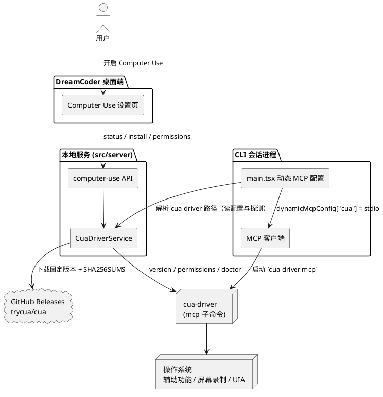
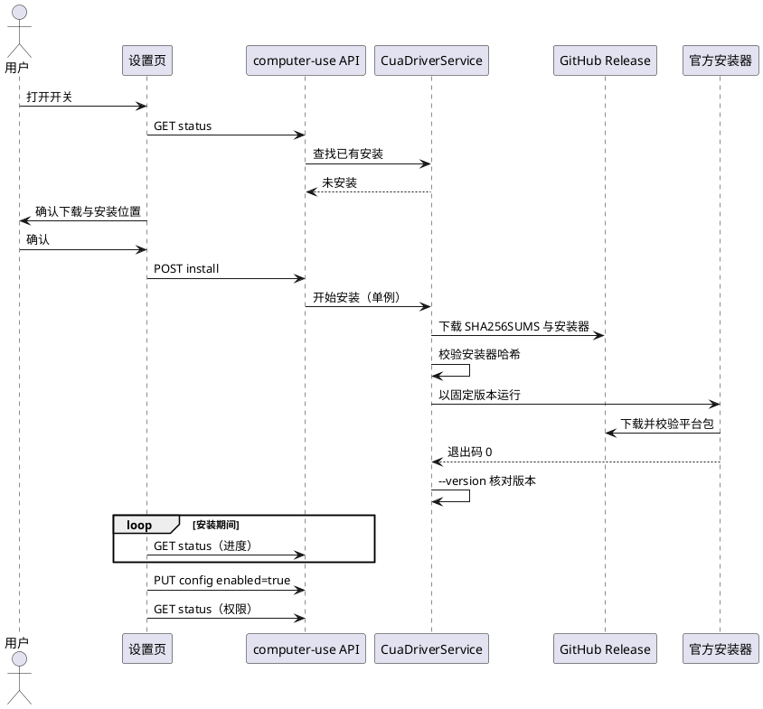
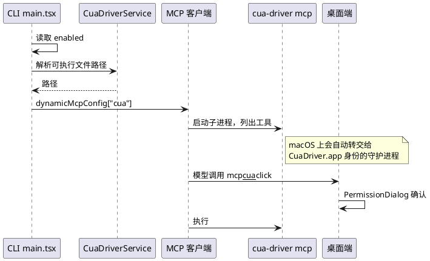

# Computer Use 统一到 cua-driver：技术设计

> 状态：已评审（2026-10-15），并按源码对照审查修订（2026-10-15），待实现。标注 `[assumption]` 的内容还没有验证，见文末"待定问题与风险"。

## 背景

DreamCoder 的 Computer Use 目前有两种模式（视觉模式和 UIA 树模式），底层是自己维护的 Python 脚本。开启前要先装 Python 并用 pip 装依赖。模型操作时会占用用户的鼠标和焦点。

[cua-driver](https://github.com/trycua/cua)（MIT 协议）是一个跨平台的桌面操作驱动。它通过 MCP 暴露 50 多个工具，支持后台操作（不抢鼠标和焦点）、按界面元素操作（macOS 辅助功能树、Windows UI 自动化树），也支持浏览器操作。维护者目前把它当外部 MCP 使用，体验很好。

本设计要做的是：用户开启 Computer Use 时，DreamCoder 自动下载并接入 cua-driver，用它取代现有的两种模式和 Python 脚本，让 Computer Use 只有一套实现。

## 目标与非目标

**目标**

- Computer Use 只保留 cua-driver 一种实现，设置页不再有模式选择。
- 开启 Computer Use 时，DreamCoder 按需下载固定版本的 cua-driver 并校验，不需要用户装 Python。
- 模型直接使用 cua-driver 的原生 MCP 工具，能用上后台操作、元素级操作和浏览器操作。
- macOS、Windows、Linux 走同一套流程。macOS 是首要验证平台（维护者的主力平台），Windows 需要单独实测，Linux 跟随 cua 标为预览。
- 删除 Python 运行时、两套执行器、按应用授权的审批流，以及相关设置项。

**非目标**

- 不把 cua-driver 打进 DreamCoder 安装包。
- 不在 cua-driver 外面再包一层自定义工具接口，也不改写它的工具描述。
- 不使用 cua 仓库里 FSL 协议的组件（Cua Spaces 等），也不启用它的视觉区域解析模型（`parse_visual_regions` 依赖的第三方模型里有 AGPL 协议的）。
- 不做 cua-driver 的自动升级。升级通过修改 DreamCoder 里固定的版本号完成。

## 现状

### 接入链路

1. CLI 启动时，`src/main.tsx` 里标注 "chicago MCP" 的代码块（约第 1601 行）读取 `computer-use-config.json`。只要 `enabled` 为真，就调用 `src/utils/computerUse/setup.ts` 的 `setupComputerUseMCP()`，把名为 `computer-use` 的 MCP 服务加进 `dynamicMcpConfig`，同时把它的全部工具加进 `allowedTools`，跳过常规的权限确认。这段代码只在 darwin 和 win32 上执行。
2. `computer-use` 是保留名。`src/services/mcp/client.ts`（约第 924 行）按名字拦截这个服务，不会启动子进程，而是在进程内创建服务（`src/utils/computerUse/mcpServer.ts`）。真正的工具调用由 `wrapper.tsx` 的 `.call()` 覆盖实现。
3. 工具定义来自 `src/vendor/computer-use-mcp/`，即 Claude Code 自带的 Computer Use 工具集，包括 `request_access` 在内的按应用授权模型。
4. 执行层由 `src/utils/computerUse/hostAdapter.ts` 按模式二选一：视觉模式用 `executor.ts`，UIA 树模式用 `uiaExecutor.ts`。两者都通过 `pythonBridge.ts` 调用 `runtime/{mac,win,uia}_helper.py`。`sidecar/runtime/` 下有一份基本相同的副本（`requirements-win.txt` 两边内容不同）。

### 准备与审批

- `src/server/api/computer-use.ts` 提供以下接口：
  - `status`：检测 Python、虚拟环境、依赖和系统权限。
  - `setup`：创建虚拟环境并用 pip 安装依赖，回退逻辑在 `pipInstall.ts`。
  - `apps`、`authorized-apps`：列出应用、读写已授权应用。
  - `open-settings`：打开系统设置。
  - `request-access`：处理授权请求。
- Python 虚拟环境放在 `<Claude 配置目录>/.runtime/venv`。
- 按应用授权的流程：`request_access` 经 `computerUseApprovalService.ts` 发出 WebSocket 事件 `computer_use_permission_request`，桌面端用 `ComputerUsePermissionModal.tsx` 弹窗；等待超时约为几分钟。这个弹窗不看会话的权限模式（`wrapper.tsx` 的 `runPermissionDialog`），用户选了"跳过权限"也照样会弹。
- 配置文件是 `<Claude 配置目录>/dreamcoder/computer-use-config.json`，字段有：`enabled`（默认开启）、`mode`（`vision` 或 `uia_tree`）、`authorizedApps`、`grantFlags`、`pythonPath`。

### 设置页

`desktop/src/pages/ComputerUseSettings.tsx` 由这几部分组成：总开关、模式选择、Python 状态和自定义路径、虚拟环境与依赖状态、辅助功能和屏幕录制权限、一键安装按钮、已授权应用列表。

### 规模

上面这些代码（TypeScript、Python 和测试）合计约 6700 行，另有 `src/vendor/computer-use-mcp/` 约 6700 行。

## 方案



整体思路：

- cua-driver 作为一个**普通的 stdio MCP 服务**接入，服务名用 `cua`，不再使用保留名 `computer-use`。这样它不会被 `client.ts` 拦截成进程内服务，走的就是标准的 MCP 子进程路径。
- DreamCoder 只负责四件事：找到或安装 cua-driver、检查系统权限、把它注册进会话，以及在设置页展示它的状态。工具本身、截图、坐标、会话管理全部交给 cua-driver。

### 产品边界：对用户是原生功能，MCP 只是内部通道

MCP 只是 DreamCoder 和 cua-driver 之间的通信方式，用户看到的是原生的 Computer Use 功能。现在的实现也一样：内部注册了一个名为 `computer-use` 的 MCP 服务，只是在进程内运行，用户看不到。具体约束如下：

- **唯一入口是 Computer Use 设置页。** 开关、安装、版本、权限、诊断都在这个页面完成，用户不需要知道 MCP 是什么，也不需要手动配置任何 MCP。
- **不出现在 MCP 设置页。** MCP 设置页的列表来自配置文件（`src/server/api/mcp.ts` 调用 `getAllMcpConfigs()`）。`cua` 是 CLI 启动会话时通过 `dynamicMcpConfig` 动态加进去的，不写进任何 MCP 配置文件，所以不会出现在这个列表里，用户也无法在那里编辑或删除它。
- **服务名 `cua` 归 DreamCoder 所有。** 参照 CLI 对 `computer-use` 的现有做法，把 `cua` 列为保留名。现有的保留名检查只覆盖两个入口：命令行的 `--mcp-config`（`main.tsx` 约第 1474 行，报错退出）和添加 MCP 的接口 `addMcpConfig`（`config.ts` 约第 646 行，拒绝添加）。用户手动写进配置文件的同名服务不会报错，而是被动态配置悄悄覆盖（`main.tsx` 约第 2407 行，动态配置展开在后）。所以设置页还要检查用户配置里有没有名为 `cua` 的服务，有的话提示"你的 MCP 配置中名为 cua 的服务已被内置 Computer Use 覆盖"。用户用别的名字另外添加的 cua-driver MCP 不受影响，但这时会话里会有两套功能相同的工具，设置页也要提示这一点。
- **会话里的显示不暴露 MCP 痕迹。** 工具卡片和权限弹窗显示的是友好名称（如"Computer Use · 点击"），不显示 `mcp__cua__click` 这样的内部名字，见下文的"工具显示"组件。例外：会话的 `/status` 面板会按 CLI 的初始化消息列出所有 MCP 服务（`LocalSlashCommandPanel.tsx` 约第 597 行），其中会出现 `cua`。这是面向排障的面板，第一版不做隐藏。

**为什么不沿用 `computer-use` 这个名字：** 这个名字在 CLI 里有两层特殊处理：一是会被拦截成进程内服务，二是按代码注释（`setup.ts`），Anthropic 官方后端看到 `mcp__computer-use__*` 工具名时会在系统提示里注入 Computer Use 提示，而这段提示描述的是 Claude 自带的工具集，和 cua 的工具对不上。换成 `cua` 可以同时避开这两点。

## 组件

### CuaDriverService（新增，`src/server/services/cuaDriverService.ts`）

DreamCoder 里唯一了解 cua-driver 的地方。对外提供以下能力：

- **查找已有安装**：按顺序查找：
  1. 用户在配置里指定的路径；
  2. 平台的标准安装位置（来自 0.34.0 官方安装器）：
     - macOS：`/Applications/CuaDriver.app/Contents/MacOS/cua-driver`；
     - Linux：`~/.local/bin/cua-driver`（指向 `~/.cua-driver/packages/current/`）；
     - Windows：`%LOCALAPPDATA%\Programs\Cua\cua-driver\bin\cua-driver.exe`（`install.ps1` 第 17、197 行），以及 `%USERPROFILE%\.cua-driver\packages\current\` 下的程序；
  3. PATH 里的 `cua-driver`。

  找到后运行 `--version` 读取版本号。维护者本机已经装过 cua-driver，会直接复用，不会重复下载。
- **安装**：见下文"安装方式"。同一时间只允许一次安装。安装进度（阶段，加上已下载和总字节数）保存在服务的内存里，由状态接口返回。
- **权限检查**：调用 `cua-driver permissions status --json`，读取辅助功能和屏幕录制的授权状态。只读，不会弹出系统授权对话框。在 macOS 上，这个命令是向正在运行的守护进程询问的；没有守护进程时，它返回 `unknown`，而不是"未授权"（见 `cua-driver --help`）。所以状态有三种：已授权、未授权、未知。"未知"时设置页显示"cua-driver 未运行，无法读取权限"，并提供"去授权"按钮（授权流程会启动守护进程）。
- **请求授权**：调用 `cua-driver permissions grant`，由 CuaDriver.app 以它自己的身份（`com.trycua.driver`）弹出系统授权对话框。也就是说，权限记在 CuaDriver 名下，不记在 DreamCoder 名下。
- **诊断**：调用 `cua-driver doctor`，原样返回输出，放在设置页的"诊断信息"里。
- **解析可执行文件路径**：供 CLI 启动时调用。返回可用的 cua-driver 路径；没有可用的返回空。纯本地操作，不联网。

版本号作为一个常量放在这个服务里，名称为 `CUA_DRIVER_VERSION`，值为维护者当前在用、已实测的 **0.34.0**（stable 渠道），对应的 GitHub Release 是 `cua-driver-rs-v0.34.0`。GitHub 把这个版本标成了预发布，但 cua 的 stable 渠道发布的就是它。

这个常量有两个用途，含义不同：

- **DreamCoder 自己安装时**：安装的就是这个版本。
- **检测已有安装时**：它是"最低已验证版本"，不是"必须相等的版本"。macOS 上 cua-driver 只有一份全机共用的安装（`/Applications/CuaDriver.app`）和一个共用的守护进程。用户自己或其他工具执行 `cua-driver update --apply`，版本就会变；`cua-driver mcp` 启动时也会提示有新版本。我们无法把这份共用安装锁在某个版本上，也不应该为了"版本相等"去降级它。因此：
  - 版本不低于 0.34.0：正常接入，来源显示"已有安装"；版本更高时，显示"高于已验证版本，可能有未适配的工具"的提示。
  - 版本低于 0.34.0：提示升级，提供"安装 0.34.0"按钮（需要确认，见流程 3）。

理由见 [ADR-0001](cua-driver-adr.md#adr-0001固定安装版本已有安装以-0340-为最低版本)。

### 安装方式

调用 cua 官方安装器，并固定版本，不自己解包。

- **macOS**：
  1. 从固定版本对应的 GitHub Release 下载 `_install-rust.sh` 和 `SHA256SUMS`；
  2. 按 `SHA256SUMS` 校验安装器；
  3. 带上环境变量 `CUA_DRIVER_RS_VERSION=<固定版本>` 和参数 `--no-modify-path` 运行安装器。

  安装器会把 `CuaDriver.app` 装到 `/Applications`，校验它的签名，并在签名要求不变时保留系统已授予的权限记录。

  **覆盖已有安装的副作用**（`_install-rust.sh` 0.34.0）：安装器会结束所有正在运行的 cua-driver 守护进程（约第 1492–1505 行），正在使用 cua 的其他工具会断开连接；如果新旧版本的签名要求不同，还会清除 CuaDriver 已有的辅助功能和屏幕录制授权，需要重新授权（约第 196–253 行）。因此，只有在本机没有 cua-driver，或已有版本低于 0.34.0 时，DreamCoder 才会运行安装器；覆盖已有安装前的确认框要写明这两点。
- **Windows**：用同样的方式下载并校验 `install.ps1`，再用 PowerShell 运行，参数为 `-Release 0.34.0 -NoPathUpdate -NoAutoStart`。这些参数已在 0.34.0 的 `install.ps1` 中确认。安装位置：程序在 `%USERPROFILE%\.cua-driver\packages\`，可见入口在 `%LOCALAPPDATA%\Programs\Cua\cua-driver\bin`。
  - **不注册登录自启任务**：`install.ps1` 默认注册一个计划任务，每次登录时运行 `cua-driver serve`。这个任务以 `RunLevel=Highest`（管理员权限）运行，注册时会自行提权并弹出 UAC 对话框（约第 677–713 行）。让一个能操作整个桌面的进程在每次登录时以管理员身份常驻，超出了"开启 Computer Use"应有的范围，所以我们传 `-NoAutoStart` 关掉它。
  - 安装器注释说没有守护进程时 MCP 调用会失败（约第 94–99 行），但 `cua-driver manifest` 对 `mcp` 子命令的说明是"Windows/Linux 上直接在进程内运行"。两者矛盾，需要社区在 Windows 上实测。如果实测确认必须有守护进程，再改为由 DreamCoder 在会话需要时启动一个非提权的 `cua-driver serve`，而不是注册开机任务。理由见 [ADR-0004](cua-driver-adr.md#adr-0004windows-上不注册登录自启任务)。
- **Linux**：与 macOS 相同，运行 `_install-rust.sh`。

所有平台运行安装器时都带上环境变量 `CUA_TELEMETRY_ENABLED=0`，安装器看到这个变量就不会写入遥测相关的状态（见"隐私"）。

下载的安装器先按同一 Release 的 `SHA256SUMS` 校验，0.34.0 两个安装器的哈希都已核对一致。本机有 cosign 时，再加上 `--require-signature`（Windows 上是 `-RequireSignature`），让安装器校验 Sigstore 签名；没有 cosign 时，只做 SHA256 校验。

为什么用官方安装器：在 macOS 上，cua-driver **必须**以 `/Applications/CuaDriver.app` 的形式安装。系统权限的归属（代码签名哈希加上 bundle id）和 `open -a CuaDriver` 的自动重启都依赖这个位置，而且升级时要验证新旧签名一致，才能保留用户已经授过的权限。这些逻辑都在官方安装器里，我们自己重写既容易出错，也会和 cua 的后续变化脱节。

### CLI 会话接入（修改 `src/main.tsx`，替换 `src/utils/computerUse/setup.ts`）

- 保留 `main.tsx` 里接入 Computer Use 的位置和启用条件：配置里 `enabled` 为真，并且没有传 `--no-computer-use`。平台判断增加 linux。
- 新的 `setupCuaDriverMCP()` 先调用"解析可执行文件路径"：
  - 拿到路径，就往 `dynamicMcpConfig` 里加一项：服务名 `cua`、`type: 'stdio'`、`command` 为该路径、`args: ['mcp']`、`env`（见下文"环境变量"）、`scope: 'dynamic'`。`env` 会和进程环境合并（`src/utils/mcpStdioEnvironment.ts`）；
  - 拿不到路径，就跳过，并写一条调试日志。CLI 启动时不触发下载。
- **工具权限**：只把只读工具加进 `allowedTools`，其余工具走普通 MCP 工具的权限确认，也就是现有的 `permission_request` 事件和 `PermissionDialog.tsx` 弹窗，确认时可以选"本会话内始终允许"。理由见 [ADR-0002](cua-driver-adr.md#adr-0002只读工具放行操作类工具逐次确认)。
  - 只读名单是一个常量，名称为 `CUA_READONLY_TOOLS`，按 0.34.0 的工具名写：`get_screen_size`、`get_cursor_position`、`list_apps`、`list_windows`、`get_window_state`、`get_accessibility_tree`、`get_desktop_state`、`zoom`、`get_browser_state`、`verify_state`、`health_report`、`get_config`、`get_session`、`list_sessions`、`get_session_state`、`get_recording_state`、`get_agent_cursor_state`。这些工具在 cua 的 MCP 注解里都是 `readOnlyHint: true`。
  - 以下工具**不放行**：
    - `clipboard_read`：涉及隐私，虽然注解是只读；
    - `check_for_update`：会联网；
    - `parse_visual_regions`：依赖视觉区域解析模型，属于非目标；
    - `check_permissions`：带 `prompt: true` 时会弹系统授权框，注解也不是只读；
    - 其余所有点击、输入、启动或结束应用、改配置、录制、安装扩展类工具。
  - `get_window_state` 和 `get_desktop_state` 有一个 `screenshot_out_file` 参数，会把截图写到指定路径。cua 的文档说截图只写到"经过校验的路径"，但具体怎么校验还没核实（见待定问题）。如果核实下来不能限制写入位置，就把这两个工具移出只读名单。
  - 名单只按 0.34.0 的工具列表写。已有安装的版本更高时，新增的工具默认需要确认，不会自动放行。
- **会话权限模式**：上面的确认只在"默认"类权限模式下生效。
  - 用户选了"跳过权限"（`bypassPermissions`，会话以 `--dangerously-skip-permissions` 启动，见 `conversationService.ts` 约第 856–870 行）时，cua 的所有工具都不再确认。
  - 用户选了 `dontAsk` 时，不在只读名单里的 cua 工具会被直接拒绝。
  - 两种情况都跟随用户的选择，不另做特殊处理。但旧实现在跳过权限模式下仍会按应用弹窗，新实现不会，所以要提示用户：Computer Use 开启时，用户切换到"跳过权限"模式，权限模式选择器显示一行警告"Computer Use 的操作将不再逐次确认"；设置页的 Computer Use 说明里也写明这一点。
- **"本会话内始终允许"的范围**：这个选项按工具名放行（`client.ts` 约第 1808 行给出的建议规则是整个工具名，`conversationService.ts` 的 `normalizeSessionPermissionUpdates` 把它写成会话规则）。比如对"点击"选了始终允许，之后本会话里点击任何应用都不再询问，比旧实现的按应用授权宽。这一点写进 ADR-0002 的代价。
- **环境变量**：启动 MCP 进程时，在环境变量里带上 `DO_NOT_TRACK=1`、`CUA_TELEMETRY_ENABLED=0` 和 `CUA_DRIVER_RS_UPDATE_CHECK=0`。前两个变量名在 cua-driver 0.34.0 的可执行文件里出现（已核对）；`CUA_DRIVER_RS_UPDATE_CHECK` 也在可执行文件里，作用是关闭启动时的更新检查，但取值含义还要在实现时核实（`[assumption]`）。在 macOS 上，这些变量只作用于 `mcp` 代理进程，到不了守护进程，见"隐私"。
- 保留名 `computer-use` 的拦截逻辑：随旧实现一起删除（见"迁移"）。

### 工具显示（桌面端，新增 `desktop/src/lib/cuaToolDisplay.ts`）

桌面端现在会把工具的原始名字直接显示出来：工具卡片见 `ToolCallBlock.tsx` 标题处，权限弹窗见 `PermissionDialog.tsx` 的 `permission.allowTool` 文案。不处理的话，用户看到的是 `mcp__cua__click`。

新增一个纯函数模块，输入工具名和参数。如果工具名以 `mcp__cua__` 开头，返回以下内容：

- **显示名称**：带"Computer Use"前缀和中英文本地化，比如"Computer Use · 点击""Computer Use · 输入文本""Computer Use · 读取窗口"。
- **图标**：按操作类型区分，比如点击、键盘、截图/读取、应用、浏览器。
- **一行摘要**：从参数里提取用户最关心的信息。cua 的操作类工具按进程号定位目标：`click`、`type_text` 等的参数只有 `pid`、`window_id` 和不透明的 `element_token`，没有应用名（`cua-driver describe click`）。这个模块是纯函数，不做进程号到应用名的反查，所以摘要只用参数里现成的信息：
  - 点击类：坐标，或"界面元素"（有 `element_token` 时）；
  - 输入类：要输入的文本前几十个字；
  - 启动应用：应用名或 bundle id（`launch_app` 的参数里有）；
  - 浏览器类：网址或页面元素。
- **权限弹窗标题**：比如"允许 Computer Use 点击？"、"允许 Computer Use 输入文本？"、"允许 Computer Use 启动 Safari？"。标题里不放应用名，`launch_app` 除外。

`ToolCallBlock`、`ToolCallGroup` 和 `PermissionDialog` 在用原始工具名之前，先查这个模块，查到就用它的结果。

**工具结果里的截图**：桌面端现在不显示工具结果里的图片。`ToolCallBlock.tsx` 和 `ToolCallGroup.tsx` 各自的 `extractTextContent` 只取文字块，图片块被丢掉。cua 的截图类工具（`get_window_state`、`get_desktop_state`、`zoom`）会在结果里返回图片，所以这次要新增：工具卡片展开后，把结果里的 `image` 块显示成缩略图，点击可以看大图。这一项对所有工具通用，不只针对 cua。

cua 会随版本新增工具，所以模块里只为常用工具写专门的摘要。没有映射的 cua 工具统一显示为"Computer Use · <工具名>"，按原样显示参数，不会退回成 `mcp__cua__` 前缀的原始名字。映射表以固定的 cua 版本为准，升级版本时一起检查。

CLI 终端里的工具渲染（`src/utils/computerUse/toolRendering.tsx`）只服务于旧工具，随旧实现删除。DreamCoder 的会话界面在桌面端，不需要为终端另做一份。

### 本地服务接口（重写 `src/server/api/computer-use.ts`）

| 方法和路径 | 作用 |
| --- | --- |
| `GET /api/computer-use/status` | 返回平台是否支持、cua-driver 的安装状态（未安装、安装中、已安装、版本过低、找不到可执行文件）、版本、是否高于已验证版本、路径、来源（自定义、已有安装、DreamCoder 安装）、安装进度、系统权限（每项为已授权、未授权或未知）、遥测状态、用户 MCP 配置中的冲突（同名 `cua`，或另一个指向 cua-driver 的服务） |
| `POST /api/computer-use/install` | 开始安装，立即返回；进度通过 `status` 轮询获取 |
| `POST /api/computer-use/permissions/grant` | 请求系统授权（仅 macOS） |
| `GET /api/computer-use/doctor` | 返回诊断输出 |
| `GET/PUT /api/computer-use/config` | 读写 `enabled` 和自定义的 cua-driver 路径 |

以下接口删除：`setup`、`apps`、`authorized-apps`、`request-access`。`open-settings` 保留，作为请求授权失败时的后备：直接打开系统设置的对应页面。

## 数据模型

`computer-use-config.json` 的新结构：

- `enabled`：布尔，默认**关闭**。原来默认开启；改成默认关闭，是因为开启就会触发下载。注意：没有保存过配置的老用户，原来靠默认值处于开启状态，升级后会变成关闭（见"迁移"）。
- `driverPath`：字符串或空，用户自定义的 cua-driver 路径。

旧字段（`mode`、`authorizedApps`、`grantFlags`、`pythonPath`）读取时直接忽略；用户下次保存配置时，这些字段会被删掉。不需要专门写数据迁移。

DreamCoder 不保存 cua-driver 自己的状态，包括会话、录制和光标设置。这些都由 cua-driver 自己管理，放在 `~/.cua-driver` 下。

## 界面流程

入口不变：设置 → Computer Use。页面标题、侧边栏名称和现在保持一致。

```
┌ Computer Use ─────────────────────────────── [开关] ┐
│ 由 cua-driver 驱动，可在后台操作桌面应用和浏览器。  │
│                                                      │
│ cua-driver   ● 已安装 v0.34.0（DreamCoder 安装）     │
│ 辅助功能     ● 已授权                                │
│ 屏幕录制     ○ 未授权          [去授权]              │
│ cua 遥测     ● 已关闭                                │
│                                                      │
│ [重新检测]   ▸ 高级：自定义 cua-driver 路径           │
│              ▸ 诊断信息                              │
└──────────────────────────────────────────────────────┘
```

**流程 1：首次开启**
- **入口**：打开开关。
- **步骤**：
  1. 打开开关时，如果检测到还没有 cua-driver，弹出确认框，告知要下载的大小和安装位置。macOS 上写"将从 GitHub 下载约 76MB，并在 /Applications 安装 CuaDriver.app"（0.34.0 的 macOS 安装包为 75.8MB）。三个平台都注明"已为你关闭 cua 的匿名遥测"。
  2. 用户确认后开始安装。安装期间开关和按钮都不可用，显示阶段和进度。
  3. 安装完成后自动检查权限。
- **成功**：三项状态全部为绿色，页面提示"新会话生效"。
- **失败**：
  - 下载失败、校验失败、安装器退出码非零时，留在当前页，显示安装器返回的具体错误，提供"重试"和"使用已有安装路径"两个选项。
  - 开关保持关闭，不写入 `enabled: true`。
  - 用户取消确认框时，开关恢复关闭，不做任何操作。

**流程 2：授权**
- **入口**：某项权限未授权时，点击"去授权"。
- **步骤**：调用请求授权接口，系统弹出授权对话框，用户在系统设置里勾选后回到页面，点"重新检测"。
- **成功**：对应权限变成已授权。
- **失败**：显示"仍未授权"，同时提供"打开系统设置"按钮作为后备。这是要用户看懂才能继续的提示，用页面内常驻的提示，不用一闪而过的消息。

**流程 3：已有安装**
- **入口**：开启时检测到本机已有 cua-driver。
- **版本不低于 0.34.0**：不弹下载确认框，直接接入，来源显示为"已有安装"。版本更高时，附一行提示"高于已验证版本 0.34.0，部分新工具会逐次确认"。不提供降级按钮。如果这份安装的 cua 遥测是开启的，显示提示和"关闭 cua 遥测"按钮（见"隐私"）。
- **版本低于 0.34.0**：显示当前版本，提供"安装 0.34.0"按钮。确认框写明：会替换 /Applications 里的 CuaDriver.app；正在使用 cua 的其他工具会断开；如果签名有变化，需要重新授权辅助功能和屏幕录制。

**流程 4：关闭**
- **入口**：关闭开关。
- **结果**：只写入 `enabled: false`，新会话不再接入 cua。不卸载 cua-driver，因为用户可能在别处也在用它。macOS 上的守护进程是全机共用的，也不由 DreamCoder 停止；设置页说明里写明停止方法（`cua-driver stop`）。

**状态说明**
- **检测中**：显示加载状态。
- **接口失败**：显示服务端返回的错误详情。"检测失败"和"未安装"是两种不同的状态，要分开展示。
- **平台不支持**：显示说明，开关不可用。
- **窄屏**：各行状态上下堆叠，按钮保留可点。

**流程 5：会话中的工具调用**
- **入口**：模型在会话里调用 cua 工具。
- **步骤**：
  1. 需要确认的工具，弹出现有的 `PermissionDialog`（"跳过权限"模式下不弹，见"会话权限模式"）。标题和摘要来自"工具显示"组件，比如"允许 Computer Use 点击？"，下方显示目标元素或坐标。
  2. 用户允许或拒绝。
  3. 工具卡片以"Computer Use · 点击"的形式出现在消息流里，带对应的图标和一行摘要。
- **成功**：卡片显示结果；返回截图的工具，展开后显示缩略图（新增能力，见"工具显示"）。
- **失败**：cua 返回的错误（比如权限不足、目标窗口不存在）原样显示在卡片的结果里，模型也能看到并自行处理。权限不足时，卡片下方附一个"去 Computer Use 设置"的链接。
- 消息流和权限弹窗里不出现 `mcp__cua__` 前缀和"MCP"字样（`/status` 排障面板除外）。

**MCP 设置页**：不显示 `cua`。Computer Use 设置页检查用户自己的 MCP 配置，有两种提示：
- 有名为 `cua` 的服务：提示它已被内置 Computer Use 覆盖，建议改名或移除。
- 有用别的名字配置的 cua-driver：提示"检测到你另外配置了 cua-driver MCP，会话中会出现重复的工具，建议移除"。判断依据是 command 路径指向 cua-driver。

## 关键时序





注意：CLI 进程里调用的"解析可执行文件路径"，指的是同一段解析逻辑，以模块函数的形式被 CLI 直接引用，不经过 HTTP。CLI 是由本地服务启动的子进程，两边共享同一份配置文件。

## 失败与处理

| 场景 | 如何发现 | 处理 |
| --- | --- | --- |
| 访问 GitHub 失败或很慢（国内网络常见） | 请求报错或超时 | 显示原始错误，可重试；提供"使用已有安装路径"。第一版不做国内镜像 |
| 安装器哈希和 `SHA256SUMS` 不一致 | 哈希比对 | 中止，不运行安装器，提示可能被篡改或下载不完整 |
| macOS 的 `/Applications` 不可写 | 安装器报错 | 原样显示安装器的提示 |
| 安装器退出码非零 | 退出码 | 显示安装器输出的最后几行；不写入 `enabled: true` |
| 安装后版本号不符 | `--version` 核对 | 视为失败，提示版本不符 |
| 重复点击安装 | 服务里有单例锁 | 第二次请求直接返回当前进度 |
| 系统权限未授予 | 权限检查 | 设置页提示；会话里 cua 工具会返回自己的权限错误，模型能看到 |
| cua-driver 启动失败或崩溃 | MCP 连接失败 | 走现有的 MCP 连接失败处理，会话照常进行，只是没有 cua 工具；设置页的诊断信息可以查看原因 |
| 配置的路径失效（被删除或移动） | 解析路径时文件不存在 | CLI 跳过接入；设置页显示"找不到可执行文件" |
| 用户本机另装了其他版本的 cua-driver | 版本核对 | 见流程 3：不低于 0.34.0 直接用，低于时经确认才安装；不静默覆盖，不降级 |
| 安装时其他工具正在使用 cua | 安装器会结束所有守护进程 | 只在确认框里告知；不额外检测 |

## 横切关注点

- **安全**：
  - 只从固定版本的 GitHub Release 下载，并按 `SHA256SUMS` 校验安装器。安装器自己会再校验平台包。
  - `SHA256SUMS` 和安装器来自同一个 Release，只能防下载损坏，防不了 Release 本身被替换。本机有 cosign 时，自动让安装器校验 Sigstore 签名；没有 cosign 时，不强制要求，以免大多数用户装不上。
  - 只有只读工具预先放行，其余工具每次调用都要用户确认（见 ADR-0002）。"跳过权限"模式下没有确认，这是用户的选择，界面上给出警告（见"会话权限模式"）。
  - cua 自己也有一层授权：守护进程默认以 `standard` 模式运行，挂到用户已登录的浏览器配置、结束不是它启动的进程等操作会被拒绝，或要求宿主授权（cua 文档 `permissions.mdx`）。cua 不弹自己的确认框，遇到这些边界直接返回 `authorization_required`。DreamCoder 第一版不接入这层授权，这类操作会失败，模型能看到错误。
  - Windows 上不注册以管理员权限运行的登录自启任务（见 ADR-0004）。
- **隐私**：
  - **结论：DreamCoder 使用 cua 时不开启遥测。** 理由和取舍见 [ADR-0003](cua-driver-adr.md#adr-0003不开启-cua-driver-遥测)。
  - **已核实的背景：** cua-driver **默认开启**"不含内容的产品遥测"，数据发往 PostHog（欧盟节点）。它的命令行提示原文是 "Cua Driver sends content-free product telemetry by default"。关闭方式有两种：环境变量 `DO_NOT_TRACK`、`CUA_TELEMETRY_ENABLED`、`CUA_DRIVER_RS_TELEMETRY_ENABLED`；或者持久化设置 `cua-driver telemetry disable`，写在 `~/.cua-driver/config.json` 的 `telemetry_enabled` 字段。
  - **DreamCoder 安装的 cua-driver**：
    1. 安装时带上 `CUA_TELEMETRY_ENABLED=0`；
    2. 安装完成后运行 `cua-driver telemetry disable`，把关闭状态持久化；
    3. 用 `cua-driver telemetry status --json` 核对确实已关闭。
  - **用户自己已有的安装**：每次启动 MCP 进程都带上关闭遥测的环境变量。设置页显示 `telemetry status` 的结果；如果是开启状态，提示用户并提供"关闭 cua 遥测"按钮，点击后执行 `telemetry disable`。是否点击由用户决定，不静默修改。
  - **环境变量在 macOS 上的局限**：macOS 上 `cua-driver mcp` 只是代理，真正执行工具的是通过 `open -n -g -a CuaDriver` 由系统启动的守护进程（cua 文档 `permissions.mdx`；`_install-rust.sh` 约第 867 行）。这个守护进程是全机共用的，可能早已被别的工具启动（维护者本机正在运行的守护进程，父进程是 1）。所以我们给 `mcp` 带的环境变量传不到守护进程，只能管住代理进程本身。在 macOS 上，可靠的手段只有持久化设置 `telemetry disable`。对已有安装、用户又没点关闭按钮的情况，守护进程可能仍会发遥测；设置页的提示要如实写明这一点。
  - **更新检查**：`cua-driver mcp` 启动时会联网检查新版本（实测时在 stderr 打印了"v0.35.4 is available"，结果缓存约 20 小时）。我们带上 `CUA_DRIVER_RS_UPDATE_CHECK=0` 来关闭它，取值含义待实现时核实。
  - `PRIVACY.md` 补充：Computer Use 使用 cua-driver，DreamCoder 会把它的遥测关掉。
- **许可证**：cua-driver 是 MIT 协议。我们不分发它的二进制，只是下载并调用，按 MIT 不需要附带它的许可证。在 README 致谢和设置页里注明"由 cua-driver（trycua/cua，MIT）驱动"。
- **外部依赖风险**：Computer Use 的质量取决于 cua。DreamCoder 自己安装的是固定版本，如果 cua 停止维护或修改许可证，我们可以一直停在已验证的版本；已发布版本的 MIT 授权不能收回。macOS 上的共用安装可能被用户或其他工具升级，这部分不在我们控制范围内（见 ADR-0001）。
- **性能**：只有开启 Computer Use 时才下载，安装包体积不变。CLI 启动时解析路径只做本地文件检查，不运行 `--version`；版本核对只在设置页做。
- **可观测性**：安装、权限检查、路径解析都写调试日志；设置页的诊断信息直接显示 `cua-driver doctor` 的输出。

## 测试策略

- **CuaDriverService**：
  - 文件系统、子进程和下载都通过参数注入，方便在测试里替换。
  - 单元测试覆盖：路径查找顺序、版本号解析、哈希比对、单例安装锁、各类安装失败对应的状态。
  - 下载部分用本地假数据，不访问网络。
- **工具显示**：对 `cuaToolDisplay` 做单元测试，覆盖：
  - 常用工具的名称、图标和摘要；
  - 未映射的 cua 工具回退为"Computer Use · <工具名>"；
  - 非 cua 工具返回空，不影响原有显示；
  - 参数缺失或格式异常时不报错。

  组件测试确认 `ToolCallBlock` 和 `PermissionDialog` 遇到 cua 工具时不显示 `mcp__cua__` 前缀；工具结果里有 `image` 块时，展开后显示缩略图。
- **CLI 接入**：对 `setupCuaDriverMCP()` 做单元测试：
  - 路径存在时，生成的配置是服务名 `cua`、`args` 为 `['mcp']`，`env` 含三个关闭变量；
  - `allowedTools` 恰好等于 `CUA_READONLY_TOOLS` 对应的完整工具名，不含 `clipboard_read`、`check_for_update`、`check_permissions`；
  - 路径不存在时返回空配置。
- **只读名单与真实工具对齐**：用 0.34.0 `tools/list` 的结果做一份测试数据，检查名单里每个工具都存在，并且注解是 `readOnlyHint: true`。
- **设置页**：组件测试覆盖：
  - 首次开启时的确认框，以及取消后开关恢复关闭；
  - 安装中所有控件不可用；
  - 安装失败时显示具体错误、开关保持关闭；
  - "检测失败"和"未安装"两种状态分开展示；
  - 权限为"未知"时的展示；
  - 已有安装版本更高时，不出现降级按钮。
- **权限模式警告**：Computer Use 开启时，切换到"跳过权限"模式会显示警告。
- **端到端**：
  - 在 macOS 上由维护者手动验证：从全新环境开启、授权，再让模型完成一次后台点击加输入。
  - Windows 由社区协助验证。
  - Linux 只做冒烟测试。

## 迁移与上线

1. **第一个版本**：新增 CuaDriverService 和新的设置页，接入 `cua`；同时删除旧实现。旧实现不保留为后备，原因是"统一"本身就是目标，两套并存会把问题拖到以后。
   - 发布前在 macOS 上由维护者完整验证。
   - Windows 上的效果，包括后台操作，以及不注册登录自启任务时 MCP 能否工作，在发布前开一个 issue，邀请社区实测，并在 README 里如实标注验证状态。
   - Linux 标为预览。
2. **要删除或改写的内容**（按 2026-10-15 的引用关系整理）：
   - `src/utils/computerUse/`：
     - 整个目录删除，包括执行器、Python 桥接、pip 安装、进程内服务、wrapper、工具渲染、锁、回合结束清理、`permissions.ts`；
     - 以下两项保留并改写：`preauthorizedConfig.ts` 改成新的配置结构；`common.ts` 只留保留名常量和检查函数，常量改为 `cua`。
   - `src/vendor/computer-use-mcp/`：整个目录删除。
   - 直接引用旧实现、需要同步修改的地方：
     - `src/query.ts`（约第 1037、1493 行）和 `src/query/stopHooks.ts`（约第 183 行）：回合结束和中断时调用旧的清理函数，删除这些调用；
     - `src/entrypoints/cli.tsx`（约第 86 行）：`--computer-use-mcp` 入口，删除；
     - `src/services/mcp/client.ts`（约第 244、924、1978 行）：进程内服务的拦截和工具覆盖，删除；
     - `src/services/mcp/config.ts`（约第 646–656、1520 行）：添加 MCP 时的保留名检查改为检查 `cua`；`DEFAULT_DISABLED_BUILTIN` 删除；
     - `src/services/analytics/metadata.ts`（约第 130 行）：内置服务名集合改为 `cua`；
     - `src/main.tsx`：Computer Use 接入块改为调用 `setupCuaDriverMCP()`；`--mcp-config` 的保留名检查改为检查 `cua`；
     - `src/components/permissions/ComputerUseApproval/`：删除；
   - `runtime/` 和 `sidecar/runtime/` 下的 Python 脚本和依赖清单。
   - `computerUseApprovalService.ts`、`ComputerUsePermissionModal.tsx`、WebSocket 事件 `computer_use_permission_request`，以及桌面端 `desktop/src/types/chat.ts`、`desktop/src/stores/chatStore.ts` 里对应的类型和处理。
   - 相关测试和多语言文案。
   - 删除后用 `grep -rn "computerUse/\|computer-use-mcp\|computer_use_permission"` 确认没有残留引用。
3. **已有用户升级后**：
   - 配置里明确写了 `enabled: true` 的用户：这个值会保留。但升级后本机还没有 cua-driver，所以 CLI 不会接入。设置页的开关显示为开启，状态行显示"未安装"和"安装"按钮，点击后走流程 1 的确认和安装。
   - 从没保存过配置的用户：原来靠默认值开启，升级后变成关闭。CHANGELOG 里写明：需要 Computer Use 的话，到设置里重新开启。
   - 旧的 Python 虚拟环境（`<Claude 配置目录>/.runtime/venv`）和辅助脚本不会自动删除。设置页检测到它们存在时，显示"清理旧运行环境"按钮，并给出占用的空间。删除前弹出普通确认框：这些文件可以随时重建，所以不需要输入确认值。删除后按钮消失。
4. **文档**：
   - README 的 Computer Use 介绍和截图改成新的说法；
   - CHANGELOG 记录这次破坏性变更：移除视觉模式和 UIA 树模式，不再需要 Python；
   - `PRIVACY.md` 补充 cua 的遥测说明。

## 备选方案

**保留旧的 Computer Use 工具接口，只把执行层换成 cua-driver。** 这样界面、审批流和模型提示都不用改。但旧接口是"截图加坐标"的模型，cua 的后台操作、元素级操作、浏览器操作在这个接口里大多表达不出来，等于把好驱动当坏驱动用。坐标、显示器、缩放这些细节还要重新逐项对齐。因此否决。

**把 cua-driver 打进 DreamCoder 安装包。** 首次使用不用下载，离线也能开启。但所有用户的安装包都会增加约 30 到 76MB（0.34.0 各平台安装包大小），即使他们从不用 Computer Use。macOS 上它还必须以 `/Applications/CuaDriver.app` 的形式存在，才能拿到独立的系统权限，所以即使打包进来，第一次使用时也得再拷贝一次。因此否决，改为按需下载。

**自己下载平台包并解压，不用官方安装器。** 好处是完全不运行外部脚本，安装位置也由我们决定。但在 macOS 上必须复刻 `/Applications` 放置、签名校验，以及升级时保留权限记录的逻辑，否则用户每次升级都要重新授权。这部分逻辑复杂，而且随 cua 版本变化。因此否决；Windows 和 Linux 为了流程统一，也用官方安装器。

**用 cua 的嵌入模式，或装一份 DreamCoder 私有的 cua-driver。** cua 支持"嵌入宿主"模式（官方文档 `EMBEDDING.md`）：宿主直接启动 `cua-driver serve --embedded` 和 `cua-driver mcp --embedded --socket <路径>`，系统权限记在宿主应用名下，不需要 `/Applications/CuaDriver.app`。Windows 和 Linux 的安装器也支持用 `CUA_DRIVER_RS_HOME` 装到独立目录。这样 DreamCoder 用的是私有的一份，版本真正固定，也不会和用户自己的 cua 互相影响。否决的原因：
- 嵌入模式下，辅助功能和屏幕录制权限要授给 DreamCoder 本身。DreamCoder 的 macOS 安装包目前没有签名（`desktop/src-tauri/tauri.conf.json` 里没有签名配置），macOS 按代码签名记录授权，每次更新 DreamCoder 都可能要重新授权。
- 守护进程的启动、等待和清理都要我们自己管理。

以后 DreamCoder 有了正式签名，可以重新评估。

**只检测已有安装，不负责安装（"检测到就接上"）。** 实现最简单。但用户得自己去终端运行安装命令，而且做不到"开启即可用"的统一体验。因此不作为主路径，只作为"使用已有安装"保留。

## 待定问题与风险

评审中做出的决定已经写进对应章节；有取舍的决定记录在 [ADR](cua-driver-adr.md) 中。剩下的都是要在实现或实测阶段核实的事项：

| 问题 | 影响 | 处理 |
| --- | --- | --- |
| macOS 上，遥测是由守护进程发出还是由 `mcp` 代理发出 | 环境变量只能管住代理（见"隐私"）。如果遥测由守护进程发出，已有安装在用户没点关闭时仍会发送 | 实现时用抓包或 cua 日志确认；无论结论如何，持久化设置都是主要手段 |
| `CUA_DRIVER_RS_UPDATE_CHECK` 的取值含义 | 设错的话，启动时仍会联网检查更新 | 实现时对照 cua 源码确认 |
| `screenshot_out_file` 能写到哪些路径 | 如果不受限制，预先放行的截图工具就能不经确认往任意路径写文件 | 实现时对照 cua 源码确认；不受限则把两个工具移出只读名单 |
| Windows 上，不注册登录自启任务时 MCP 能否工作；后台操作的实际效果 | 安装器注释和 `cua-driver manifest` 说法矛盾 | 社区实测；如果必须有守护进程，改为会话需要时由 DreamCoder 启动非提权的 `serve`，结论回填到"安装方式" |
