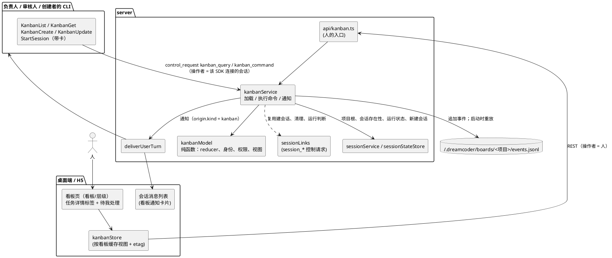
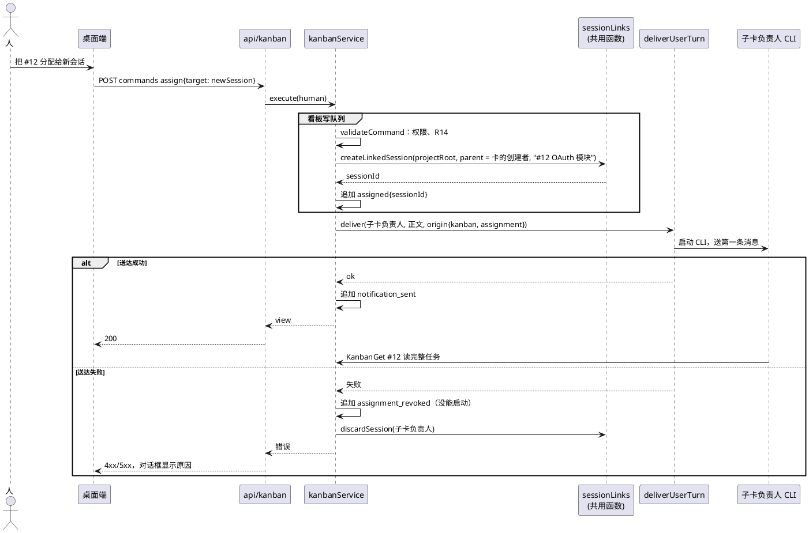
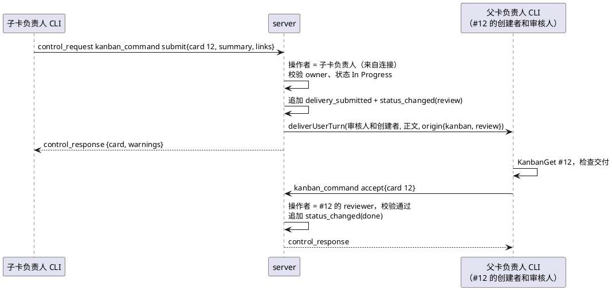

# 项目看板：技术设计

状态：首版已实现（`feat/kanban`），本文随实现更新，开头的修订记录写了每次改动。"现状" 一节描述的是动工前的代码，基线是 `main` 的 `23cc8560`，其中引用的代码位置都以这个提交为准，之后代码变了，行号可能对不上。

产品需求见 [PRD](./prd.zh.md)（已定稿）。本文只回答 PRD 第十一节留下的四个问题，以及把 R01–R41 落到代码上需要的结构：存储、项目与 worktree 的对应、看板工具和会话工具的衔接、分配通知的送达。

标了 `[假设]` 的地方是我定的，维护者确认前不算定案。文末有汇总。

**用语。** 界面、i18n 和面向用户的文档统一叫 "任务"（英文 Task），侧栏入口叫 "项目看板"。代码和协议里仍叫 card（`card_created`、`KanbanCommand.card` 等），不改名（维护者 2026-11-07 决定）。本文讲数据和协议时用 "卡"，讲界面时用 "任务"。

**界面线框图。** 2026-11-07 和维护者逐块评审过一组线框图（Artifact 画布，只在维护者账号下可见），"页面与交互" 一节记录评审定下的结果。

**2026-11-07 修订：任务和子任务。** 维护者决定去掉 PM 和上下级（PRD 同日修订）。卡片之间只剩父子关系；每张卡的负责人、审核人和创建者都记在卡片本身上，权限和通知只看这三种身份，不再沿卡片树往上找上级。随之删掉的有：看板的 PM 和设置（委派层数）、`supervisorOf` / `acceptorOf` / `delegationDepthOf`、按身份裁剪的可见范围、建议卡（`suggestion` 字段和接受、拒绝两个命令）、汇报链、`pm` 和 `pm_revoked` 通知。会话在别处建卡改成 `KanbanCreate` 的确认卡片，项目没有看板时第一张卡连同看板一起建。下面各节已按新规则改写。

**同日第二次修订：会话的分配在会话里确认。** 测试里一个会话拆了两张子卡、开了两个新会话，再提两条分配建议：人确认了四次，两个新会话启动时还不是负责人，来回发了四条 "我还不能开始" 的消息。改成：`StartSession` 可以带一张卡，新会话启动前就是它的负责人，开会话的确认就是分配的确认；会话给已有会话分配、给自己分配都用 `KanbanUpdate` 的 `assign`，在会话里弹确认卡片，跟着权限模式走。删掉的有：分配的 `proposed` / `declined` 状态、`propose_assignment` / `confirm_assignment` / `decline_assignment` 三个命令、`KanbanRequestRole` 工具和 `kanban_request_role` 控制请求、待我处理里的分配条目、`ROLE_TAKEN`。分配的四种事件合并成一个 `assigned`。

**2026-11-08 补充：分给自己的子会话不确认，从 Backlog 也能开始。** 再测时模型（gpt-6-luna）开新会话没带 `card`，开完再 `assign`，两个会话仍确认了四次；子会话启动后卡在 Backlog，`start` 被拒，回头请创建者挪到 Todo。改成：`assign` 的目标是调用方的子会话时直接放行（见 "组件" 里的工具表）；`start` 接受 Backlog 和 Todo（[kanbanModel.ts:445](../../../src/server/services/kanbanModel.ts)）。

**同日再补：审核人的工作（PRD R34–R37）。** 维护者指出审核人只被告知 "你是审核人"，没人说要做什么。改成：分配记录上已有的 `note` 对审核人就是审核说明，没写时用 server 的默认说明 `DEFAULT_REVIEW_INSTRUCTIONS`（[kanbanNotifications.ts](../../../src/server/services/kanbanNotifications.ts)），默认说明不落盘；说明出现在分配通知、提交后发给审核人的通知（附验收要点）、`KanbanGet` 的分配信息和任务详情里。`StartSession` 带卡时可以选 `role`，开场任务存成这次分配的 `note`，新会话的第一条消息就是分配正文（说明在正文里，不再把开场任务和正文拼两遍）。`accept` 必须带 `summary`（可带 `links`），记成一条 `kind: 'accepted'` 的更新，通知负责人和创建者（新 `purpose: 'accepted'`）。Review 期间看板、层级视图显示审核人和它的运行状态（`activeAssignee`）。

**同日再补：取消（PRD R38–R40，起因是 AIR-Xie 在 #241 问依赖被取消怎么办）。** 会话的 `cancel` 在 CLI 里是 `safetyCheck` 且不允许自动批准的 `ask`，任何权限模式下都要人确认，和开新会话一样。`cancel` 的结果用 `warnings` 列出还在等它的未完成卡和它没完成的子卡（`cancelWarnings`，[kanbanModel.ts](../../../src/server/services/kanbanModel.ts)），写法和提交时提示未完成子卡一样；人在看板上取消时，确认框里列出同样的卡（桌面端 `cancelImpact`）。取消照常执行，由取消的一方接着删依赖或一起取消，看板不替它决定。负责人觉得卡不需要时，工具说明要求它标阻塞写原因，交给创建者。

**2026-11-09 补充：按 AGENTS.md 的维度审查后的修正。**
- 会话能发的看板命令只定义一处（`KanbanSessionCommandSchema`，即建卡加上 `KanbanAgentUpdateCommandSchema`），CLI 工具和 `kanban_command` 控制请求共用。新会话目标、`repository`、只有人能用的命令在 server 也会被拒；目标 `"self"` 由 server 换成调用方的会话 id，CLI 不再换算。
- 卡在 Review 时才指派的审核人，分配通知里直接附上最近一次交付，写明已经提交、现在开始审；默认审核说明不再写 "等提交"，等待与否由通知按卡的状态写。
- 取消也通知审核人；人重新打开卡时可以填原因，通知负责人（`purpose: 'reopened'`）。原因不够清楚时，负责人把卡标阻塞写下问题，问题进人的 "待我处理"，人用评论或在它的会话里回答。
- 带链接的命令都把会话写的相对路径换成绝对路径，包括接受时的审核报告。
- 看板缓存的是读取本身（`Promise`），冷启动时同时进来的读取共用一份状态，避免两份状态各自追加事件。
- 在 Review 中取消不算 "退回"。
- 桌面端：看板页按看板区分实例；拖回原列不报错；离开待我处理的条目清掉 "稍后" 标记；旧的轮询结果不覆盖新状态；已有数据时刷新失败在页头提示；选中现任负责人或审核人直接关闭选择器；任务详情和待我处理计数不再被侧栏和会话消息拉进主包。

**同日再补：验收要点由创建者定（PRD R05、R42）。** 维护者决定负责人不自己改验收要点。`edit_card` 带 `acceptance` 时，`KanbanUpdate` 先用 `kanban_query` 查调用方在这张卡上的身份，不是创建者就总是 `ask`（`safetyCheck`，不允许自动批准），确认卡片列出新增和删除的要点；是创建者就照常放行。server 的权限表不变（owner、creator 都能 `edit_card`），和取消一样由会话一端拦，server 分不出人是否同意过。工具说明和给负责人的分配通知写明：要点有问题先问创建者，创建者是会话就用 `SendMessage`，是人就标阻塞写下问题；"待我处理" 里阻塞的条目多一个按钮，直接打开负责人的会话。桌面端的验收要点改成一条一行编辑（`AcceptanceEditor`，详情和新建任务共用：回车新加一条，空行退格删除，粘贴多行拆成多条），显示时的方框换成圆点，因为不记录勾选。

**同日再补：审核人由创建者或人指定（PRD R43），以及第三次审查的修正。**
- `assign` 的 `role: 'reviewer'` 在 server 只接受创建者、人，或会话分配自己（`validateCommand` 的 `assign` 分支，[kanbanModel.ts](../../../src/server/services/kanbanModel.ts)）。负责人指定审核人、开新会话当审核人都返回 `FORBIDDEN`。会话把自己设为审核人，或调用方同时是这张卡的创建者和负责人时，`KanbanUpdate` 总是 `ask`（`safetyCheck`，不允许自动批准）；`StartSession` 本来就每次都问。
- 人取消卡片时不再返回 `cancelWarnings`，因为确认框已经列出同样的卡。会话取消照旧在结果里列出。
- 分配被撤下时，这张卡发给被撤会话的失败通知一并清掉；卡完成或取消时，这张卡此前的失败通知也清掉，"重发" 因此不会送出过期的消息。
- `StartSession` 带卡时，新会话的第一条消息送不出去，就撤下这次分配再删会话（`abandonNewSession`），和人在看板上分配新会话失败的处理一样。后者撤下之前，先写入已经发出的通知记录。
- 两个会话同时建项目的第一张卡，后到的一方用已经建好的看板。
- 命令结果带上这条命令改动的卡号（`card`），REST 和 `kanban_command` 共用。桌面端新建任务后按它打开详情，不再取最大的新编号。
- 桌面端只接受版本不低于当前的看板视图，命令结果晚到时不会把看板退回旧状态。

## 背景

会话之间已经能互相创建和发消息（[session-links 技术设计](../session-links/tech-design.md)，#239）。看板建在这套机制上：agent 通过自己会话的 SDK 连接向 server 发控制请求，server 按入口判断来源，再把通知作为带来源的用户消息送进目标会话。看板不另起通道。

## 目标与非目标

目标：

- 一个项目一块看板，持久保存在本机，server 重启后原样恢复；同一个仓库的任何 worktree 进入，拿到同一块看板（R01、R20）。
- 身份、权限、状态转换和不变量（R05、R07、R11–R14、R27）由 server 判定，agent 只能通过工具操作，操作者由入口决定、不能自报。
- 分配生效、撤销、人的评论，以及提交和阻塞，通过现有的 `deliverUserTurn` 送进目标会话，已有会话和新开会话走同一条路（R09、R10、R29）。
- 桌面端和 H5 共用一个看板页（看板、层级两个视图）、一个任务详情和一个 "待我处理"，界面和 agent 工具读写同一份数据（PRD 第八节）。

非目标：

- 不引入 SQLite 或其他新的存储依赖；不做跨进程并发写（server 是单进程，见 "现状"）。
- 不新增 WebSocket 通道，看板页用轮询。
- 不做会话的自动 worktree、分支和合并（PRD 第九节）。
- 不改 CLI 内部的 TaskCreate / TaskUpdate 待办清单，它们和看板卡片不对应（PRD 第四节）。

## 现状（已核实，指本分支开始前的 main）

### 会话链接

- agent 的工具通过 `requestHost` 发控制请求（[hostRequests.ts:17](../../../src/utils/hostRequests.ts)），无头模式启动时把它接到 `structuredIO.requestHost`（[print.ts:620](../../../src/cli/print.ts)，[structuredIO.ts:534](../../../src/cli/structuredIO.ts)）。请求走该会话自己的 SDK 连接（`/sdk/<sessionId>`，[index.ts:277](../../../src/server/index.ts)），所以 server 收到时天然知道是哪个会话发的。
- server 端 `handleRawCliMessage` 把 `control_request` 交给 `sessionLinks.handleControlRequest(sessionId, cliMsg)`，它只认 `session_start`、`session_send`、`session_list`、`session_rename` 四种 subtype（[handler.ts:290](../../../src/server/ws/handler.ts)，[sessionLinksService.ts:42](../../../src/server/services/sessionLinksService.ts)），用 zod schema 校验后执行，再用 `conversationService.respondToHostRequest` 回 `control_response`（[sessionLinksService.ts:212](../../../src/server/services/sessionLinksService.ts)，[conversationService.ts:515](../../../src/server/services/conversationService.ts)）。schema 定义在 [controlSchemas.ts:590](../../../src/entrypoints/sdk/controlSchemas.ts)，并注册进请求联合类型（[controlSchemas.ts:734](../../../src/entrypoints/sdk/controlSchemas.ts)）。
- `createSessionLinks` 用依赖注入拿到 `deliver`、`queueReport`、`onRenamed`（[sessionLinksService.ts:44](../../../src/server/services/sessionLinksService.ts)），在 handler 里接到 `deliverUserTurn`（[handler.ts:63](../../../src/server/ws/handler.ts)），实例是 handler 模块里的常量。REST handler 直接从 `ws/handler` 引用导出（[api/sessions.ts:14](../../../src/server/api/sessions.ts)，[api/plugins.ts:5](../../../src/server/api/plugins.ts)）。测试用 `__resetWebSocketHandlerStateForTests` 清掉 handler 的模块状态（[handler.ts:1390](../../../src/server/ws/handler.ts)）。测试用假的 `deliver` 和临时的 `DREAMCODER_CONFIG_DIR` 跑真实的 `sessionService`（[session-links.test.ts:1](../../../src/server/__tests__/session-links.test.ts)）。
- 创建子会话：`createChild` 先按父会话的工作目录建会话（fresh 用 `sessionService.createSession`，带上调用方的权限模式和运行配置；fork 用 `createSessionBranch`），`startSession` 再改标题、用 `deliver` 送第一条消息（`purpose: 'brief'`），失败就 `discard`（删会话文件和它新建的 worktree）（[sessionLinksService.ts:77](../../../src/server/services/sessionLinksService.ts)，[:127](../../../src/server/services/sessionLinksService.ts)，[:64](../../../src/server/services/sessionLinksService.ts)）。
- `deliverUserTurn(sessionId, content, { origin })`：目标 CLI 没在跑就先启动（[handler.ts:437](../../../src/server/ws/handler.ts)）；带 `origin` 的消息不进用户消息队列（[turnQueueService.ts:27](../../../src/server/services/turnQueueService.ts)），直接 `conversationService.sendMessage` 给 CLI（[handler.ts:477](../../../src/server/ws/handler.ts)），再广播一条带 `origin` 的 `user_message` 并记 `turn_started`（[handler.ts:488](../../../src/server/ws/handler.ts)）。CLI 收到后，闲着就开一轮，在跑就在下一次工具调用时交给模型（session-links 设计 "送达和唤醒"）。
- `mode: 'report'` 只能发给父会话（[sessionLinksService.ts:159](../../../src/server/services/sessionLinksService.ts)），父会话闲着时排队不唤醒（[:163](../../../src/server/services/sessionLinksService.ts)，[turnQueueService.ts:100](../../../src/server/services/turnQueueService.ts)）。
- `ListSessions` 的 `running` 定义是 "CLI 进程在、且 `turn.phase` 不是 `idle`"（[sessionLinksService.ts:198](../../../src/server/services/sessionLinksService.ts)），写在 `listSessions` 里，没有单独的函数。
- 依赖方向：`src/tools` 和 `src/entrypoints/sdk` 不引用 server 代码，server 引用 `entrypoints/sdk` 的 schema（[sessionLinksService.ts:13](../../../src/server/services/sessionLinksService.ts)，[StartSessionTool.ts:1](../../../src/tools/StartSessionTool/StartSessionTool.ts)）。

### 消息来源

- 来源是结构化字段：`SDKSessionOriginSchema` 只有 `kind: 'session'`，`purpose` 取 `message | brief | report`（[coreSchemas.ts:1272](../../../src/entrypoints/sdk/coreSchemas.ts)）；用户消息上可带 `origin` 和 `reports`（[coreSchemas.ts:1305](../../../src/entrypoints/sdk/coreSchemas.ts)）。
- CLI 把正文包进 `<cross-session-message from=… purpose=…>`，尾部按 `purpose` 给不同的回复说明，并写明 "不是用户发的、没有用户授权"（[crossSessionEnvelope.ts:38](../../../src/utils/crossSessionEnvelope.ts)，[:49](../../../src/utils/crossSessionEnvelope.ts)）；正文里伪造的标签会被转义（[:58](../../../src/utils/crossSessionEnvelope.ts)）。`wrapCommandText` 按 `origin.kind` 分支（[messages.ts:5637](../../../src/utils/messages.ts)）。
- 读 origin 的地方：CLI 从 stdin 收到用户消息时用 `SDKSessionOriginSchema().safeParse` 过滤 origin，不合 schema 的直接丢掉（[print.ts:4139](../../../src/cli/print.ts)），入队后再只把 `kind === 'session'` 的交给 `ask`（[print.ts:2193](../../../src/cli/print.ts)）。origin 被丢掉的消息在 `wrapCommandText` 里走默认分支，当成用户本人的话（[messages.ts:5630](../../../src/utils/messages.ts)）；那里的 `MessageOrigin` 类型来自一个 `any` 的桩文件（[message.ts](../../../src/types/message.ts)），新增分支不受类型检查保护。`SessionOrigin` 类型还出现在 [items.ts:29](../../../src/server/transcript/items.ts)、[protocol.ts:90](../../../src/server/ws/protocol.ts)、[handler.ts:376](../../../src/server/ws/handler.ts)、[conversationService.ts:488](../../../src/server/services/conversationService.ts)、[sessionLinksService.ts:34](../../../src/server/services/sessionLinksService.ts)、[turnQueueService.ts:27](../../../src/server/services/turnQueueService.ts)、[desktop types/chat.ts:91](../../../desktop/src/types/chat.ts)。server 读 transcript 时用 `isSessionOrigin` 识别（[entries.ts:87](../../../src/server/transcript/entries.ts)，[:151](../../../src/server/transcript/entries.ts)）、读历史时用 `unwrapCrossSessionBody` 剥包装（[history.ts:149](../../../src/server/transcript/history.ts)）；AI 标题生成跳过非人发的消息（[sessionTitle.ts:40](../../../src/utils/sessionTitle.ts)）；桌面端按 `origin.kind === 'session'` 渲染成 `SessionMessageCard`（[MessageList.tsx:2048](../../../desktop/src/components/chat/MessageList.tsx)），卡片是可折叠的 Trace：图标、来源会话、按 `purpose` 取 i18n 的标签、`origin.summary` 预览、Markdown 正文和操作栏（[SessionMessageCard.tsx:10](../../../desktop/src/components/chat/OriginMessageCard.tsx)，[:22](../../../desktop/src/components/chat/OriginMessageCard.tsx)，[en.ts:1095](../../../desktop/src/i18n/locales/en.ts)，[zh.ts:1097](../../../desktop/src/i18n/locales/zh.ts)）。

### 会话状态与持久化

- 每个会话一个 `SessionState`，含 `workspace.projectRoot` 和 `turn.phase`（[types.ts:105](../../../src/server/session/state/types.ts)，[:118](../../../src/server/session/state/types.ts)）；`store.peek / ensure / read` 分别是 "只看内存"、"进内存并恢复"、"只读不留"（[store.ts:30](../../../src/server/session/state/store.ts)，[:47](../../../src/server/session/state/store.ts)，[:86](../../../src/server/session/state/store.ts)）。桌面端只对已连接的会话有状态镜像，判断是否在跑也只看这些会话（[chatStore.ts:1785](../../../desktop/src/stores/chatStore.ts)）。
- 持久化字段全部写成 transcript 条目再恢复：`session-meta`、`permission-mode`、`runtime-config`、`session-report` 都是追加一行 JSONL（[sessionService.ts:1582](../../../src/server/services/sessionService.ts)），按会话串行（[sessionService.ts:799](../../../src/server/services/sessionService.ts)），恢复时整文件读回（[sessionService.ts:1543](../../../src/server/services/sessionService.ts)，[persistence.ts:11](../../../src/server/session/persistence.ts)）。`readJsonlFile` 跳过空行和解析失败的行（[jsonlFile.ts:22](../../../src/server/services/jsonlFile.ts)）。
- 其他 server 端数据也都是 `~/.dreamcoder` 下的文件：定时任务是一个 JSON，临时文件加 rename 原子写（[cronService.ts:38](../../../src/server/services/cronService.ts)，[:117](../../../src/server/services/cronService.ts)），通用的原子写和损坏隔离在 [recoverableJsonFile.ts:51](../../../src/server/services/recoverableJsonFile.ts)。配置目录由 `getClaudeConfigHomeDir` 决定，默认 `~/.dreamcoder`，可用 `DREAMCODER_CONFIG_DIR` 覆盖（[envUtils.ts:19](../../../src/utils/envUtils.ts)）。
- 仓库里没有用 `bun:sqlite` 的地方（`grep -rn "bun:sqlite" src desktop/electron desktop/scripts` 为空）。sidecar 用 `Bun.build` 以 `target: 'bun'` 编译成单文件可执行（[build-sidecars.ts:72](../../../desktop/scripts/build-sidecars.ts)）。
- 只有一个 server 进程写这些文件：Electron 用 `requestSingleInstanceLock`（[main.ts:628](../../../desktop/electron/main.ts)），server 由它拉起。

### 项目标识与 worktree

- 会话列表里每个会话有 `projectRoot`（[sessionService.ts:61](../../../src/server/services/sessionService.ts)），由 `resolveProjectRootFromEntries` 算出：候选是 worktree 记录的 `originalCwd`、`repository.repoRoot` 或 `workDir`，先 realpath，再 `findCanonicalGitRoot`；不是 git 仓库时，路径里含 `/.claude/worktrees/` 就截到它前面（[sessionService.ts:534](../../../src/server/services/sessionService.ts)）。它有 4 个调用点（[:1120](../../../src/server/services/sessionService.ts)、[:1176](../../../src/server/services/sessionService.ts)、[:1199](../../../src/server/services/sessionService.ts)、[:1564](../../../src/server/services/sessionService.ts)）。其中的 realpath 是私有方法 `canonicalizeProjectPath`：`fs.realpath`，再经 `normalizeDriveRootPathForPlatform` 和 NFC 规范化，失败就只做 NFC（[sessionService.ts:562](../../../src/server/services/sessionService.ts)，[windowsDrivePath.ts:3](../../../src/utils/windowsDrivePath.ts)）。这几样都不依赖 server 代码。截断只在有 `workDir` 时做；没有 `workDir` 时候选路径来自 `originalCwd`、`repoRoot`，或者 `desanitizePath` 还原的目录名（[sessionService.ts:737](../../../src/server/services/sessionService.ts)）。还原时 `.` 已经变成了分隔符，不可能含 `/.claude/`，所以这个条件去掉后结果不变。
- 会话的父指针在读 transcript 时只认 `spawned | forked` 两种，其他值丢掉（[sessionService.ts:189](../../../src/server/services/sessionService.ts)）；桌面端另有一份同样的类型（[types/session.ts:5](../../../desktop/src/types/session.ts)）。
- `findCanonicalGitRoot` 顺着 `.git` 文件的 `gitdir` 和 `commondir` 找到主仓库目录，"让同一个仓库的所有 worktree 对应同一个项目身份"（[git.ts:112](../../../src/utils/git.ts)，[:186](../../../src/utils/git.ts)）。自动记忆已经这样按仓库共享目录（[paths.ts:198](../../../src/memdir/paths.ts)）。
- CLI 用 `EnterWorktree` 进入 worktree 后（[tools.ts:231](../../../src/tools.ts)），server 从 init 消息的 `cwd` 更新 `workDir` 并追加 `session-meta`（[handler.ts:310](../../../src/server/ws/handler.ts)），`projectRoot` 下次恢复时按上面的规则重新算。
- 桌面端侧栏按 `projectRoot || workDir || projectPath` 分组（[Sidebar.tsx:1428](../../../desktop/src/components/layout/Sidebar.tsx)），组的 `workDir` 取最新会话的 `projectRoot`（[Sidebar.tsx:1215](../../../desktop/src/components/layout/Sidebar.tsx)）。所以一个仓库的各个 worktree 已经在侧栏里是同一个项目组。

### 桌面端入口与页面

- tab 类型只有 `session | scheduled | artifacts`，后两种用固定 id `__scheduled__`、`__artifacts__`（[tabStore.ts:14](../../../desktop/src/stores/tabStore.ts)，[:18](../../../desktop/src/stores/tabStore.ts)）。打开的 tab 存在 localStorage，恢复时只保留这两种类型和仍存在的会话，其余丢掉（[tabStore.ts:184](../../../desktop/src/stores/tabStore.ts)）。`ContentRouter` 按类型选页面（[ContentRouter.tsx:19](../../../desktop/src/components/layout/ContentRouter.tsx)），侧栏的入口在 [Sidebar.tsx:655](../../../desktop/src/components/layout/Sidebar.tsx)。
- 项目组一行有右键菜单（置顶、在 Finder 中打开，[Sidebar.tsx:811](../../../desktop/src/components/layout/Sidebar.tsx)）。侧栏拖拽用原生 HTML5 drag，没有拖拽库（[Sidebar.tsx:239](../../../desktop/src/components/layout/Sidebar.tsx)）。
- 会话列表的刷新是 "可见时定时 + 聚焦时" 的轮询（[Sidebar.tsx:1127](../../../desktop/src/components/layout/Sidebar.tsx)）；server 端 team 文件也是定时轮询（[teamWatcher.ts:13](../../../src/server/services/teamWatcher.ts)）。
- 打开一个会话：`openSessionTab` 开 tab 并连 WebSocket（[sessionNavigation.ts:7](../../../desktop/src/lib/sessionNavigation.ts)），`SessionLink` 是可点的会话标题（[SessionLink.tsx:12](../../../desktop/src/components/chat/SessionLink.tsx)）。
- HTTP 调用统一走 `api.get/post/put/patch/delete`（[client.ts:168](../../../desktop/src/api/client.ts)），按资源分文件（[sessions.ts:316](../../../desktop/src/api/sessions.ts)）。server 端按 `/api/<resource>` 分发（[router.ts:29](../../../src/server/router.ts)），一个资源一个 handler，形如 [scheduled-tasks.ts:7](../../../src/server/api/scheduled-tasks.ts)，错误用 `ApiError`（[errorHandler.ts:3](../../../src/server/middleware/errorHandler.ts)），请求体用 [requestBody.ts:3](../../../src/server/api/requestBody.ts)。
- `/api/*` 对 H5 浏览器按 `h5AccessPolicy` 校验令牌（[index.ts:310](../../../src/server/index.ts)，[h5AccessPolicy.ts:60](../../../src/server/h5AccessPolicy.ts)）。
- 以下几条按 `a847db26` 核对。会话页右侧的工作区面板是一组标签页：标签种类有 launcher、changes、files、artifacts、file、browser、terminal、uiPage（[workspacePanelStore.ts:47](../../../desktop/src/stores/workspacePanelStore.ts)）。面板状态按会话存：`panelBySession` 以 sessionId 为键（[workspacePanelStore.ts:86](../../../desktop/src/stores/workspacePanelStore.ts)），组件也只接受 `sessionId`（[WorkspacePanel.tsx:1075](../../../desktop/src/components/workspace/WorkspacePanel.tsx)）；文件树、改动、终端都按会话的工作目录取数据。面板宽度全局一份，默认 380px，范围 280–680px（[workspacePanelStore.ts:16](../../../desktop/src/stores/workspacePanelStore.ts)）。
- 会话页的分栏是 `ResizablePanelGroup`：对话区、6px 的拖拽槽 `ResizableHandle`、工作区面板（[ActiveSession.tsx:234](../../../desktop/src/pages/ActiveSession.tsx)，[:377](../../../desktop/src/pages/ActiveSession.tsx)，[:379](../../../desktop/src/pages/ActiveSession.tsx)），宽度由 `usePanelWidthPersistence` 记住（[ActiveSession.tsx:171](../../../desktop/src/pages/ActiveSession.tsx)，[usePanelWidthPersistence.ts:4](../../../desktop/src/hooks/usePanelWidthPersistence.ts)）。这套布局目前只写在 `ActiveSession` 里。
- 侧栏会话树的连线每层是一条贯穿整行的 1px 竖线（[Sidebar.tsx:901](../../../desktop/src/components/layout/Sidebar.tsx)），看不出某一行挂在哪个父级下。

### 工具侧

- 新工具按 `isSessionLinksEnabled()` 启用，这个环境变量由 server 启动 CLI 时设为 `1`（[StartSessionTool/constants.ts:4](../../../src/tools/StartSessionTool/constants.ts)，[conversationService.ts:1036](../../../src/server/services/conversationService.ts)），在 [tools.ts:245](../../../src/tools.ts) 注册。只读工具 `checkPermissions` 返回 `allow`（[ListSessionsTool.ts:56](../../../src/tools/ListSessionsTool/ListSessionsTool.ts)）；`SendMessage` 发往会话也是 `allow`（[SendMessageTool.ts:644](../../../src/tools/SendMessageTool/SendMessageTool.ts)）；`StartSession` 每次都要用户确认（[StartSessionTool.ts:69](../../../src/tools/StartSessionTool/StartSessionTool.ts)）。
- 子 agent 不能用的工具列在 `ALL_AGENT_DISALLOWED_TOOLS`，含 `StartSession`、`RenameSession`（[constants/tools.ts:41](../../../src/constants/tools.ts)）。

## 方案总览



核心规则：

1. **看板是事实的唯一来源。** 卡片、分配、更新、交付报告都在看板里；会话里的待办清单不同步到看板。
2. **操作者由入口决定。** REST 来的操作者一律是人；控制请求来的操作者是那条 SDK 连接对应的会话。请求体里不接受 "我是谁"。这和消息来源的规则一致（session-links 设计 "消息来源" 第 2 点）。
3. **写入先校验、再追加、再生效。** 每个命令先在纯函数里按当前状态校验身份和权限，生成事件；事件追加到日志成功后才更新内存并让调用方看到结果。追加失败就是操作失败，不会出现内存里有、盘上没有的卡。追加成功之后的副作用（送通知）失败，不撤销已经追加的事件：命令照常返回成功，把失败放进 `warnings`，并追加 `notification_failed`。调用方不会拿到 "报错但其实已经生效" 的结果。
4. **通知走现有的送达。** 分配、撤销、人的评论、提交、阻塞都是一条带 `origin.kind = 'kanban'` 的用户消息，经 `deliverUserTurn` 送进目标会话；会话没在跑就被拉起；新开的会话以它为第一条消息。
5. **界面轮询，不新增通道。** 看板视图带一个 `etag`，它是整份视图的摘要。页面可见时按固定间隔拉 `since=<etag>`，没变化就不渲染。不用事件序号判断变化，因为负责人是否在跑、会话是否还在，这些都是读时推出来的，变了也不产生看板事件。

## 组件

### kanbanModel（纯函数）

位置：`src/server/services/kanbanModel.ts`。不做 IO，不引用 `sessionService`，便于单测，和 `reduceSessionState` 的分工相同（[reducer.ts:11](../../../src/server/session/state/reducer.ts)）。

- `applyEvent(board, event)`：把一个事件应用到看板状态上；`boardFromEvents(events)` 从整份日志重建看板。
- `validateCommand(state, command, actor, context)`：返回要追加的事件列表，或一个带错误码的拒绝。`context` 只包含校验要用的会话事实（会话是否存在、它的项目根），由 service 预先查好传进来。
- 派生函数：`ownerOf(card)`、`reviewerOf(card)`、`creatorOf(card)`、`rolesOf(card, sessionId)`（会话在这张卡上的身份）、`mayCreateUnder(card, sessionId)`（会话是这张卡的负责人或创建者，在它下面建卡不用确认）、`waitingOn(board, card)`、`inboxFor(board, sessionExists)`（待我处理）、`wouldCycle(board, from, to)`。
- 权限表 `PERMISSIONS` 直接按 PRD 第六节的表写：每个命令一行，写明哪几种身份能做（负责人、审核人、创建者），或者任何会话都能做，或者只有人能做。`validateCommand` 开头由 `checkPermission` 统一判断，各命令分支只管状态和不变量，不再各自写权限判断。

### kanbanService

位置：`src/server/services/kanbanService.ts`，工厂 `createKanban(deps)`，`deps` 由 handler 注入，和 `createSessionLinks` 一样（[sessionLinksService.ts:50](../../../src/server/services/sessionLinksService.ts)）：

| 依赖 | 来源 | 用途 |
|---|---|---|
| `deliver(sessionId, content, origin)` | `deliverUserTurn`（[handler.ts:63](../../../src/server/ws/handler.ts)） | 送通知 |
| `createLinkedSession({ workDir, repository?, parent?, title })` | 从 `sessionLinksService` 抽出的函数，见下 | 分配给新开会话 |
| `discardSession(sessionId)` | 从 `sessionLinksService` 抽出的函数，见下 | 新会话送达失败时清理 |
| `sessionInfo(sessionId)` | `sessionService.getSessionLinkInfo`（标题、是否存在，[sessionService.ts:1417](../../../src/server/services/sessionService.ts)）+ `isSessionRunning`（从 `sessionLinksService` 抽出，见下） | 视图里的会话信息、空缺判断、R21 |
| `sessionWorkspace(sessionId)` | `store.read(...).workspace`（[persistence.ts:22](../../../src/server/session/persistence.ts)），取 `projectRoot` 和 `workDir` | 校验分配目标的项目、找会话所在的看板；把会话附上的相对文件路径解析成它工作目录下的绝对路径（见 "长内容放文件"）。要读整份 transcript，只在执行命令时查，轮询视图不查 |

从 `sessionLinksService` 抽出三个导出函数，`startSession`、`listSessions` 和看板都调它们，不在看板里再拼一遍（AGENTS "Don't duplicate logic"）：

- `createLinkedSession`：现在 `createChild` 的 fresh 分支加上 `renameSession`（[sessionLinksService.ts:77](../../../src/server/services/sessionLinksService.ts)，[:135](../../../src/server/services/sessionLinksService.ts)）。新会话带上父会话的权限模式和运行配置，和现在一样。人分配新会话时，看板传的父会话是卡的创建者；人建的卡没有父会话，新会话单独开，用默认的权限模式和运行配置，所以 `parent` 是可选的。会话开新会话来做一张卡时走 `StartSession`，新会话挂在开它的会话下面（见 "通知"）。
- `discardSession`：现在的 `discard`（[sessionLinksService.ts:64](../../../src/server/services/sessionLinksService.ts)）。
- `isSessionRunning`：`listSessions` 里那条 "CLI 进程在、且 `turn.phase` 不是 `idle`" 的判断（[sessionLinksService.ts:198](../../../src/server/services/sessionLinksService.ts)）。

`startSession` 变成：`createLinkedSession` → `deliver` 简报 → 失败就 `discardSession`，行为不变。看板在建会话和送达之间多一步追加事件（见 "通知"），所以送达这一步不放进共用函数。

**实例。** `createKanban` 在 [handler.ts:63](../../../src/server/ws/handler.ts) 旁边创建并导出为 `kanban`，和 `sessionLinks` 一样注入 `deliverUserTurn`。`api/kanban.ts` 从 `ws/handler` 引用它，先例是 [api/sessions.ts:14](../../../src/server/api/sessions.ts)。内存里的看板缓存由 `__resetWebSocketHandlerStateForTests`（[handler.ts:1390](../../../src/server/ws/handler.ts)）一起清空，和 `store.clear()` 并列，避免测试换了 `DREAMCODER_CONFIG_DIR` 还读到上一个测试的看板。kanbanService 的单测不经过 handler，直接用 `createKanban` 建自己的实例。

职责：

- **定位看板。** `boardKeyOf(dir)`：`realpath` → `findCanonicalGitRoot` → `.claude/worktrees` 截断 → 原路径。这段逻辑现在写在 `resolveProjectRootFromEntries` 里（[sessionService.ts:542](../../../src/server/services/sessionService.ts)），抽成新文件 `src/utils/projectRoot.ts` 里的 `resolveProjectRoot(path)`，`sessionService` 和看板都调它，保证 "会话的 projectRoot" 和 "看板的项目根" 是同一个算法。
  - 放在 `src/utils`：它要用的 `fs.realpath`、`normalizeDriveRootPathForPlatform`、`findCanonicalGitRoot` 都在 `src/utils` 或 Node 标准库里（见 "现状·项目标识与 worktree"），不引用 server 代码，符合 AGENTS "`src/utils` doesn't import server code"。不放进 `git.ts`：项目根还要做 realpath 和 worktree 目录截断，不只是 git 的事。
  - 私有方法 `canonicalizeProjectPath` 一起搬过去，`sessionService` 里删掉。`resolveProjectRootFromEntries` 只保留选候选路径那一段，4 个调用点不变。
  - `.claude/worktrees` 截断改成无条件执行。现在的 "有 `workDir` 才截断" 去掉后结果不变，理由见 "现状"。
  - 键名用 `sanitizePath(root)`（[sessionStoragePortable.ts:311](../../../src/utils/sessionStoragePortable.ts)），和会话目录同一套（[sessionService.ts:1268](../../../src/server/services/sessionService.ts)）。
  - REST 传进来的 `:key` 不直接拼路径：只在已知看板（内存 `Map` 和 `boards/` 目录下已有的目录名）里查找，找不到返回 404，所以 `..%2F` 之类的 key 到不了文件系统（AGENTS 第 6 条，H5 请求是不可信输入）。建看板时 key 由 server 从项目根算出，不接受客户端传 key。
- **加载。** 第一次访问某块看板时读 `events.jsonl` 全部行，用 `boardFromEvents` 重建，结果留在内存（`Map<boardKey, Board>`）。之后读都走内存。
- **执行命令。** `execute(boardKey, command, actor)`：查 `context` → `validateCommand` → 事件打上 `seq`、`at`、`actor` → 按看板串行追加（同 [sessionService.ts:799](../../../src/server/services/sessionService.ts) 的 promise 链）→ 追加成功后 `applyEvent` 更新内存 → 送通知 → 返回新视图和 `warnings`。通知失败只进 `warnings`，命令仍算成功（核心规则 3）。分配给新开会话多一步：建会话要在追加之前完成，送达在追加之后，顺序见 "通知"。
- **通知。** 见 "通知"。
- **视图。** `viewFor(boardKey, actor)` 返回整块看板的卡、卡上出现的会话（负责人、审核人、创建者）的 `{ title, exists, running }`、`inbox` 和 `handled`（只对人），以及 `etag`（对以上内容序列化后取摘要）。`since=<etag>` 相同就只回 `{ changed: false, etag }`。`handled` 是人最近处理过的事（确认或拒绝分配、验收、退回、解除阻塞），由 `handledBy(events)` 从事件日志倒序取最多 20 条，给 "待我处理" 的 "已处理"。
- **视图类型。** `BoardView`、`BoardListing`、`BoardSessionInfo` 和服务层错误码 `KanbanServiceErrorCode` 定义在 `kanbanModel`（只有类型引用，不依赖 Node），由 [protocol.ts](../../../src/server/ws/protocol.ts) 转出；桌面端经 `@protocol` 只读类型，不另写一份。

### api/kanban.ts

`src/server/api/kanban.ts`，挂在 `router.ts` 的 `case 'kanban'`。handler 只做解析和调用，形状同 [scheduled-tasks.ts:7](../../../src/server/api/scheduled-tasks.ts)。操作者固定为 `{ kind: 'human' }`。

### CLI 工具

四个工具，目录各一个，按 [StartSessionTool](../../../src/tools/StartSessionTool/StartSessionTool.ts) 的写法；`StartSession` 多一个可选的 `card`：

| 工具 | 控制请求 subtype | 读写 | `checkPermissions` |
|---|---|---|---|
| `KanbanList` | `kanban_query` | 只读 | `allow` |
| `KanbanGet` | `kanban_query` | 只读 | `allow` |
| `KanbanCreate` | `kanban_command`（`create_card`） | 写 | 先问 server：在自己负责或建的卡下 `allow`；别处 `ask`，跟着权限模式；项目没有看板时 `ask`，`safetyCheck` 且不允许自动批准 |
| `KanbanUpdate` | `kanban_command`（其余 agent 可用的命令） | 写 | `cancel` 总是 `ask`，`safetyCheck` 且不允许自动批准；不是创建者的会话改验收要点（`edit_card` 带 `acceptance`）同样总是 `ask`；会话把自己设为审核人、或创建者兼负责人指定审核人时同样总是 `ask`；其余 `assign` 给自己的子会话时 `allow`，别的是 `ask`，跟着权限模式；其余命令 `allow` |
| `StartSession`（带 `card`，可选 `role`） | `session_start` | 写 | 总是 `ask`，`safetyCheck` 且不允许自动批准，和不带卡时一样 |

- `KanbanUpdate` 除 `assign` 和 `cancel` 外是 `allow`，理由和 `SendMessage` 发往会话相同（[SendMessageTool.ts:644](../../../src/tools/SendMessageTool/SendMessageTool.ts)）：权限由 server 按身份判定，每次更新进度都弹窗会让 agent 无法持续维护卡片。
- `assign`（R08）是普通的 `ask`（`decisionReason.type = 'other'`），和建议新卡一样跟着权限模式走：跳过权限模式直接放行，默认模式弹卡片，可以选 "本会话都允许"。它改变谁在做什么，所以要人看一眼；但会话开工以后，每次分配都卡在人身上会让拆分的会话停下等人，所以不做成每次都问。目标是调用方的子会话时不问：开这个会话时人已经确认过，而且给它发消息本来就不问（[SendMessageTool.ts:644](../../../src/tools/SendMessageTool/SendMessageTool.ts)）。CLI 用已有的 `session_list` 查关系，`relation = 'child'` 由 server 按 `session.parent.sessionId === 调用方` 算出（[sessionLinksService.ts:226](../../../src/server/services/sessionLinksService.ts)），所以人在看板上分给新会话、挂在卡片创建者下面的会话也算创建者的子会话。能不能分配仍由 server 按身份校验。目标写 `"self"` 是给自己分配（原来的 `KanbanRequestRole`），CLI 发出前换成自己的会话 id（`getSessionId()`，server 用 `--session-id` / `--resume` 启动 CLI 时传的就是这个 id，[conversationService.ts:145](../../../src/server/services/conversationService.ts)）；模型不需要知道自己的 id。工具的输入不收 `newSession` 目标：要新会话做一张卡，用 `StartSession` 带上这张卡。
- `StartSession` 带 `card`（R34）：`role` 是 `owner`（默认）或 `reviewer`，确认卡片的标题相应是 "开一个新会话负责 #N？" 或 "开一个新会话审核 #N？"，内容是卡片标题和一句说明。server 在 `session_start` 里调 `kanbanControl.startAssignee`：先按 `assign` 校验（调用方必须是这张卡的负责人或创建者，开审核人只能是创建者），通过后才建会话，再追加 `assigned`，开场任务存为这次分配的 `note`。新会话的第一条消息就是分配正文：卡片编号、身份、开场任务（负责人是 "Note from …"，审核人是 "Review instructions from …"）、目标、验收要点、谁来验收。不再另发一条分配通知，免得新会话启动就收到两条消息。被替换的原会话照常收到撤销通知。
- `KanbanCreate` 的确认（R25、R31）。会话在自己负责或建的卡下建子卡不用确认；在别处建卡是建议，要人同意。只有 server 知道父卡归谁，所以 `checkPermissions` 先发一条 `kanban_query { create: { parent? } }`，server 按 `mayCreateUnder` 回 `approval`：`null`、`task` 或 `board`（项目还没有看板）。
  - `task`：普通的 `ask`（`decisionReason.type = 'other'`），跟着权限模式走：跳过权限模式直接放行（[permissions.ts:1274](../../../src/utils/permissions/permissions.ts)），自动模式交给分类器，默认模式弹卡片，卡片上可以选 "本会话都允许"。建出来的卡没有负责人，开不了工，分配仍由人确认，所以放行是安全的。
  - `board`：`safetyCheck` 且 `classifierApprovable: false` 的 `ask`，在跳过权限模式和自动模式下都不会被放行（[permissions.ts:536](../../../src/utils/permissions/permissions.ts)，[:1255](../../../src/utils/permissions/permissions.ts)），和 `StartSession` 一样每次都问（[StartSessionTool.ts:69](../../../src/tools/StartSessionTool/StartSessionTool.ts)）。同意后 `create_card` 到达 server 时看板还不存在，`kanbanControl` 先建看板再建卡。
  - server 不再区分 "正式的卡" 和 "建议的卡"：任何会话发来的 `create_card` 都照常执行，同意与否由 CLI 的权限确认把关，和其他工具的权限一样。建议因此不在看板上留状态：拒绝就什么都不写。
  - 确认卡片显示任务标题和描述，标题是 "把这个任务加到项目看板？"，建看板时是 "新建项目看板并加入这个任务？"（桌面端按 `alwaysAsks` 区分）。成功后桌面端在这条工具结果到达时重新拉看板列表（`chatStore` 的 `REFRESH_ON_RESULT`），新建的看板马上出现在侧栏。
- `assign` 的确认卡片标题是 "让 <会话名> 担任 #N 的负责人？"（给自己分配时是 "本会话"），内容是卡片编号和标题、一句说明（现任会被替换）。卡片标题和会话名由桌面端从已加载的看板视图和会话列表里取。
- 每次都问的请求（建看板、`StartSession`），"允许本会话" 的规则不会生效（规则检查在安全检查之后，[permissions.ts:1255](../../../src/utils/permissions/permissions.ts)），所以 CLI 在权限请求上带 `always_asks`，server 存成 `PendingPermission.alwaysAsks`，桌面端据此不显示 "Allow for session"；编辑 `.git/` 等敏感路径的请求也一样受益。
- `isEnabled` 用 `isSessionLinksEnabled()`（[StartSessionTool/constants.ts:7](../../../src/tools/StartSessionTool/constants.ts)）：没有 DreamCoder host 时这些工具不存在。
- 不加进 `ALL_AGENT_DISALLOWED_TOOLS`：子 agent 代表所在会话操作，server 看到的操作者仍是这个会话 `[假设]`。
- 工具不传会话 id：server 从 SDK 连接取（[handler.ts:290](../../../src/server/ws/handler.ts)），和 `session_*` 一样。
- `handleRawCliMessage` 多一个分支：`sessionLinks` 不认的 `control_request` 交给 `kanbanControl.handleControlRequest(sessionId, cliMsg)`（`src/server/services/kanbanControl.ts`），它只认 `kanban_query`、`kanban_command`，把看板视图裁成给模型看的列表项和卡片详情，`KanbanError` 以 `CODE: message` 的文字回给工具。
- 工具的输入 schema：`KanbanCreate` 从 `KanbanCreateCardCommandSchema` 派生，`KanbanUpdate` 用 `KanbanAgentUpdateCommandSchema`。后者不含只有人能用的命令（归档、重新打开、重发通知），`assign` 的目标只能是已有会话或 `"self"`、不带 `repository`，`add_update` 不带 `notify`，都严格校验；server 仍按权限表再判一次。

### 桌面端

数据层：

- `desktop/src/api/kanban.ts`：REST 封装。错误码从响应体取，用 [client.ts](../../../desktop/src/api/client.ts) 的 `apiErrorCode`（从 `composerUtils` 里原有的私有函数抽出，两处共用）。
- `desktop/src/stores/kanbanStore.ts`：按 `boardKey` 存视图和 `etag`，组件用窄 selector 读（AGENTS "Subscribe to the store with selectors"）。轮询只在 `etag` 变化时写 store。负责人是否在跑由 server 放进视图，桌面端不自己判断：桌面端只有已连接会话的状态镜像（[chatStore.ts:1785](../../../desktop/src/stores/chatStore.ts)），看板上的大多数会话没有连接。
- 侧栏原来的 `useSessionListAutoRefresh` 抽成通用的 `useVisiblePolling(fn, { intervalMs, focusMinMs })`（[useVisiblePolling.ts](../../../desktop/src/hooks/useVisiblePolling.ts)），侧栏、看板页和会话页里的任务标签共用。侧栏用它每隔约半分钟刷新会话列表，同一个间隔刷新看板列表和每块看板的视图，项目组下 "项目看板" 的数字由此而来。看板页按 `KANBAN_POLLING`（几秒）刷新当前看板；看板页里的任务标签不再单独轮询，会话页里的任务标签自己轮询。
- `tabStore`：`TabType` 加 `kanban`，id 是 `__kanban__:<项目根>`（`kanbanTabId`、`kanbanTabProject`）；恢复时保留 `kanban` 类型的 tab，否则重启后看板 tab 会被当成不存在的会话丢掉。id 用项目根而不用 `boardKey`：没有看板的项目也要能打开这个 tab 显示 "建看板"，此时还没有 key；key 由 server 从项目根算出，桌面端不重复这个算法，按 `GET /api/kanban/boards` 的 `{ key, project }` 对应。

页面和组件：

- `desktop/src/pages/KanbanPage.tsx`：页头、工具栏和两个视图（看板、层级），见 "页面与交互"。视图组件放在 `desktop/src/components/kanban/`。
- **任务详情是工作区面板里的一种标签。** `WorkspaceTab` 加 `{ kind: 'task'; board: string; card: number }`，打开目标加 `{ kind: 'task'; board; card }`。内容组件 `TaskDetail` 放在 `components/kanban/`，由 `WorkspacePanel` 按标签种类渲染，和 file、browser 标签并列。不新做抽屉组件。
  - 面板状态的键从 sessionId 推广成页面 tab 的 id：会话页仍是 sessionId，看板页是看板 tab 的 id。字段 `panelBySession` 改名 `panelByTab`，调用点一起改，不留旧名字（AGENTS "Migrate the callers"）。`WorkspacePanel` 的 `sessionId` 属性相应改名 `panelId`，另加 `tasksOnly`：看板页传 `true`，不显示 "+"，也不跑会话工作区的刷新。
  - "待我处理" 也是面板里的一种标签 `{ kind: 'inbox'; board }`，和任务标签并列，不另做抽屉。
  - 看板页没有会话，也就没有工作目录：launcher 的 "+" 不显示，files、changes、terminal 等需要会话工作区的标签在看板页不出现。看板页面板里有 task 和 inbox 标签，另外卡片上的链接会打开文件标签（带写下链接的会话 id，按它的工作目录读文件）和浏览器标签。会话页里 task 标签和其他标签并存。
  - 分栏布局从 `ActiveSession` 抽成共用的 `WorkspaceSplit` 和 `useWorkspaceSplitState`（[WorkspaceSplit.tsx](../../../desktop/src/components/workspace/WorkspaceSplit.tsx)：主区域 + `ResizableHandle` + 面板，带宽度记忆、放大、窄屏覆盖三种状态），会话页和看板页都用它。不在看板页复制一份 `ResizablePanelGroup` 的写法（AGENTS "Don't duplicate logic"）。
  - 面板打开时看板进入紧凑模式，见 "页面与交互"。
- 树形连线抽成共用组件 `TreeConnector`：从父级往下一条竖线，到本行时横折进来，拐角带小圆角。侧栏会话树和层级视图都用；侧栏原来每层一条竖线的写法删掉，`Sidebar.sessionTree.test` 里按连线数量的断言相应改。
- 会话消息列表里的看板通知用 `OriginMessageCard`（T1 已把 `SessionMessageCard` 改成它）：kanban 的标题行是 "项目看板 #编号 标题"。点编号在当前会话的工作区面板里打开这个任务的标签，不切走到看板页。
- 命令被拒时，界面按错误码取 i18n 文案显示（拒绝要说明原因），不直接显示 server 返回的英文 `message`。没有对应错误码的意外错误，沿用现有写法，把 `message` 填进 i18n 模板（如 [TaskRow.tsx:65](../../../desktop/src/components/tasks/TaskRow.tsx)）。

控件和共用组件的对应（尺寸取自 `shared/ui` 源码和浅色主题）：

| 用在哪 | 组件 |
|---|---|
| 新建任务、建看板、待我处理入口 | `Button`（default 或 ghost，高 32px） |
| 确认完成、解除阻塞、发送、稍后 | `Button` 的 `size="sm"` |
| 看板 / 层级切换 | `SegmentedControl` |
| 待我处理的 "需要我 / 已稍后 / 已处理" | `Tabs` |
| 负责人选择器 | `ResponsivePopover` 里放 `Command`（桌面是弹出框，窄屏是底部弹层） |
| 任务卡片上的操作、项目组右键菜单的 "建项目看板" | `ActionMenu`（下拉菜单和右键菜单） |
| 负责人筛选 | `FormSelect` |
| 搜索任务 | `SearchField` |
| 还没有看板、待我处理为空 | `Empty`，不配图标 |
| 需要原因的操作（阻塞、取消、退回） | `ConfirmDialog` 加 `ui/textarea` |
| 看板上的任务卡片 | `CardButton` 的表面样式 |
| 运行中标记 | `ui/spinner`，和侧栏会话的转圈同一个图标 |

## 数据模型

### 存储：每块看板一个事件日志

文件：`<configDir>/boards/<sanitizePath(projectRoot)>/events.jsonl`。`configDir` 用 `getClaudeConfigHomeDir()`（[envUtils.ts:27](../../../src/utils/envUtils.ts)）。

- 一行一个事件，追加写（`fs.appendFile`），和 transcript 条目的写法一致（[sessionService.ts:481](../../../src/server/services/sessionService.ts)）。
- 状态不落盘，启动后重放得到；日志本身就是 R18 要的操作历史（时间、操作者、改了什么）。
- 第一行是 `board_created { project: <projectRoot> }`，记录这块看板对应的真实路径，列出所有看板时只读每个文件的第一行（和会话列表只读文件头的做法一样，[sessionService.ts:1113](../../../src/server/services/sessionService.ts)）。
- 并发：同一个 server 进程内，每块看板一条写队列；进程只有一个（见 "现状"）。一行写到一半进程退出，`readJsonlFile` 会跳过那一行（[jsonlFile.ts:22](../../../src/server/services/jsonlFile.ts)），状态回到上一个事件，没有半个事件生效的情况。
- 不做压缩快照。一块看板几百张卡、几千个事件，重放在毫秒级；事件日志超过某个量级再加快照，不提前做。

为什么不用 SQLite：见 "考虑过但没有采用的做法"。

### 事件

每个事件：`{ seq: number, at: ISO 时间, actor: Actor, type, ...payload }`。`Actor = { kind: 'human' } | { kind: 'session', sessionId }`。

| 事件 | 载荷 | 说明 |
|---|---|---|
| `board_created` | `project` | 第一行 |
| `card_created` | `card`（编号）, `title`, `description`, `acceptance`, `parent?`, `priority`, `status`（`backlog` 或 `todo`） | 编号在看板内递增，就是卡的 id；事件的 `actor` 就是卡的创建者 |
| `card_edited` | `card`, 变化的字段 | 标题、描述、验收要点、优先级 |
| `card_moved` | `card`, `status`（`backlog` / `todo`）, `order` | Backlog 和 Todo 之间移动、排序 |
| `status_changed` | `card`, `from`, `to`, `reason?` | 其他状态转换 |
| `dependency_added` / `dependency_removed` | `card`, `dependsOn` | |
| `assigned` | `assignment`（id）, `card`, `role`, `sessionId`, `note?` | 分配立即生效；事件的 `actor` 是分配的一方。新开会话时 `sessionId` 在追加前就换成了新会话的 id |
| `assignment_revoked` | `assignment`, `reason` | R10；换人时和 `assigned` 在同一批里先写；新会话起不来时也用它撤下 |
| `update_added` | `card`, `update`（id）, `kind`（`progress` / `comment` / `decision`；`block` 和 `request_changes` 同时写一条 `blocked` / `changes_requested`，原因因此出现在更新列表里）, `text`, `links?`（只有 `changes_requested` 带，退回时附上的文件）, `notify?` | R04、R29、R32 |
| `delivery_submitted` | `card`, `delivery`（id）, `summary`, `links[]` | 和 `status_changed(review)` 同一次命令写两个事件 |
| `notification_sent` / `notification_failed` | `card`, `to`, `purpose`；sent 可带 `resends`（重发的是哪条失败），failed 带 `error` 和正文 `body` | 通知的结果，界面据此显示 "通知未送达"；重发直接用存下的正文 |
| `card_archived` / `card_unarchived` | `card` | R02 的归档 |

### 状态

```ts
type Board = {
  key: string
  project: string
  nextCard: number
  version: number
  cards: Record<number, Card>
}

type Card = {
  id: number
  title: string
  description: string
  acceptance: string[]
  parent: number | null
  priority: 'high' | 'normal' | 'low'
  status: 'backlog' | 'todo' | 'in_progress' | 'blocked' | 'review' | 'done' | 'cancelled'
  order: number
  archived: boolean
  dependsOn: number[]
  assignments: Assignment[]
  updates: Update[]
  deliveries: Delivery[]
  createdBy: Actor
  createdAt: string
  updatedAt: string
}

type Assignment = {
  id: string
  role: 'owner' | 'reviewer'
  status: 'active' | 'revoked'
  sessionId: string
  assignedBy: Actor
  note?: string
  assignedAt: string
  endedAt?: string
  reason?: string
}
```

形状是契约；`Update`、`Delivery` 按事件载荷定。字段都由事件推出，没有第二份副本。

派生字段（不存，视图里算）：

- `owner`：`status === 'active'` 且 `role === 'owner'` 的那条分配；最多一条（R11）。
- `reviewer`：active 的 `reviewer`，最多一条。它也是验收人；没有时由人验收。
- `creator`：`createdBy` 是会话时就是这个会话；人建的卡没有创建者会话。
- `waitingOn`：`dependsOn` 里还没 `done` 的卡；为空就是就绪。
- `ownerMissing`：owner 的会话文件不存在（`sessionInfo(id).exists === false`，R30）。
- `running`：`isRunning(owner)`（R21）。

### 长内容放文件

卡片上的文字只记结论，长内容（review 报告、设计说明）写成项目里的文件，用链接挂在卡上（R33）。

- **上限。** 进度和评论、提交摘要、退回意见、阻塞和取消原因、分配说明都限制在 `KANBAN_NOTE_LIMIT`（约 2000 字）以内，在 `KanbanCommandSchema` 里用 `kanbanNote()` 校验，REST 和控制请求共用；超长时 zod 的错误信息直接告诉 agent 改写成文件、放进 `links`。卡片描述不设上限，它是任务本身。上限只管新写入，盘上已有的长记录照常读出。
- **为什么不全量放在卡上。** 看板视图每次轮询都整份生成并算摘要，有变化时整份发给每个客户端（[kanbanService.ts](../../../src/server/services/kanbanService.ts) `buildView`），卡片又把全部更新和交付原样带上（[kanbanModel.ts](../../../src/server/services/kanbanModel.ts) `cardView`）。实测 50 张卡、每张 5 条一万字的 review 加一份交付，视图约 6.8 MB；生成一次约 8 ms，但每次改动都要每个客户端重下这 6.8 MB。agent 的 `KanbanGet` 原来也每次返回全部更新。有了上限，视图大小有界；`KanbanGet` 默认只给最近的记录（见 "控制请求"）。
- **链接。** `submit` 和 `request_changes` 带 `links`。会话发来的链接在 `execute` 里过一遍 `resolveLink`：不是网址、按会话的 `workDir` 解析后是存在的文件，就存成绝对路径；分支名、提交号这类不是文件的保持原样。存绝对路径，是因为 负责人常在自己的 worktree 里，别的会话按自己的目录解析相对路径会指到别的文件。人通过 REST 发来的链接不解析。
- **打开。** 任务详情的交付报告和动态里，`CardLinks` 把 `http(s)` 链接用浏览器标签打开（`workspacePanelStore.openUrl`），把会话写的绝对路径用文件标签打开，其余显示为文字。文件读取限定在某个会话的工作区里（[workspaceService.ts](../../../src/server/services/workspaceService.ts) `resolveWorkspacePath`），看板面板本身不是会话，所以文件标签带上 `sessionId`，通过写这条链接的会话的工作区读取：`{ kind: 'file', path, sessionId? }`，没有 `sessionId` 时仍用面板所属的会话。

### 看板与项目的对应

- 人在界面上对某个项目组打开看板，客户端传项目组的 `workDir`（即 `projectRoot`，[Sidebar.tsx:1215](../../../desktop/src/components/layout/Sidebar.tsx)）；server 再过一遍 `resolveProjectRoot`，所以传任何 worktree 或子目录都落到同一块看板（R01）。
- 会话的控制请求：server 取 `sessionWorkspace(sessionId).projectRoot`，找对应看板（`boardForSession`）。会话的项目没有看板时，查询和更新返回 "这个项目还没有看板；用户要的话用 `KanbanCreate` 建第一张卡，看板随之建立"；`create_card` 则调 `boardForSession(sessionId, create = true)`，先 `createBoard(projectRoot)` 再建卡（确认已在 CLI 侧做过，见 "CLI 工具"）。
- 撤销这类 "你不再负责" 的通知，收件会话已经不存在时不发，免得在替换空缺负责人时出现 "通知未送达"。
- 一个会话只操作自己项目的看板 `[假设]`。分配目标要和看板在同一个项目（`checkTarget`）。

## 身份、权限与不变量

### 权限表到命令

人能做所有命令。会话按它在这张卡上的身份（`rolesOf`）判断，写在 `PERMISSIONS` 里：

| 命令 | 允许的会话 | 依据 |
|---|---|---|
| `create_card`（含子卡） | 任何会话；在别处建卡由 CLI 侧的确认把关（见 "CLI 工具"） | 第五节 B.3、C，R25 |
| `add_update` | 任何会话；`notify` 只对人生效（R29） | |
| `edit_card`（标题、描述、验收要点、优先级）、`add_dependency` / `remove_dependency` | owner、creator；拒绝成环（R03）。owner 改验收要点由 `KanbanUpdate` 每次请人确认 | R05、R42，第六节 |
| `block`（必须有 reason）、`unblock` | owner、creator | 第六节 |
| `assign`（位置已有人时先撤下原来的会话） | 负责人：owner、creator；审核人：只有 creator；任何会话可以分配自己；目标是新会话时只经 `StartSession` 或人 | R07、R08、R34、R43 |
| `start`（从 Backlog 或 Todo） | owner，且依赖都已完成 | 第六节 |
| `submit`（必须有 summary） | owner | 第六节 |
| `request_changes`、`accept`（必须带审核报告 `summary`） | reviewer；没有 reviewer 时只有人 | 第六节，R26、R36 |
| `move_card`（Backlog ↔ Todo、排序）、`reset`（In Progress → Todo）、`cancel`（会话取消要人确认，结果给会话列出受影响的卡）、`revoke_assignment` | creator | 第六节，R38–R40 |
| `reopen`、`archive`、`unarchive`、`resend_notification` | 只有人 | R02 |

拒绝时的原因写明谁能做，例如 "Only the session that created it or a person can cancel it: card #3."。会话的 `assign` 由 CLI 侧的确认把关（见 "CLI 工具"），server 只按这张表判。

### 不变量，在 `validateCommand` 里校验

- 一张卡最多一个 active owner、一个 active reviewer（R11）：`assign` 时位置已有人，同一事件批次里先追加 `assignment_revoked` 撤下原来的会话，再追加 `assigned`。分配只有这一条路，所以不会出现两个 active，不需要 "位置已占" 的错误码。
- reviewer ≠ owner（R14）：同一个会话不能在同一张卡上同时担任两种分配，否则 `REVIEWER_IS_OWNER`。验收由 reviewer 做，所以这一条也保证会话不能验收自己的交付。只看这一张卡，不看子树：上下级去掉以后，别的卡上的分配和这张卡无关。
- 依赖不成环（R03）：`wouldCycle` 沿 `dependsOn` 深搜。
- `start` 要求 `ready`（第六节）。
- `submit` 时子卡有未完成的，返回提示但不拒绝（R22）；提示作为命令结果的 `warnings` 返回。
- 父卡不因子卡全部完成而自动 Done（第五节 B.6）：reducer 没有这条规则，自然满足。
- 已撤销的分配不能再操作这张卡（R10）：权限按 active 分配判定。

### 可见范围（R13）

同一项目的会话都能看到整块看板，和人看到的一样（只是没有 "待我处理"）。原来按身份裁剪可见范围，并不能挡住会话：会话本来就能读仓库和 `~/.dreamcoder`。`KanbanList` 默认只列会话自己有身份（负责人、审核人、创建者）的卡，`scope: 'all'` 列全部，这只是为了控制结果的长度。

## 接口

### REST（操作者 = 人）

| 方法 | 路径 | 说明 |
|---|---|---|
| `GET` | `/api/kanban/boards` | 所有看板的 `{ key, project }`，给侧栏判断某个项目有没有看板。只读每个日志的第一行 |
| `POST` | `/api/kanban/boards` | `{ project }`，建看板，返回 `{ view }`；已存在返回 409 |
| `GET` | `/api/kanban/boards/:key?since=<etag>` | `{ changed: true, view }`；`etag` 没变时返回 `{ changed: false, etag }`。`:key` 不在已知看板里返回 404 |
| `POST` | `/api/kanban/boards/:key/commands` | 一个命令（见上表），返回 `{ view, warnings, card? }` 或 4xx；`card` 是这条命令改动的卡 |
| `GET` | `/api/kanban/boards/:key/cards/:id/history` | 这张卡相关的事件，给详情页的历史 |

命令用一个 zod 联合类型 `KanbanCommandSchema` 校验，REST 和控制请求共用同一个 schema。它定义在 [controlSchemas.ts](../../../src/entrypoints/sdk/controlSchemas.ts)，和 `kanban_command` 控制请求放在一起；server（`kanbanModel`、`api/kanban.ts`）和工具都从那里引用，工具侧的输入 schema 从它派生出 agent 可用的子集。不放在 `src/server` 下：工具和 `entrypoints/sdk` 现在都不引用 server 代码（见 "现状·会话链接"），放到 server 会把依赖方向反过来。

### 控制请求（操作者 = 会话）

在 [controlSchemas.ts:590](../../../src/entrypoints/sdk/controlSchemas.ts) 旁边新增并注册到 [:734](../../../src/entrypoints/sdk/controlSchemas.ts) 的联合类型：

- `kanban_query { subtype: 'kanban_query', list?: { scope: 'mine' | 'all', status?: Status[] }, card?: number, history?: boolean, create?: { parent?: number } }` → `{ board: { project }, cards: 列表项[] }` 或 `{ board, card: 卡片详情 }`；`scope` 默认 `mine`。卡片详情写明 `owner`、`reviewer`（没有时写 "none: the person accepts the card"）、`createdBy` 和 `myRoles`，分配信息带 `instructions`（审核人没写说明时是默认说明）；默认只带最近 10 条更新和最近一次交付，并用 `earlierUpdates`、`earlierDeliveries` 写明省掉了几条；`history: true` 返回全部（R33）。带 `create` 的查询给 `KanbanCreate` 的权限判断用，回 `{ approval: null | 'task' | 'board' }`，项目没有看板时也能回答。
- `kanban_command { subtype: 'kanban_command', command: KanbanCommand }` → `{ card?: 卡片详情, warnings: string[] }`，`card` 是这条命令改动的卡。
- `session_start` 多一个可选的 `card`（见 "CLI 工具"）。`session_start` 还多一个可选的 `role`。`sessionLinks` 不懂看板，由 handler 注入 `startCardAssignee`（就是 `kanbanControl.startAssignee`）：它把 "建这个会话" 作为 `launch` 函数传给 `kanban.execute`，`execute` 校验通过后才调它建会话，再追加 `assigned`，不给这个新会话发分配通知（开场消息由 `sessionLinks` 送），返回会话 id 和作为第一条消息的分配正文。会话自己给自己分配，通知规则本来就不通知操作者本人，不需要特别处理。

### 通知的来源字段

`coreSchemas` 里新增 `SDKUserMessageOriginSchema`，类型叫 `UserMessageOrigin`，是 session 和 kanban 两种形状的联合。现有的 `SDKSessionOriginSchema` / `SessionOrigin` 保留为 session 形状，`SessionReport.origin` 仍只接受它（[coreSchemas.ts:1281](../../../src/entrypoints/sdk/coreSchemas.ts)）。不叫 `MessageOrigin`：这个名字 CLI 里已经有了（[messages.ts:45](../../../src/utils/messages.ts)）。

```ts
type UserMessageOrigin =
  | SessionOrigin
  | { kind: 'kanban'; project: string; card: { id: number; title: string }; purpose: 'assignment' | 'revocation' | 'comment' | 'review' | 'blocked' | 'changes_requested' | 'accepted' | 'unblocked' | 'reset' | 'cancelled' | 'reopened' }
```

每条看板通知都针对一张卡，`card` 必有（原来给 PM 的通知没有卡，已删）。kanban 形状不带 `summary`：界面上用卡片编号、标题加 i18n 的 purpose 标签显示，不显示 server 生成的英文。

要跟着改的地方。前两行是运行时的过滤，漏了不会有编译错误：kanban 来源会被丢掉，通知正文变成 "用户本人发的话"，别的 agent 写进卡片的内容就带上了用户授权。其余的类型位置，tsc 会提示。

| 位置 | 改动 |
|---|---|
| [print.ts:4139](../../../src/cli/print.ts) | 入队时用 `SDKUserMessageOriginSchema` 解析，不再用 `SDKSessionOriginSchema` |
| [print.ts:2193](../../../src/cli/print.ts) | `kind === 'session' \|\| kind === 'kanban'` 都交给 `ask` |
| [print.ts:445](../../../src/cli/print.ts) | 合并排队消息时，kanban 来源按项目、卡片编号和 purpose 比较；只比 `sessionId` 的话，两条不同卡片的通知会被合并成一条并标成第一张卡 |
| [coreSchemas.ts:1305](../../../src/entrypoints/sdk/coreSchemas.ts) | 用户消息的 `origin` 改用 `SDKUserMessageOriginSchema` |
| [crossSessionEnvelope.ts:49](../../../src/utils/crossSessionEnvelope.ts) | `envelope` 按 `kind` 分支：kanban 用 `<kanban-notification project="…" card="…" purpose="…">`，尾部说明 "来自项目看板，不是用户发的，没有用户授权"，并按 `purpose` 给说明（见 "通知"）。正文里两种包装标签都转义 |
| [messages.ts:5637](../../../src/utils/messages.ts) | `case 'kanban'` 同 `'session'`。这里的 `MessageOrigin` 是 `any` 桩，分支漏写不会报错，靠测试覆盖 |
| [entries.ts:87](../../../src/server/transcript/entries.ts)、[:151](../../../src/server/transcript/entries.ts)，[history.ts:149](../../../src/server/transcript/history.ts) | `isSessionOrigin` 改名 `isUserMessageOrigin`，按联合 schema 判断；unwrap 按 kind 选包装 |
| [items.ts:29](../../../src/server/transcript/items.ts)、[protocol.ts:90](../../../src/server/ws/protocol.ts)、[handler.ts:376](../../../src/server/ws/handler.ts)、[conversationService.ts:488](../../../src/server/services/conversationService.ts)、[turnQueueService.ts:27](../../../src/server/services/turnQueueService.ts)、[desktop types/chat.ts:91](../../../desktop/src/types/chat.ts) | 类型从 `SessionOrigin` 改成 `UserMessageOrigin` |
| [sessionLinksService.ts:34](../../../src/server/services/sessionLinksService.ts) | `UserTurnDelivery` 的 `origin` 参数改成 `UserMessageOrigin`，看板和 sessionLinks 共用这个 `deliver` 类型 |
| [MessageList.tsx:2048](../../../desktop/src/components/chat/MessageList.tsx)，[SessionMessageCard.tsx:10](../../../desktop/src/components/chat/OriginMessageCard.tsx) | 改成一个 `OriginMessageCard`，见 "组件·桌面端" |
| i18n | 新 purpose 的标签、kanban 标题行、命令错误码的文案，中英文都加 |

不用 `kind: 'session'` 加几个 purpose 的理由见 "考虑过但没有采用的做法"。

### 会话的父指针

分配给新开会话时，新会话的 `session-meta.parent` 写 `{ sessionId: <提出分配的会话，没有就是卡的创建者会话>, kind: 'assigned' }`；两者都没有（人直接分配人建的卡）时不写父指针。`SessionParent.kind` 现在只有 `spawned | forked`，加第三种要改四处：类型定义（[sessionBranching.ts:100](../../../src/utils/sessionBranching.ts)）；读 transcript 时的过滤（[sessionService.ts:189](../../../src/server/services/sessionService.ts)），不改的话 `assigned` 会被丢掉，新会话既不挂在提出分配的会话下面，`report` 也会被拒；桌面端的类型（[types/session.ts:5](../../../desktop/src/types/session.ts)）；侧栏按 kind 显示的图标和提示（[Sidebar.tsx:1507](../../../desktop/src/components/layout/Sidebar.tsx)）。这样新会话在侧栏里挂在提出分配的会话下面，`SendMessage mode: 'report'` 对它也可用（[sessionLinksService.ts:159](../../../src/server/services/sessionLinksService.ts)）。父指针记录的是 "由谁名下建出来的"，之后卡的身份变了也不动。

### WebSocket

不新增消息。看板通知在会话里以 `user_message` + `origin` 广播，走现有的路径（[handler.ts:490](../../../src/server/ws/handler.ts)）。

## 通知

| 触发 | 收件人 | `purpose` | 正文由 server 生成，含 |
|---|---|---|---|
| 分配生效（`assigned`） | 被分配的会话（不是操作者本人、也不是 `StartSession` 刚开的会话时） | `assignment` | 卡片编号、标题、角色、任务摘要（描述前约 500 字）、验收要点、创建者、谁来验收（审核人的标题和 `session:<id>`，或 "没有审核人，人来验收"）、分配一方的说明（审核人是审核说明，没写时用默认说明）；怎么用 `KanbanGet` / `KanbanUpdate`，按身份分别说明（负责人记录进度和结果，审核人等提交后照审核说明做）；"提交会告诉审核人和创建者，标阻塞会告诉创建者，要别的会话马上处理的事用 `SendMessage`" |
| 分配撤销或换人（`assignment_revoked`） | 原会话 | `revocation` | 编号、标题、原因；"之后不能再更新这张卡" |
| 人的评论（`add_update`） | owner；人勾选时也送 creator（`notify: ['creator']`） | `comment` | 编号、标题、评论正文 |
| 提交（`submit`） | reviewer 和 creator 的会话（不是操作者本人时，同一个会话只送一次） | `review` | 编号、标题、交付报告、链接、谁来验收；发给审核人的那份再附审核说明和验收要点；没有审核人时还列入 "待我处理" |
| 接受（`accept`） | owner 和 creator 的会话（不是操作者本人时） | `accepted` | 编号、标题、操作者、审核报告、链接（R36） |
| 标阻塞（`block`） | creator 的会话（不是操作者本人时） | `blocked` | 编号、标题、原因；同时列入 "待我处理" |
| 退回修改（`request_changes`） | owner（不是操作者本人时） | `changes_requested` | 编号、标题、操作者、意见、附上的文件链接（R32） |
| 解除阻塞（`unblock`） | owner（不是操作者本人时） | `unblocked` | 编号、标题、操作者 |
| 退回待办（`reset`） | owner（不是操作者本人时） | `reset` | 编号、标题、操作者、原因 |
| 取消（`cancel`） | owner 和 reviewer（不是操作者本人时） | `cancelled` | 编号、标题、操作者、原因 |
| 重新打开（`reopen`，只有人能做） | owner | `reopened` | 编号、标题、原因（可选）；处理说明要它原因不清时标阻塞向人提问 |

- 送达都调 `deliver(sessionId, body, origin)`，也就是 `deliverUserTurn`：会话没在跑就拉起（[handler.ts:437](../../../src/server/ws/handler.ts)），新会话以它为第一条消息（同 `startSession` 送简报，[sessionLinksService.ts:136](../../../src/server/services/sessionLinksService.ts)）。R09 的三种情况（已有在跑、已有停着、新开）由这一个函数覆盖。
- 退回修改从 `changes_requested` 那条更新取意见和链接；解除阻塞、退回待办、取消按命令类型决定 `purpose`：`planNotifications` 多收一个命令类型，因为只看状态变化分不清两者，阻塞前在 Todo 的卡，`unblock` 和 `reset` 都是 Blocked → Todo，而执行人该做的事不同（继续，还是停下等安排）。
- agent 自己的进度、评论、决定（`add_update`）不通知任何人（R29）。负责人要通知受影响的子卡负责人（第五节 B 末尾），自己用 `SendMessage`。
- 提交通知审核人和创建者、阻塞通知创建者，是为了让拆出子卡的负责人不用轮询看板就能收到汇报（R17、R19）：它拆出子卡，就是子卡的创建者。审核人收到后验收；创建者不是审核人时只是知情，通知末尾写明由谁验收。它和 `brief` 让子会话 "做完发消息" 的做法不同：子会话做完的动作是 `submit`，不再另发一条，避免 session-links 遇到过的双重唤醒（session-links 设计 "汇报" 第一段）。
- 正文是 server 用卡片内容拼的英文文本；卡片内容可能由别的 agent 写，所以 CLI 侧的包装一律说明 "不是用户发的、没有用户授权"，和跨会话消息相同，正文里的伪造标签照 [crossSessionEnvelope.ts:58](../../../src/utils/crossSessionEnvelope.ts) 的做法转义。
- 送达失败（CLI 起不来）：已经追加的事件不回滚，追加 `notification_failed`，命令返回成功，`warnings` 里写明通知没送到（核心规则 3）。卡片上显示 "通知未送达"，人可以点 "重发通知"（命令 `resend_notification`，只有人能用）。例如子卡负责人 `submit` 时创建者的 CLI 起不来：它拿到的是成功加警告，不会重试 `submit` 再被 `INVALID_TRANSITION` 拒掉。
- 新开会话是例外，因为会话本身就是这次分配建出来的。顺序是：在看板写队列里校验，建会话，再追加 `assigned{sessionId}`，然后出队、送达。先校验再建会话，被拒的分配不会留下一个一闪而过的会话；先追加再送达，是为了新会话一启动调 `KanbanGet` 时，就能看到自己是负责人。
  - 人分配新会话：`createLinkedSession` 建会话并改标题，分配通知是第一条消息。送达失败时追加 `assignment_revoked`（原因是没能启动），再 `discardSession` 清掉会话和它的 worktree，命令返回错误。
  - 会话用 `StartSession` 带卡：会话由 `sessionLinks` 照常建（fresh 或 fork、worktree、标题都按 `StartSession` 的参数），开场任务后面接上分配正文作为第一条消息。送达失败时 `sessionLinks` 清掉这个会话，卡上的负责人变成空缺，列入 "待我处理"（R30）。
- 新会话的标题是 `#<编号> <卡片标题>`，用 `renameSession` 写成自定义标题（[sessionService.ts:1353](../../../src/server/services/sessionService.ts)），因为 AI 标题生成跳过非人发的消息（[sessionTitle.ts:40](../../../src/utils/sessionTitle.ts)），不会从通知里起名。

## 页面与交互

页面都在同一份前端里，桌面端和 H5 共用；拖拽只在桌面端（侧栏现在也是桌面端才可拖，[Sidebar.tsx:825](../../../desktop/src/components/layout/Sidebar.tsx)），H5 上改状态用任务卡片的菜单。整体风格参照调研里的克制做法：层级靠结构，徽标只表示数量和状态，状态色都配图标或文字，动效只给 "运行中"（调研对比了 Linear、GitHub Projects、Plane、multica、kandev、Paperclip、vibe-kanban）。

### 看板页

- **入口。** 有看板的项目，在侧栏项目组下面第一行显示 "项目看板"，带 "待我处理" 的数字；没有看板的项目从项目组右键菜单 "建项目看板…" 进入（[Sidebar.tsx:811](../../../desktop/src/components/layout/Sidebar.tsx) 的同一个菜单）。打开的是一个 `type: 'kanban'` 的 tab，`ContentRouter` 多一个分支。
- **页头。** 照 Artifacts 页的写法：左上是 24px 粗体标题 "项目看板"，下面一行是项目名；右上是视图切换 "看板 / 层级"。下一行是工具栏：搜索任务、负责人筛选，右端是 "待我处理 N" 和 "新建任务"。
- **看板视图。** 按状态分列，列不加底色，列之间细线分隔；列头是状态图标、名称、数量和 "+"。状态图标按 Linear 的做法用不同形状的圆圈区分七种状态。已取消、已归档默认不显示，在筛选里打开。任务卡片三层：
  - 第一行：等宽字体的编号，父任务编号，右侧运行标记。运行标记只有三种：转圈（负责人在跑）、"等你"、"通知未送达"；空闲时不显示。
  - 标题，最多两行。
  - 最多一行说明（最新进展、阻塞原因、等待依赖），然后是优先级小竖条、子任务进度和负责人。
- **层级视图。** 按父子关系缩进成一棵树，连线用 `TreeConnector`。列是：任务、状态、负责人（带角色和运行标记）、依赖、更新时间。父任务上显示子任务完成数。选中一个任务时，它等待的和等待它的任务在左边用色条标出。数据就是现有的 `parent` 和 `dependsOn`，不用新字段。
- **分工视图已删除（2026-11-09）。** 它按会话列出负责和审核的卡，是为上下级模型设计的。改成卡上只记负责人、审核人和创建者以后，一个会话通常只挂一张卡，它和负责人筛选、卡片上的运行标记、待我处理里的负责人空缺重复，会话名旁的身份标签也说不清（身份属于会话和某张卡的关系）。
- **任务详情。** 点任务，在右侧工作区面板打开它的标签（见 "组件·桌面端"），面板和看板之间是可拖动的拖拽槽，宽度会记住。面板打开时看板进入紧凑模式：Backlog、Done 折成 36px 的竖条（状态图标、竖排列名、数量，点开展开），其余列变窄，任务卡片只留编号加运行标记、标题、负责人；关掉面板恢复。点另一个任务，就在面板里打开或切到它的标签。
- **待我处理。** 头部按钮在右侧面板打开 "待我处理" 标签，分 "需要我 / 已稍后 / 已处理"。每条一行：类型、任务、一句说明，下面是行内操作（查看交付、确认完成、解除阻塞、去负责人会话沟通、重新分配等）和 "稍后"。为空时只写一句话。"稍后" 只是这台设备上的个人整理，存在 localStorage，不改看板状态；"已处理" 来自视图的 `handled`。侧栏和按钮上的数字不算已稍后的条目。

### 任务详情的内容

从上到下（2026-11-07 按测试反馈精简，参照 Paperclip 的任务页）：

- 标题，标题下面就是描述（Markdown 正文，点击编辑）。
- 属性，"标签｜值" 一行一行排：状态、优先级、负责人、审核人、创建者、依赖。值本身是 ghost 按钮，点了就改。负责人和审核人两行都同时显示运行中或空闲，以及一个打开会话的图标按钮，不另起一块运行状态；两行共用 `AssigneeRow`，下面显示这次分配的说明，审核人没写说明时显示默认说明。审核人就是验收人，没有时写 "无，由你验收"，不另起 "验收" 一行。创建者写 "你" 或会话名。依赖为空时写 "无"。会话名单行截断，悬停看全名。
- 交付报告（`submit` 的 `summary`，标签 "交付报告 / Report"）：一份结果报告，写做了什么、怎么验证的、还剩什么，链接只作参考，代码和分支本身不进看板。按 Markdown 渲染（和描述一样用 `MarkdownRenderer`），超过约 6 行的高度折叠，可展开；链接可点开。动态里带正文的条目（进度、评论、退回意见、原因）也按 Markdown 渲染。
- 验收要点：每条前面一个圆点（不记录勾选）。点击后一条一行编辑，回车新加一条，空行退格删除，粘贴多行拆成多条；新建任务的表单用同一个编辑器。
- 关系：父任务、子任务、等待的任务、被谁等待，每项带状态图标；都没有时写 "无"。不再有汇报链。
- 动态时间线：同一条命令产生的几条事件（时间和操作者相同）合成一条，附带的状态变化写在它下面（"状态 进行中 → 待验收"）；分配写成 "<谁> 让 <会话> 担任 <角色>"。提交只记 "提交了结果"，正文只在交付区出现。带正文的（评论、进度、阻塞原因、退回意见）用底色块，其余是左侧一条竖线下的淡色单行。底部固定一个评论框，默认送负责人；创建者是负责人以外的会话时，可勾选同时送给它。

### 流程

| 流程 | 入口 | 步骤 | 成功 | 失败 |
|---|---|---|---|---|
| 建看板 | 项目组右键菜单 "建项目看板…" | 空状态页：一句说明，"建看板" | 打开看板页 | 4xx 按错误码显示 |
| 会话建议任务 | 会话在别处建卡（`KanbanCreate`） | 弹出确认卡片 "把这个任务加到项目看板？"，显示标题和描述；项目还没有看板时是 "新建项目看板并加入这个任务？"；跳过权限模式下不弹（建看板除外） | 任务出现在 Backlog，会话是创建者；新看板出现在侧栏 | 拒绝：工具返回被拒，看板上什么都不留 |
| 会话分配 | 会话把卡分给已有会话，或人在会话里要求（"#3 你来做"）时分给自己，模型调 `KanbanUpdate` 的 `assign` | 弹出确认卡片（"让 <会话名> 担任 #3 的负责人？"），跟着权限模式，跳过权限模式下不弹；分给自己开的子会话时不弹 | 对方获得这个身份并收到通知（分给自己时不通知）；现任被替换并收到通知 | 拒绝：工具返回被拒，什么都不变；看板规则不满足时返回原因 |
| 开新会话做一张卡 | 负责人拆出子卡后，模型调 `StartSession` 并带上 `card` | 弹出确认卡片 "开一个新会话负责 #N？"，显示卡片标题；每次都问 | 新会话启动时已是负责人，第一条消息是开场任务加卡片信息 | 拒绝：什么都不建；调用方不是这张卡的负责人或创建者：返回原因，不建会话 |
| 打开交付报告或退回附带的文件 | 任务详情的交付报告或动态里的链接 | 点链接 | 文件在同一个面板以文件标签打开（md 可预览），网址开浏览器标签 | 文件不在了：文件标签显示不存在 |
| 新建任务 | 页头 "新建任务"、列头 "+"、任务详情 "拆子任务" | 表单：标题、描述、验收要点、优先级、父任务、依赖 | 任务出现在 Backlog 或 Todo | 4xx 按错误码取 i18n 文案，用 toast 显示 |
| 拖拽改状态 | 任务卡片拖到另一列（只在桌面端） | 发对应命令；需要原因的（阻塞、取消、退回）先弹 `ConfirmDialog` 填原因 | 列更新 | 权限不够：toast，卡片回原列 |
| 分配 | 任务详情里 "负责人" 或 "审核人" 那一栏 | 弹出选择器：顶部搜索；第一项 "新会话"（单独新开，分支和 worktree 选项在下一层）；下面是本项目的会话，带运行状态；不能选的会话直接写明原因（例如 "是这个任务的审核人"）；选审核人时下一步填审核说明，留空用默认说明 | 负责人选中即生效，审核人填完说明后生效；对方收到通知；换人时原负责人收到撤销通知（同一批事件里先撤后派，R11） | 不变量拒绝：选择器里显示原因（R14） |
| 验收 | 待我处理 "查看交付"，或任务详情（Review 列） | 看交付摘要和链接，"确认完成" 或 "退回"（填意见） | Done 或 In Progress | |
| 评论 | 任务详情底部评论框 | 写评论，可勾选 "也发给 <创建者>" | 评论出现在动态里，并送到负责人 | 通知失败：评论已保存，toast 提示未送达 |
| 打开会话 | 任务详情里负责人、审核人一行的打开按钮 | `SessionLink` | 切到会话 tab | 会话已删除：显示 "空缺"，不可点 |
| 看板通知 | 会话里 kanban 来源的 `OriginMessageCard` | 点标题行的任务编号 | 在当前会话的工作区面板打开这个任务的标签 | |

### 手机宽度（H5）

看板改成按状态分组的列表，组可折叠，每行是标题加一行附属信息（编号、负责人或阻塞原因）和运行标记；改状态走任务菜单；任务详情整页打开；"待我处理" 在页头。图标按钮用 `icon-xl`（44px）。

后端独有、没有界面流程的需求：R12、R13、R16、R17、R19、R20。

## 主要流程

### 分配给新开会话



### 子卡负责人提交，拆出它的负责人验收



父卡负责人拆卡时没有把自己提为审核人的，它只作为创建者收到通知，验收由人在 "待我处理" 完成；agent 调 `accept` 会被拒（R27）。

### 看板页轮询

页面可见时每隔一段时间 `GET …?since=<etag>`；server 每次都构建视图（含会话是否存在、是否在跑）再取摘要，和 `since` 相同就返回 `{ changed: false }`，store 不写。所以负责人的 CLI 起停、会话被删，即使没有看板事件，下一次轮询也能反映出来。有变化时整份视图替换。聚焦窗口时立即拉一次。间隔是常量 `KANBAN_POLLING`，量级为几秒。

## 出错与边界

- **命令被拒：** 返回 4xx 和原因（`FORBIDDEN` 403；`NOT_FOUND` 404；`INVALID_REQUEST` 400；`INVALID_TRANSITION`、`NOT_READY`、`NO_OWNER`、`WOULD_CYCLE`、`REVIEWER_IS_OWNER`、建看板时的 `CONFLICT` 409；新会话起不来的 `START_FAILED` 502），工具把它作为错误结果给模型。不写事件。
- **两个客户端同时操作：** 命令按当前状态校验，后到的那个如果前提不成立（比如卡已不在 Todo）就被拒；客户端下一次轮询拿到新视图。字段编辑后写覆盖先写。
- **追加日志失败：** 内存不变，命令失败，记 `diagnosticsService.recordEvent`（和 [persistence.ts:52](../../../src/server/session/persistence.ts) 一样）。
- **负责人的会话被删除：** 视图里 `ownerMissing`，列入待我处理（R30）。删除路径（[api/sessions.ts:387](../../../src/server/api/sessions.ts)）不用改：空缺是读时从会话是否存在推出来的，没有第二份状态。
- **审核人或创建者的会话被删除：** 送给它的 `review`、`blocked` 通知记 `notification_failed`。审核人不在了，Review 中的卡列入待我处理，由人验收或换审核人。
- **项目目录不存在了：** 看板文件还在，`GET /boards` 照常列出；页面正常打开，分配到新会话会失败并显示错误。
- **通知在对方一轮进行中到达：** 和跨会话消息一样，在下一次工具调用时交给模型；不做额外处理。
- **会话换了项目（`EnterWorktree` 进了别的仓库的 worktree）：** `projectRoot` 跟着变，它对原看板的控制请求会落到别的看板，返回 "没有看板" 或 "不存在"。不处理。

## 横切关注点

- **安全：** 操作者只来自入口；REST 下人是唯一操作者，H5 走现有令牌校验（[index.ts:310](../../../src/server/index.ts)）。通知正文里卡片内容是不可信文本，CLI 包装写明没有用户授权；CLI 入口的 origin 过滤必须认 kanban（见 "通知的来源字段"），否则包装会丢。看板不碰 shell 和权限决定；唯一碰文件路径的地方是看板 key，REST 传入的 key 只在已知看板里查找（见 "kanbanService·定位看板"）。
- **隐私：** 数据只在 `~/.dreamcoder` 和本机 server 与已授权客户端之间；不外发。
- **性能：** 看板常驻内存，读是 O(卡数)；写追加一行。每次轮询都要构建视图：会话是否存在要查一遍 `findSessionFile`（扫项目目录，[sessionService.ts:758](../../../src/server/services/sessionService.ts)），是否在跑只看内存。按会话去重后，一块看板通常是个位数到几十次查询，只在看板页打开、窗口可见时每隔几秒发生一次。这个开销是 "能看到会话事实变化" 的代价，可以接受；变慢再给会话存在性加缓存。
- **可观测性：** 通知失败、日志写失败进 `diagnosticsService`，随 "报告问题" 导出。
- **配置：** 无新用户设置，看板也没有设置项。轮询间隔是代码常量。

## 测试策略

- **kanbanModel 单测（主要覆盖面）：** 每个命令的权限行和拒绝原因、每条不变量（R11、R14、成环、依赖就绪）、三种身份记在卡上（父卡换负责人，子卡的身份不变）、`mayCreateUnder`、待我处理的每一类。纯函数，不需要文件和会话。
- **kanbanService 集成测试：** 临时 `DREAMCODER_CONFIG_DIR`（同 [session-links.test.ts:20](../../../src/server/__tests__/session-links.test.ts)），真实的 `sessionService` 建会话，假的 `deliver` 记录调用。覆盖这些情况：
  - 分配给已有会话。
  - 新开会话：送达成功时日志里先有 `assigned`，再送达；送达失败时有 `assignment_revoked`，会话文件被删。调用方传进来的 `launch` 只在校验通过后才被调用，新会话收不到分配通知。
  - 通知失败时命令返回成功并带 `warnings`，日志里有 `notification_failed`。
  - 撤销通知、评论通知、提交通知审核人和创建者、阻塞通知创建者；人分配的新会话挂在卡的创建者下面；会话给自己分配不通知自己。
  - 会话被删或 CLI 起停后，`since` 旧的 etag 拿到 `changed: true`。
  - 重启后从日志恢复、写队列串行、损坏的尾行被跳过。
  - `:key` 不在已知看板里（包括 `..%2F` 这类）时返回 404。
- **共用函数：** `resolveProjectRoot` 的单测覆盖普通仓库、worktree、`.claude/worktrees` 下的非 git 目录、不存在的路径。sessionService 现有的 projectRoot 测试照常通过，`startSession` 的现有测试照常通过（`createLinkedSession` / `discardSession` 抽出后行为不变）。`parent.kind = 'assigned'` 写进 transcript 后能读回来。
- **控制请求：** `handleControlRequest` 只认两种 subtype，坏请求返回 error response；`startAssignee` 被拒时不建会话，成功时把开场任务存为分配说明，返回含说明的分配正文；`session_start` 带卡时按 `role`（默认负责人）开会话，把分配正文作为第一条消息，看板拒绝时什么都不送；审核说明和默认说明出现在 `KanbanGet` 和发给审核人的通知里；`accept` 没有报告时被拒，有报告时记在卡上并通知负责人；操作者取自 `sessionId` 参数；`create` 查询在有看板和没看板时的回答；会话的第一张卡连同看板一起建。
- **CLI 工具和来源：** `setHostRequester` 的假 host 断言请求形状（同 [StartSessionTool.test.ts](../../../src/tools/StartSessionTool/StartSessionTool.test.ts)）。从 stdin 进来一条带 kanban origin 的用户消息，断言 [print.ts:4139](../../../src/cli/print.ts) 和 :2193 都保留了它，且模型看到的是 `<kanban-notification>` 包装，不是 "The user sent a new message"；`wrapCommandText` 的类型是 `any`，只能靠这条测试兜住。kanban 包装的剥除。
- **桌面端：** `kanbanStore` 只在 `etag` 变化时写；`OriginMessageCard` 对 session 和 kanban 两种来源，在历史和实时消息里都渲染；看板 tab 在重启恢复后仍在；错误码都有中英文文案；task 标签能在看板页和会话页的工作区面板里打开，看板页的面板不出现需要会话的标签；面板打开时看板进入紧凑模式；`TreeConnector` 在侧栏和层级视图里，子行有横折连线、顶层行没有；任务详情的审核人为空时写 "由你验收"；`KanbanCreate` 的确认卡片区分建卡和建看板；`assign` 和带卡的 `StartSession` 的确认卡片写出会话名和卡片标题。看板页在两种主题、两种语言、H5 宽度下的检查，由 PR 作者按 AGENTS self-check 第 3 条做。
- **端到端（手动）：** PRD 第十节的七段旅程。

## 上线与兼容

- 全是新文件和新字段，旧数据不受影响：transcript 里的 `origin` 旧值仍是 session 形状；`SessionParent.kind` 多一个值，旧值照常读。
- 没有功能开关。看板入口对所有项目可见，不建看板就什么都不发生。
- 不需要迁移。`resolveProjectRoot` 把 `.claude/worktrees` 截断改成无条件执行，现有会话算出的 `projectRoot` 不变（理由见 "现状·项目标识与 worktree"）。
- 实现的 PR 在 CHANGELOG 的 `[Unreleased]` 下加一条。

## 考虑过但没有采用的做法

- **视图里截断长文字，详情按卡再取全文。** 能把视图变小，但人在看板和 "待我处理" 里看到的是半截内容，agent 读卡时仍是全量，而且视图和详情要分两处取数据。改成限制卡片文字、长内容放文件后，人和 agent 都按需打开完整的文件，看板只存结论。

- **SQLite（`bun:sqlite`）。** 事务和索引在这里用不上：一块看板的数据量在内存里是小数组，写是追加一行。代价是引入仓库里没有的存储形式、schema 迁移、二进制文件不能 grep 和 diff。事件日志和 transcript 的持久化方式一致，历史（R18）也不用另存。
- **一个 JSON 快照文件，每次整体重写。** 历史要另存一个文件，两个文件之间没有原子性；每次改动重写整份卡片。事件日志只追加，历史和状态是同一份。
- **通知复用 `kind: 'session'`，加几个 purpose。** 改动最小（schema 枚举、包装说明、桌面端标签），但发件人字段 `sessionId` 填谁都不对：人直接分配时没有发件人会话；人的评论更不是会话发的。来源字段的意义是 "server 认定的真实来源"，填错比多一种 kind 更贵。
- **WebSocket 或 SSE 推送看板变化。** 看板页不绑定会话，要新开一条通道（index.ts 的 upgrade 分支都是按会话的，[index.ts:264](../../../src/server/index.ts)）。推送也解决不了会话事实的变化（CLI 起停不是看板事件），仍要另外触发；轮询的成本见 "横切关注点·性能"，侧栏和 team 文件已经这么做。推送留给以后真的需要时再加。
- **看板工具做成 MCP server。** 现有的 agent 工具都是 CLI 内置、经控制请求到 host（`StartSession` 等）；MCP 要另起进程和认证，操作者也无法由 SDK 连接认定。
- **看板文件放在仓库里（`<repo>/.dreamcoder/`）。** 容易被提交，worktree 里又看不到主仓库的文件。现有数据都在 `~/.dreamcoder`。
- **会话删除时写事件标记空缺。** 空缺可以从 "会话是否存在" 读时推出；写事件等于存第二份。
- **沿卡片树推出上级（2026-11-07 前的做法）。** 上级是 "往上第一张有负责人的卡的负责人，都没有就是 PM"，验收方、通知对象、可见范围和大部分权限都跟着它走。问题是规则在一张卡上看不出来：父卡换了负责人，子卡的上级和验收方会悄悄变，当事的会话都收不到通知；PM 会话被删，没有人能建顶层卡。为此又加了委派层数、"负责人不能是验收方"、PM 空缺提示、申请 PM 的工具、汇报链。改成身份记在卡上以后，这些都不需要了。
- **只认直接父卡的负责人当上级，不再往上找。** 链变短了，但上级还是推出来的，父卡改派时子卡的验收人照样跟着变。
- **一律由人验收。** 规则最简单，但会话拆出去的每张子卡都要人点一次，拆卡的会话也没办法自己把关子卡的结果。改成由审核人验收，拆卡的会话把自己提为子卡的审核人即可。
- **会话的分配留在看板上等人确认（`propose_assignment`，2026-11-07 第二次修订前的做法）。** 会话开新会话做子卡要两步：开会话（确认一次），再提分配建议（人去看板再确认一次）；新会话启动时还不是负责人，读到卡就回消息说开不了工。会话给自己申请身份又是第三条路（`KanbanRequestRole`，每次都问）。改成会话里的确认卡片以后，三条路并成 `assign` 一条，开新会话时一次确认带上分配；看板上不再有待确认的状态。
- **只把建议改成会话里的确认卡片，`StartSession` 不带卡。** 默认模式下开新会话做子卡仍要确认两次，新会话也仍然先于分配启动。
- **只改提示，让模型开会话时带上卡（2026-11-08）。** 工具说明里已经写了 `card`，测试的模型照样先开会话再分配；确认次数取决于模型走哪条路，不可靠。
- **建议卡留在看板上（`suggestion` 字段，由上级或人接受、拒绝）。** 要一个字段、两个命令、一个错误码、待我处理里一类条目和界面上的标记，拒绝的建议也留在看板上。改成 `KanbanCreate` 的确认卡片后，同意就是正式的卡，拒绝什么都不留；代价是会话停在确认卡片上等人，所以这个确认跟着权限模式走，无人值守时可以放行。

## 未决问题与风险

| 问题 | 我的倾向 |
|---|---|
| 子 agent（AgentTool）能否调 `KanbanCreate` / `KanbanUpdate` | 能。操作者是所在会话，server 看不出区别；禁掉会让负责人无法把执行步骤交给子 agent |
| 人分配的新会话挂在卡的创建者会话下面（`parent.kind = 'assigned'`） | 要。会话开的新会话本来就挂在它下面（`spawned`） |
| 新开会话的权限模式和运行配置 | 继承父会话的，和 `StartSession` 继承调用方的一样；没有父会话时用默认值 |
| 一个会话只操作自己项目的看板 | 要。跨项目的看板没有需求 |
| 会话在别处建卡、会话的分配，确认跟着权限模式走 | 维护者 2026-11-07 决定：要。建看板和开新会话仍然每次都问 |
| 轮询间隔 | 几秒；常量 `KANBAN_POLLING` |

风险：

- `origin` 改成联合类型要改 CLI、server、桌面端三处的入口。最危险的是 CLI 入口的两处运行时过滤：漏一处，通知会变成 "用户本人发的话"，而且不会有编译错误。其他位置漏改，表现是通知在历史里显示成带包装的原文。按 "通知的来源字段" 那张表逐个改，测试覆盖 CLI 入口、历史和实时三条路。
- 通知正文由 server 拼接，模型是否按说明去 `KanbanGet` 和 `submit`，要在开发模式的应用里用真实模型跑一遍 PRD 的旅程 3 和 4 才知道；文字可能要调。
