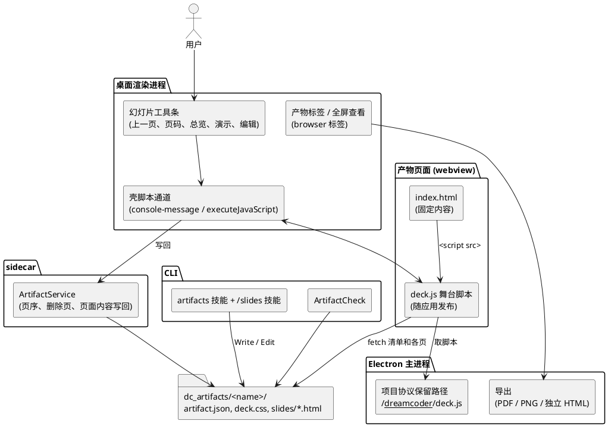
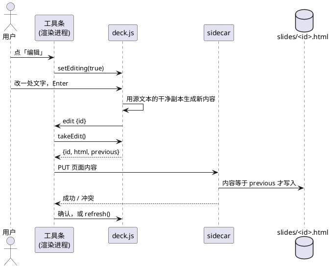

# 幻灯片（Slides）技术设计

状态：草案，2026-11-15。维护者已确认的决定列在文末「已定」；已按一轮对照源码的独立审查修订（见文末「审查后的修订」），并在真实 Electron 里验证过关键假设（见「已验证」），待最终审阅。分支 `docs/slides-tech-design`，基线 `main` 的 `ee90358d`，文中代码位置以这个提交为准。没有 PRD，目标和取舍来自维护者在对话里确认的方向。

## 背景

Artifacts 现在有两种产物：网页（`page`）和画布（`canvas`）。幻灯片在 2026-11-01 被拆出当前范围，原因写在 [Artifacts 技术设计](../artifacts/tech-design.md)的「幻灯片（以后再做）」：

- 当时的 `deck` 只是一个标签，在应用里和普通页面一样，没有翻页、总览和演示。
- 导出 PDF 只出第一页。
- open-design 的幻灯片模板各自带一套翻页脚本，没有共同结构。

这三点的根因相同：翻页、缩放、打印由每个产物自己实现。本设计把这部分收归应用，产物只保留内容。

参考了两个做法（都只学结构和思路，不复制文字和代码）：

- Claude 的 Slides 类型（2026-11-15 读它的类型说明）：一个索引、一份共用 CSS、每页一个只含 `<section>` 的 HTML 文件；画布固定 1920×1080；正文不跑脚本，另有受限的嵌入元素；用户的编辑写回 HTML。
- [frontend-slides](https://github.com/zarazhangrui/frontend-slides)（MIT）：固定舞台整体缩放；切页用 `visibility` 而不是 `display`；打印时每页一个固定尺寸的块；模板是设计说明而不是成品 HTML。

## 目标与非目标

**目标**

- 新的产物种类 `deck`：源文件是 HTML，每页一个文件，Agent 和用户改同一份文件。
- 应用提供舞台：缩放、翻页、分步出现、总览、演示。
- 导出：PDF 每页一张、当前页 PNG、可独立演示的单文件 HTML。
- 点选和评论能指明是哪一页，并给出那一页的文件路径。
- 用户能直接改文字、调整页序、删除页，改动写回源文件。
- 独立的 Slides 入口、`/slides` 技能和幻灯片模板。
- Agent 侧：格式约定、静态检查、溢出检查。
- 顺带修掉现有的问题：产物页面比面板高时，导出的 PNG 内容不对（见「导出」和「已验证」）。

**非目标**

- 导出 pptx。单独评估，不在本设计里（见「备选方案」）。
- 页面正文里运行脚本。需要脚本的内容（图表库、小演示）放进嵌入页，见「页面文件」。
- 用户拖动元素、改样式、加元素。这些仍然交给 Agent。也不为了支持这些操作去限制页面能用的标签（见「备选方案」）。
- 恢复被删除的页。
- 演讲者备注和演讲者视图。
- 4:3。只做 16:9。
- 换页过渡效果的自定义。
- 导入现有的 pptx。
- 把字体打包进应用。模板的字体保持在线加载，离线时退回系统字体。
- H5 页面里的预览，和 Artifacts 现有范围一致。

## 现状

- **产物种类**：`ARTIFACT_KINDS` 只有 `page`、`canvas`（`src/utils/artifacts.ts:13`）；清单解析在 `parseArtifactManifest`（`src/utils/artifacts.ts:142`），画布用 `boards` 字段列出画板。
- **画布的做法可以照搬**：
  - 入口是内容固定的小文件，只加载随应用发布的脚本（`CANVAS_ENTRY_HTML`，`src/utils/canvas.ts:6`），`ArtifactCheck` 核对它一字不差（`isCanvasEntryHtml`，`src/utils/canvas.ts:18`）。
  - 脚本由项目协议的保留路径提供：`serveProjectRequest` 在解析项目文件之前判断 `/__dreamcoder__/` 前缀，只返回白名单里的文件（`desktop/electron/browser.ts:281-286`，白名单 `CANVAS_SHELL_FILES` 在 `src/utils/canvas.ts:4`）。目录来自主进程的 `canvasShellDir`（`desktop/electron/main.ts:137`、`:147`）。
  - 页面到渲染进程：webview 的 `console-message`，带固定前缀并校验来源脚本（`parseCanvasMessage`，`desktop/src/lib/canvasBridge.ts:26`；监听在 `desktop/src/lib/browserGuests.ts:151-156`）。处理函数按标签登记在 `canvasHandlers` 里（`:52`、`:193`），没登记的标签，消息直接丢弃。
  - 渲染进程到页面：`webview.executeJavaScript` 调脚本暴露的对象（`refreshCanvas`，`desktop/src/lib/browserGuests.ts:198`；主题用 `applyCanvasScheme`，`:178`）。
  - 写回：渲染进程收到 `move` 后调 sidecar，sidecar 读-改-写清单并返回新的修改时间，渲染进程用它更新标签记的时间（`desktop/src/hooks/useCanvasTab.ts:19-24`，`src/server/services/artifactService.ts:361`）。
- **产物标签靠元数据识别**：产物标签是带 `root` 和 `artifact` 的 `browser` 标签，画布多一个 `canvas: true`（`desktop/src/stores/workspacePanelStore.ts:45`，设置处 `:524`）。自动刷新、导出、画布写回都只对这样的标签生效（`desktop/src/stores/artifactStore.ts:17-18`，`BrowserView.tsx:94`、`:99`）。
- **Agent 打开的标签没有这份元数据**：`navigate` 带 `newTab` 时，渲染进程只用地址开标签（`desktop/src/lib/browserControlRequests.ts:42`）。所以 Agent 打开的产物标签现在没有自动刷新和导出，Agent 打开的画布里拖动画板也不会写回。
- **全屏查看**对任何种类的产物都登记画布的处理函数（`desktop/src/components/artifacts/ArtifactViewer.tsx:37`），也对任何种类提供导出（`:39`）。
- **webview 不在标签组件里**：每个 webview 放在一个全局层里的槽位元素中，盖在标签组件留出的空白区域上（槽位在 `createGuest` 里创建，`desktop/src/lib/browserGuests.ts:102-104`）。
- **地址**：页内跳转会把标签的地址更新成当前地址（`syncPage`，`desktop/src/lib/browserGuests.ts:79-85`）。重启后重开只取地址的路径部分，`#` 后面的部分被丢掉（`resolveStoredBrowserUrl`，`desktop/src/lib/browserGuests.ts:261`）。重载用的是 `webview.reload()`（`:289-291`），重载的是 webview 当前的地址。
- **导出**：
  - 渲染进程的 `exportArtifactPage` 先暂停 Agent 设置的视口模拟，再发导出请求（`desktop/src/lib/artifactExport.ts:34-35`）。
  - PDF 用 `printToPDF({ printBackground: true, preferCSSPageSize: true })`（`desktop/electron/pageExport.ts:93`），纸张尺寸取页面自己的 `@page`。
  - PNG 在标签里的 webview 上按整页内容尺寸截取（`desktop/electron/pageExport.ts:41-52`）。探针里验证，这种截法在内容超出 webview 的可见画面时，输出的是重复的画面（见「已验证」）。
  - 独立 HTML 复制当前的 DOM，把样式表和 `<script src>` 的内容内联回文档（`desktop/electron/standaloneHtml.ts:142-148`），打开独立文件时脚本会再跑一遍。它不处理 iframe。
- **刷新**：产物文件变了就重载标签，画布改为调 `refresh()`（`desktop/src/stores/artifactStore.ts:29-32`）。
- **缩略图**：截的是页面当前显示的整个视口（`captureThumbnail`，`desktop/electron/browserCapture.ts:44-50`）。
- **点选和选区**：结果带所在文档的地址；画布标签再问脚本要画板标题作为引用的名称（`canvasBoardLabel`，`desktop/src/lib/browserGuests.ts:162`，调用处 `:409` 和 `desktop/src/lib/browserPicks.ts:76`）。文字选区的结果里没有选择器。
- **Agent 的浏览器工具**：`navigate` 接受产物文件夹（`src/server/browserHost/service.ts:407-415`），另有 `evaluate`、`press_key`、`screenshot`（`src/server/browserHost/tools.ts:198`、`:120`、`:128`）。`evaluate` 跑在页面自己的环境里，能访问页面的全局对象（`src/server/browserHost/evaluate.ts:101-108`）。
- **静态检查**：`checkArtifact` 对画布走单独分支（`src/utils/artifactCheck.ts:100`）。引用的本地文件按**所在文件的目录**解析（`referenceProblems`，`src/utils/artifactCheck.ts:51`）。设计系统的检查把「文件存在」和「入口页链接了 `tokens.css`」写在一个函数里（`src/utils/artifactCheck.ts:32-46`）。
- **模板**：
  - 目录记录的类别只有 `web`、`prototype`（`src/utils/designTemplates.ts:26`）。
  - 模板文件夹里没有清单；从模板建产物时新写一份清单，固定 `kind: 'page'`（`src/utils/designTemplates.ts:110-122`）。
  - 预览直接打开模板文件夹里的入口（`src/server/api/design.ts:44-50`）。
  - 转换脚本只认 `web`、`prototype`（`scripts/design-templates/convert.ts:12`）；缩略图脚本用 `file://` 地址在无头浏览器里截图（`scripts/design-templates/thumbnails.ts:26`）。
- **技能**：`artifacts` 技能讲产物约定（`src/skills/bundled/artifacts.ts`）；`/design` 技能带按需读取的参考文件，提示词里附模板索引（`src/skills/bundled/design.ts:246`、`:253-266`）。设计系统的用法说明要求「在产物的入口 HTML 里加样式链接」（`designSystemUsage`，`src/utils/designSystems.ts:179-184`）。
- **入口**：Artifacts 页「新建」一栏只有 Design 一个方块，旁边写「更多类型敬请期待」（`desktop/src/pages/ArtifactsPage.tsx:131-147`）。点它由 `useArtifactViewStore` 的 `openDesign` 打开 `DesignMode`（`desktop/src/pages/ArtifactsPage.tsx:58`、`:92`）；开始会话时发 `/design` 或 `/design <产物路径>`（`desktop/src/lib/startDesignSession.ts:22`）。

## 总体结构



磁盘上的文件是幻灯片内容的唯一来源。舞台脚本只负责把它们显示出来；工具条在应用里，用共享组件；写盘只经 sidecar。

## 幻灯片产物的文件

```
dc_artifacts/<name>/
  artifact.json
  index.html        固定内容，只加载舞台脚本
  deck.css          全部页面共用的样式
  slides/
    cover.html      每页一个文件
    agenda.html
  embeds/           嵌入页（可选）
  assets/           图片、字体（可选）
```

### 清单

`ArtifactManifest`（`src/utils/artifacts.ts:26`）加一个字段，`ARTIFACT_KINDS` 加 `deck`：

```ts
type ArtifactManifest = {
  version: 1
  id: string
  kind: 'page' | 'canvas' | 'deck'
  title: string
  entry: string
  designSystem?: string
  template?: { id: string; commit: string }
  boards?: ArtifactBoard[]
  slides?: string[]
}
```

- `slides` 是页面 id 的有序列表，只给 `deck` 用。页序只存在这里。
- 页面文件按约定是 `slides/<id>.html`，清单里不再存文件路径。id 只能是 `[A-Za-z0-9_-]{1,64}`。
- 页面标题不存：总览和点选要用时，取这一页第一个标题元素的文字，没有就用 id。
- `slides/` 里没列进清单的文件不显示，`ArtifactCheck` 报出来。

### 入口文件

和画布一样是固定内容，`ArtifactCheck` 核对：

```html
<!doctype html>
<html>
<head>
<meta charset="utf-8">
<title>Deck</title>
</head>
<body>
<script src="/__dreamcoder__/deck.js"></script>
</body>
</html>
```

`deck.css` 和设计系统的 `tokens.css` 由舞台脚本按清单加进文档，不写在入口里。这样入口永远不用改，升级只换应用里的脚本。

### 页面文件

- 每个文件只有一个根元素 `<section>`，前后没有别的内容：没有 `<html>`、`<head>`、`<body>`、`<style>`、`<script>`。
- 画面固定 1920×1080 像素。页面里的尺寸都按这个画面写，不用视口单位，不写响应式断点。
- 标签不限：`<section>` 里可以写任意 HTML 和 CSS。
- 样式写在 `deck.css` 里，用类名选择，不用 `#id`。`deck.css` 不给 `html`、`body` 和 `dc-` 开头的类写规则，这些归舞台脚本。
- **相对路径一律从产物文件夹算起**（已验证）：图片写 `assets/chart.png`，嵌入页写 `embeds/demo.html`，不写 `../assets/...`。原因是页面文件被插进 `index.html` 这个文档里显示，浏览器按 `index.html` 的位置解析路径。`deck.css` 就在产物文件夹里，它里面的 `url()` 也是同一个基准。单独打开一个页面文件，引用会失效，这是预期内的。
- 正文不放脚本和内联事件属性。动效用 CSS（`@keyframes`、`transition`）。
- 需要脚本的内容用嵌入页：`<iframe src="embeds/<文件>.html">`，指向产物文件夹里的一个完整 HTML 文件，在 `deck.css` 里给它定宽高。嵌入页里可以跑脚本、引用产物文件夹里的库文件。嵌入页是完整的文档，它里面的相对路径按它自己的位置解析。
- 分步出现：元素加 `class="fragment"`，按文档顺序一步出现一个。借用 reveal.js 的类名，因为模型熟悉；只借名字。
- 字体可以在线加载，也可以把文件放进产物文件夹。

**为什么正文不允许脚本**：页面文件是被舞台脚本取来、解析后插进同一个文档的，`<script>` 本来就不会执行。把它定成格式规则，导出和编辑才有确定的结果：导出取的是最终画面，编辑写回的是源文件里原有的结构。

**为什么用嵌入页**：脚本在 iframe 自己的文档里运行，不会改动幻灯片正文的节点，所以不影响上面两点。Claude 的 Slides 也是这个思路。嵌入页和画布的画板一样是同源 iframe，Agent 的快照、点击在里面可用（画布已验证，见 Artifacts 设计的「现状」）。嵌入页里的内容用户不能直接编辑。

### 设计系统

沿用清单的 `designSystem`。舞台脚本读到它，就在 `deck.css` 之前加一条指向 `../<designSystem>/tokens.css` 的样式链接。相应地：

- `ArtifactCheck` 对 `deck` 只查设计系统的文件存在，不查「入口页链接了 `tokens.css`」。现有函数把两项写在一起（`src/utils/artifactCheck.ts:32-46`），要拆开。
- 设计系统的用法说明现在要求改入口 HTML（`designSystemUsage`，`src/utils/designSystems.ts:179-184`；`/design` 的设计系统参考文件里也有同样的话）。对 `deck` 照做会改坏固定入口。这段文字改成按产物种类给：`deck` 只需在清单里写 `designSystem`。

## 舞台脚本

`deck.js` 随应用发布，和 `canvas.js` 放在同一个目录，无依赖、不需要构建。

### 渲染

1. `fetch` 相邻的 `artifact.json`，再并行 `fetch` 每个 `slides/<id>.html`。
2. 每个文件用 `DOMParser` 解析，取出唯一的 `<section>`，放进舞台自己的包装元素里。舞台的运行状态（当前页、模式）只记在包装元素和文档根上，**不往 `<section>` 里面加节点**。编辑写回依赖这一点。
3. 取不到或解析不出 `<section>` 的页显示占位，写明文件路径。
4. 舞台记住每一页载入时的源文本，刷新和编辑都用它。

文档结构：

```
body
  #dc-deck                    记当前模式
    .dc-stage                 1920×1080，整体缩放
      .dc-slide[data-slide]   每页一个包装，记是否当前页
        section#<id>          页面文件的内容
```

### 缩放和切页

- 舞台固定 1920×1080，用一个 `transform: scale()` 整体缩放到视口内，四周留边，不重排内容。
- 非当前页用 `visibility: hidden` 加 `opacity: 0` 隐藏，不用 `display: none`。`deck.css` 里的版式类（如 `display: flex`）会盖掉 `display: none`，造成几页同时显示。
- 留边的底色跟随应用主题，用画布已有的 `setScheme` 通道。页面内容的颜色由作者决定，不跟随主题。

### 三种模式

| 模式 | 用途 | 分步 | 键盘 |
|---|---|---|---|
| 浏览（默认） | 在面板里看、评论、编辑 | 全部显示最终状态 | ←/→、PageUp/PageDown、Home/End 按页翻 |
| 总览 | 所有页缩小排成网格，点一页回到浏览 | 最终状态 | 方向键移动选中，Enter 打开 |
| 演示 | 全屏放映 | 按步出现 | ←/→、空格按步，Esc 退出 |

总览用的是同一批节点换一种排法，不复制页面。

### 刷新

脚本暴露 `refresh()`，产物文件变化时由渲染进程调用（见「应用侧」的「刷新」）：

- 重新取清单和各页文件，和舞台记着的源文本比较。
- 只替换内容变了的页；按新清单增加、去掉、重排页面。
- 保留当前模式和当前页；当前页被去掉时停在相邻的页。
- 用户正在编辑、还没提交的那一页不替换。
- 没有变化时什么都不做。

用整页重载代替它会把总览、演示和编辑状态全部清掉：Agent 一页一页写幻灯片时，用户会被反复扔回浏览模式。

### 地址

- 当前页写进地址的 `#<id>`（`history.replaceState`）。加载和 `hashchange` 时按它定位。
- 用户手动重载时，`webview.reload()` 重载的是当前地址，所以停在原来那一页。
- 页内跳转后的地址会被存进标签（`desktop/src/lib/browserGuests.ts:79-85`）。`resolveStoredBrowserUrl`（`:261`）改为保留 `#` 部分，重启后也回到原来那一页。这一处改动对所有项目页面生效。
- 代价：每翻一页，标签的地址更新一次，面板状态跟着持久化一次。这是用户操作的频率，可以接受。`history.replaceState` 会触发 webview 的页内跳转事件、重载后停在原页，都已验证。

### 打印

舞台脚本自带打印样式，所有产物一致：

- `@page { size: 1920px 1080px; margin: 0 }`。
- `@media print` 下取消缩放，每个包装元素是一个 1920×1080 的块，`break-after: page`，全部可见，分步元素显示最终状态。

### 静态模式

给独立 HTML 导出用。导出的文件里，文档已经带着渲染好的舞台，`deck.js` 被内联在里面。

- 脚本等文档解析完（`DOMContentLoaded`）再判断：文档里已有 `#dc-deck` 且含页面时，不再 `fetch`，直接接管现有节点。不能在脚本一执行时就判断，因为导出文件里脚本标签可能排在舞台节点前面。
- 接管时重置导出那一刻留下的运行状态：缩放重新计算，模式回到浏览，当前页按地址或第一页，去掉 `contenteditable`。舞台自己的样式标签带固定 id，已存在就不再加第二份。
- 静态模式下没有编辑和调序，只有缩放、翻页和演示。

### 对外接口

脚本暴露 `window.__dreamcoderDeck`，给渲染进程（`executeJavaScript`）和 Agent（`evaluate` 工具）用：

| 方法 | 作用 |
|---|---|
| `state()` | 产物 id、当前页 id、序号、总页数、模式 |
| `goTo(id)`、`next()`、`prev()` | 翻页 |
| `setMode(mode)` | 切换浏览、总览、演示 |
| `setScheme(scheme)` | 留边底色 |
| `refresh()` | 见「刷新」 |
| `stageRect()` | 当前页在视口里的位置和大小，缩略图用 |
| `overflow()` | 每一页里超出 1920×1080 画面的元素，Agent 检查用 |
| `setEditing(on)`、`takeEdit()` | 见「用户编辑」 |

## 应用侧

### 壳脚本的目录和常量

现在目录叫 `canvas-shell`，常量叫 `CANVAS_*`。加了 `deck.js` 之后名字不再准确，改名为 `artifact-shell`，`desktop/public/artifact-shell/` 下放 `canvas.js` 和 `deck.js`。要动的地方：

- `src/utils/canvas.ts:1-4`：保留前缀、目录名、文件白名单移到新文件 `src/utils/artifactShell.ts`；画布专有的（入口内容、画板路径规则）留下；幻灯片专有的放 `src/utils/deck.ts`。
- `desktop/electron/main.ts`（`:23`、`:111`、`:125`、`:137`、`:147`、`:578`、`:635`）和 `desktop/electron/browser.ts`（`:277-285`、`:364`、`:479-485`）里的变量名和导入。`serveProjectRequest` 的逻辑不变，白名单多一项。
- 测试里写死的路径：`desktop/electron/browser.test.ts`、`desktop/src/lib/canvasShell.test.ts`、`src/skills/bundled/artifacts.test.ts`。
- `desktop/src/lib/canvasBridge.ts:2` 有自己的一份脚本路径常量（桌面前端代码不引用 `src/`），新的 `deckBridge.ts` 同样处理。
- Artifacts 设计文档里提到目录名的两处。
- 打包不受影响：`electron-builder.json` 整个复制 `dist`，没有配置点名这个目录。

### 页面和渲染进程的通道

沿用画布的两条通道，改三处：

1. **解析分层**：`canvasBridge.ts` 拆成通用的一层（前缀、来源脚本路径校验、JSON 解析）和各脚本自己的消息形状。新增 `deckBridge.ts`。
2. **登记项记录是哪种壳**：`canvasHandlers`（`desktop/src/lib/browserGuests.ts:52`）已经是按标签登记的表，但它把「有登记」等同于「是画布」（`canvasBoardLabel` 的 `:164`、`applyCanvasScheme` 的 `:179`）。登记项改为带上壳的种类。全屏查看（`ArtifactViewer.tsx:37`）按产物种类登记对应的处理函数，不再对所有种类都登记画布的。
3. **页面自报身份**：壳脚本加载完发一条带产物 id 的消息（幻灯片用 `state`，画布加一条 `ready`）。监听处对所有标签都解析这条消息，不要求先有登记。

幻灯片的消息（页面到渲染进程）：

| 消息 | 内容 | 何时发 |
|---|---|---|
| `state` | 产物 id、当前页 id、序号、总页数、模式 | 加载完成、翻页、模式变化、刷新后 |
| `order` | 新的 id 列表 | 总览里拖动调序结束 |
| `edit` | 页 id | 一处文字修改提交 |
| `exit` | 无 | 演示模式里按 Esc |

消息都很小。页面内容不走 `console-message`：渲染进程收到 `edit` 后用 `executeJavaScript` 调 `takeEdit()` 取回内容。`executeJavaScript` 能拿到返回值已在画布里用到（`canvasBoardLabel`，`desktop/src/lib/browserGuests.ts:170`）。

### 把标签认成产物标签

问题：Agent 用 `navigate` 打开的标签没有产物元数据（`desktop/src/lib/browserControlRequests.ts:42`）。`/slides` 的流程里，用户看着的正是 Agent 打开的那个标签；如果工具条、导出、刷新、写回都依赖元数据，它们在这个标签上全部不生效。

做法：由页面自报身份，渲染进程核对后补上元数据。

1. 收到来源校验通过的 `state`，把幻灯片状态记进这个标签的页面状态（`useBrowserStore` 里已有的每标签记录）。**工具条只看这份状态**，所以任何显示着幻灯片的标签都有翻页、总览和演示，包括 Agent 打开的、模板预览的、全屏查看的。标签跳到别的页面时清掉。
2. 标签还没有产物元数据时，用消息里的产物 id 向 sidecar 查位置（现有的 `artifactsApi.openById`，`desktop/src/lib/browserGuests.ts:274` 已在用），核对标签地址的路径确实是这个产物的入口，然后给标签补上 `root` 和 `artifact`（带 `deck: true`）。之后它和用户自己打开的产物标签没有区别：自动刷新、导出、编辑写回都生效。
3. 查不到的（模板预览的文件夹不是登记过的产物）保持原样：能翻页和演示，没有编辑。

`BrowserTabArtifact`（`desktop/src/stores/workspacePanelStore.ts:45`）加 `deck?: true`，和 `canvas?: true` 并列；用户从列表打开产物时按清单的 `kind` 设置（`:524`），校验已存标签的地方（`:360`）同步。

画布的 `ready` 走同一条路径，Agent 打开的画布标签因此也得到写回和刷新。这是现有的缺口，这次一并补上。Agent 打开的普通页面产物仍然不被识别（它没有壳脚本可以自报），不在本设计范围内。

### 刷新

`reloadTab`（`desktop/src/stores/artifactStore.ts:29-32`）现在是「画布调 `refresh()`，其它整页重载」。改成「有壳脚本的标签调壳脚本的 `refresh()`，其它整页重载」，`refreshCanvas`（`desktop/src/lib/browserGuests.ts:198`）相应改成按登记的壳种类调用。

写回之后**不更新标签记的修改时间**。下一次检查会多调一次 `refresh()`，它发现没有变化就什么都不做。画布当初更新这个时间，是因为多一次刷新会重载所有画板；幻灯片的 `refresh()` 没有这个问题，而更新时间反而会盖住同一时刻 Agent 的写入：sidecar 返回的是整个文件夹最新的修改时间（`src/server/services/artifactService.ts:378`），渲染进程记下它之后，就看不出 Agent 刚写的另一页是新的了。

### 工具条

新组件 `DeckControls`，产物标签（`BrowserView.tsx`）和全屏查看（`ArtifactViewer.tsx`）共用。

```
[‹] [›]  3 / 12   [总览] [演示]            [编辑] [删除本页]   …（导出）
```

- 全部用 `shared/ui` 的组件，文字走 i18n，中英文都加。
- 翻页、总览、演示：标签的页面状态里有幻灯片状态就显示。
- 「编辑」和「删除本页」：还要求标签有产物元数据。属于第三阶段。

### 演示

- 点「演示」：渲染进程让这个 webview 所在的**槽位元素**进入全屏（`createGuest` 里创建的那个，`desktop/src/lib/browserGuests.ts:102-104`），再调 `setMode('present')`。不能对标签组件里的区域做全屏：webview 不在它里面，全屏出来是一块空白盖在 webview 上。全屏由渲染进程发起，因为点击发生在应用界面里。
- 退出：页面发 `exit`，或全屏被系统退出时，渲染进程调 `setMode('browse')`。
- 已验证：槽位全屏时 webview 铺满，页面按新尺寸重新缩放；macOS 上窗口进入系统全屏。焦点在页面里时，Esc 先到页面、全屏不会自己退出，所以必须走上面的 `exit` 消息由渲染进程退出全屏；焦点在应用界面上时，Esc 直接退出全屏，渲染进程从全屏变化事件得知。

## 导出

幻灯片标签提供和页面一样的三种导出（`BrowserView.tsx:99` 的条件改为排除画布、不排除幻灯片；全屏查看本来就对所有种类提供）。

- **PDF**：不改导出代码。现有调用已经按页面的 `@page` 取纸张（`desktop/electron/pageExport.ts:93`），舞台脚本的打印样式让每页幻灯片占一张。已验证：3 页的幻灯片输出 3 页，每页 1440×810 点，即 1920×1080 像素。
- **PNG**：所有种类的产物都改成在隐藏窗口里渲染后截图，不再在标签里的 webview 上截。
  - 原因：webview 实际渲染的画面只有它在窗口里看得见的那么大。截取范围一旦超过这个大小，超出的部分是已有画面的重复平铺，不是真实内容。放大倍数、扩大截取范围、模拟更大的视口、临时把 webview 撑大，结果都一样（见「已验证」）。这同时是现有的问题：比面板高的网页产物，现在导出的 PNG 就是这样。
  - 做法：主进程开一个不显示的窗口，用同一个浏览器分区（项目协议只在这个分区上有），加载标签当前的地址，等页面就绪后截图，然后销毁窗口，失败时也销毁。这个窗口只加载那一个地址，禁止跳转和开新窗口。主进程里已经有给网站复刻用的隐藏窗口（`desktop/electron/backgroundBrowser.ts`），窗口的创建和防护能共用的就共用。
  - 两种尺寸，由渲染进程在导出请求里给出：
    - 幻灯片：视口 1920×1080，像素比 1，截一屏。得到正好 1920×1080 的当前页（地址里带着 `#<页 id>`）。
    - 网页：视口宽度取标签当前的宽度，像素比不变，按整页内容高度截。画面的排版和用户在标签里看到的一致，高度上限仍是 16384 像素。
  - 隐藏窗口是重新加载的页面，没有 Agent 设置的视口模拟，所以 PNG 不再需要暂停和恢复模拟（`desktop/src/lib/artifactExport.ts:34` 的条件改为只对 PDF 暂停）。
  - 代价：PNG 是页面**重新加载后**的样子，不带用户在标签里点出来的状态（展开的面板、填过的表单）。现在的导出本来能带上这些，但只在页面不超过可见范围时才是对的。画布仍然只能导出单张画板，单张画板走的也是这条路径。
- **独立 HTML**：
  - 导出前渲染进程先调 `setEditing(false)` 和 `setMode('browse')`。
  - 现有导出复制当前 DOM，并把 `deck.js` 和舞台加的样式表内联进去。打开这个文件时脚本进入静态模式（见上），结果是一个可以离线翻页和演示的单文件。
  - 嵌入页：现有导出不处理 iframe，导出后相对地址会失效。补一步：同源 iframe 按它的**源文件**生成内联版本（取文件文本、解析、内联资源），写进 `srcdoc`。不能用 iframe 当前的文档：嵌入页的脚本已经跑过一遍，序列化后再跑一遍，图表会画两次。这一步对普通页面产物同样生效。
- 嵌入页在 PDF 和 PNG 里是导出那一刻的画面。

## 缩略图

现有缩略图截的是整个视口（`desktop/electron/browserCapture.ts:44-50`），对幻灯片会带上留边，而且截到的是当时碰巧显示的那一页或总览。幻灯片只在「浏览模式、第一页」时截，并把 `stageRect()` 作为截取范围传给主进程。已验证：按范围截取可用，得到的就是不带留边的那一页（范围在 webview 的可见画面之内，不受上面 PNG 那个限制）。

## 评论和点选

- 只有当前页看得见、点得到，所以点选和文字选区一定落在当前页上。引用所属的页直接取标签状态里的当前页，不需要按元素反查。文字选区的结果里没有选择器，也只能这样做。
- 引用的名称显示「产物名 / 页标题」，发给 Agent 的文本写明 `slides/<id>.html`。
- `canvasBoardLabel` 的两个调用处（`desktop/src/lib/browserGuests.ts:409`、`desktop/src/lib/browserPicks.ts:76`）改为调一个按壳种类取名称的函数，画布和幻灯片各自实现。
- Agent 的快照只包含看得见的内容，所以只看到当前页。Agent 要看别的页，用 `evaluate` 调 `goTo(id)`。

## 用户编辑

三种操作，都只在浏览或总览模式下可用，都要求标签有产物元数据。页面格式不限标签，所以只做不依赖页面结构的操作。

### 改文字

1. 用户点工具条的「编辑」，渲染进程调 `setEditing(true)`。舞台去掉分步的运行状态，全部显示最终状态。
2. **可编辑的单位**：内部只有文字和行内元素的块级元素，比如一个标题、一个段落、一个列表项、一个单元格。点进去后它变成 `contenteditable="plaintext-only"`：能改字，里面已有的行内元素（加粗、链接、带类名的 `<span>`）保留，粘贴进来的带格式内容只留文字（已验证）。内部还有块级元素的容器不能直接编辑，要点到里面的块。嵌入页里的内容不能改。
3. Enter 提交，Esc 取消，失去焦点也提交。舞台脚本要自己拦下 Enter：不拦的话浏览器会插入一个换行。
4. 提交时，舞台用这一页的**源文本**重新解析出一份干净的副本，按元素在 `<section>` 里的位置路径找到对应元素，把编辑后元素的 `innerHTML` 放进去，序列化成新的文件内容，暂存。然后发 `edit`。
5. 渲染进程调 `takeEdit()` 取回 `{ id, html, previous }`，`previous` 是这一页的源文本。
6. 渲染进程调 sidecar 写回。sidecar 比较文件当前内容和 `previous`：一致就写入；不一致返回冲突。
7. 成功后舞台把新内容记为这一页的源文本。冲突时提示「这一页刚被改过」，舞台调 `refresh()` 载入新内容。



**为什么在页面里生成新内容，而不是在 sidecar 里改**：改 HTML 需要解析器，页面里现成有，sidecar 没有，也不该为此引入依赖。**为什么用源文本的副本而不是直接序列化当前画面**：当前画面带着舞台的运行状态，副本只包含源文件里有的东西。

**格式会被规范化**：浏览器序列化出来的 HTML 和 Agent 手写的不一定逐字相同。已知的差别有：属性引号统一成双引号、标签名小写、SVG 里的自闭合写法展开成成对标签、部分字符实体改写、布尔属性的写法。所以一页第一次被用户编辑时，除了改的那一处，还可能有这类格式变化；之后再编辑就稳定了。技能要求 Agent 按序列化后的写法写页面文件，减少这种差异，但不保证没有。

### 调页序

总览里拖动一页到新位置，舞台发 `order`，带完整的新列表。sidecar 要求新列表和清单当前的 `slides` **是同一组 id**，只是顺序不同；不是的话返回冲突，舞台调 `refresh()`。

这条规则防的是这个情况：Agent 正在往清单里加新页，用户这边的舞台还没刷新就拖了一下，发出的是旧列表。如果接口允许「新列表是旧列表的一部分」，Agent 刚加的页会被当成用户删掉的。

### 删除一页

工具条的「删除本页」，确认后调 sidecar，只带当前页的 id：从 `slides` 里去掉它，并删除对应文件。删除不可恢复。和调页序是两个接口。

### 代价

- sidecar 写的文件不进文件历史（和画板位置写回一样），用户的编辑不能用「回退」撤销。文字改错了可以再改；删掉的页不能恢复，删除前有确认框，删错了让 Agent 重做。
- Agent 不会被主动告知用户改了什么。它下一次编辑那个文件时，CLI 现有的「文件在读取后被修改」检查会让它先重读。
- sidecar 的写入会被算进当时正在运行的那个会话的「改过这个产物」记录里，即使那个会话没碰它（`endTurn`，`src/server/services/artifactService.ts:188`）。画板位置写回现在也是这样。

## Agent 侧

### 技能

- `artifacts` 技能：`kind` 说明加 `deck`，给出固定入口的原文和文件布局。
- 新的内置技能 `/slides`，用户可调用，模型也可自行调用，和 `/design` 分开。注册方式同 `/design`（`src/skills/bundled/design.ts:253`）：正文短，讲总流程（访谈、选模板或从零开始、设计系统、制作、检查），具体做法放参考文件按需读取。文字自己写：
  - `format.md`：上文「页面文件」的规则，包括相对路径的基准、嵌入页的写法、按序列化后的写法写 HTML。
  - `interview.md`：先问清是演讲用还是阅读用（决定每页的内容量）、大约多少页、内容从哪来、风格或设计系统。
  - `layout.md`：画面边距、字号下限、一页一个要点、同类页面用同一套结构；内容放不下就拆页，不缩字。
  - `checks.md`：见下面两节。
  - 设计系统的提取方法和 `/design` 共用同一份参考内容；「怎么套用」那一步按产物种类给（见上文「设计系统」）。
- 制作顺序：先写清单、`deck.css` 和封面，在新标签打开给用户看，再写其余页面。每加一页同时更新清单。
- 模板索引各用各的：`/slides` 的提示词只列幻灯片模板，`/design` 的只列网页和原型（`renderDesignTemplateIndex` 的调用处按类别过滤，`src/skills/bundled/design.ts:246`）。带产物路径调用时（`/slides <产物路径>`）跳过选模板，做法同 `/design`（`src/skills/bundled/design.ts:236-244`）。
- 选模板工具接受目录里的任何模板 id，不按技能限制。两个技能各自的索引里没有对方的模板，所以不另加限制。
- `/design` 的描述和正文加一句：要做幻灯片时改用 `/slides`。

### 静态检查

`checkArtifact`（`src/utils/artifactCheck.ts:100`）加 `deck` 分支。仓库的 CLI 一侧没有 HTML 解析库，结构检查用文本匹配：

- 入口是固定内容；`deck.css` 存在。
- `slides` 里的 id 合法、不重复，对应文件存在。
- 每个页面文件以 `<section` 开头、以 `</section>` 结尾，没有 `<script>` 和内联事件属性。
- 引用的本地文件存在。**页面文件的引用按产物文件夹解析**，不是按页面文件所在的 `slides/`；`referenceProblems`（`src/utils/artifactCheck.ts:48-58`）现在固定按所在文件的目录解析，要加一个基准目录参数。`deck.css` 和嵌入页按各自的位置解析。
- 嵌入页必须在这个产物的文件夹内。现有检查只要求在 `dc_artifacts/` 内，这是一条新规则。
- `slides/` 里有文件没列进清单时报出来。

### 溢出检查

内容超出画面只有渲染后才看得出来。Agent 在标签里打开产物后，用 `evaluate` 调 `__dreamcoderDeck.overflow()`，得到每页超出画面的元素；再对拿不准的页 `goTo` 后截图。`checks.md` 写明：只查 `scrollHeight` 不够，重叠要看截图。

## 模板

- **类别**：`DesignTemplateCategory`（`src/utils/designTemplates.ts:26`）加 `slides`。
- **模板文件夹就是一份完整的幻灯片产物**：固定入口、`artifact.json`（带 `kind: 'deck'` 和 `slides`）、`deck.css`、各页文件，加一份设计说明作为上下文文件。带清单是必须的：预览直接打开模板文件夹（`src/server/api/design.ts:44-50`），舞台脚本要读清单才知道有哪些页。
- **从模板建产物**：`createArtifactFromTemplate` 现在总是新写一份清单并覆盖（`src/utils/designTemplates.ts:110-122`），对幻灯片会把 `slides` 丢掉，建出一份空的。改成：类别是 `slides` 时读模板自带的清单，保留 `kind` 和 `slides`，换上新的 `id`、标题、`designSystem` 和 `template`。
- **给 Agent 的模板说明**按种类给：现在的说法是「入口文件就是要改的示例」（`designTemplateGuidance`，`src/utils/designTemplates.ts:131`），对幻灯片入口是固定的壳，要改的是 `deck.css` 和 `slides/`。
- **来源**：[beautiful-html-templates](https://github.com/zarazhangrui/beautiful-html-templates)，固定在提交 `e5e204fb`（2026-06-09）。34 套，每套有设计说明（`design.md`）、一份约 10 页的示例幻灯片（`template.html`）和元数据（`template.json`：气质、场合、正式程度、密度、配色、字体）。frontend-slides 的模板包是它的一个子集（只有设计说明），所以直接从这个仓库收。
- **许可**（2026-11-15 核实）：MIT，`Copyright (c) 2026 Zara Zhang`。模板里没有图片和字体文件。字体都是在线加载：主要是 Google Fonts，另有 8 套通过 CDN 加载中文字体。我们不分发字体文件；我们现有的网页模板里也有 25 个这样加载 Google Fonts。
- **转换**（一次性，脚本放 `scripts/design-templates/`）。现有的转换和缩略图脚本是为单页模板写的，幻灯片要一条自己的路径：
  1. 34 套全收。
  2. 把每套的示例幻灯片拆成我们的结构：共用样式进 `deck.css`，每页一个文件，翻页脚本去掉，随视口变化的数值按比例换算到 1920×1080，生成清单。示例里依赖脚本的效果改成 CSS，或放进嵌入页。这一步由模型做，维护者抽查。
  3. 设计说明原样带入，前面加一段声明：尺寸和结构以本设计的格式为准。
  4. 元数据转成目录记录的标签和风格描述。
  5. 缩略图：现有脚本用 `file://` 打开入口（`scripts/design-templates/thumbnails.ts:26`），幻灯片的入口要从保留路径取 `deck.js`、要 `fetch` 清单，`file://` 下都不行。缩略图脚本对幻灯片改为起一个只在脚本里用的本地静态服务，同时提供模板文件夹和 `deck.js`，按 1920×1080 截第一页。
  6. 许可证和来源写进目录记录和 `THIRD_PARTY_NOTICES.md`。
- `daisy-days` 的装饰 SVG 里有制作工具的署名注释，转换时去掉（上游的设计说明写明可以去掉）。

## 入口

Slides 是独立入口，不并进 Design。

- **Artifacts 页**：「新建」一栏加「Slides」方块，和 Design 并排；去掉「更多类型敬请期待」这句。
- **Slides 开始页**：点方块进入。上方选项目，下面是幻灯片模板库（缩略图、标题、标签、搜索）和「从零开始」。
  - 「用这个模板创建」：sidecar 把模板复制进 `dc_artifacts/<name>/` 并写清单，新开会话，发 `/slides <产物路径>`。
  - 「从零开始」：新开会话，发 `/slides`。
  - 可以选设计系统，做法同 Design 页。
- **会话里输入 `/slides`**：当前会话直接开始，Agent 先访谈，再按需要用选模板工具推荐幻灯片模板。
- **Design 页不出现幻灯片**。

**实现上不复制 Design 页**：现在的 `DesignMode`（`desktop/src/components/design/DesignMode.tsx:31`）把项目选择、模板库、搜索、设计系统选择写在一个组件里。改成一个按「范围」取参数的开始页：范围决定可见的模板类别、是否显示类别筛选和「复刻网站」入口、开始会话时发的命令。Design 和 Slides 是它的两种范围。`startDesignSession`（`desktop/src/lib/startDesignSession.ts:13`）加一个命令参数，不另写一份。

## 加了 `deck` 和 `slides` 之后要同步的地方

种类和类别在前后端各有一份定义，TypeScript 不会全部报出来：

- 产物种类：`src/utils/artifacts.ts:13`；`desktop/src/types/artifact.ts:1`；种类的显示名 `desktop/src/lib/artifactDisplay.ts:5-8`（这张表的类型是 `Record<string, …>`，漏了 `deck` 不会报错，运行时拿到空值）；i18n 的 `artifacts.kind.*`，中英文各一条。
- 模板类别：`src/utils/designTemplates.ts:26`；`desktop/src/types/design.ts:1`；类别的显示名 `desktop/src/lib/designTemplates.ts:5-8`；`DesignMode.tsx:157` 里写死的类别列表，以及「全部」现在不过滤类别（`:69`）；选模板卡片 `DesignTemplateChoice.tsx`。
- 转换脚本的测试里有一条断言「没有 slides 类别」（`scripts/design-templates/convert.test.ts`），要改。

## 接口

| 接口 | 方向 | 说明 |
|---|---|---|
| 清单 `kind: 'deck'`、`slides` | 文件 | 页面 id 的有序列表 |
| 保留路径 `/__dreamcoder__/deck.js` | 页面 → 主进程 | 白名单加一项 |
| `window.__dreamcoderDeck` | 渲染进程、Agent → 页面 | 见「对外接口」 |
| `state`、`order`、`edit`、`exit` | 页面 → 渲染进程 | `console-message`，前缀 `dreamcoder-deck:`，校验来源脚本 |
| 画布的 `ready` | 页面 → 渲染进程 | 带产物 id，用于把标签认成产物标签 |
| `PATCH /api/artifacts/slides/order` | 渲染进程 → sidecar | `dir`、`name`、`slides`。必须和清单当前的列表是同一组 id，否则 409 |
| `DELETE /api/artifacts/slides` | 渲染进程 → sidecar | `dir`、`name`、`id`。从清单去掉这个 id 并删除文件 |
| `PUT /api/artifacts/slides/content` | 渲染进程 → sidecar | `dir`、`name`、`id`、`html`、`previous`。id 必须在清单里；文件当前内容等于 `previous` 才写入，否则 409 |
| PNG 导出请求 | 渲染进程 → 主进程 | 带渲染视口：宽度、可选的高度和像素比。主进程在隐藏窗口里按它渲染后截图；没给高度时按整页内容高度截 |
| 缩略图请求的截取范围 | 渲染进程 → 主进程 | 可选的范围 |
| 独立 HTML 导出 | 主进程 | 同源 iframe 按源文件内联成 `srcdoc` |
| `resolveStoredBrowserUrl` | 渲染进程 | 重开时保留地址的 `#` 部分 |
| `ArtifactCheck` | Agent | `deck` 分支；引用检查加基准目录参数 |
| `createArtifactFromTemplate` | CLI 与 sidecar 共用 | 幻灯片模板保留自带清单的 `kind` 和 `slides` |
| 设计系统用法说明 | CLI | 按产物种类给 |
| 模板目录 | 文件 | 类别加 `slides` |
| 内置技能 `/slides` | 用户、Agent | 可带产物路径；参考文件按需读取 |
| 开始会话 | 渲染进程 | `startDesignSession` 加命令参数（`/design` 或 `/slides`） |

三个新的 sidecar 接口放在 `/api/artifacts/` 下，目录校验用 `resolveArtifactsDir`，和画板写回同一套（`src/server/services/artifactService.ts:323`、`:361`）。

## 失败与边界

- 某页文件取不到或格式不对：这一页显示占位和文件路径，其余页正常。
- 清单的 `slides` 为空：显示「还没有页面」。
- 地址里的 `#<id>` 不存在（那一页被删了）：回到第一页。
- 写回和调序的冲突：见「用户编辑」。
- 页面正文里有脚本：不执行；`ArtifactCheck` 报错。
- 嵌入页文件不存在：iframe 是空的；`ArtifactCheck` 报错。

## 安全

- 产物页面和现在一样跑在侧边浏览器的沙箱里，没有 preload。页面文件由 Agent 写在用户的项目里，和其它产物同等对待。
- 页面发来的消息一律校验：来源必须是舞台脚本的地址，形状必须正确。
- 页面自报的产物 id 不直接采信：渲染进程向 sidecar 查到这个产物的位置后，核对标签地址确实是它的入口，才补元数据。
- 写回只能改这个产物清单里列出的页面文件和清单的 `slides` 字段。sidecar 校验目录在已登记的 `dc_artifacts/` 内、id 合法且在清单里；内容大小设上限。
- 「正文不允许脚本」是格式规则，不是安全边界。嵌入页和正文同源，能访问外层文档，这和画布的画板相同。它发的 `console-message` 来源不是舞台脚本，会被丢弃；即使设法伪造了消息，能做的也只是改它自己这个产物的页面。

## 测试

- 清单解析：`deck` 和 `slides` 的合法与非法形状（`src/utils/__tests__/artifacts.test.ts`）。
- `ArtifactCheck` 的 `deck` 分支逐条，包括「页面文件的引用按产物文件夹解析」和「嵌入页在产物文件夹内」。
- 舞台脚本（和 `canvasShell.test.ts` 同样的方式在 DOM 环境里跑）：渲染、翻页、分步、地址定位、总览、`overflow`；`refresh()` 只替换变了的页并保留模式；静态模式在脚本排在舞台节点之前时也能接管，并重置运行状态；编辑生成的新内容只改动目标元素、保留行内元素、不带运行状态。
- `deckBridge` 的消息解析：前缀、来源、形状。
- 把标签认成产物标签：没有元数据的标签收到 `state` 后补上元数据；地址和产物入口对不上时不补；模板预览只有工具条没有编辑。
- sidecar：调序（同一组 id 通过，多一个或少一个 409）、删除页、内容写回（一致写入、不一致 409、id 不在清单里拒绝）。
- 桌面：工具条按页面状态显示；`order`、`edit` 触发对应接口；写回后不改标签的修改时间；点选和文字选区的引用带当前页的标题和文件路径；开始页两种范围各自的模板和命令；全屏查看按种类登记处理函数。
- 导出：PNG 走隐藏窗口，幻灯片和网页各自的视口参数，窗口用完即销毁、失败时也销毁，只有 PDF 暂停模拟；长页面的 PNG 内容正确要在真实 Electron 里验收（单元测试里的截图是模拟的，查不出这个问题）；独立 HTML 把同源 iframe 按源文件内联成 `srcdoc`；PDF 页数在真实 Electron 里验收，不进单元测试。
- 模板和技能：从幻灯片模板建出的清单保留 `slides`；`/slides` 的索引只含幻灯片模板，`/design` 的不含；设计系统用法说明对 `deck` 不提入口 HTML。

## 分阶段

按依赖顺序。每个阶段结束都是能用的状态。

**第一阶段：格式和查看**

- 清单 `deck`、固定入口、壳脚本目录改名、`deck.js`（渲染、缩放、三种模式、刷新、地址、打印、静态模式）。
- 通道的三处改动；把标签认成产物标签（含画布的 `ready`）；刷新改走壳脚本；工具条（翻页、页码、总览、演示）。
- PNG 导出改到隐藏窗口（对所有种类生效，先在应用里用一个长页面复现现有问题，改完再验一次）。
- 幻灯片的三种导出，含独立 HTML 对 iframe 的内联；缩略图；点选带页信息；重开保留 `#`。
- `ArtifactCheck` 的 `deck` 分支；`artifacts` 技能和 `/slides` 技能（此时还没有模板索引，从零开始）；设计系统用法说明按种类给。
- 种类 `deck` 的各处同步。

结束时：Agent 能做幻灯片，用户能看、演示、评论、导出。

**第二阶段：模板和入口**

- 模板类别及各处同步、从模板建产物保留清单、幻灯片的转换和缩略图脚本、34 套的转换和抽查。
- `/slides` 的模板索引、开始页按范围取参数、Artifacts 页的 Slides 方块。

**第三阶段：用户编辑**

- 改文字、调页序、删除页，以及三个写回接口。

## 已验证

2026-11-15，用一个独立的探针程序验证：Electron 45.0.0（Chrome 156），macOS，像素比 2。探针用和应用相同的条件搭了一个最小环境：自定义的项目协议（同样的权限）、沙箱且无 preload 的 webview、放在固定定位的槽位里；另写了一个只有几十行的舞台脚本原型和一份 3 页的幻灯片。探针和原型都是临时文件，不在仓库里。

| 要确认的事 | 结果 |
|---|---|
| 页面文件里的相对路径按产物文件夹解析 | 成立。`assets/` 下的图片加载成功，`embeds/` 下的嵌入页加载成功、脚本运行、外层文档能读到它的内容 |
| PDF 按幻灯片分页 | 成立。3 页幻灯片输出 3 页，每页 1440×810 点（1920×1080 像素） |
| `history.replaceState` 更新标签地址 | 成立。webview 触发页内跳转事件，地址带上 `#<id>`；`reload()` 之后仍在那一页 |
| `contenteditable="plaintext-only"` 可用 | 成立。输入的字插进去，原有的 `<span>` 保留；插入带格式的 HTML 时只留下文字。Enter 会插入换行，需要脚本拦截 |
| 槽位元素全屏 | 成立。webview 铺满，页面重新缩放；macOS 进入系统全屏 |
| 全屏时 Esc 的去向 | 焦点在页面里：页面收到按键，全屏不退出。焦点在应用界面：直接退出全屏 |
| 用带放大倍数的截取范围导出 1920×1080 的 PNG | **不成立**。输出是已有画面的重复平铺 |
| 模拟一个 1920×1080 的视口再截 | **不成立**。页面按新尺寸排版了，但截到的仍是平铺 |
| 临时把 webview 撑到内容那么高再截 | **不成立**。页面的视口变高了，截到的仍是平铺 |
| 在隐藏窗口里渲染后截 | 成立。幻灯片得到正好 1920×1080，细线清晰，嵌入页的脚本正常运行；3000 像素高的页面 6 段颜色全部正确 |
| 按范围截缩略图 | 成立 |

没覆盖的：

- 按键是程序合成的，没有用真实键盘在系统全屏下试过 Esc。
- 只在 macOS 上试过。Windows 上的全屏和像素比没有验证。
- 探针里的舞台脚本是原型，不是最终实现。

### 现有的 PNG 导出有同样的问题（本任务一并修）

上面那条限制不只影响幻灯片。探针用应用现有的截图参数（`desktop/electron/pageExport.ts:41-52`）去截一个比 webview 高的普通页面（6 段不同颜色，共 3000 像素高），得到的图尺寸是对的，但内容全是第一屏的重复，后面 5 段颜色都没有出现。同一个页面放进隐藏窗口用同样的参数截，6 段颜色全部正确。

也就是说，网页产物比面板高时，现在导出的 PNG 是重复的画面。这是在探针里看到的，还没有在应用里复现，实现时第一步先复现。维护者 2026-11-15 决定在本任务里一并修，做法见「导出」。

## 备选方案

- **像 Claude 那样限制页面能用的标签，换取移动元素、改颜色、新增页等编辑能力**。Claude 只允许一组固定的标签，结构可预期，这些编辑才能可靠地写回。没选：用户身边随时有 Agent，这些改动说一句就行；格式收紧后模板的表现力受限，风格强的模板要改写才能收录。
- **整个幻灯片一个 HTML 文件，所有 `<section>` 写在一起**（frontend-slides 和 open-design 模板的做法）。更像普通网页，正文也能保留脚本。没选，因为：Agent 改一页要先读整个文件；用户编辑的冲突粒度是整份幻灯片；调页序要改写大文件。
- **每页一个完整的 HTML，放进 iframe**（画布画板的做法）。每页互相隔离，可以跑脚本。没选，因为：iframe 不会跨页分页，PDF 要逐页打印再合并，得引入合并 PDF 的库；Agent 的快照额度按 iframe 均分；共用样式要每页各引一遍。
- **引入 reveal.js**。它自带页面结构、主题和控件，而控件我们要用应用自己的界面；编辑写回和与应用的通信它都不管。能省的只有翻页和分步，这部分很小。
- **Markdown 生成幻灯片**（Marp、Slidev）。版式受限，Slidev 还需要构建。
- **工具条放在页面里**（画布的做法）。画布为此在脚本里维护了一份中英文字表，并专门加了主题通道（`desktop/public/canvas-shell/canvas.js:9-13`，`desktop/src/lib/browserGuests.ts:178`）。幻灯片的控件更多，放在应用里可以直接用共享组件、i18n 和主题。代价是独立 HTML 导出里没有按钮，只有键盘操作。
- **Agent 打开标签时由 sidecar 把产物信息一并传给渲染进程**，代替「页面自报身份」。sidecar 在 `navigate` 里确实知道这是哪个产物（`src/server/browserHost/service.ts:412`）。没选：开新标签和在已有标签里跳转是两条不同的请求路径，都要改，还要处理标签跳走之后元数据失效；页面自报只有一处，而且对「怎么打开的」不敏感。
- **文件变化时整页重载，靠地址里的页号回到原处**（本文第一版的做法）。没选：重载会清掉总览、演示和编辑状态。
- **并进 Design，共用 `/design`**。访谈、设计系统、检查回路确实相近。没选：维护者决定入口分开，和 Claude 的做法一致；共用的部分通过共享开始页组件和共享参考内容实现，不靠合并入口。
- **导出 pptx**。从固定尺寸的页面换算成 PowerPoint 的原生形状是可行的方向（dom-to-pptx，MIT），本设计的固定舞台正是它需要的前提。但它是新依赖，还原度没有实测，所以单独评估，不放进本设计。

## 待定问题

暂无。实现中遇到的问题记在这里，定了之后写回相应章节。

## 已定

维护者 2026-11-15 确认：

- 页面正文不跑脚本，需要脚本的内容用嵌入页。
- 用户编辑只做改文字、调页序、删除页；页面格式保持自由，不限制标签。
- 删除的页不做恢复。
- Slides 是独立入口和独立技能 `/slides`，不并进 Design。
- 34 套模板全收。许可已核实，见「模板」。
- 现有 PNG 导出在长页面上的问题，在本任务里一并修。

## 审查后的修订

2026-11-15 由一个独立的子代理对照 `ee90358d` 的源码审查了本文的第一版。引用的代码位置全部核对无误；下面是它发现并已改进的问题，四个「会出错」的由我对照代码复核过。

| 问题 | 原来的写法 | 现在的写法 |
|---|---|---|
| 页面文件里的相对路径，运行时按 `index.html` 解析，检查工具却按 `slides/` 解析，文中的嵌入页示例会被报成文件不存在 | 没有说明基准 | 一律从产物文件夹算起，检查工具加基准目录参数 |
| 调序接口允许「新列表是旧列表的一部分」并删除少掉的页；舞台还没刷新时拖一下，会删掉 Agent 刚加的页 | 调序和删除共用一个接口 | 调序必须是同一组 id；删除是单独的接口，只带一个 id |
| 从模板建产物总是新写清单，幻灯片会建成空的；模板文件夹没有清单，预览也读不到页面 | 只改 `kind` | 模板自带清单，建产物时保留 `kind` 和 `slides` |
| Agent 打开的标签没有产物元数据，工具条、导出、刷新、写回在用户实际看着的标签上都不生效 | 全部依赖标签元数据 | 页面自报身份，渲染进程核对后补元数据；工具条只看页面状态 |
| 写回后更新标签的修改时间，会盖住同一时刻 Agent 的写入 | 照搬画布的做法 | 写回后不更新；多出的一次刷新不做任何事 |
| 文件变化时整页重载，会把用户扔回浏览模式 | 靠地址回到原页 | 舞台脚本提供 `refresh()` |
| 全屏查看对所有种类登记画布的处理函数，会和幻灯片的冲突 | 没有提到 | 登记项带壳的种类，按产物种类登记 |
| 独立 HTML 里脚本可能排在舞台节点之前，静态模式判断失败；导出时的运行状态会被原样带出 | 脚本启动时判断 | 文档解析完再判断，并重置运行状态；导出前退出编辑和演示 |
| 嵌入页从当前文档导出，脚本会跑两遍 | 内联当前文档 | 按源文件生成 |
| PNG 的截取范围在暂停视口模拟之前取，数值不对 | 先取范围再导出 | 这条路径后来被验证推翻，改为在隐藏窗口里渲染，见「已验证」 |
| 设计系统的用法说明让 Agent 改入口 HTML，会改坏固定入口 | 两个技能共用原文 | 按产物种类给 |
| 全屏的对象写的是标签里的区域，webview 不在里面 | 「承载 webview 的容器」 | 明确是槽位元素 |
| 改文字时元素里的行内标签会丢 | 没有说明 | 写回 `innerHTML`，并规定可编辑的单位 |
| 模板的转换和缩略图脚本只支持单页模板 | 「同一套流程」 | 幻灯片单独一条路径 |
| 种类和类别在前后端各有一份定义，有的漏了不会报错 | 没有列出 | 单列一节 |
| 文字选区的结果里没有选择器，不能按元素反查所属的页 | `slideOf(selector)` | 直接取当前页，去掉这个方法 |
| 序列化的差别不止引号和大小写 | 「只产生一处差异」 | 如实写明会规范化 |
| 缩略图会截到当时显示的任意一页，带留边 | 没有提到 | 只截第一页，按舞台范围截 |
