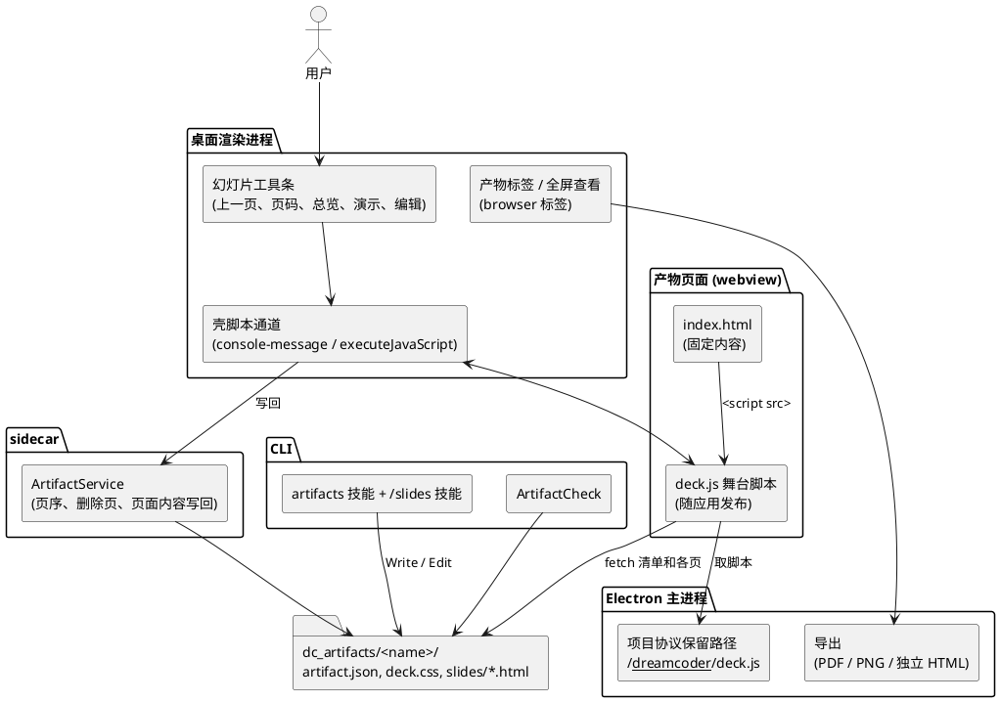
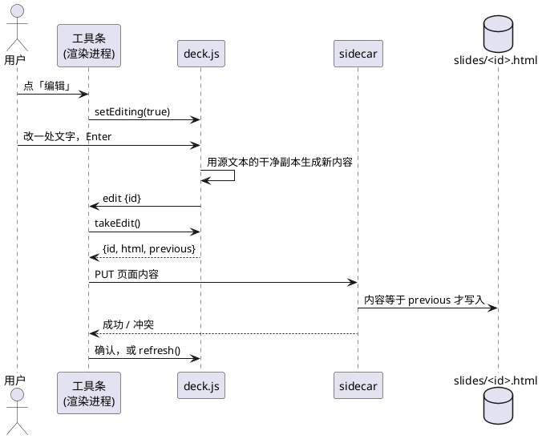

# 幻灯片（Slides）技术设计

状态：第一阶段（格式和查看）已实现，2026-11-15，分支 `feat/slides`。第二阶段（模板和入口）已实现，34 套模板全部转换（先 3 套试点，维护者看过后批量转换其余 31 套）。第三阶段未做。维护者已确认的决定列在文末「已定」；已按一轮对照源码的独立审查修订（见文末「审查后的修订」），并在真实 Electron 里验证过关键假设和第一阶段的实现（见「已验证」）。实现和本文原稿不一致的地方已改进正文，并逐条列在文末「第一阶段的实现」。「现状」一节描述的是实现之前的代码（基线 `main` 的 `ee90358d`），那里的代码位置以这个提交为准。没有 PRD，目标和取舍来自维护者在对话里确认的方向。

## 背景

Artifacts 现在有两种产物：网页（`page`）和画布（`canvas`）。幻灯片在 2026-11-01 被拆出当前范围，原因写在 [Artifacts 技术设计](../artifacts/tech-design.md)的「幻灯片（以后再做）」：

- 当时的 `deck` 只是一个标签，在应用里和普通页面一样，没有翻页、总览和演示。
- 导出 PDF 只出第一页。
- open-design 的幻灯片模板各自带一套翻页脚本，没有共同结构。

这三点的根因相同：翻页、缩放、打印由每个产物自己实现。本设计把这部分收归应用，产物只保留内容。

参考了两个做法（都只学结构和思路，不复制文字和代码）：

- Claude 的 Slides 类型（2026-11-15 读它的类型说明）：一个索引、一份共用 CSS、每页一个只含 `<section>` 的 HTML 文件；画布固定 1920×1080；正文不跑脚本，另有受限的嵌入元素；用户的编辑写回 HTML。
- [frontend-slides](https://github.com/zarazhangrui/frontend-slides)（MIT）：固定舞台整体缩放；切页用 `visibility` 而不是 `display`；打印时每页一个固定尺寸的块；模板是设计说明而不是成品 HTML。

## 目标与非目标

**目标**

- 新的产物种类 `deck`：源文件是 HTML，每页一个文件，Agent 和用户改同一份文件。
- 应用提供舞台：缩放、翻页、分步出现、总览、演示。
- 导出：PDF 每页一张、当前页 PNG、可独立演示的单文件 HTML。
- 点选和评论能指明是哪一页，并给出那一页的文件路径。
- 用户能直接改文字、调整页序、删除页，改动写回源文件。
- 独立的 Slides 入口、`/slides` 技能和幻灯片模板。
- Agent 侧：格式约定、静态检查、溢出检查。
- 顺带修掉现有的问题：产物页面比面板高时，导出的 PNG 内容不对（见「导出」和「已验证」）。

**非目标**

- 导出 pptx。单独评估，不在本设计里（见「备选方案」）。
- 页面正文里运行脚本。需要脚本的内容（图表库、小演示）放进嵌入页，见「页面文件」。
- 用户拖动元素、改样式、加元素。这些仍然交给 Agent。也不为了支持这些操作去限制页面能用的标签（见「备选方案」）。
- 恢复被删除的页。
- 演讲者备注和演讲者视图。
- 4:3。只做 16:9。
- 换页过渡效果的自定义。
- 导入现有的 pptx。
- 把字体打包进应用。模板的字体保持在线加载，离线时退回系统字体。
- H5 页面里的预览，和 Artifacts 现有范围一致。

## 现状

本节是第一阶段实现之前的状态，保留作为设计的依据。

- **产物种类**：`ARTIFACT_KINDS` 只有 `page`、`canvas`（`src/utils/artifacts.ts:13`）；清单解析在 `parseArtifactManifest`（`src/utils/artifacts.ts:142`），画布用 `boards` 字段列出画板。
- **画布的做法可以照搬**：
  - 入口是内容固定的小文件，只加载随应用发布的脚本（`CANVAS_ENTRY_HTML`，`src/utils/canvas.ts:6`），`ArtifactCheck` 核对它一字不差（`isCanvasEntryHtml`，`src/utils/canvas.ts:18`）。
  - 脚本由项目协议的保留路径提供：`serveProjectRequest` 在解析项目文件之前判断 `/__dreamcoder__/` 前缀，只返回白名单里的文件（`desktop/electron/browser.ts:281-286`，白名单 `CANVAS_SHELL_FILES` 在 `src/utils/canvas.ts:4`）。目录来自主进程的 `canvasShellDir`（`desktop/electron/main.ts:137`、`:147`）。
  - 页面到渲染进程：webview 的 `console-message`，带固定前缀并校验来源脚本（`parseCanvasMessage`，`desktop/src/lib/canvasBridge.ts:26`；监听在 `desktop/src/lib/browserGuests.ts:151-156`）。处理函数按标签登记在 `canvasHandlers` 里（`:52`、`:193`），没登记的标签，消息直接丢弃。
  - 渲染进程到页面：`webview.executeJavaScript` 调脚本暴露的对象（`refreshCanvas`，`desktop/src/lib/browserGuests.ts:198`；主题用 `applyCanvasScheme`，`:178`）。
  - 写回：渲染进程收到 `move` 后调 sidecar，sidecar 读-改-写清单并返回新的修改时间，渲染进程用它更新标签记的时间（`desktop/src/hooks/useCanvasTab.ts:19-24`，`src/server/services/artifactService.ts:361`）。
- **产物标签靠元数据识别**：产物标签是带 `root` 和 `artifact` 的 `browser` 标签，画布多一个 `canvas: true`（`desktop/src/stores/workspacePanelStore.ts:45`，设置处 `:524`）。自动刷新、导出、画布写回都只对这样的标签生效（`desktop/src/stores/artifactStore.ts:17-18`，`BrowserView.tsx:94`、`:99`）。
- **Agent 打开的标签没有这份元数据**：`navigate` 带 `newTab` 时，渲染进程只用地址开标签（`desktop/src/lib/browserControlRequests.ts:42`）。所以 Agent 打开的产物标签现在没有自动刷新和导出，Agent 打开的画布里拖动画板也不会写回。
- **全屏查看**对任何种类的产物都登记画布的处理函数（`desktop/src/components/artifacts/ArtifactViewer.tsx:37`），也对任何种类提供导出（`:39`）。
- **webview 不在标签组件里**：每个 webview 放在一个全局层里的槽位元素中，盖在标签组件留出的空白区域上（槽位在 `createGuest` 里创建，`desktop/src/lib/browserGuests.ts:102-104`）。
- **地址**：页内跳转会把标签的地址更新成当前地址（`syncPage`，`desktop/src/lib/browserGuests.ts:79-85`）。重启后重开只取地址的路径部分，`#` 后面的部分被丢掉（`resolveStoredBrowserUrl`，`desktop/src/lib/browserGuests.ts:261`）。重载用的是 `webview.reload()`（`:289-291`），重载的是 webview 当前的地址。
- **导出**：
  - 渲染进程的 `exportArtifactPage` 先暂停 Agent 设置的视口模拟，再发导出请求（`desktop/src/lib/artifactExport.ts:34-35`）。
  - PDF 用 `printToPDF({ printBackground: true, preferCSSPageSize: true })`（`desktop/electron/pageExport.ts:93`），纸张尺寸取页面自己的 `@page`。
  - PNG 在标签里的 webview 上按整页内容尺寸截取（`desktop/electron/pageExport.ts:41-52`）。探针里验证，这种截法在内容超出 webview 的可见画面时，输出的是重复的画面（见「已验证」）。
  - 独立 HTML 复制当前的 DOM，把样式表和 `<script src>` 的内容内联回文档（`desktop/electron/standaloneHtml.ts:142-148`），打开独立文件时脚本会再跑一遍。它不处理 iframe。
- **刷新**：产物文件变了就重载标签，画布改为调 `refresh()`（`desktop/src/stores/artifactStore.ts:29-32`）。
- **缩略图**：截的是页面当前显示的整个视口（`captureThumbnail`，`desktop/electron/browserCapture.ts:44-50`）。
- **点选和选区**：结果带所在文档的地址；画布标签再问脚本要画板标题作为引用的名称（`canvasBoardLabel`，`desktop/src/lib/browserGuests.ts:162`，调用处 `:409` 和 `desktop/src/lib/browserPicks.ts:76`）。文字选区的结果里没有选择器。
- **Agent 的浏览器工具**：`navigate` 接受产物文件夹（`src/server/browserHost/service.ts:407-415`），另有 `evaluate`、`press_key`、`screenshot`（`src/server/browserHost/tools.ts:198`、`:120`、`:128`）。`evaluate` 跑在页面自己的环境里，能访问页面的全局对象（`src/server/browserHost/evaluate.ts:101-108`）。
- **静态检查**：`checkArtifact` 对画布走单独分支（`src/utils/artifactCheck.ts:100`）。引用的本地文件按**所在文件的目录**解析（`referenceProblems`，`src/utils/artifactCheck.ts:51`）。设计系统的检查把「文件存在」和「入口页链接了 `tokens.css`」写在一个函数里（`src/utils/artifactCheck.ts:32-46`）。
- **模板**：
  - 目录记录的类别只有 `web`、`prototype`（`src/utils/designTemplates.ts:26`）。
  - 模板文件夹里没有清单；从模板建产物时新写一份清单，固定 `kind: 'page'`（`src/utils/designTemplates.ts:110-122`）。
  - 预览直接打开模板文件夹里的入口（`src/server/api/design.ts:44-50`）。
  - 转换脚本只认 `web`、`prototype`（`scripts/design-templates/convert.ts:12`）；缩略图脚本用 `file://` 地址在无头浏览器里截图（`scripts/design-templates/thumbnails.ts:26`）。
- **技能**：`artifacts` 技能讲产物约定（`src/skills/bundled/artifacts.ts`）；`/design` 技能带按需读取的参考文件，提示词里附模板索引（`src/skills/bundled/design.ts:246`、`:253-266`）。设计系统的用法说明要求「在产物的入口 HTML 里加样式链接」（`designSystemUsage`，`src/utils/designSystems.ts:179-184`）。
- **入口**：Artifacts 页「新建」一栏只有 Design 一个方块，旁边写「更多类型敬请期待」（`desktop/src/pages/ArtifactsPage.tsx:131-147`）。点它由 `useArtifactViewStore` 的 `openDesign` 打开 `DesignMode`（`desktop/src/pages/ArtifactsPage.tsx:58`、`:92`）；开始会话时发 `/design` 或 `/design <产物路径>`（`desktop/src/lib/startDesignSession.ts:22`）。

## 总体结构



磁盘上的文件是幻灯片内容的唯一来源。舞台脚本只负责把它们显示出来；工具条在应用里，用共享组件；写盘只经 sidecar。

## 幻灯片产物的文件

```
dc_artifacts/<name>/
  artifact.json
  index.html        固定内容，只加载舞台脚本
  deck.css          全部页面共用的样式
  slides/
    cover.html      每页一个文件
    agenda.html
  embeds/           嵌入页（可选）
  assets/           图片、字体（可选）
```

### 清单

`ArtifactManifest`（`src/utils/artifacts.ts:26`）加一个字段，`ARTIFACT_KINDS` 加 `deck`：

```ts
type ArtifactManifest = {
  version: 1
  id: string
  kind: 'page' | 'canvas' | 'deck'
  title: string
  entry: string
  designSystem?: string
  template?: { id: string; commit: string }
  boards?: ArtifactBoard[]
  slides?: string[]
}
```

- `slides` 是页面 id 的有序列表，只给 `deck` 用。页序只存在这里。
- 页面文件按约定是 `slides/<id>.html`，清单里不再存文件路径。id 只能是 `[A-Za-z0-9_-]{1,64}`。
- 页面标题不存：点选和引用要用时，取这一页第一个标题元素（`h1` 到 `h6`）的文字，没有就用 id。
- `slides/` 里没列进清单的文件不显示，`ArtifactCheck` 报出来。

### 入口文件

和画布一样是固定内容，`ArtifactCheck` 核对：

```html
<!doctype html>
<html>
<head>
<meta charset="utf-8">
<title>Deck</title>
</head>
<body>
<script src="/__dreamcoder__/deck.js"></script>
</body>
</html>
```

`deck.css` 和设计系统的 `tokens.css` 由舞台脚本按清单加进文档，不写在入口里。这样入口永远不用改，升级只换应用里的脚本。

### 页面文件

- 每个文件只有一个根元素 `<section>`，前后没有别的内容：没有 `<html>`、`<head>`、`<body>`、`<style>`、`<script>`。
- 画面固定 1920×1080 像素。页面里的尺寸都按这个画面写，不用视口单位，不写响应式断点。
- 标签不限：`<section>` 里可以写任意 HTML 和 CSS。
- 样式写在 `deck.css` 里，用类名选择，不用 `#id`。`deck.css` 不给 `html`、`body` 和 `dc-` 开头的类写规则，这些归舞台脚本。
- 舞台给 `<section>` 定好画面尺寸、`box-sizing: border-box`、`position: relative` 和 `overflow: hidden`，其余（`display`、内边距、背景、颜色）由作者决定。没写背景的页是白底黑字，不随应用主题变。
- **相对路径一律从产物文件夹算起**（已验证）：图片写 `assets/chart.png`，嵌入页写 `embeds/demo.html`，不写 `../assets/...`。原因是页面文件被插进 `index.html` 这个文档里显示，浏览器按 `index.html` 的位置解析路径。`deck.css` 就在产物文件夹里，它里面的 `url()` 也是同一个基准。单独打开一个页面文件，引用会失效，这是预期内的。
- 正文不放脚本和内联事件属性。动效用 CSS（`@keyframes`、`transition`）。
- 需要脚本的内容用嵌入页：`<iframe src="embeds/<文件>.html">`，指向产物文件夹里的一个完整 HTML 文件，在 `deck.css` 里给它定宽高。嵌入页里可以跑脚本、引用产物文件夹里的库文件。嵌入页是完整的文档，它里面的相对路径按它自己的位置解析。
- 页码不写进页面文件。舞台提供两个 CSS 计数器（见「舞台脚本」的「页码」），`deck.css` 里写一次，每页只放一个空元素。指向别的页的页码引用（目录里的 `p. 14`）也不写。
- 章节号是内容，可以写进页面：章节扉页的大号数字、页眉的 `Chapter 02`、页脚的 `Chapter 02 of 05`。增加、删除或调换章节时，Agent 把后面受影响的章节号和「共几章」一起改对；检查回路里核对一遍（见「技能」）。
- 分步出现：元素加 `class="fragment"`，按文档顺序一步出现一个。借用 reveal.js 的类名，因为模型熟悉；只借名字。
- 字体可以在线加载，也可以把文件放进产物文件夹。

**为什么正文不允许脚本**：页面文件是被舞台脚本取来、解析后插进同一个文档的，`<script>` 本来就不会执行。把它定成格式规则，导出和编辑才有确定的结果：导出取的是最终画面，编辑写回的是源文件里原有的结构。

**为什么用嵌入页**：脚本在 iframe 自己的文档里运行，不会改动幻灯片正文的节点，所以不影响上面两点。Claude 的 Slides 也是这个思路。嵌入页和画布的画板一样是同源 iframe，Agent 的快照、点击在里面可用（画布已验证，见 Artifacts 设计的「现状」）。嵌入页里的内容用户不能直接编辑。

### 设计系统

沿用清单的 `designSystem`。舞台脚本读到它，就在 `deck.css` 之前加一条指向 `../<designSystem>/tokens.css` 的样式链接。相应地：

- `ArtifactCheck` 对 `deck` 只查设计系统的文件存在，不查「入口页链接了 `tokens.css`」。现有函数把两项写在一起（`src/utils/artifactCheck.ts:32-46`），要拆开。
- 设计系统的用法说明现在要求改入口 HTML（`designSystemUsage`，`src/utils/designSystems.ts:179-184`；`/design` 的设计系统参考文件里也有同样的话）。对 `deck` 照做会改坏固定入口。这段文字改成按产物种类给：`deck` 只需在清单里写 `designSystem`。`UseDesignSystem` 工具不知道系统要用在哪种产物上，它返回的说明两种都写。
- 设计系统的字号、间距、容器宽度是给网页定的，放到 1920×1080 的画面上太小。`/slides` 的设计系统参考文件让 Agent 只从 `var(--*)` 取颜色、字体、圆角、阴影、时长，幻灯片的字号和边距在 `deck.css` 里另定变量。

## 舞台脚本

`deck.js` 随应用发布，和 `canvas.js` 放在同一个目录，无依赖、不需要构建。

### 渲染

1. `fetch` 相邻的 `artifact.json`，再并行 `fetch` 每个 `slides/<id>.html`。
2. 每个文件用 `DOMParser` 解析，取出唯一的 `<section>`，放进舞台自己的包装元素里。舞台的运行状态（当前页、模式）只记在包装元素和文档根上，**不往 `<section>` 里面加节点**。编辑写回依赖这一点。
3. 取不到或解析不出 `<section>` 的页显示占位，写明文件路径。
4. 舞台记住每一页载入时的源文本，刷新和编辑都用它。

文档结构：

```
body
  #dc-deck[data-mode]         记当前模式
    .dc-stage                 1920×1080，整体缩放；位置和比例记在它的 CSS 变量里
      .dc-slide[data-slide]   每页一个包装，data-current 记是否当前页
        section               页面文件的内容
    .dc-notice                「还没有页面」「无法读取」
```

舞台不给 `<section>` 加 `id`：地址里的 `#<页 id>` 如果对上某个元素的 `id`，浏览器会自己去滚动它。

`deck.css` 和 `tokens.css` 用 `<link>` 加进 `<head>`（`tokens.css` 在前），这样它们里面的 `url()` 按各自的位置解析。舞台同时记着这两个文件上次取到的文本，见「刷新」。文档标题设成清单的 `title`。

### 缩放和切页

- 舞台固定 1920×1080，用一个 `transform: scale()` 整体缩放到视口内，四周留边，不重排内容。
- 非当前页用 `visibility: hidden` 加 `opacity: 0` 隐藏，不用 `display: none`。`deck.css` 里的版式类（如 `display: flex`）会盖掉 `display: none`，造成几页同时显示。
- 留边的底色跟随应用主题，用画布已有的 `setScheme` 通道。页面内容的颜色由作者决定，不跟随主题。
- 总览不另做一套缩略图：舞台本身变成一个网格（每格仍是 1920×1080），整个舞台用同一个 `scale()` 缩到视口宽度内，外层容器滚动。列数按视口宽度取 1 到 6。

### 三种模式

| 模式 | 用途 | 分步 | 键盘 |
|---|---|---|---|
| 浏览（默认） | 在面板里看、评论、编辑 | 全部显示最终状态 | ←/→、PageUp/PageDown、Home/End 按页翻 |
| 总览 | 所有页缩小排成网格，点一页回到浏览 | 最终状态 | 方向键移动选中（上下按列数），Home/End，Enter 或 Esc 回到浏览 |
| 演示 | 全屏放映 | 按步出现 | ←/→、PageUp/PageDown（翻页笔发的是这两个键）、空格按步，Home/End，Esc 退出 |

总览用的是同一批节点换一种排法，不复制页面。

带 Ctrl、Cmd、Alt 的按键和在输入框里的按键不处理。

分步的运行状态：演示模式下，还没出现的分步元素带一个 `data-dc-pending` 属性，靠它隐藏。离开演示模式时全部去掉，所以浏览、总览和导出时 `<section>` 里没有舞台加的任何东西。

### 页码

舞台提供两个 CSS 计数器，名字是对幻灯片作者公开的接口：

- `dc-slide`：当前页的序号，从 1 起，按清单 `slides` 的顺序。
- `dc-slides`：总页数。

用法是在 `deck.css` 里写一次，每页放一个空元素：

```css
.page-number::after { content: counter(dc-slide, decimal-leading-zero) " / " counter(dc-slides, decimal-leading-zero); }
```

```html
<p class="page-number"></p>
```

做法：舞台的样式里每个包装元素 `.dc-slide` 给 `dc-slide` 加一；舞台元素 `.dc-stage` 的内联样式里写 `counter-reset: dc-slide 0 dc-slides <页数>`，页数每次按清单更新（`countSlides`）。两者都在舞台自己的元素上，`<section>` 里不加任何东西。

- 序号按文档顺序自然得到，加页、删页、调序之后不用改任何页面文件。
- 非当前页用 `visibility` 隐藏而不是 `display: none`，所以照样计数。
- 浏览、总览、演示、打印用的是同一批节点，页码在这些模式和三种导出里都对。
- 独立 HTML：内联样式随文档一起导出；静态模式接管时再按文档里的页数写一遍，不依赖导出时带没带。

**为什么**：原先 `layout.md` 让 Agent 把页码写进每一页（当时的理由是舞台不往页面里加东西）。验收时 Agent 做出来的幻灯片每页写死 `03 / 04`，小标题里还有 `02 / ARCHITECTURE`：每加一页要改所有页，第三阶段用户能调序和删除之后写死的数字会直接错。

**页码和章节号分开处理**（维护者 2026-11-15 决定）。页码每页都有，完全由位置决定，用计数器。章节号是内容：分几章、哪一页是章节扉页，是写内容时定的，不随每一次加页、删页变化；第三阶段用户能直接改文字，写在页面里的章节号点开就能改，计数器生成的反而改不了。CSS 计数器也跨不了页去数章节（每页在舞台里各自一个包装元素，章节计数器要在舞台元素上重置，那是舞台的样式）。所以不为章节号加机制，交给 Agent 在改章节结构时一起改，检查回路里再核对。第一版规则把章节号也禁了，试点时 `pink-script` 的章节扉页只能显示本页页码，读者看到的是 `04` 而不是第二章的 `02`。

### 刷新

脚本暴露 `refresh()`，产物文件变化时由渲染进程调用（见「应用侧」的「刷新」）：

- 重新取清单、各页文件、`deck.css` 和 `tokens.css`，和舞台记着的文本比较。
- 只替换内容变了的页；按新清单增加、去掉、重排页面。
- `deck.css` 或 `tokens.css` 的文本变了，就给对应的 `<link>` 换一个带序号的地址让它重新加载。
- 保留当前模式和当前页；当前页被去掉时停在相邻的页。当前页没变时不滚动总览：用户在总览里看着别处，Agent 每写一页都把画面拉回当前页是不对的。
- 演示模式下当前页的内容变了，已经出现的步数不超过新内容的分步个数。
- 用户正在编辑、还没提交的那一页不替换（第三阶段）。
- 没有变化时什么都不做，也不发 `state`。
- 清单读不出来（比如 Agent 正写到一半）时保持现有画面，只在控制台记一条；下一次文件变化会再刷新。
- 连续的调用排队执行，不会乱序。

**页面直接引用的文件**。页面文本没变，它引用的文件也可能变：Agent 先写页面、后写嵌入页（先开标签再逐个写文件时就是这个顺序），或者之后改嵌入页、补一张图片。所以每次刷新还要看这些文件：

- 范围是页面里带 `src` 的 `iframe`、`img`、`video`、`audio`、`source`，且地址和幻灯片同源。
- 舞台对每个地址发一个不走缓存的 `HEAD` 请求，把「状态码加 `ETag`」记在引用它的元素上；下次刷新再取一次，和元素上记的不同，就只让这个元素重新加载。项目协议给文件响应带上由大小和修改时间得出的 `ETag`，并且对 `HEAD` 只回头部、不读文件内容（`desktop/electron/browser.ts` 的 `respondWithFile`）。
- 重新加载的办法是把元素的 `src` 重设成原来的值（`source` 则调所在音视频元素的 `load()`）。地址不变，不加查询串，`<section>` 里的属性和源文件保持一致。已在真实 Electron 里确认这样拿到的是新文件，不是缓存里的旧内容（见「已验证」）。
- 引用的文件没变的元素不动：嵌入页不重载（用户可能正在操作它），页面不重建。
- 同一个文件被几个元素引用时只问一次。

不处理的见「失败与边界」。

用整页重载代替它会把总览、演示和编辑状态全部清掉：Agent 一页一页写幻灯片时，用户会被反复扔回浏览模式。

### 地址

- 当前页写进地址的 `#<id>`（`history.replaceState`）。加载和 `hashchange` 时按它定位。
- 用户手动重载时，`webview.reload()` 重载的是当前地址，所以停在原来那一页。
- 页内跳转后的地址会被存进标签（`desktop/src/lib/browserGuests.ts:79-85`）。`resolveStoredBrowserUrl`（`:261`）改为保留 `#` 部分，重启后也回到原来那一页。这一处改动对所有项目页面生效。
- 代价：每翻一页，标签的地址更新一次，面板状态跟着持久化一次。这是用户操作的频率，可以接受。`history.replaceState` 会触发 webview 的页内跳转事件、重载后停在原页，都已验证。

### 打印

舞台脚本自带打印样式，所有产物一致：

- `@page { size: 1920px 1080px; margin: 0 }`。
- `@media print` 下取消缩放，每个包装元素是一个 1920×1080 的块，`break-after: page`，全部可见，分步元素显示最终状态。

### 静态模式

给独立 HTML 导出用。导出的文件里，文档已经带着渲染好的舞台，`deck.js` 被内联在里面。

- 脚本等文档解析完（`DOMContentLoaded`）再判断：文档里已有 `#dc-deck` 且含页面时，不再 `fetch`，直接接管现有节点。不能在脚本一执行时就判断，因为导出文件里脚本标签可能排在舞台节点前面。
- 接管时重置导出那一刻留下的运行状态：缩放重新计算，模式回到浏览，当前页按地址或第一页，分步的隐藏标记去掉（第三阶段再加上去掉 `contenteditable`）。舞台自己的样式标签带固定 id，已存在就不再加第二份。
- 静态模式下没有编辑和调序，只有缩放、翻页、总览和演示。没有应用的工具条，所以多两个键：`F` 进入演示（脚本自己请求浏览器全屏），`O` 切换总览；演示里按 Esc 由脚本自己退出，不发 `exit`。留边的底部有一行很小的按键提示，只在浏览模式显示。这两个键和提示只在静态模式下有，应用里用工具条。
- `refresh()` 在静态模式下直接返回 `false`。

### 对外接口

脚本暴露 `window.__dreamcoderDeck`，给渲染进程（`executeJavaScript`）和 Agent（`evaluate` 工具）用：

| 方法 | 作用 |
|---|---|
| `state()` | 产物 id、当前页 id、当前页标题、序号（从 0 起，没有页时是 -1）、总页数、模式 |
| `goTo(id)`、`next()`、`prev()` | 翻页；`next()`、`prev()` 在演示模式下按步走 |
| `setMode(mode)` | 切换浏览、总览、演示 |
| `setScheme(scheme)` | 留边底色 |
| `refresh()` | 见「刷新」 |
| `stageRect()` | 当前页在视口里的位置和大小，缩略图用 |
| `overflow()` | 每一页里超出 1920×1080 画面的元素（只报最外层的那个），带类名、文字开头和以画面像素计的位置，Agent 检查用 |
| `prepareCapture()` | 导出 PNG 用：去掉留边让当前页铺满视口，等样式表、当前页的图片和嵌入页、字体都加载完再返回 |
| `setEditing(on)`、`takeEdit()` | 见「用户编辑」（第三阶段） |

## 应用侧

### 壳脚本的目录和常量

目录原来叫 `canvas-shell`，常量叫 `CANVAS_*`。加了 `deck.js` 之后名字不再准确，已改名为 `artifact-shell`，`desktop/public/artifact-shell/` 下放 `canvas.js` 和 `deck.js`：

- `src/utils/artifactShell.ts`：保留前缀、目录名、文件白名单，以及画布和幻灯片共用的「固定入口」的生成和比较。`src/utils/canvas.ts` 只留画布专有的（入口内容、画板路径规则），`src/utils/deck.ts` 是幻灯片专有的（入口内容、`deck.css` 和 `slides/` 的名字、页面 id 的规则、画面尺寸）。
- `desktop/electron/main.ts` 和 `desktop/electron/browser.ts` 里的变量名和导入。`serveProjectRequest` 的逻辑不变，白名单多一项。
- 桌面前端代码不引用 `src/`，所以保留路径在 `desktop/src/lib/shellBridge.ts` 里另有一份，`canvasBridge.ts` 和 `deckBridge.ts` 各自拼出脚本路径。
- 打包不受影响：`electron-builder.json` 整个复制 `dist`，没有配置点名这个目录。

### 页面和渲染进程的通道

沿用画布的两条通道，改三处：

1. **解析分层**：`canvasBridge.ts` 拆成通用的一层（前缀、来源脚本路径校验、JSON 解析）和各脚本自己的消息形状。新增 `deckBridge.ts`。
2. **不再用「有登记」判断「是画布」**：`canvasHandlers`（`desktop/src/lib/browserGuests.ts`）只负责把画布的 `move`、`open` 交给登记的处理函数。原来靠它判断的三件事改成不看登记：
   - 主题和刷新：对任何项目页面调同一句 `(window.__dreamcoderCanvas || window.__dreamcoderDeck)`，页面上有哪种壳就调哪种，都没有就什么也不做（`desktop/src/lib/shellBridge.ts`）。Agent 打开的画布因此也跟随主题。
   - 引用的名称：标签的页面状态里有幻灯片状态就按幻灯片取，否则问画布脚本。
   - 全屏查看（`ArtifactViewer.tsx`）只在产物是画布时登记画布的处理函数。

   原稿写的是「登记项带上壳的种类」。第一阶段幻灯片没有需要登记的处理函数（`state`、`exit` 都在 `browserGuests.ts` 里直接处理），登记表里放种类没有用处；第三阶段的 `order`、`edit` 需要处理函数时再加幻灯片的登记。
3. **页面自报身份**：壳脚本加载完发一条带产物 id 的消息（幻灯片用 `state`，画布加一条 `ready`）。监听处对所有标签都解析这条消息，不要求先有登记。
4. **来源校验收紧**：除了路径是壳脚本的保留路径，还要求来源地址是项目协议。别的网站在自己的域名下放一个同路径的脚本，发的消息不被接受。

幻灯片的消息（页面到渲染进程）：

| 消息 | 内容 | 何时发 |
|---|---|---|
| `state` | 产物 id、当前页 id、当前页标题、序号、总页数、模式 | 加载完成、翻页、模式变化、刷新后；内容和上一条相同时不发 |
| `order` | 新的 id 列表 | 总览里拖动调序结束 |
| `edit` | 页 id | 一处文字修改提交 |
| `exit` | 无 | 演示模式里按 Esc |

消息都很小。页面内容不走 `console-message`：渲染进程收到 `edit` 后用 `executeJavaScript` 调 `takeEdit()` 取回内容。`executeJavaScript` 能拿到返回值已在画布里用到（`canvasBoardLabel`，`desktop/src/lib/browserGuests.ts:170`）。

### 把标签认成产物标签

问题：Agent 用 `navigate` 打开的标签没有产物元数据（`desktop/src/lib/browserControlRequests.ts:42`）。`/slides` 的流程里，用户看着的正是 Agent 打开的那个标签；如果工具条、导出、刷新、写回都依赖元数据，它们在这个标签上全部不生效。

做法：由页面自报身份，渲染进程核对后补上元数据。

1. 收到来源校验通过的 `state`，把幻灯片状态记进这个标签的页面状态（`useBrowserStore` 里已有的每标签记录）。**工具条只看这份状态**，所以任何显示着幻灯片的标签都有翻页、总览和演示，包括 Agent 打开的、模板预览的、全屏查看的。标签跳到别的页面时清掉。
2. 标签还没有产物元数据时，用消息里的产物 id 在 sidecar 的产物列表里找到它（`artifactsApi.list`，再用 `artifactsApi.open` 取入口文件），把入口文件解析成地址，和标签当前的地址比较（协议、主机、路径都相同），相同才给标签补上 `root` 和 `artifact`（带 `deck: true`）。之后它和用户自己打开的产物标签没有区别：自动刷新、导出、缩略图、编辑写回都生效。实现在 `desktop/src/lib/artifactTabs.ts`。
   - 用列表而不是 `openById`：标签的元数据还需要产物名、修改时间和「是不是全局区」，`openById` 只给路径。
   - 每次页面加载只查一次（产物 id 和上一条 `state` 相同就不再查），翻页不会反复请求。
   - 等结果的时候标签可能已经跳走，所以比较的是拿到结果那一刻的地址。
3. 查不到的（模板预览的文件夹不是登记过的产物）保持原样：能翻页和演示，没有编辑。

`BrowserTabArtifact`（`desktop/src/stores/workspacePanelStore.ts:45`）加 `deck?: true`，和 `canvas?: true` 并列；用户从列表打开产物时按清单的 `kind` 设置（`:524`），校验已存标签的地方（`:360`）同步。

**标签是否正显示它的产物**。产物元数据一旦加上就不清：清掉的话，网页产物点了外链再后退就认不回来（网页不会自报）。但标签可能已经去了别的页面，尤其是 Agent 打开的标签：Agent 常用同一个标签接着去看别的地址。所以凡是按「这是产物标签」做事的地方，都先问一句标签现在显示的是不是这个产物：地址是项目协议的页面，且路径的第一段等于元数据里的产物名（`tabShowsArtifact`，`desktop/src/lib/artifactTabs.ts`；取路径第一段的 `artifactFolderOf` 也给引用名称用）。用到它的三处：

- 文件变化时的刷新（`reloadChangedArtifactTabs`）：不显示该产物的标签跳过，不调壳脚本也不重载，记着的修改时间也不往前推，标签回到产物后下一次检查还会刷新。
- 标签里的导出菜单。
- 缩略图：不显示该产物时不截，免得把别的页面存成这个产物的缩略图。

没有这一步的话，Agent 在认领过的标签里打开 `localhost:3000`，再改幻灯片文件，会把 localhost 那一页整页重载，导出菜单导出的也是 localhost。

画布的 `ready` 走同一条路径，Agent 打开的画布标签因此也得到写回和刷新。这是现有的缺口，这次一并补上。Agent 打开的普通页面产物仍然不被识别（它没有壳脚本可以自报），不在本设计范围内。

### 刷新

`reloadTab`（`desktop/src/stores/artifactStore.ts`）原来是「画布调 `refresh()`，其它整页重载」，现在是「页面上有壳脚本就调它的 `refresh()`，没有就整页重载」：`refreshArtifactShell`（`desktop/src/lib/browserGuests.ts`）对页面调壳脚本的 `refresh()`，页面上没有壳脚本时返回 `false`，调用处据此改为整页重载。单张画板的标签仍然整页重载。

（第三阶段）写回之后**不更新标签记的修改时间**。下一次检查会多调一次 `refresh()`，它发现没有变化就什么都不做。画布当初更新这个时间，是因为多一次刷新会重载所有画板；幻灯片的 `refresh()` 没有这个问题，而更新时间反而会盖住同一时刻 Agent 的写入：sidecar 返回的是整个文件夹最新的修改时间（`src/server/services/artifactService.ts:378`），渲染进程记下它之后，就看不出 Agent 刚写的另一页是新的了。

### 工具条

新组件 `DeckControls`（`desktop/src/components/artifacts/DeckControls.tsx`），产物标签（`BrowserView.tsx`）和全屏查看（`ArtifactViewer.tsx`）共用。它是地址栏（或查看器标题行）下面单独的一行，页面不是幻灯片时不占位置。导出仍在原来的菜单里。

```
[‹] [›]  3 / 12   [总览] [演示]            [编辑] [删除本页]   …（导出）
```

- 全部用 `shared/ui` 的组件，文字走 i18n，中英文都加。
- 翻页、总览、演示：标签的页面状态里有幻灯片状态就显示。
- 「编辑」和「删除本页」：还要求标签有产物元数据。属于第三阶段。

### 演示

- 点「演示」：渲染进程让这个 webview 所在的**槽位元素**进入全屏（`createGuest` 里创建的那个），把键盘焦点交给 webview（否则方向键到不了页面），再调 `setMode('present')`。不能对标签组件里的区域做全屏：webview 不在它里面，全屏出来是一块空白盖在 webview 上。全屏由渲染进程发起，因为点击发生在应用界面里。
- 退出：页面发 `exit` 时渲染进程退出全屏；全屏结束时（不管是这样退出的还是被系统退出的），渲染进程对还在演示模式的幻灯片调 `setMode('browse')`。页面发 `exit` 而槽位并不在全屏（比如 Agent 用 `evaluate` 进的演示模式），直接调 `setMode('browse')`。
- 已验证：槽位全屏时 webview 铺满，页面按新尺寸重新缩放；macOS 上窗口进入系统全屏。焦点在页面里时，Esc 先到页面、全屏不会自己退出，所以必须走上面的 `exit` 消息由渲染进程退出全屏；焦点在应用界面上时，Esc 直接退出全屏，渲染进程从全屏变化事件得知。

## 导出

幻灯片标签提供和页面一样的三种导出。「能不能导出」是一个判断（`isExportableArtifact`，`desktop/src/lib/artifactTabs.ts`）：画布不能，其余都能；标签和全屏查看都用它。全屏查看原来对画布也给导出，而导出的独立 HTML 里画布脚本会重新运行、读不到清单，现在和标签一致，不给。标签里另外要求标签正显示着这个产物（见「把标签认成产物标签」）。

- **PDF**：不改导出代码。现有调用已经按页面的 `@page` 取纸张（`desktop/electron/pageExport.ts:93`），舞台脚本的打印样式让每页幻灯片占一张。已验证：3 页的幻灯片输出 3 页，每页 1440×810 点，即 1920×1080 像素。
- **PNG**：所有种类的产物都改成在隐藏窗口里渲染后截图，不再在标签里的 webview 上截。
  - 原因：webview 实际渲染的画面只有它在窗口里看得见的那么大。截取范围一旦超过这个大小，超出的部分是已有画面的重复平铺，不是真实内容。放大倍数、扩大截取范围、模拟更大的视口、临时把 webview 撑大，结果都一样（见「已验证」）。这同时是现有的问题：比面板高的网页产物，现在导出的 PNG 就是这样。
  - 做法：主进程开一个不显示的窗口，用同一个浏览器分区（项目协议只在这个分区上有），加载标签当前的地址，等页面就绪后截图，然后销毁窗口，失败时也销毁。这个窗口只加载那一个地址，禁止跳转和开新窗口。主进程里已经有给网站复刻用的隐藏窗口（`desktop/electron/backgroundBrowser.ts`），窗口的创建和防护能共用的就共用。
  - 两种尺寸，由渲染进程在导出请求里给出：
    - 幻灯片：视口 1920×1080，像素比 1，截一屏。得到正好 1920×1080 的当前页（地址里带着 `#<页 id>`）。浏览模式本来有留边，所以截图前调舞台的 `prepareCapture()` 去掉留边。
    - 网页：视口取标签当前的宽度和高度（槽位元素的大小，不是 Agent 模拟出来的大小），像素比不变，按整页内容高度截。画面的排版和用户在标签里看到的一致（高度也要给：页面用 `100vh` 排版时，视口高度不对排出来就不一样），高度上限仍是 16384 像素。系统设成一直显示滚动条时，标签里的页面比槽位窄一个滚动条的宽度，隐藏窗口里没有，排版会差这十几个像素。
  - 就绪的判断（`desktop/electron/pageCapture.ts` 的 `pageSettled`）：页面加载完成后，幻灯片等 `prepareCapture()`，再等字体，然后把还在进行的有限时长动画和过渡直接推到结束（入场动画不会截在半透明的中间状态）。最多等 15 秒，超时就按当时的样子截并记一条日志。
  - 窗口的尺寸用调试协议的视口覆盖来定，不依赖窗口本身能开多大（屏幕比 1920×1080 小也一样）。
  - 隐藏窗口是重新加载的页面，没有 Agent 设置的视口模拟，所以 PNG 不再需要暂停和恢复模拟（`desktop/src/lib/artifactExport.ts:34` 的条件改为只对 PDF 暂停）。
  - 代价：PNG 是页面**重新加载后**的样子，不带用户在标签里点出来的状态（展开的面板、填过的表单）。现在的导出本来能带上这些，但只在页面不超过可见范围时才是对的。画布仍然只能导出单张画板，单张画板走的也是这条路径。
- **独立 HTML**：
  - 导出前渲染进程先调 `setMode('browse')`（第三阶段再加 `setEditing(false)`）。
  - 现有导出复制当前 DOM，并把 `deck.js` 和舞台加的样式表内联进去。打开这个文件时脚本进入静态模式（见上），结果是一个可以离线翻页和演示的单文件。
  - 嵌入页：现有导出不处理 iframe，导出后相对地址会失效。补一步：同源 iframe 按它的**源文件**生成内联版本（取文件文本、解析、内联资源），写进 `srcdoc`。不能用 iframe 当前的文档：嵌入页的脚本已经跑过一遍，序列化后再跑一遍，图表会画两次。这一步对普通页面产物同样生效。嵌套的 iframe 最多处理三层；别的网站的 iframe 保持原样，并计入「仍需联网的外链」。
- 嵌入页在 PDF 和 PNG 里是导出那一刻的画面。

## 缩略图

现有缩略图截的是整个视口（`desktop/electron/browserCapture.ts:44-50`），对幻灯片会带上留边，而且截到的是当时碰巧显示的那一页或总览。幻灯片只在「浏览模式、第一页」时截，并把 `stageRect()` 作为截取范围传给主进程。「是不是幻灯片」取自标签元数据的 `deck`（全屏查看取清单的 `kind`），这样页面还没报状态时不会先按普通页面截一张。已验证：按范围截取可用，得到的就是不带留边的那一页（范围在 webview 的可见画面之内，不受上面 PNG 那个限制）。

## 评论和点选

- 只有当前页看得见、点得到，所以点选和文字选区一定落在当前页上。引用所属的页直接取标签状态里的当前页，不需要按元素反查。文字选区的结果里没有选择器，也只能这样做。
- 引用的名称显示「产物名 / 页标题」。发给 Agent 的文本里，引用的 `title` 一行写成 `slides/<id>.html · 页标题`（文件路径在前，标题再长也不会把它截掉）；`url` 一行仍是标签的地址，带 `#<页 id>`。不新增引用字段，引用文本的格式不变。
- `canvasBoardLabel` 的两个调用处改为调 `artifactReferenceLabel`（`desktop/src/lib/browserGuests.ts`）：有幻灯片状态就按幻灯片给名称和标题，否则问画布脚本要画板标题。
- Agent 的快照只包含看得见的内容，所以只看到当前页。Agent 要看别的页，用 `evaluate` 调 `goTo(id)`。

## 用户编辑

三种操作，都只在浏览或总览模式下可用，都要求标签有产物元数据。页面格式不限标签，所以只做不依赖页面结构的操作。

### 改文字

1. 用户点工具条的「编辑」，渲染进程调 `setEditing(true)`。舞台去掉分步的运行状态，全部显示最终状态。
2. **可编辑的单位**：内部只有文字和行内元素的块级元素，比如一个标题、一个段落、一个列表项、一个单元格。点进去后它变成 `contenteditable="plaintext-only"`：能改字，里面已有的行内元素（加粗、链接、带类名的 `<span>`）保留，粘贴进来的带格式内容只留文字（已验证）。内部还有块级元素的容器不能直接编辑，要点到里面的块。嵌入页里的内容不能改。
3. Enter 提交，Esc 取消，失去焦点也提交。舞台脚本要自己拦下 Enter：不拦的话浏览器会插入一个换行。
4. 提交时，舞台用这一页的**源文本**重新解析出一份干净的副本，按元素在 `<section>` 里的位置路径找到对应元素，把编辑后元素的 `innerHTML` 放进去，序列化成新的文件内容，暂存。然后发 `edit`。
5. 渲染进程调 `takeEdit()` 取回 `{ id, html, previous }`，`previous` 是这一页的源文本。
6. 渲染进程调 sidecar 写回。sidecar 比较文件当前内容和 `previous`：一致就写入；不一致返回冲突。
7. 成功后舞台把新内容记为这一页的源文本。冲突时提示「这一页刚被改过」，舞台调 `refresh()` 载入新内容。



**为什么在页面里生成新内容，而不是在 sidecar 里改**：改 HTML 需要解析器，页面里现成有，sidecar 没有，也不该为此引入依赖。**为什么用源文本的副本而不是直接序列化当前画面**：当前画面带着舞台的运行状态，副本只包含源文件里有的东西。

**格式会被规范化**：浏览器序列化出来的 HTML 和 Agent 手写的不一定逐字相同。已知的差别有：属性引号统一成双引号、标签名小写、SVG 里的自闭合写法展开成成对标签、部分字符实体改写、布尔属性的写法。所以一页第一次被用户编辑时，除了改的那一处，还可能有这类格式变化；之后再编辑就稳定了。技能要求 Agent 按序列化后的写法写页面文件，减少这种差异，但不保证没有。

### 调页序

总览里拖动一页到新位置，舞台发 `order`，带完整的新列表。sidecar 要求新列表和清单当前的 `slides` **是同一组 id**，只是顺序不同；不是的话返回冲突，舞台调 `refresh()`。

这条规则防的是这个情况：Agent 正在往清单里加新页，用户这边的舞台还没刷新就拖了一下，发出的是旧列表。如果接口允许「新列表是旧列表的一部分」，Agent 刚加的页会被当成用户删掉的。

### 删除一页

工具条的「删除本页」，确认后调 sidecar，只带当前页的 id：从 `slides` 里去掉它，并删除对应文件。删除不可恢复。和调页序是两个接口。

### 代价

- sidecar 写的文件不进文件历史（和画板位置写回一样），用户的编辑不能用「回退」撤销。文字改错了可以再改；删掉的页不能恢复，删除前有确认框，删错了让 Agent 重做。
- Agent 不会被主动告知用户改了什么。它下一次编辑那个文件时，CLI 现有的「文件在读取后被修改」检查会让它先重读。
- sidecar 的写入会被算进当时正在运行的那个会话的「改过这个产物」记录里，即使那个会话没碰它（`endTurn`，`src/server/services/artifactService.ts:188`）。画板位置写回现在也是这样。

## Agent 侧

### 技能

- `artifacts` 技能：`kind` 说明加 `deck`，给出固定入口的原文和文件布局，其余规则指向 `/slides`。
- 新的内置技能 `/slides`，用户可调用，模型也可自行调用，和 `/design` 分开。注册方式同 `/design`（`src/skills/bundled/design.ts:253`）：正文短，讲总流程（访谈、选模板或从零开始、设计系统、制作、检查），具体做法放参考文件按需读取。文字自己写：
  - `format.md`：上文「页面文件」的规则，包括相对路径的基准、嵌入页的写法、按序列化后的写法写 HTML。
  - `interview.md`：先问清是演讲用还是阅读用（决定每页的内容量）、大约多少页、内容从哪来、风格或设计系统。
  - `layout.md`：画面边距、字号下限、一页一个要点、同类页面用同一套结构；内容放不下就拆页，不缩字。页码用舞台的计数器，不写进页面；章节号是内容，写进页面，按章节顺序编、「共几章」和实际一致；页脚这类重复内容仍然写进每页。
  - `checks.md`：见下面两节；最后一步按清单顺序读一遍章节号，核对连续、和所在章节对得上、「共几章」和目录与实际章节数一致。
  - 幻灯片模板的说明里加一句：示例里的章节号和章节数是样例内容，按新幻灯片的章节结构重编。
  - 设计系统的提取方法和 `/design` 共用同一份参考内容；「怎么套用」那一步按产物种类给（见上文「设计系统」）。两个技能共用的文字（设计系统参考、访谈的通用规则、语言规则）和共用的提示词拼装放在 `src/skills/bundled/designSystemGuide.ts`。
  - 流程是五步：访谈、选模板或从零开始、设计系统、制作、检查（第一阶段没有模板，是四步）。选了模板就跳过设计系统，按模板说明改：保留 `deck.css`、类名、版式和页面种类，换掉全部例子内容，多余的页从清单去掉并删文件，同一种页需要更多时复制同种页面。带一个已有的幻灯片产物路径调用时，提示词指明这份幻灯片并让 Agent 先读它，跳过选模板；这份幻灯片是从模板建的，还给出模板说明并跳过选设计系统。
- 制作顺序：先写清单、`deck.css` 和封面，在新标签打开给用户看，再写其余页面。每加一页同时更新清单。
- 模板索引各用各的：`/slides` 的提示词只列幻灯片模板，`/design` 的只列网页和原型（共用的 `templateIndexSection` 按类别过滤，`src/skills/bundled/designSystemGuide.ts`）。带产物路径调用时（`/slides <产物路径>`）跳过选模板，做法同 `/design`。选模板工具的说明改成「在 design 或 slides 技能里用」（`src/tools/ChooseDesignTemplateTool/prompt.ts`）。
- 选模板工具接受目录里的任何模板 id，不按技能限制。两个技能各自的索引里没有对方的模板，所以不另加限制。
- `/design` 的描述和正文加一句：要做幻灯片时改用 `/slides`。

### 静态检查

`checkArtifact`（`src/utils/artifactCheck.ts:100`）加 `deck` 分支。仓库的 CLI 一侧没有 HTML 解析库，结构检查用文本匹配：

- 入口是固定内容；`deck.css` 存在。
- `slides` 里的 id 合法、不重复，对应文件存在。
- 每个页面文件是一个 `<section>`：以 `<section` 开头、以 `</section>` 结尾，并且按开闭标签数下来，最外层只在文件末尾才闭合（一个文件里并排写两个 `<section>` 会报错，舞台对这样的文件显示占位）。没有 `<script>` 和内联事件属性（标签里的 `on…=`）。
- 引用的本地文件存在。**页面文件的引用按产物文件夹解析**，不是按页面文件所在的 `slides/`；`referenceProblems`（`src/utils/artifactCheck.ts`）加了基准目录参数。`deck.css` 和嵌入页按各自的位置解析。
- 嵌入页（页面文件里 `<iframe src>` 指向的本地文件）必须在这个产物的文件夹内。现有检查只要求在 `dc_artifacts/` 内，这是一条新规则。在文件夹内且存在的嵌入页，再检查它自己引用的本地文件。
- `slides/` 里有 `.html` 文件没列进清单时报出来。
- 设计系统：只查文件存在，不查入口有没有链接 `tokens.css`。

### 溢出检查

内容超出画面只有渲染后才看得出来。Agent 在标签里打开产物后，用 `evaluate` 调 `__dreamcoderDeck.overflow()`，得到每页超出画面的元素；再对拿不准的页 `goTo` 后截图。`checks.md` 写明：只查 `scrollHeight` 不够，重叠要看截图。

## 模板

- **类别**：`DesignTemplateCategory` 有 `web`、`prototype`、`slides` 三种，前后端各一份（`src/utils/designTemplates.ts`、`desktop/src/types/design.ts`）。幻灯片模板和网页、原型在同一个目录 `desktop/design-templates/catalog.json` 里。两条转换各管自己的类别：`convert.ts` 只转网页和原型，重跑时保留目录里的幻灯片记录和文件夹；`slides.ts apply` 只写幻灯片记录，保留其余的（`mergeCatalog`，`scripts/design-templates/convert.ts`）。
- **模板文件夹就是一份完整的幻灯片产物**：固定入口、`artifact.json`（带 `kind: 'deck'` 和 `slides`）、`deck.css`、各页文件，加一份设计说明 `DESIGN.md`。带清单是必须的：预览直接打开模板文件夹（`src/server/api/design.ts`），舞台脚本要读清单才知道有哪些页。
- **从模板建产物**：`createArtifactFromTemplate`（`src/utils/designTemplates.ts`）对 `slides` 类别先读模板自带的清单，种类不是 `deck`、没有 `slides` 或入口不对就拒绝，什么也不建；建出的清单保留 `kind` 和 `slides`，换上新的 `id`、标题、`template`。
- **给 Agent 的模板说明按种类给**（`designTemplateGuidance`）：网页说「入口文件就是要改的示例」；幻灯片说「`index.html` 是固定的舞台文件，不改；要改的是 `deck.css`、清单里列的页和 `slides/` 下的文件，`DESIGN.md` 讲风格」。
- **不接受设计系统**：每套幻灯片模板都是封闭的视觉系统（上游的使用说明明确要求不换字体、不换颜色），目录记录的 `acceptsDesignSystem` 一律为 `false`。要用设计系统就从零开始。
- **目录记录**：英文标题取上游 `template.json` 的 `name`，英文简介取 `tagline`，标签取 `mood` 加 `scheme`（亮、暗、混合）；中文标题、中文简介和中英文风格描述写在 `scripts/design-templates/slide-curation.json`；生成提示词所有幻灯片模板共用一份（`SLIDE_TEMPLATE_PROMPT`，`scripts/design-templates/slides.ts`）；许可证取上游根目录的 `LICENSE`，作者 Zara Zhang；来源路径是 `templates/<id>`。
- **来源**：[beautiful-html-templates](https://github.com/zarazhangrui/beautiful-html-templates)，固定在提交 `e5e204fb`（2026-06-09）。34 套，每套有设计说明（`design.md`）、一份约 10 页的示例幻灯片（`template.html`）和元数据（`template.json`：气质、场合、正式程度、密度、配色、字体）。frontend-slides 的模板包是它的一个子集（只有设计说明），所以直接从这个仓库收。本地克隆放在 `refs/artifacts/beautiful-html-templates`（被 git 忽略），转换脚本把它当输入读，不运行其中的任何脚本。
- **许可**（2026-11-15 核实）：MIT，`Copyright (c) 2026 Zara Zhang`。模板里没有图片和字体文件。字体都是在线加载：主要是 Google Fonts，另有 8 套通过 Google Fonts 加载中文或日文字体（`Noto Sans SC`、`Noto Serif SC`、`Noto Sans JP`）。我们不分发字体文件；我们现有的网页模板里也有 25 个这样加载 Google Fonts。许可证全文随目录放在 `desktop/design-templates/LICENSE-beautiful-html-templates.txt`，`THIRD_PARTY_NOTICES.md` 有一条。

### 转换

脚本在 `scripts/design-templates/`：`slides.ts`（`draft`、`apply`、`shots` 三个命令）、`slideCss.ts`（长度换算，纯函数）、`thumbnails.ts`（加了幻灯片的路径）。无头浏览器用本机已有的 Chrome，经调试协议驱动（`scripts/lib/headlessChrome.ts`），不加依赖。每套分四步：

1. **草稿**（`slides.ts draft --source <克隆> <id…>`，确定性的）。在无头 Chrome 的空白页里用浏览器自己的解析器读 `template.html`：先去掉 `script`、`noscript`、注释和所有 `on…` 属性，所以上游的脚本一行也不运行。按整理文件里的选择器取出每一页，根元素统一成 `<section>`，去掉 `active` 类和编号用的 `data-slide`、`data-index`、`data-label` 等属性，用浏览器的序列化写出页面文件（正好是 `format.md` 要求的写法）。样式：字体的 `<link>` 换成 `@import`；去掉小窗口和打印的媒体查询；按下面的规则换算长度；去掉注释和统一缩进。页面 id 取页面的种类类名（`slide-hero` → `hero`），没有就取标题，重复的加后缀。最后列出清理时要改的地方（`html`、`body` 的规则，`#id` 选择器，依赖 `.active` 的规则，`position: fixed`，靠 `opacity: 0` 藏起来的元素，自己的计数器，像 `03 / 12` 的文字，带 id 的元素）。
2. **清理**（由模型做，逐套看截图）。按下面的清单把草稿改成能在舞台上正确显示、符合 `format.md` 和 `layout.md` 的幻灯片，并和上游截图对照。
3. **定稿**（`slides.ts apply --source <克隆>`）。写固定入口、把标题设成上游的名字、生成 `DESIGN.md`（上游的设计说明，YAML 头之后加一段声明：来源和许可、已转换成本格式，凡是讲视口单位、导航、页码计数、脚本和单文件的地方以本格式为准）；把模板文件夹复制进一个临时的 `dc_artifacts/` 跑 `ArtifactCheck`；再做一遍机械检查（`finishProblems`）：不许有 `html`、`body` 的规则、`#id` 选择器、依赖 `.active` 的规则、`position: fixed`、写死的 `NN / NN`，不许有小于 20px 的字号。任何一条不过就失败，不写目录。通过的生成目录记录、合并进目录、复制许可证。
4. **检查和缩略图**。`slides.ts check <id…>` 只做第 3 步的检查、不写目录，几个人同时清理不同的模板时用它（`apply` 每次重写整个目录）；检查里还有一条：模板文件夹里只能有格式规定的文件（清单、入口、`deck.css`、`DESIGN.md`、`slides/`、`embeds/`、`assets/`），转换时留下的备份文件会被拦下。`slides.ts draft` 可以用 `--out` 把草稿写到别的目录，不覆盖已清理的模板。`slides.ts shots --out <目录> <id…>` 起一个只在脚本里用的本地静态服务（同时提供模板文件夹和 `/__dreamcoder__/deck.js`），在 1920×1080 下逐页截图，并写出 `overflow()` 的结果。`thumbnails.ts slides` 用同样的方式截第一页（舞台的 `prepareCapture()` 去掉留边、等字体、结束有限的动画），再用 `sips` 压成最长边 640 的 JPEG，放 `desktop/public/design-templates/<id>.jpg`。

**长度换算**。上游有两种写法：

- 10 套用上游自己的 `<deck-stage>`，本来就是 1920×1080 的固定画布，像素值直接可用（整理文件里 `factor: 1`）。
- 24 套是自适应网页：字号、间距写成 `clamp()` 和 `vw`、`vh`，固定像素（下限、边框、小字的 `10px`）是按笔记本窗口写的。照 1920 宽原样换算，标签只有 10px、正文 16px 左右，内容只占画面中间一块（上游自己的 1920×1080 截图就是这样），在侧栏里缩小显示后读不了，也不符合 `layout.md` 的字号下限。所以这些模板按「960×540 的窗口里的样子，整体放大两倍」换算（`factor: 2`）：`vw`、`vh` 按 1920×1080 的画面换算成像素（`1vw` = 19.2px），固定像素乘 2，再把只剩像素的 `clamp()`、`min()`、`max()`、`calc()` 算成一个值。效果是标签约 20px、正文约 24 到 26px、边距约 96px，和 `layout.md` 的下限基本吻合；以 `vw` 为主的大标题和上游 1920 下差不多。仍然小于下限的字号在清理时提到下限。

**清理清单**（试点三套就是按这个做的，批量转换时交给转换的模型）：

- 去掉 `html`、`body` 的规则，把字体、颜色、背景、字体平滑移到页面的基础类上；`*` 的重置改成 `.slide, .slide *`，不碰舞台的元素。
- 去掉导航和计数的样式（进度条、页码浮层、圆点、按键提示、整条轨道的容器），这些元素不在页面里。
- 基础类上去掉 `position`、`inset`、`width`、`height`、`opacity`、`transform`、`transition`、`pointer-events`、`z-index`、`flex: 0 0 …` 这些舞台负责的东西；依赖 `.active` 或 `[data-deck-active]` 的规则改成最终状态。只对 `<deck-stage>` 写的选择器（`deck-stage > section`）改成页面的类。
- 页码：页码浮层换成每页一个空元素，样式里用 `counter(dc-slide)` 和 `counter(dc-slides)` 填，保留原来的位置、字体和颜色；页面里写死的页码（`03 / 09`、页眉里的本页页号、目录里的 `pp. 14`）去掉或换成计数器。章节号（扉页数字、`Chapter 02`、`Chapter 02 of 05`、目录的章节编号）是内容，保留上游的写法；上游自己编得前后不一致的，按页面顺序理顺。一个数字是页码还是章节号，看它是不是恰好等于本页的页序、在不同的页上是不是在给章节计数。加了页码元素之后检查对页面直接子元素的 `:last-child`、`:nth-child` 选择器是否还选得对。
- 字号不小于 20px；文字不出画面、不互相压；页面内的 `overflow: auto` 改成 `hidden`（舞台里不该有滚动条）。
- 例子内容可以改短来放下（例子本来就是占位内容），不改版式的结构。
- 不改字体和颜色。
- 页面 id 按内容起短名（`cover`、`agenda`、`growth`、`closing`），不要 `slide-3` 这种按位置的名字，也不要整句标题。
- 判断页码的标准（维护者定）：每一页都有、数字等于页序的，不管前面写的是 `§`、`No.` 还是别的，都是页码，用计数器；只出现在章节扉页、或者同一章的各页共用同一个数字的，才是章节号。

### 质量怎么保证

转换者（人或模型）说转好了不算数，下面每一项都要由不依赖转换者的方式确认：

- `slides.ts apply` 通过：`ArtifactCheck` 和上面的机械检查。
- `slides.ts shots` 的 `overflow.json` 为空，或者列出的只有有意出画面的装饰。
- 逐页看截图，和上游的截图（`screenshots/<id>-N.png`，每套 3 张）对照。
- 在 Electron 探针里用真实的项目协议和 `deck.js` 打开每一套，跑 `overflow()`、查有没有占位页，并用应用自己的 PNG 导出逐页导出（试点就是这样验证的，见「已验证」）。
- 最后由一个没参与转换的模型（Opus）对照上游截图和上游源码逐套审查，审查提出的问题改完再走一遍上面几项。

## 入口

Slides 是独立入口，不并进 Design。

- **Artifacts 页**：「新建」一栏是 Design 和 Slides 两个方块（调色板和 `Presentation` 图标，都带 New 角标），由一张两项的表画出来（`desktop/src/pages/ArtifactsPage.tsx`）；「更多类型敬请期待」这句和它的文案已删除。
- **开始页**：原来的 `DesignMode` 改成按「范围」取参数的 `StartPage`（`desktop/src/components/design/StartPage.tsx`），不复制一份。范围是 `design` 或 `slides`，组件里一张表按范围给出：开始会话用的命令、可见的模板类别（design 是网页和原型，slides 只有幻灯片）、标题、没有项目时的提示、「从零开始」的提示、没有模板时的空状态、是否显示「复刻网站」（只有 design）。类别筛选只在本范围有不止一个类别时出现，「全部」只在本范围的类别里过滤。设计系统库两种范围都有。
  - 点任何一个入口（「用这个模板创建」「从零开始」「复刻网站」），都只是新开会话、打开它，在输入框里放一个「块」，焦点在输入框，**不发送**。块显示人能读的名字：「幻灯片 · Grove」「幻灯片」「设计 · <模板名>」，选了设计系统时后面加「设计系统：<名字>」，复刻是「复刻 example.com」。输入框的提示语按入口换成针对它的问题（幻灯片是「这份幻灯片要讲什么？给谁看？」）。
  - 块只记着选了什么（命令、模板和要复制进的项目、设计系统、复刻地址），产物推迟到按下发送时才创建：有模板时 sidecar 把模板复制进 `dc_artifacts/<name>/` 并写清单，没有模板但选了设计系统时把系统复制进这个会话的工作目录，然后发出 `/slides <产物路径或系统目录> <用户的话>`（复刻是 `/design 复刻网站 <地址> <用户的话>`）。斜杠命令在最前面，用户的话跟在后面；没输入文字也能发，发出的就是原来的 `/slides <路径>`、`/slides`、`/design 复刻网站 <地址>`，由 Agent 提问。创建失败时提示用户，块和已输入的文字都留在输入框里，可以再发。
  - 对话里这条消息显示块和用户的话，不显示路径；模型收到的仍是带路径的命令。会话标题取用户的话，没输入时取块的名字：`user_message` 多一个可选的 `title`，sidecar 用它代替消息正文去起标题（`getTitleInputForUserMessage`，`src/server/ws/handler.ts`），客户端的临时标题也用它。
  - 块可以像引用一样点叉去掉，去掉后就是普通的新会话。
  - 模板预览在页头下面显示幻灯片工具条（翻页、页码、总览、演示），复用 `DeckControls`，只看页面上报的状态；网页模板不上报，不显示。
- **状态**：`artifactViewStore` 的 `designing` 改成 `starting: 'design' | 'slides' | null`，方法是 `openStart(scope)` 和 `closeStart()`。
- **块和开始会话**（`desktop/src/lib/designStart.ts`）：`openDesignStart(project, start)` 在这个项目里新建会话、连接、把块放进输入框、打开标签；`prepareDesignStart(sessionId, start)` 在发送时创建产物或复制设计系统，返回要放在消息最前面的命令；`designStartLabel` 给块的名字。「创建产物、装设计系统、拼命令」只有发送时这一份。哪些命令有块也只在这里定义（`designStartOfCommand`、`typedDesignStart`，现在是 `/design` 和 `/slides`），输入框只问「这个命令有没有块」。
  - 项目只记在模板里（`template.project`）：只有复制模板时用得到；手打的命令没有模板，也就不需要项目，不用替它找一个值。设计系统按会话复制，复刻不建东西。
  - 块存在 `workspaceChatContextStore` 里，和引用并列（`startsBySession`，每个会话最多一个），不是一种新的引用：引用可以有多个、会去重、发送时变成正文前面的上下文和附件，块最多一个、决定消息的前缀、发送时还要先异步创建产物，塞进引用的列表就得在去重、格式化、附件这几处都把它挑出来。共用的是存放位置和生命周期（按会话、只在客户端、会话删除时一起清掉）以及输入框里的显示（同一排附件卡片，图标是 Artifacts 的图标）。刷新或重连后和引用一样不保留。
  - 已打开的空会话和会话里的输入框是同一个 `ChatInput`（空会话时 `variant="hero"`），块在两种样子里都显示。「新任务」页（还没有会话时的大输入框）是另一个组件 `EmptySession`，还没有会话，块记在这个页面的草稿里（`useNewSessionStore` 的 `start`），在这个页面上显示、换提示语、可以去掉。按发送时走这个页面原来的流程：按选好的项目、分支、worktree、权限模式和模型建会话，再创建产物、把命令放在消息最前面发出。发送那一步和会话里的输入框共用 `designStartMessage`（`designStart.ts`）：创建产物或复制设计系统，给出模型收到的正文、显示的文字、块和标题。
  - 已打开的空会话里，在启动控件里换了文件夹、分支或 worktree，会话会被替换成新的（`replaceEmptySession`），块跟着搬到新会话上。
  - H5 页面没有 Artifacts 入口（侧栏只在桌面端显示），不涉及。
- **会话里输入 `/slides` 或 `/design`**：和开始页「从零开始」进来的结果相同，输入框里的命令文字变成块（「幻灯片」或「设计」），提示语换成对应的问题，焦点留在输入框，不发送。在斜杠菜单里点选、用 Tab 或 Enter 选中，打完整命令后按 Enter，打完命令接一个空格（空格后面的字留下当作用户的话），粘贴一段以命令开头的文字，这几种方式都一样。之后和开始页进来的一样：再按发送才发出，可以只发块，块可以去掉。新会话和进行中的会话都适用；一轮正在运行时，带块的消息按斜杠命令的规则直接发出，不进排队。已经有块时再输入其中一个命令，换成新的块。其它斜杠命令和技能不变。即使斜杠菜单的列表里一时还没有这个命令，打完整的命令按 Enter 也先变成块，不会选中名字相近的别的命令。发出后 Agent 先访谈，再按需要用选模板工具推荐幻灯片模板。对话里选模板卡片的「预览」开的是普通浏览器标签，第一阶段的工具条在那里已经有。
- **Design 页不出现幻灯片模板**，`/design` 的模板索引也不含（`templateIndexSection`，`src/skills/bundled/designSystemGuide.ts`，两个技能各传自己的类别）。

## 加了 `deck` 和 `slides` 之后要同步的地方

种类和类别在前后端各有一份定义，TypeScript 不会全部报出来：

- 产物种类：`src/utils/artifacts.ts:13`；`desktop/src/types/artifact.ts:1`；种类的显示名 `desktop/src/lib/artifactDisplay.ts:5-8`（这张表的类型是 `Record<string, …>`，漏了 `deck` 不会报错，运行时拿到空值）；i18n 的 `artifacts.kind.*`，中英文各一条。
- 模板类别：`src/utils/designTemplates.ts`；`desktop/src/types/design.ts`；类别的显示名 `desktop/src/lib/designTemplates.ts` 和 i18n 的 `design.category.slides`；开始页里可见的类别由范围表决定，`filterDesignTemplates` 接受类别数组；选模板卡片 `DesignTemplateChoice.tsx` 用类别的显示名，不用改。（第二阶段已同步）
- 网页模板的转换（`scripts/design-templates/convert.ts`）仍然只收网页和原型，它的测试改成「不收幻灯片模板、保留目录里的幻灯片模板」。

## 接口

| 接口 | 方向 | 说明 |
|---|---|---|
| 清单 `kind: 'deck'`、`slides` | 文件 | 页面 id 的有序列表 |
| 保留路径 `/__dreamcoder__/deck.js` | 页面 → 主进程 | 白名单加一项 |
| 项目协议的文件响应 | 主进程 → 页面 | 多一个 `ETag` 头（由文件大小和修改时间得出）；`HEAD` 请求只回头部。舞台用它判断页面引用的文件有没有变 |
| `window.__dreamcoderDeck` | 渲染进程、主进程（`prepareCapture`）、Agent → 页面 | 见「对外接口」 |
| CSS 计数器 `dc-slide`、`dc-slides` | 舞台 → `deck.css` | 当前页的序号和总页数，见「页码」 |
| `state`、`exit`（第三阶段加 `order`、`edit`） | 页面 → 渲染进程 | `console-message`，前缀 `dreamcoder-deck:`，校验来源脚本 |
| 画布的 `ready` | 页面 → 渲染进程 | 带产物 id，用于把标签认成产物标签 |
| `PATCH /api/artifacts/slides/order` | 渲染进程 → sidecar | `dir`、`name`、`slides`。必须和清单当前的列表是同一组 id，否则 409 |
| `DELETE /api/artifacts/slides` | 渲染进程 → sidecar | `dir`、`name`、`id`。从清单去掉这个 id 并删除文件 |
| `PUT /api/artifacts/slides/content` | 渲染进程 → sidecar | `dir`、`name`、`id`、`html`、`previous`。id 必须在清单里；文件当前内容等于 `previous` 才写入，否则 409 |
| PNG 导出请求 | 渲染进程 → 主进程 | `browser_export_page` 的 `viewport`：宽度、高度、可选的像素比，以及 `wholePage`。主进程在隐藏窗口里按这个视口渲染后截图；`wholePage` 为真时按整页内容高度截，否则只截一屏。地址由主进程从标签的 webContents 取，不由渲染进程给 |
| 缩略图请求的截取范围 | 渲染进程 → 主进程 | `browser_capture_thumbnail` 的 `clip`，可选 |
| 独立 HTML 导出 | 主进程 | 同源 iframe 按源文件内联成 `srcdoc` |
| `resolveStoredBrowserUrl` | 渲染进程 | 重开时保留地址的 `#` 部分 |
| `ArtifactCheck` | Agent | `deck` 分支；引用检查加基准目录参数 |
| `createArtifactFromTemplate` | CLI 与 sidecar 共用 | 幻灯片模板保留自带清单的 `kind` 和 `slides` |
| 设计系统用法说明 | CLI | 按产物种类给 |
| 模板目录 | 文件 | 类别加 `slides` |
| 内置技能 `/slides` | 用户、Agent | 可带产物路径；参考文件按需读取 |
| 开始会话 | 渲染进程 | `openDesignStart` 只放块；发送时 `prepareDesignStart` 创建产物并给出命令 |
| WebSocket `user_message` | 客户端 → sidecar | 可选 `title`：起会话标题用的文字，有它时不用消息正文 |
| `GET /api/skills/slash-commands?cwd=` | 渲染进程 → sidecar | 没有会话时某个目录可用的斜杠命令，和会话的列表同一个来源（`listSkillSlashCommands`：内置技能、磁盘上的技能、旧式命令）。「新任务」页用它；原来用的 `/api/skills` 只列磁盘上的技能，菜单里没有 `/design`、`/slides` 这些内置技能 |

三个新的 sidecar 接口放在 `/api/artifacts/` 下，目录校验用 `resolveArtifactsDir`，和画板写回同一套（`src/server/services/artifactService.ts:323`、`:361`）。

## 失败与边界

- 某页文件取不到或格式不对：这一页显示占位和文件路径，其余页正常。
- 清单的 `slides` 为空：显示「还没有页面」。
- 地址里的 `#<id>` 不存在（那一页被删了）：回到第一页。
- 写回和调序的冲突：见「用户编辑」。
- 页面正文里有脚本：不执行；`ArtifactCheck` 报错。
- 嵌入页文件不存在：iframe 是空的；`ArtifactCheck` 报错。
- 已知限制：刷新只看页面**直接**引用的文件（上面列的五种元素的 `src`）。下面这些变了，标签不会自己更新，要手动重载：嵌入页自己再加载的脚本、样式或数据；`deck.css` 和 `style` 属性里 `url()` 指向的图片；`srcset`、`poster`。
- 已知限制：标签的产物元数据里的产物名是打开时记下的，「标签是否正显示它的产物」拿它和地址比。产物被搬进全局区、并且因为那里已有同名产物而改了文件夹名之后，重启重开的标签地址用的是新文件夹名，和记下的名字对不上，这个标签不再自动刷新，也没有导出菜单和缩略图。只在搬移加重名时发生；从 Artifacts 列表重新打开这个产物就恢复。上线前不为它加处理。
- 已知限制：从开始页带块发出的第一条消息，发送方当时看到的是块和用户的话；刷新、重连、在另一个客户端（包括 H5）打开，或从历史重新加载之后，这条消息显示的是发给模型的原文，即 `/slides <路径> <用户的话>`。原因：显示内容只在发送方当时那条本地消息里，会话记录里存的是发给模型的原文。以后的方向：把用户消息的显示内容存到服务端，历史和其他客户端都从那里读。

## 安全

- 产物页面和现在一样跑在侧边浏览器的沙箱里，没有 preload。页面文件由 Agent 写在用户的项目里，和其它产物同等对待。
- 页面发来的消息一律校验：来源必须是舞台脚本的地址，形状必须正确。
- 页面自报的产物 id 不直接采信：渲染进程向 sidecar 查到这个产物的位置后，核对标签地址确实是它的入口，才补元数据。
- 写回只能改这个产物清单里列出的页面文件和清单的 `slides` 字段。sidecar 校验目录在已登记的 `dc_artifacts/` 内、id 合法且在清单里；内容大小设上限。
- 「正文不允许脚本」是格式规则，不是安全边界。嵌入页和正文同源，能访问外层文档，这和画布的画板相同。它发的 `console-message` 来源不是舞台脚本，会被丢弃；即使设法伪造了消息，能做的也只是改它自己这个产物的页面。

## 测试

第一阶段已有的测试：

- 清单解析：`deck` 和 `slides` 的合法与非法形状（`src/utils/__tests__/artifacts.test.ts`）。
- `ArtifactCheck` 的 `deck` 分支逐条，包括「页面文件的引用按产物文件夹解析」和「嵌入页在产物文件夹内」（`src/utils/__tests__/artifactCheck.test.ts`）。
- 舞台脚本，在 DOM 环境里跑真实的 `deck.js`（`desktop/src/lib/deckShell.test.ts`）：渲染、缩放、翻页、分步、地址定位、总览、`overflow`、`stageRect`；`refresh()` 只替换变了的页并保留模式；页面引用的嵌入页、图片、音视频晚于页面出现或被修改时只重新加载那个元素，没变的不动；总页数的计数器在加页、删页后更新，静态模式下也有；静态模式在脚本排在舞台节点之前时也能接管，并重置运行状态。
- 画布脚本的 `ready`（`desktop/src/lib/canvasShell.test.ts`）。
- 消息解析：前缀、来源、形状（`desktop/src/lib/deckBridge.test.ts`、`canvasBridge.test.ts`）。
- 标签是否正显示它的产物、能不能导出（`desktop/src/lib/artifactTabs.test.ts`）；认领后的标签跳到别的地址时产物变化不重载、不出导出菜单、不截缩略图，跳回后恢复（`artifactStore.test.ts`、`BrowserView.test.tsx`）；全屏查看对画布不给导出（`ArtifactViewer.test.tsx`）。
- 标签（`desktop/src/lib/browserGuests.test.ts`）：幻灯片状态记进页面状态、跳走时清掉；没有元数据的标签收到 `state` 或 `ready` 后补上元数据，地址和产物入口对不上时不补，没登记的产物只有工具条；演示的进入和三种退出；引用带当前页的标题和文件路径；主题和刷新对两种壳通用；重开保留 `#`。
- 桌面：工具条按页面状态显示（`DeckControls.test.tsx`、`BrowserView.test.tsx`、`ArtifactViewer.test.tsx`）；全屏查看只对画布登记处理函数；缩略图只在浏览模式第一页按范围截（`useArtifactThumbnail.test.tsx`）；文件变化时幻灯片标签不整页重载（`artifactStore.test.ts`）。
- 导出：PNG 走隐藏窗口，幻灯片和网页各自的视口参数，窗口用完即销毁、失败时也销毁，禁止跳转和开新窗口（`desktop/electron/pageCapture.test.ts`、`pageExport.test.ts`）；只有 PDF 暂停模拟，幻灯片导出 HTML 前回到浏览模式（`desktop/src/lib/artifactExport.test.ts`）；独立 HTML 把同源 iframe 按源文件内联成 `srcdoc`（`standaloneHtml.test.ts`）；缩略图按范围截（`browserCapture.test.ts`）。长页面的 PNG 内容正确、PDF 页数不进单元测试（截图是模拟的，查不出来），在真实 Electron 里验证，见「已验证」。
- 技能（`src/skills/bundled/slides.test.ts`、`artifacts.test.ts`）：`/slides` 的流程和参考文件；参考文件里写的舞台接口和保留的类名前缀与 `deck.js` 对得上；`/slides` 的提示词里没有模板索引；设计系统用法说明对 `deck` 不提入口 HTML。

后面阶段要加的：

- 第二阶段（已有）：从幻灯片模板建出的清单保留 `kind` 和 `slides`、清单不对时什么也不建、模板说明按种类给、内置的每套幻灯片模板复制进项目后通过 `ArtifactCheck`（`src/utils/__tests__/designTemplates.test.ts`）；`/slides` 的索引只含幻灯片模板、从模板建的幻灯片给模板说明并跳过选模板和选设计系统，`/design` 的索引不含幻灯片模板（`src/skills/bundled/slides.test.ts`、`design.test.ts`）；长度换算（`scripts/design-templates/slideCss.test.ts`）、页面 id、草稿的提示、定稿的机械检查、目录记录、`DESIGN.md` 的声明位置、定稿和合并目录（`slides.test.ts`）、网页模板转换保留幻灯片模板（`convert.test.ts`）；开始页两种范围各自的模板、命令、类别筛选和复刻卡片，模板预览有工具条（`StartPage.test.tsx`），store 的新状态、Artifacts 页的两个方块（各自的测试文件）；入口的块：点入口后只放块、不发送、不创建（`desktop/src/lib/designStart.test.ts`），发送时才创建产物、只有块也能发且内容和原来一样、带文字时命令在前、创建失败时块和文字保留、去掉块后是普通消息、Design 三个入口和 Slides 两个入口、空会话的大输入框里显示块和提示语，手打 `/slides`、`/design` 的六种方式都变成块、已有块时换块、别的斜杠命令不变、进行中的会话里也能用、列表里没有该命令时按 Enter 也变成块（`ChatInput.test.tsx`），新任务页的菜单有内置的 `/design`、菜单选中、完整命令加 Enter、命令加空格三种方式在这个页面上变成块、发送时按选好的项目和分支建会话并把命令放在最前、只发块和去掉块、别的命令照常发送（`EmptySession.test.tsx`），空会话被替换时块跟过去（`ChatInput.test.tsx`），没有会话时的斜杠命令列表含内置技能（`src/server/__tests__/skills.test.ts`），消息显示块不显示路径、临时标题取给定的 `title`（`chatStore.test.ts`），sidecar 用 `title` 起标题（`websocket-handler.test.ts`）。草稿步骤要用本机的 Chrome，没有单元测试，靠试点的截图验证。
- 第三阶段：sidecar 的调序（同一组 id 通过，多一个或少一个 409）、删除页、内容写回（一致写入、不一致 409、id 不在清单里拒绝）；`order`、`edit` 触发对应接口；写回后不改标签的修改时间；编辑生成的新内容只改动目标元素、保留行内元素、不带运行状态。

## 分阶段

按依赖顺序。每个阶段结束都是能用的状态。

**第一阶段：格式和查看**（已实现，2026-11-15）

- 清单 `deck`、固定入口、壳脚本目录改名、`deck.js`（渲染、缩放、三种模式、刷新、地址、打印、静态模式）。
- 通道的三处改动；把标签认成产物标签（含画布的 `ready`）；刷新改走壳脚本；工具条（翻页、页码、总览、演示）。
- PNG 导出改到隐藏窗口（对所有种类生效，先在应用里用一个长页面复现现有问题，改完再验一次）。
- 幻灯片的三种导出，含独立 HTML 对 iframe 的内联；缩略图；点选带页信息；重开保留 `#`。
- `ArtifactCheck` 的 `deck` 分支；`artifacts` 技能和 `/slides` 技能（此时还没有模板索引，从零开始）；设计系统用法说明按种类给。
- 种类 `deck` 的各处同步。

结束时：Agent 能做幻灯片，用户能看、演示、评论、导出。

**第二阶段：模板和入口**（已实现，2026-11-15）

- 模板类别及各处同步、从模板建产物保留清单、幻灯片的转换和缩略图脚本、34 套的转换和抽查。
- `/slides` 的模板索引、开始页按范围取参数、Artifacts 页的 Slides 方块。

**第三阶段：用户编辑**

- 改文字、调页序、删除页，以及三个写回接口。

## 已验证

2026-11-15，用一个独立的探针程序验证：Electron 45.0.0（Chrome 156），macOS，像素比 2。探针用和应用相同的条件搭了一个最小环境：自定义的项目协议（同样的权限）、沙箱且无 preload 的 webview、放在固定定位的槽位里；另写了一个只有几十行的舞台脚本原型和一份 3 页的幻灯片。探针和原型都是临时文件，不在仓库里。

| 要确认的事 | 结果 |
|---|---|
| 页面文件里的相对路径按产物文件夹解析 | 成立。`assets/` 下的图片加载成功，`embeds/` 下的嵌入页加载成功、脚本运行、外层文档能读到它的内容 |
| PDF 按幻灯片分页 | 成立。3 页幻灯片输出 3 页，每页 1440×810 点（1920×1080 像素） |
| `history.replaceState` 更新标签地址 | 成立。webview 触发页内跳转事件，地址带上 `#<id>`；`reload()` 之后仍在那一页 |
| `contenteditable="plaintext-only"` 可用 | 成立。输入的字插进去，原有的 `<span>` 保留；插入带格式的 HTML 时只留下文字。Enter 会插入换行，需要脚本拦截 |
| 槽位元素全屏 | 成立。webview 铺满，页面重新缩放；macOS 进入系统全屏 |
| 全屏时 Esc 的去向 | 焦点在页面里：页面收到按键，全屏不退出。焦点在应用界面：直接退出全屏 |
| 用带放大倍数的截取范围导出 1920×1080 的 PNG | **不成立**。输出是已有画面的重复平铺 |
| 模拟一个 1920×1080 的视口再截 | **不成立**。页面按新尺寸排版了，但截到的仍是平铺 |
| 临时把 webview 撑到内容那么高再截 | **不成立**。页面的视口变高了，截到的仍是平铺 |
| 在隐藏窗口里渲染后截 | 成立。幻灯片得到正好 1920×1080，细线清晰，嵌入页的脚本正常运行；3000 像素高的页面 6 段颜色全部正确 |
| 按范围截缩略图 | 成立 |

没覆盖的：

- 按键是程序合成的，没有用真实键盘在系统全屏下试过 Esc。
- 只在 macOS 上试过。Windows 上的全屏和像素比没有验证。
- 探针里的舞台脚本是原型，不是最终实现。（实现之后用真实的脚本重新验证过，见下一节。）

### 第一阶段的实现（2026-11-15 再次验证）

实现完成后又写了一个独立探针：Electron 45.0.0，macOS，像素比 2。和上一个探针不同，这一次用的是仓库里的真实模块：`installBrowser`（项目协议、保留路径、webview 的附加策略）、`capturePagePng`、`exportPage`、`captureThumbnail` 和真实的 `deck.js`；只有宿主页面是探针自己写的。探针是临时文件，不在仓库里，也没有启动应用本身。

| 要确认的事 | 结果 |
|---|---|
| 现有 PNG 导出的问题能不能用旧代码复现 | 能。把基线上 `pageExport.ts` 的截图函数原样搬进探针，在 640×400 的 webview 里截一个 3000 像素高、6 段颜色的页面：输出 1250×6000，6 个取样点全是第一段的颜色 |
| 新的 PNG 导出，同一个页面 | 输出 1280×6000（宽 640、像素比 2），6 段颜色全部正确；页面上一个 5 秒的淡入动画在截图里已是结束状态 |
| 幻灯片的 PNG | 正好 1920×1080。左上角是页面背景色（没有留边），右下角 10 像素的色块在，第 540 行的 1 像素黑线只占那一行（上下两行是背景色），4 秒的淡入动画是结束状态，`tokens.css` 的变量和 `deck.css` 里的 `url()` 都生效。从开窗到出图约 0.4 秒 |
| 用 `100vh` 排版的页面的 PNG | 视口 640×400、上下各半的两个色块：输出 1280×800，上半和下半的颜色都对 |
| 带嵌入页的那一页的 PNG | 嵌入页的脚本运行了，画面里是脚本设的颜色 |
| 隐藏窗口用完销毁 | 导出四次之后只剩宿主窗口 |
| 视口覆盖在加载前设置 | 成立。先加载空白页、挂调试器、设视口，再加载目标地址，页面一开始就按目标尺寸排版 |
| `console-message` 的来源 | 舞台脚本发的消息，来源地址是 `dreamcoder-project://<id>/__dreamcoder__/deck.js`，和校验的写法一致 |
| 地址 | 加载后 webview 触发页内跳转事件，地址带上 `#cover` |
| 页面文件里的 `<script>` | 不执行 |
| 相对路径 | 页面里的图片、`deck.css` 里的 `url()`、嵌入页都按产物文件夹解析；嵌入页里的 `../assets/…` 按它自己的位置解析，脚本只运行一次。前提：这些文件在页面加载时都已存在；文件晚于页面出现的情况当时没有验证，见下面「引用的文件晚于页面出现或被修改」 |
| `overflow()` | 报出宽 2400 像素的那个元素，位置是画面像素（右边界 2496） |
| 缩略图 | 按 `stageRect()` 截，得到 320×180，左上和左下取样都是页面背景色，没有留边 |
| PDF | 浏览、总览、演示（两个分步还没出现）三种模式下各导一次：都是 3 页、每页 1440×810 点，三个文件大小相同 |
| `refresh()` | 在总览模式下改一个页面文件和 `deck.css` 后调用：模式和当前页不变，页面内容和样式都更新 |
| 按键（程序合成，焦点在 webview 里） | → 翻页；演示模式下空格出现一步；Esc 发出 `exit`，模式不自己变 |
| 独立 HTML | 导出的单个文件用 `file://` 打开（地址带 `#agenda`）：停在那一页，`next()` 能翻页，样式和变量都在，嵌入页在 `srcdoc` 里、脚本只运行一次，舞台的样式标签只有一份，按 `O` 进入总览；除了文件本身没有任何网络请求 |

没有覆盖、要在应用里验收的，见文末「第一阶段的实现」里的清单。

### 引用的文件晚于页面出现或被修改（2026-11-15）

维护者在应用里验收时发现：Agent 先写了含 `<iframe src="embeds/…">` 的页面，40 多秒后才写嵌入页，打开着的标签一直显示 `Not found`，手动重载才好。原因是刷新只在页面文本变了时才重建那一页。修正见「刷新」的「页面直接引用的文件」。

修正后用另一个独立探针验证（同样是真实的 `installBrowser`、项目协议和 `deck.js`，webview 里打开一份两页的幻灯片）。第一页引用一个嵌入页、两张图片、一段音频，其中嵌入页、一张图片和音频的文件一开始不存在；第二页引用一个始终存在、从不修改的嵌入页和图片，并在它的嵌入页窗口上做了记号。当前页停在第二页，模式是总览。

| 步骤 | 结果 |
|---|---|
| `HEAD` 请求 | 状态 200，带 `ETag` 和长度 |
| 文件还不存在时 | 嵌入页显示 `Not found`，图片宽度 0，音频没有时长 |
| 写出嵌入页、图片、音频后调 `refresh()` | 嵌入页显示新内容，图片宽 10，音频 1 秒 |
| 修改这三个文件，并替换另一张原本已加载成功的图片，再调 `refresh()` | 嵌入页显示修改后的内容；两张图片的宽度都变成新文件的（20 和 40），没有拿到旧图；音频 3 秒 |
| 什么都没改，再调 `refresh()` | 第一页的嵌入页窗口上新做的记号还在，没有重载 |
| 删掉一张图片后调 `refresh()` | 这张图片宽度变回 0 |
| 整个过程中 | 第二页嵌入页窗口上的记号一直在，没有重载过；当前页和总览模式没变；元素的 `src` 属性始终是源文件里的写法 |

第一个探针在这次修改之后也重跑了一遍，结果不变。

### 页码计数器（2026-11-15）

同一个探针，`deck.css` 里按「页码」一节的写法写了页码，每页一个空的 `<p class="page-number">`，三页（a、b、c）。

| 要确认的事 | 结果 |
|---|---|
| 浏览模式 | webview 截图：第二页显示 `02 / 03` |
| 总览模式 | 截图里三页分别是 `01 / 03`、`02 / 03`、`03 / 03` |
| 演示模式 | 截图：第三页显示 `03 / 03` |
| PDF | 3 页，取出的文字依次是 `01 / 03`、`02 / 03`、`03 / 03` |
| 清单顺序改成 c、a、b 后刷新 | PDF 第一页是 c，页码仍是 `01 / 03`、`02 / 03`、`03 / 03`，跟着新顺序走 |
| 清单去掉一页（c、b）后刷新 | PDF 2 页：`01 / 02`、`02 / 02`；舞台的内联样式是 `dc-slide 0 dc-slides 2` |
| PNG | 导出第二页（b）：图里是 `02 / 02` |
| 独立 HTML | 导出的文件里带着 `counter-reset`；用 `file://` 打开后打印成 PDF：`01 / 02`、`02 / 02` |
| 独立 HTML 里没有总数时 | 把导出文件里的 `counter-reset` 删掉再打开：静态模式接管后舞台上重新有 `dc-slide 0 dc-slides 2`，PDF 仍是 `01 / 02`、`02 / 02` |
| 打印样式 | `.dc-stage` 上带 `!important` 的规则不涉及计数器，上面几条 PDF 就是在打印样式下得到的 |

### 第二阶段的 34 套模板（2026-11-15）

试点三套之后，其余 31 套由 9 个子代理按「清理清单」分批清理，每套的结果由下面几项确认，不靠子代理的自述：

| 要确认的事 | 结果 |
|---|---|
| `slides.ts apply`（`ArtifactCheck`、机械检查、多余文件） | 34 套都通过，目录里 34 条幻灯片模板 |
| 脚本里逐页截图和 `overflow()` | 351 页；29 套为空，5 套只列出有意出画面的装饰（`cartesian` 的几何圆、`coral` 的折线、`daisy-days` 的花和云、`grove` 的水印数字、`sakura-chroma` 的彩带） |
| 逐页看总览图并和上游截图对照 | 34 套都看过 |
| Electron 探针：真实协议和 `deck.js`，每套跑 `overflow()`、查占位页，用 `capturePagePng` 逐页导出 | 34 套 351 页，没有占位页，`overflow()` 和脚本里的结果一致，导出的图和脚本截图一致 |
| Opus 子代理逐套审查（只读） | 27 套「良好」；提出的问题改完后重新截图和检查，见「第二阶段的实现」 |

批量时发现并修掉的转换脚本问题：

- 带引号的 `url("data:…")` 里含有 `)`（6 套的噪点纹理就是这样写的）时，长度换算会把后面大段样式当成字符串跳过，那部分 `rem`、`vw`、`clamp()` 没有换算。受影响的 6 套里，2 套是倍数 1、没有视口单位，结果不变；3 套清理时已按 2 倍手工换算（和修好后的草稿核对过）；`scatterbrain` 先被按 1.5 倍重写，按修好后的草稿重做。
- 页码检查把 `50/50` 当成了页码，现在只拦带空格的 `03 / 12` 和补零的 `03/12`；`#id` 检查把渐变里的颜色当成了选择器，现在只看选择器。

### 第二阶段的试点模板（2026-11-15）

`bold-poster`（浅色大字，上游是自适应网页）、`pink-script`（深色，上游是 1920 固定画布）、`vellum`（深蓝底，带中文字体，上游是自适应网页）按「转换」一节走完四步。

| 要确认的事 | 结果 |
|---|---|
| `slides.ts apply`（`ArtifactCheck` 和机械检查） | 三套都通过 |
| 脚本里逐页截图和 `overflow()` | 三套共 28 页，逐页看过；`overflow()` 都是空的 |
| Electron 探针：真实的 `installBrowser`、项目协议和 `deck.js`，webview 里打开每一套 | 页数 10、9、9，没有占位页，`overflow()` 都是空的 |
| 同一探针里用应用的 PNG 导出（`capturePagePng`，地址带 `#<id>`）逐页导出 | 28 张 1920×1080，和脚本里的截图一致 |
| 缩略图 | 三张，都是第一页，没有留边 |

清理时看截图发现并改掉的：`pink-script` 只对 `<deck-stage>` 写了页面背景，换掉选择器前整套是白底；`bold-poster` 加了页码元素后，`:last-child` 选不中最后一列，最后一列多出一条边框；`bold-poster` 的 `global` 页内容超出版心（`overflow()` 查不出来，因为没有出画面）；`pink-script` 的 `matrix` 页标题第三行压在表头上（上游也是这样）。

和上游相比去掉或改了的，逐套记在下面「第二阶段的实现」。没有覆盖：示例里没有中文内容，`vellum` 的中文字体只确认了已加载样式，没有看过中文排版。

### 现有的 PNG 导出有同样的问题（本任务一并修）

上面那条限制不只影响幻灯片。探针用应用现有的截图参数（`desktop/electron/pageExport.ts:41-52`）去截一个比 webview 高的普通页面（6 段不同颜色，共 3000 像素高），得到的图尺寸是对的，但内容全是第一屏的重复，后面 5 段颜色都没有出现。同一个页面放进隐藏窗口用同样的参数截，6 段颜色全部正确。

也就是说，网页产物比面板高时，现在导出的 PNG 是重复的画面。这是在探针里看到的，还没有在应用里复现，实现时第一步先复现。维护者 2026-11-15 决定在本任务里一并修，做法见「导出」。

## 备选方案

- **像 Claude 那样限制页面能用的标签，换取移动元素、改颜色、新增页等编辑能力**。Claude 只允许一组固定的标签，结构可预期，这些编辑才能可靠地写回。没选：用户身边随时有 Agent，这些改动说一句就行；格式收紧后模板的表现力受限，风格强的模板要改写才能收录。
- **整个幻灯片一个 HTML 文件，所有 `<section>` 写在一起**（frontend-slides 和 open-design 模板的做法）。更像普通网页，正文也能保留脚本。没选，因为：Agent 改一页要先读整个文件；用户编辑的冲突粒度是整份幻灯片；调页序要改写大文件。
- **每页一个完整的 HTML，放进 iframe**（画布画板的做法）。每页互相隔离，可以跑脚本。没选，因为：iframe 不会跨页分页，PDF 要逐页打印再合并，得引入合并 PDF 的库；Agent 的快照额度按 iframe 均分；共用样式要每页各引一遍。
- **引入 reveal.js**。它自带页面结构、主题和控件，而控件我们要用应用自己的界面；编辑写回和与应用的通信它都不管。能省的只有翻页和分步，这部分很小。
- **Markdown 生成幻灯片**（Marp、Slidev）。版式受限，Slidev 还需要构建。
- **工具条放在页面里**（画布的做法）。画布为此在脚本里维护了一份中英文字表，并专门加了主题通道（`desktop/public/canvas-shell/canvas.js:9-13`，`desktop/src/lib/browserGuests.ts:178`）。幻灯片的控件更多，放在应用里可以直接用共享组件、i18n 和主题。代价是独立 HTML 导出里没有按钮，只有键盘操作。
- **Agent 打开标签时由 sidecar 把产物信息一并传给渲染进程**，代替「页面自报身份」。sidecar 在 `navigate` 里确实知道这是哪个产物（`src/server/browserHost/service.ts:412`）。没选：开新标签和在已有标签里跳转是两条不同的请求路径，都要改，还要处理标签跳走之后元数据失效；页面自报只有一处，而且对「怎么打开的」不敏感。
- **文件变化时整页重载，靠地址里的页号回到原处**（本文第一版的做法）。没选：重载会清掉总览、演示和编辑状态。
- **并进 Design，共用 `/design`**。访谈、设计系统、检查回路确实相近。没选：维护者决定入口分开，和 Claude 的做法一致；共用的部分通过共享开始页组件和共享参考内容实现，不靠合并入口。
- **导出 pptx**。从固定尺寸的页面换算成 PowerPoint 的原生形状是可行的方向（dom-to-pptx，MIT），本设计的固定舞台正是它需要的前提。但它是新依赖，还原度没有实测，所以单独评估，不放进本设计。

## 待定问题

暂无。实现中遇到的问题记在这里，定了之后写回相应章节。

## 已定

维护者 2026-11-15 确认：

- 页面正文不跑脚本，需要脚本的内容用嵌入页。
- 用户编辑只做改文字、调页序、删除页；页面格式保持自由，不限制标签。
- 删除的页不做恢复。
- Slides 是独立入口和独立技能 `/slides`，不并进 Design。
- 34 套模板全收。许可已核实，见「模板」。
- 现有 PNG 导出在长页面上的问题，在本任务里一并修。

## 审查后的修订

2026-11-15 由一个独立的子代理对照 `ee90358d` 的源码审查了本文的第一版。引用的代码位置全部核对无误；下面是它发现并已改进的问题，四个「会出错」的由我对照代码复核过。

| 问题 | 原来的写法 | 现在的写法 |
|---|---|---|
| 页面文件里的相对路径，运行时按 `index.html` 解析，检查工具却按 `slides/` 解析，文中的嵌入页示例会被报成文件不存在 | 没有说明基准 | 一律从产物文件夹算起，检查工具加基准目录参数 |
| 调序接口允许「新列表是旧列表的一部分」并删除少掉的页；舞台还没刷新时拖一下，会删掉 Agent 刚加的页 | 调序和删除共用一个接口 | 调序必须是同一组 id；删除是单独的接口，只带一个 id |
| 从模板建产物总是新写清单，幻灯片会建成空的；模板文件夹没有清单，预览也读不到页面 | 只改 `kind` | 模板自带清单，建产物时保留 `kind` 和 `slides` |
| Agent 打开的标签没有产物元数据，工具条、导出、刷新、写回在用户实际看着的标签上都不生效 | 全部依赖标签元数据 | 页面自报身份，渲染进程核对后补元数据；工具条只看页面状态 |
| 写回后更新标签的修改时间，会盖住同一时刻 Agent 的写入 | 照搬画布的做法 | 写回后不更新；多出的一次刷新不做任何事 |
| 文件变化时整页重载，会把用户扔回浏览模式 | 靠地址回到原页 | 舞台脚本提供 `refresh()` |
| 全屏查看对所有种类登记画布的处理函数，会和幻灯片的冲突 | 没有提到 | 登记项带壳的种类，按产物种类登记 |
| 独立 HTML 里脚本可能排在舞台节点之前，静态模式判断失败；导出时的运行状态会被原样带出 | 脚本启动时判断 | 文档解析完再判断，并重置运行状态；导出前退出编辑和演示 |
| 嵌入页从当前文档导出，脚本会跑两遍 | 内联当前文档 | 按源文件生成 |
| PNG 的截取范围在暂停视口模拟之前取，数值不对 | 先取范围再导出 | 这条路径后来被验证推翻，改为在隐藏窗口里渲染，见「已验证」 |
| 设计系统的用法说明让 Agent 改入口 HTML，会改坏固定入口 | 两个技能共用原文 | 按产物种类给 |
| 全屏的对象写的是标签里的区域，webview 不在里面 | 「承载 webview 的容器」 | 明确是槽位元素 |
| 改文字时元素里的行内标签会丢 | 没有说明 | 写回 `innerHTML`，并规定可编辑的单位 |
| 模板的转换和缩略图脚本只支持单页模板 | 「同一套流程」 | 幻灯片单独一条路径 |
| 种类和类别在前后端各有一份定义，有的漏了不会报错 | 没有列出 | 单列一节 |
| 文字选区的结果里没有选择器，不能按元素反查所属的页 | `slideOf(selector)` | 直接取当前页，去掉这个方法 |
| 序列化的差别不止引号和大小写 | 「只产生一处差异」 | 如实写明会规范化 |
| 缩略图会截到当时显示的任意一页，带留边 | 没有提到 | 只截第一页，按舞台范围截 |

## 第一阶段的实现

2026-11-15 实现。和本文原稿不一致的地方，正文已按实际做法改写；下表逐条列出。实现完成后由一个独立的子代理对照本文审查了全部改动，没有发现必须修的问题；它提出的四条建议（检查放过并排的两个 `<section>`、刷新时总览被拉回当前页、网页 PNG 的视口高度写死、Artifacts 设计里一处旧名字）和三条顺带的问题（演示中步数超出、没有 `src` 的 iframe 让导出多等、刷新调用失败时没有退回整页重载）都已改掉。

| 原稿 | 实际做法 | 原因 | 代码位置 |
|---|---|---|---|
| `state` 带产物 id、当前页 id、序号、总页数、模式 | 多带当前页的标题 | 引用的名称要用页标题；放进 `state` 之后渲染进程不用为每次点选再问页面一次 | `desktop/public/artifact-shell/deck.js`（`state`）、`desktop/src/lib/deckBridge.ts` |
| 处理函数的登记项带上壳的种类 | 登记表仍只管画布的 `move`、`open`；主题、刷新、引用名称不再看登记 | 第一阶段幻灯片没有要登记的处理函数；原来靠「有登记」判断的三件事，用「页面上有没有壳脚本」和「标签有没有幻灯片状态」判断更直接，Agent 打开的画布也因此跟随主题 | `desktop/src/lib/shellBridge.ts`、`browserGuests.ts`（`applyShellScheme`、`refreshArtifactShell`、`artifactReferenceLabel`） |
| 消息校验来源脚本的路径 | 还要求来源是项目协议 | 别的网站可以在自己的域名下放同路径的脚本 | `desktop/src/lib/shellBridge.ts`（`isShellScript`） |
| 用 `artifactsApi.openById` 查产物位置 | 用 `artifactsApi.list` 找到产物，再用 `open` 取入口 | 元数据还需要产物名、修改时间和是否在全局区 | `desktop/src/lib/artifactTabs.ts` |
| 对外接口没有导出专用的方法 | 加 `prepareCapture()` | 浏览模式有留边，1920×1080 的视口里页面不是原尺寸；另外截图前要等样式表、图片、嵌入页、字体 | `deck.js`（`prepareCapture`）、`desktop/electron/pageCapture.ts`（`pageSettled`） |
| 「等页面就绪后截图」没有写怎么判断 | 加载完成、`prepareCapture()`、字体、把有限时长的动画推到结束；最多等 15 秒 | 入场动画会让截图停在中间状态；等不到时也要给出结果并销毁窗口 | `desktop/electron/pageCapture.ts` |
| 隐藏窗口「禁止跳转」 | 页面自己发起的跳转和开新窗口一律拒绝；加载过程中服务器的重定向按标签同样的地址规则放行 | 标签当前的地址可能是会重定向的网址 | `desktop/electron/pageCapture.ts`（`guard`） |
| 隐藏窗口的创建和防护与网站复刻共用 | 只共用窗口的创建（`createHiddenWindow`）；防护各写各的 | 两处的规则不同：复刻的窗口允许跳到放行的地址，导出的窗口不允许跳转 | `desktop/electron/main.ts`、`pageCapture.ts`、`backgroundBrowser.ts` |
| 文档结构里是 `section#<id>` | 不给 `<section>` 加 `id` | 地址里的 `#<id>` 对上元素的 `id` 时浏览器会自己滚动；也不该改页面内容 | `deck.js`（`createEntry`、`fill`） |
| 分步的运行状态没有写放在哪 | 演示模式下给还没出现的分步元素加 `data-dc-pending` 属性，离开演示模式时去掉 | 「第 N 步之前的分步元素」用纯 CSS 选不出来；属性在浏览、总览、导出时都不存在 | `deck.js`（`applyStep`） |
| 键盘只列了基本的几个键 | 演示模式加 PageUp/PageDown，总览加 Esc 回到浏览，三种模式都有 Home/End | 翻页笔发的是 PageUp/PageDown | `deck.js`（`keyActions`） |
| 静态模式「只有键盘操作」，没有写用哪些键进入演示 | `F` 进入演示并请求全屏，`O` 切换总览，Esc 由脚本自己退出；留边底部有一行按键提示。只在静态模式下有 | 独立文件里没有工具条，不给键就进不了演示；不给提示收到文件的人不知道有这些键 | `deck.js`（`keyActions`、`present`、`adopt`） |
| 刷新只比较清单和页面文件 | 也比较 `deck.css` 和 `tokens.css`，变了就让 `<link>` 重新加载 | Agent 改样式是最常见的操作之一，不处理的话改了 `deck.css` 画面不变 | `deck.js`（`syncSheet`） |
| 刷新只比较清单和页面文件，「文件变化」只指页面文本 | 也看页面直接引用的同源文件（嵌入页、图片、音视频）：用 `HEAD` 取状态码和 `ETag`，变了就只重新加载那个元素；项目协议为此加了 `ETag` 和对 `HEAD` 的处理 | 维护者验收时发现：嵌入页晚于页面写出时标签一直显示 `Not found`。Agent 之后改嵌入页、补图片也是同一个缺口 | `deck.js`（`syncReferences`、`reloadReference`）、`desktop/electron/browser.ts`（`respondWithFile`） |
| 没有页码的机制；`layout.md` 让 Agent 把页码写进每一页 | 舞台提供 CSS 计数器 `dc-slide`、`dc-slides`；技能改成页码在 `deck.css` 里写一次，页面文件里不写页码（第二阶段放宽：章节号是内容，可以写进页面，见「页码」） | 维护者验收时看到每页写死 `03 / 04`、小标题里写死章节序号；加页要改所有页，调序和删除之后会错 | `deck.js`（样式里的 `counter-increment`、`countSlides`）、`src/utils/deck.ts`、`src/skills/bundled/slides.ts` |
| 刷新时清单读不出来的情况没有写 | 保持现有画面 | Agent 正在写清单时会读到不完整的内容 | `deck.js`（`refresh`） |
| 引用「写明 `slides/<id>.html`」，没有写放在哪 | 放进引用的 `title`：`slides/<id>.html · 页标题` | 不改引用文本的格式和解析 | `browserGuests.ts`（`artifactReferenceLabel`） |
| 设计系统用法说明「按产物种类给」 | `designSystemUsage` 多一个可选的种类参数；不给种类时两种都写 | `UseDesignSystem` 工具不知道系统要用在哪种产物上 | `src/utils/designSystems.ts` |
| 设计系统对幻灯片「只需在清单里写」 | 参考文件另外说明：字号和间距不取设计系统的，在 `deck.css` 里另定 | 设计系统的字号是给网页定的，在 1920×1080 的画面上太小 | `src/skills/bundled/designSystemGuide.ts` |
| 文档标题 | 舞台把文档标题设成清单的 `title` | 固定入口的标题是「Deck」，标签和导出的文件都会显示它 | `deck.js`（`apply`） |
| 没有提到标签离开产物之后的事 | 加「标签是否正显示它的产物」的判断，刷新、导出菜单、缩略图都先看它；元数据不清 | Agent 打开的标签现在会被认成产物标签，而 Agent 常用同一个标签去看别的地址；不加的话产物一变会把别的页面整页重载，导出的也是别的页面 | `desktop/src/lib/artifactTabs.ts`（`tabShowsArtifact`、`artifactFolderOf`）、`stores/artifactStore.ts`、`components/workspace/BrowserView.tsx` |
| 「全屏查看本来就对所有种类提供」导出 | 全屏查看对画布不再给导出，和标签用同一个判断 | 画布导出的独立 HTML 打不开；两处不一致 | `desktop/src/lib/artifactTabs.ts`（`isExportableArtifact`）、`components/artifacts/ArtifactViewer.tsx` |
| 工具条的位置没有写 | 地址栏下面单独一行 | 地址栏那一行已经放满；全屏查看的标题行是窗口拖动区域 | `desktop/src/components/artifacts/DeckControls.tsx` |
| PNG 的视口「宽度、可选的高度和像素比」，网页只给宽度 | 视口总是给宽度和高度，另加 `wholePage` 说明截一屏还是截整页；网页给槽位元素的宽度和高度 | 只给宽度时主进程要自己定一个高度，用 `100vh` 排版的页面排出来和标签里不一样；取槽位而不取页面自己报的大小，是因为后者会带上 Agent 的视口模拟 | `desktop/electron/pageCapture.ts`、`desktop/src/lib/browserGuests.ts`（`browserGuestSize`）、`artifactExport.ts` |

## 第二阶段的实现

2026-11-15 实现机制、入口和 3 套试点。和本文原稿不一致的地方，正文已按实际做法改写，下表逐条列出。

| 原稿 | 实际做法 | 原因 | 代码位置 |
|---|---|---|---|
| 「随视口变化的数值按比例换算到 1920×1080」 | 两种上游写法分开：固定画布的直接用；自适应的按「960×540 的窗口放大两倍」换算，见「长度换算」 | 照 1920 宽换算，标签 10px、正文 16px，不符合字号下限，侧栏里读不了 | `scripts/design-templates/slideCss.ts`、`slide-curation.json` 的 `factor` |
| 「把每套的示例幻灯片拆成我们的结构……这一步由模型做」 | 拆页、样式和长度换算由脚本确定性地做（草稿），模型只做清理 | 长度换算每套上百处，模型手算容易错；浏览器的序列化正好是格式要求的写法 | `scripts/design-templates/slides.ts`（`draftTemplate`） |
| 模板文件夹带「一份设计说明」 | 文件名 `DESIGN.md`，和设计系统的说明同名；声明段放在 YAML 头之后 | 放在最前面会让 YAML 头失效 | `slides.ts`（`withNotice`） |
| 缩略图脚本「起一个本地静态服务……截第一页」 | 同时用这套服务做逐页截图和 `overflow()`（`shots` 命令）；无头 Chrome 改用调试协议驱动，以便调 `prepareCapture()` | 命令行截图调不了页面脚本，截到的是带留边的浏览模式 | `scripts/lib/headlessChrome.ts`、`slides.ts`（`serveDeck`、`openDeck`、`shootSlide`）、`thumbnails.ts` |
| 没有写定稿时的检查 | 定稿时除了 `ArtifactCheck`，再拒绝 `html`、`body` 的规则、`#id` 选择器、`.active`、`position: fixed`、写死的 `NN / NN`、小于 20px 的字号 | 批量转换时质量不能只靠转换者自述 | `slides.ts`（`finishProblems`） |
| 没有写幻灯片模板接不接受设计系统 | 一律不接受 | 每套是封闭的视觉系统 | `slides.ts`（`buildSlideRecord`） |
| `DesignMode` 改成按范围取参数 | 改名为 `StartPage`；`artifactViewStore` 的 `designing` 改成 `starting`；`filterDesignTemplates` 接受类别数组 | 一个组件服务两个入口，名字跟着改 | `desktop/src/components/design/StartPage.tsx`、`desktop/src/stores/artifactViewStore.ts`、`desktop/src/lib/designTemplates.ts` |
| 没有提开始页的模板预览 | 预览里接上 `DeckControls` | 原来的预览没有工具条，幻灯片模板只能看第一页 | `desktop/src/components/design/DesignTemplatePreview.tsx` |
| 「页码……页面文件里不出现任何随页序变化的数字，包括小标题里的章节序号」 | 页码用计数器；章节号是内容，可以写进页面，改章节结构时一起改，检查回路里核对 | 维护者看过试点后决定，理由见「页码」 | `src/skills/bundled/slides.ts`（`format.md`、`layout.md`、`checks.md`）、`src/utils/designTemplates.ts`（`adaptTarget`）、`scripts/design-templates/slides.ts`（`SLIDE_TEMPLATE_PROMPT`） |
| 两个技能的模板索引各自过滤 | 抽成共用的 `templateIndexSection` 和 `usedTemplateGuidance`，两个技能各传自己的类别 | 不写两遍 | `src/skills/bundled/designSystemGuide.ts` |
| 「新任务」页的斜杠菜单取 `/api/skills`，没有内置技能（`main` 上就是这样） | 改取 `/api/skills/slash-commands`；在那里输入 `/design`、`/slides` 也变成块，留在这个页面上，按发送时走这个页面的建会话流程 | 维护者在新任务页找不到 `/design` | `src/server/api/skills.ts`、`desktop/src/pages/EmptySession.tsx`、`desktop/src/stores/newSessionStore.ts` |
| 会话里输入 `/slides`、`/design` 按普通斜杠命令直接发出 | 和开始页进来的一样变成块，等用户再发 | 维护者试了手打 `/slides`，期望和开始页同一个块 | `desktop/src/lib/designStart.ts`（`typedDesignStart`）、`desktop/src/components/chat/ChatInput.tsx` |
| 点入口后新开会话，立刻发 `/slides <路径>`、`/design <路径>` 等 | 新开会话后只在输入框里放一个块，等用户输入再发；产物推迟到发送时创建；消息显示块和用户的话，标题取用户的话或块的名字 | 维护者看过第二阶段后决定：用户没有机会先说话，第一条消息和会话标题都是一串路径 | `desktop/src/lib/designStart.ts`、`desktop/src/components/chat/ChatInput.tsx`、`desktop/src/stores/workspaceChatContextStore.ts`、`src/server/ws/handler.ts` |

**其余 31 套和上游相比**（逐套的清单在转换时的报告里，这里只列共同的和值得注意的）：

- 共同：翻页脚本、导航、进度条、切页和入场动画去掉；页码浮层换成计数器；小于 20px 的字号提到 20px；例子内容有删短，放不下的地方收紧了间距。
- 上游靠脚本画的图改成页面里的 SVG 或 CSS，数据、配色、类型不变，没有动画和悬停提示：`retro-windows`（三张 Chart.js 图）、`coral`、`cartesian`（两张）。上游自己画坏的图修成了能看的样子：`playful`（柱子高度塌成 0）、`neo-grid-bold`（堆叠后超过 100%，改成并排）、`8-bit-orbit`（柱高和数值本来要脚本填）。
- `8-bit-orbit` 的星空、粒子和山脉原本由脚本生成，改成固定的静态元素。
- `retro-windows` 是像素写死的窗口界面，按 2 倍放不下，整体用 1.5 倍；字号仍不小于 20px。这是唯一没按「长度换算」规则的一套。
- `daisy-days` 每个装饰 SVG 自带的 `<style>` 挪进 `deck.css`；装饰按 2 倍放大后压住内容，单独缩到 1.2 倍。
- `signal`、`grove` 的次要文字透明度调高了一点，原来在深底上读不清。这是唯一改了颜色的两套。
- 页码按上面的标准改成计数器：`editorial-tri-tone` 每页的 `§ 03`…`§ 08`、`signal` 和 `grove` 页眉的本页页号、`broadside`、`monochrome` 等页眉里的页号。章节号保留并理顺：`neo-grid-bold` 扉页的 `02` 改成和目录一致的 `04`，`peoples-platform` 的 `Section 02` 改成和目录一致的 `03`；`pin-and-paper`、`stencil-tablet` 的阶段号在页面里没改，改的是页序（引言和数字两页挪到第三阶段的图表页后面），阶段号就不再倒退。
- 页面 id 改成按内容起的短名（`coral`、`playful`、`raw-grid` 等 11 套原来是 `slide-3` 或整句标题）。

**试点三套和上游相比**：

- 三套共同：上游的翻页脚本、键盘提示、切页动画、页码浮层都不在了，翻页、页码和演示由舞台和应用的工具条提供；字体照旧在线加载。
- `bold-poster`：去掉底部随进度变长的红条（要靠脚本）；页码浮层换成每页右下角的计数器，颜色跟随所在页（红底、深底页上原来是深色字，看不见）；封面上边距 54px 提到 72px；路线图页的小标签 18px 提到 20px；三栏页的 `overflow: auto` 改成 `hidden`；`global` 页收紧间距、把伦敦那张卡的文字改短。
- `pink-script`：章节号保留上游的写法（扉页的大号 `02`、页眉的 `Chapter 0X`、页脚的 `Chapter 02 of 05`、目录的 `01`…`05`）。上游自己编得不一致：页眉编到 `Chapter 07`，页脚写共 5 章，目录的 5 章和页眉的顺序也对不上。按页面顺序理顺成 5 章（数字、分区、曲线、方法、对比），目录第 4、5 行改成「The Method」「The Field」，原来的「Voices & Encore」一行去掉，引言和邀请两页作收尾、页眉不带章节号。目录右栏的 `pp. 14` 这类页码引用换成一句短描述；页脚页码用计数器，当前页号保持粉色；`matrix` 页标题改成两行；表格里的小标签 16px 提到 20px。
- `vellum`：去掉底部圆点和右下角的页码浮层；标签、说明、正文的字号从 14、16、20px 提到 20、20、24px；每页左下角注释里的 `01 / 09` 和页眉里的页号换成计数器，`[Field Note 03]` 改成 `[Field Note]`：这个 03 等于本页页序，和同一页页眉右侧的 `03`、左下角的 `03 / 09` 是同一个数，整套只有这一页叫 Field Note，不是章节或条目编号。封面的 `Essay 01` 不随页序，保留。
- 没有标题元素的页（`bold-poster` 和 `pink-script` 的大标题是 `div`），引用和消息里用页面 id 当页名。

### 待应用内验收

下面几项只有在真实应用里才能确认，探针和单元测试都覆盖不到。

1. **现有 PNG 问题在应用里的复现和修正**。在 `main` 上的应用里打开一个比面板高的网页产物，导出 PNG，看图的下半部分是不是上半部分的重复；换到本分支再导出同一个产物，应当是完整的页面，宽度等于面板里页面的宽度。
2. **幻灯片的三种导出**。让 Agent 用 `/slides` 做一份至少 3 页、带一个嵌入页的幻灯片：PNG 是 1920×1080 的当前页，没有留边；PDF 的页数等于幻灯片页数；独立 HTML 用浏览器直接打开能翻页，按 `F` 进入演示，按 `O` 进入总览，嵌入页正常。
3. **演示和真实键盘**。点「演示」：窗口进入全屏，幻灯片铺满；方向键和空格翻页、出现分步；按 Esc 退出全屏并回到浏览模式。再试一次：进入演示后用 Cmd+Tab 切到别的应用再切回来，按 Esc 也应当退出并回到浏览模式。
4. **Agent 打开的标签**。Agent 用 `navigate` 打开幻灯片的标签应当有工具条和导出菜单；Agent 再写一页时，标签停在用户正在看的那一页和模式上，页数加一。Agent 打开的画布标签里拖动画板，重开标签后位置保留。让 Agent 在同一个标签里再打开一个别的地址，然后改幻灯片文件：这个标签不应被重载，「更多」菜单里没有导出；后退回到幻灯片后导出菜单回来。
5. **重启后回到原来那一页**。翻到第 3 页，重启应用，标签重新打开后仍在第 3 页。
6. **评论**。在第 2 页上点选一个元素、选中一段文字各一次，引用卡片显示「产物名 / 页标题」，Agent 收到的文本里有 `slides/<id>.html`。
7. **两种主题和两种语言**下的工具条，以及留边的底色跟随主题。
8. **Windows**：全屏、PNG 的像素比。
9. **Slides 入口**（第二阶段）：Artifacts 页有 Design 和 Slides 两个方块；Slides 开始页里 34 套幻灯片模板都在、缩略图正确，没有类别筛选和复刻卡片，预览能翻页；用一个模板创建后新会话的输入框里有「幻灯片 · <模板名>」的块、提示语是针对幻灯片的问题、焦点在输入框、什么都没发，`dc_artifacts/` 下还没有新产物；输入一句话发送后才出现产物，对话里显示块和这句话，会话标题取这句话，Agent 不再问要不要用模板，改出来的幻灯片保留模板的版式；不输入直接发送时标题是块的名字；去掉块后发的是普通消息。在会话里手打 `/slides` 按 Enter、打 `/slides ` 接着打字、从斜杠菜单选它，都应当变成「幻灯片」块而不是直接发出；`/review` 这类别的命令照旧。「新任务」页的斜杠菜单里有 `/design`、`/slides`；在那里打 `/design` 按 Enter、打 `/design ` 接着打字、从菜单选它，都应当在这个页面上出现「设计」块、提示语换成设计的问题；选个项目和分支后发送，新会话建在这个项目和分支上，对话里显示块和打的字。在已打开的空会话里放了块后换个文件夹，块还在。Design 的三个入口（模板、从零开始、复刻网站）同样走一遍。Design 页没有幻灯片模板。sidecar 要重新构建才有新的技能文字和按 `title` 起标题。
