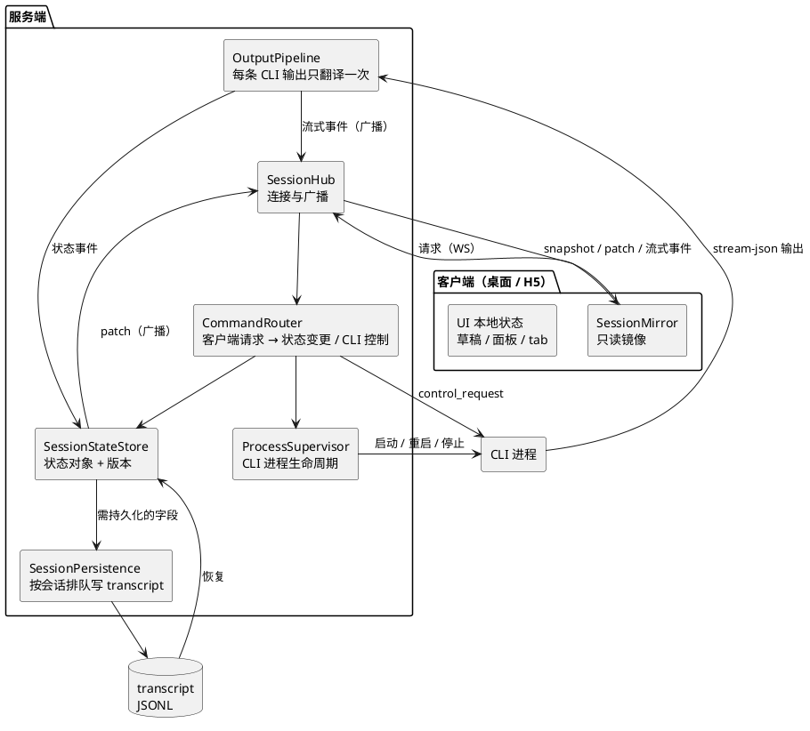
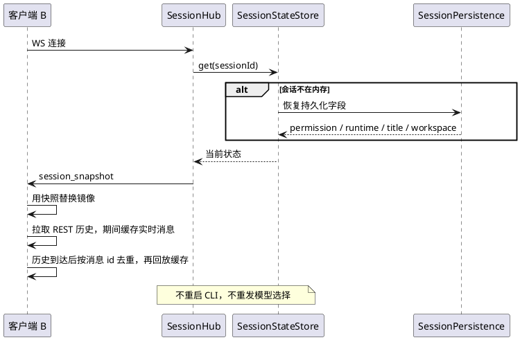
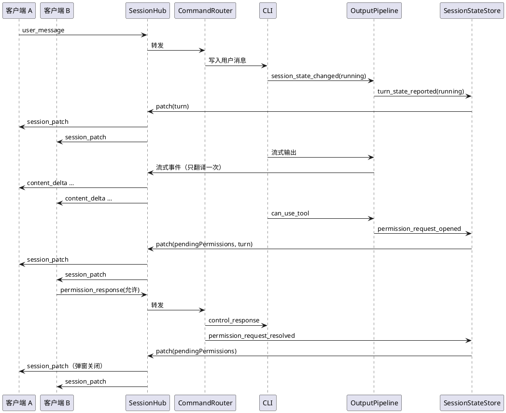
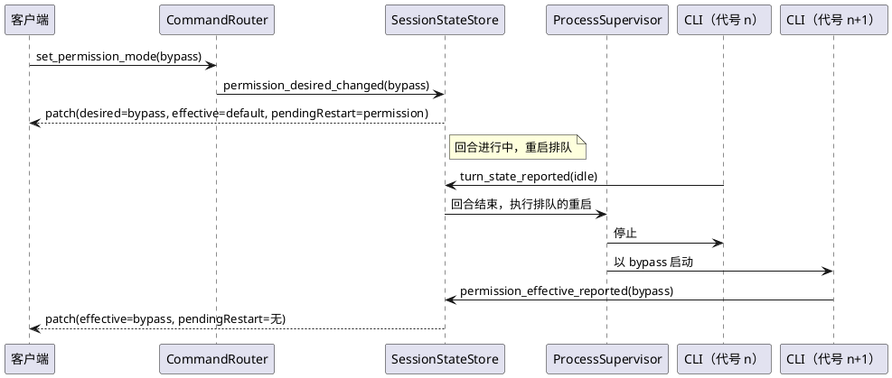

# 会话状态管理技术设计

状态：维护者已确认，实现中（分支 `feat/session-state`）。基线：`main` 的 `a1a91bc`（含 #149）。文中的代码位置以这个提交为准，实现前需要重新核对。

## 背景

DreamCoder 的每个会话由服务端拉起一个 CLI 进程执行，桌面端和手机 H5 通过 WebSocket 连到服务端。同一个会话的状态现在分散在 CLI、服务端的两个内存对象、会话记录文件（transcript JSONL）和每个客户端各自的 store 里，各处靠零散的消息互相同步。

#149 把权限模式收成了按会话保存，但盘点（2026-10-21，只读）发现同类问题遍布其他状态，而且在「同一个会话有多个客户端连着」时最严重：第二个客户端的流式输出会乱，连上时会重启 CLI 打断正在跑的回合，权限弹窗在各端不收敛，刷新后运行状态和历史不能正确重建。

本设计给出一个统一的会话状态模型：服务端是每个会话状态的唯一持有者，CLI 执行并汇报，客户端只发请求和渲染。

## 目标与非目标

**目标**

- 每个会话在服务端只有一个状态对象，所有读写经过它。
- 同一个会话的所有客户端看到一致的状态和一致的流式输出，任何一端连上、断开、刷新都不影响其他端。
- 客户端连接或重连时拿到一份完整快照，之后只收增量；增量丢失时能自动重新同步。
- 需要跨 app 重启保留的状态，有唯一的持久化出口和统一的恢复顺序。
- 区分「用户要求的值」和「CLI 实际生效的值」，界面始终显示实际值。

**非目标**

- 不改「每个会话一个 CLI 进程」的进程模型，不把 agent 循环搬进服务端。
- 不让切 Bypass、换 provider 免重启。这两项由 CLI 启动参数和环境变量决定。
- 不重新定义服务端与 CLI 之间的 stream-json 协议，只在现有消息上补充使用。
- 不同步纯界面状态：打开的 tab、composer 草稿、面板开合、终端。这些保留在各客户端。
- 不重做 Agent Teams 的状态模型。本设计只给 team 留出字段和过滤规则。

## 现状

### 三层结构

- **桌面端 / H5**：同一份前端构建，H5 由服务端的 `staticH5.ts` 提供。会话状态主要在 `desktop/src/stores/chatStore.ts` 的 `PerSessionState`，模型选择在 `sessionRuntimeStore`（localStorage），会话列表在 `sessionStore`。
- **服务端**：`src/server/ws/handler.ts` 处理 WebSocket；内存状态分在两个对象：
  - `SessionRuntime`（`src/server/ws/sessionRuntime.ts:52`）：连接的客户端、标题计数、流式状态、模型覆盖、权限模式、启动与重启的 Promise、预热。
  - `SessionProcess`（`src/server/services/conversationService.ts:41`）：CLI 进程句柄、工作目录、权限模式、待处理的权限请求、初始化消息、输出回调列表。
- **CLI**：每个会话一个进程，以 `--print --input-format stream-json --output-format stream-json --sdk-url …` 启动（`conversationService.ts:124`）。

服务端没有独立的会话状态存储。需要持久化的状态都写成 transcript 条目，读取时再从 transcript 推出来（`sessionService.ts`）。

### 当前协议

客户端发：`prewarm_session`、`user_message`、`permission_response`、`set_permission_mode`、`set_runtime_config`、`stop_generation`、`ping`。

服务端发：流式内容（`content_start`、`content_delta`、`tool_use_complete`、`tool_result`、`thinking`、`message_complete`），状态类（`status`、`permission_mode`、`permission_request`、`session_title_updated`、`team_*`、`task_update`、`background_task`），以及 `error`、`system_notification`、`transcript_item`、`api_retry`。定义在 `src/server/ws/protocol.ts`。

### 已核实的主要问题

- **流式翻译按客户端重复执行。** 每个客户端各注册一个输出回调（`handler.ts` 的 `bindClientSessionOutput`），每个回调对同一条 CLI 输出调用 `translateCliMessage`，而翻译读写的是按会话共享的 `runtime.stream`（`getStreamState`）。第一次翻译就改掉了块状态和「已收到流事件」标记，后面的客户端丢工具调用、文字重复。
- **连接即重启。** `connectToSession`（`chatStore.ts:700` 起）每次连接都重发本地存的模型选择；服务端 `handleSetRuntimeConfig` 只要旧值不存在或不同就重启 CLI，不检查是否正在回合中。
- **会话文件分裂。** `appendSessionMetadata`（`sessionService.ts:1377`）按传入的 workDir 计算目标文件，CLI 进入 worktree 后 cwd 变化，就新建一个只有元数据的同名文件。
- **状态消息只发给一个连接。** `status`、标题、错误、`/clear` 通常只发给触发它的连接；`team_*` 反过来广播给所有会话。
- **权限请求不收敛。** 一端回复后不广播；CLI 的 `control_cancel_request` 只在服务端 map 里删除（`conversationService.ts:679`），不通知客户端；重连补发不去重。
- **回合边界靠猜。** CLI 有 `session_state_changed`（`src/utils/sessionState.ts:92`，取值 `idle`、`running`、`requires_action`），但只在设置 `CLAUDE_CODE_EMIT_SESSION_STATE_EVENTS` 时发出，服务端没设，只能看 `result`。
- **刷新丢历史。** `loadHistory` 在本地已有消息时只做合并（`chatStore.ts` 的 `mergeRestoredHistoryIntoLiveMessages` 分支），而重连后实时消息或补发的权限请求可能先于历史到达。

完整盘点表见维护者手里的盘点报告，本文不重复。

## 方案概览



核心规则：

- **单一写入口**：会话状态只能通过 `SessionStateStore.apply` 改变。客户端请求、CLI 汇报、进程生命周期事件都先变成「状态事件」再进来。
- **单次翻译**：每条 CLI 输出在 `OutputPipeline` 里翻译一次，得到状态事件和流式事件两类结果。流式事件交给 `SessionHub` 广播给该会话的所有客户端。
- **全量广播**：状态的每次变化都以 `session_patch` 广播给该会话的所有客户端，不再有只发给某一个连接的状态消息。只有对某个请求的直接报错才单发给发起者。
- **快照加增量**：客户端连接时收到 `session_snapshot`，之后按版本号应用 `session_patch`，发现版本不连续就重新要快照。
- **期望值与实际值分开**：权限模式、模型这类「用户要求后需要 CLI 确认」的状态同时记两份，实际值只由 CLI 的汇报更新。

## 组件

### SessionStateStore

位置：`src/server/session/state/`（新目录）`[assumption]`。

持有所有会话的 `SessionState`，按会话 id 索引。对外只有三类操作：

- `get(sessionId)`：返回当前状态的只读快照，会话不在内存时从 `SessionPersistence` 恢复。
- `apply(sessionId, event)`：应用一个状态事件。内部是一个纯函数 reducer：输入旧状态和事件，输出新状态和变化的字段。版本号加一，生成 patch，交给订阅者。
- `subscribe(listener)`：供 `SessionHub`（广播）和 `SessionPersistence`（落盘）订阅变化。

reducer 是纯函数，不做 IO，不调用 CLI，便于单测。所有副作用由订阅者完成。

内存回收沿用现在「所有客户端断开一段时间后回收」的策略（`handler.ts` 的断开清理，时长量级为几十秒，有待处理权限请求时延长到半小时量级）。回收只丢运行期字段，持久化字段下次从 transcript 恢复，所以回收后不会再出现「模型选择丢失」。

### OutputPipeline

每个会话一个，替代现在每个客户端一个的输出回调。

- 向 `ProcessSupervisor` 注册一次，接收这个会话 CLI 的全部输出。
- 对每条输出调用一次翻译，翻译用的流式状态（当前块、工具块、parentToolUseId 等）归 pipeline 自己所有，不再放在 `SessionRuntime` 上被多个调用方共享。
- 翻译结果分两类：
  - **流式事件**：文字增量、thinking、工具调用开始和完成、工具结果。交给 `SessionHub` 广播，不进状态对象，因为它们量大、只对正在看的客户端有意义。
  - **状态事件**：回合状态、权限请求的出现与撤销、实际权限模式、实际模型、工作目录、slash 命令、目标、后台任务。交给 `SessionStateStore.apply`。
- 进程重启时，pipeline 收到 `ProcessSupervisor` 的新进程通知，重置流式状态。

`translateCliMessage` 的现有逻辑整体迁移进来，拆成「产生流式事件」和「产生状态事件」两部分，行为保持不变。

### SessionHub

管理每个会话的客户端连接，替代 `SessionRuntime.clients` 和 `clientOutputCallbacks`。

- 客户端连上：加入该会话的连接集合，立即发送 `session_snapshot`。不再在连接时绑定或解绑任何 CLI 输出回调。
- 广播：把 `SessionStateStore` 的 patch 和 `OutputPipeline` 的流式事件发给该会话的所有连接。
- 单发：只有「这个请求不合法」这类针对某个连接的错误才单发。
- Team 事件只发给属于该 team 的会话（按 `SessionState.team` 过滤），修正现在广播给所有会话的问题。
- Team 状态本身不收归服务端：成员关系仍以 CLI 写的 team 文件为准，服务端继续轮询（`teamWatcher.ts`）。状态对象里只有一个 `team` 字段，说明这个会话属于哪个 team、是队长还是队员。Agent Teams 的方向确定之前不扩展，避免提前替它做设计决定。

### CommandRouter

把客户端请求翻译成状态事件和对 CLI 的控制操作，是 `handler.ts` 里 `handleSetPermissionMode`、`handleSetRuntimeConfig`、`permission_response`、`stop_generation` 等处理函数的归宿。

- 先校验请求，再 `apply` 一个「期望值变化」事件，再决定是发 `control_request` 还是请 `ProcessSupervisor` 重启。
- 需要重启的变更（Bypass 切换、provider 切换、模型和 effort 切换），在回合进行中一律排队，等回合结束再执行，不打断正在跑的回合。界面通过 `desired` 与 `effective` 不一致看到「待生效」。
- 第一版换模型和 effort 仍然重启 CLI，行为与现在一致。CLI 支持 `set_model` 控制请求（`src/cli/print.ts` 的控制请求分支），同一个 provider 内换模型可以不重启，但需要先验证这条路径在本 fork 里与上游代理配合正常，留作后续改动。换 provider 无论如何都要重启，因为 provider 的地址和密钥是启动时以环境变量传入的（`handler.ts` 的 `getRuntimeSettings`）。
- 权限回复采用先到先得：只接受当前 `pendingPermissions` 里存在的 requestId；第一个回复生效，`apply` 一个「已处理」事件，事件里带结果（允许或拒绝）和处理它的客户端类型（桌面或 H5）。广播后其他端的弹窗关闭，并显示「已在另一端允许 / 拒绝」。之后对同一 requestId 的回复返回「已被处理」的错误，不再转给 CLI。现在服务端不检查就把每个回复都转给 CLI（`conversationService.ts` 的 `respondToPermission`），CLI 本身只认第一个，所以这条规则和 CLI 的实际行为一致，只是让界面跟上。没有选「只允许发起回合的客户端回复」，因为那样在桌面发消息后就没法在手机上批准。

### ProcessSupervisor

`conversationService.ts` 中进程管理部分的归宿：启动、重启、停止、预热、强杀。

- 每次启动分配一个递增的**进程代号**（generation）。所有来自进程的事件、所有「延迟执行的强杀」都带上代号，代号不符就丢弃。修正现在重启窗口里删错进程、杀错进程的问题。
- 进程状态变化（启动中、已预热、运行中、重启中、停止中、已退出、失败）作为状态事件交给 store。
- 启动参数从 `SessionState` 的期望值生成：权限模式、模型、effort、工作目录、是否恢复。`CLAUDE_DANGEROUS_MODE` 这类环境覆盖，在生成参数时同时写回实际值，避免界面显示和 CLI 实际不一致。
- 启动 CLI 时设置 `CLAUDE_CODE_EMIT_SESSION_STATE_EVENTS=1`，拿到 `session_state_changed` 作为回合边界。

### SessionPersistence

统一负责会话状态与 transcript 的读写。

- **写**：订阅 store 的变化，只处理标为持久化的字段，写成对应的 transcript 条目。所有写入（追加、整体重写、改名）经过同一个按会话排队的写队列，扩展现在只给权限模式用的 `permissionModeWrites`（`sessionService.ts:358`）。
- **定位**：会话文件的位置在会话创建时确定，之后所有写入都写到这个文件，不再按当前工作目录重新计算。
- **读**：会话第一次进入内存时，从 transcript 按固定顺序恢复持久化字段，见「数据模型」。
- **CLI 退出后补写标题**：CLI 退出或压缩上下文时，会把它缓存的自定义标题重新追加到文件末尾（`src/utils/sessionStorage.ts` 的 `reAppendSessionMetadata`），目的是让标题留在读取时扫描的末尾窗口内（量级几十 KB）。它会先读末尾吸收外部改名，但改名之后又输出超过这个量级才退出时读不到，会写回旧标题。所以 `ProcessSupervisor` 报告进程退出后，`SessionPersistence` 检查文件末尾最后一条 `custom-title`，与状态里的标题不一致时再追加一条。不改 CLI 的写回，因为服务端读列表也只扫末尾窗口（#138），这个重写对我们同样有用。权限模式不受影响：CLI 只在会话文件还没建出来时缓存权限模式，退出时不重写。

### 客户端：SessionMirror

在 `chatStore` 里把会话状态拆成两部分：

- **镜像**：服务端 `SessionState` 的只读副本。只通过 `session_snapshot` 替换、`session_patch` 修改，界面组件从这里读权限模式、模型、运行状态、待处理权限请求、标题等。
- **本地状态**：消息列表的渲染缓存、流式文字缓冲、草稿、面板。只有这部分由客户端自己改。

客户端发请求后不直接改镜像。为了手感，可以在界面上做「显示用」的乐观更新（比如按钮立即高亮），但下一个 patch 到达时以服务端为准。

`sessionRuntimeStore`（localStorage）只保留「新会话页的草稿选择」，连接已有会话时不再重发。

`newSessionStore` 在当前客户端窗口的内存中保管一份新会话草稿：文字、附件、项目、分支、worktree 选项和权限模式。侧栏新建、项目加号和新建快捷键只打开草稿页，不调用创建接口，也不向会话列表插入占位记录。项目加号把草稿项目设为该项目；侧栏新建和快捷键在草稿没有文字和附件时，改用当前会话的项目。切换页面保留草稿；切换草稿项目时保留内容并重置分支和 worktree 选项。刷新或退出窗口不保留这份内存草稿。

首次提交非空文字或附件时，客户端才创建服务端会话并发送消息。只选择项目、输入空白，或执行本地界面斜杠命令，不创建会话。提交中的重复操作不会再次创建；创建失败保留草稿；取得会话 ID 后若连接或发送同步报错，重试复用该 ID。创建和发送仍是两步操作，客户端没有服务端事务或首条消息确认保证。正常发送交给现有 WebSocket 队列后清空草稿；期间用户切换到其他页面，完成时不抢回当前页面。

`tabStore` 把 `activeTabId: null` 作为空白草稿页保存和恢复。已保存的会话不存在时返回空白页；只有明确保存为 Scheduled 时才恢复 Scheduled。历史空会话和旧逻辑已经保存的 Scheduled 选择不自动清理。

## 数据模型

### SessionState

```ts
type SessionState = {
  id: string
  version: number

  permission: {
    desired: PermissionMode
    effective: PermissionMode | null
  }
  runtime: {
    desired: RuntimeSelection
    effective: { modelId: string | null; effort?: string } | null
  }
  title: { text: string | null; source: 'custom' | 'ai' | 'goal' | 'first-message' | null }
  workspace: {
    workDir: string
    projectRoot: string | null
    repository?: SessionRepository
    workDirExists: boolean
  }

  process: {
    phase: 'stopped' | 'starting' | 'prewarmed' | 'running' | 'restarting' | 'stopping' | 'failed'
    generation: number
    pendingRestart?: 'permission' | 'runtime'
    lastError?: { code: string; message: string }
  }
  turn: {
    phase: 'idle' | 'running' | 'awaiting_permission'
    startedAt?: number
    activity?: 'thinking' | 'streaming' | 'tool' | 'compacting'
  }
  pendingPermissions: PendingPermission[]
  slashCommands: SessionSlashCommand[]
  activeGoal: ActiveGoal | null
  backgroundTasks: BackgroundTaskSummary[]
  team: { name: string; role: 'lead' | 'member' } | null
  clientCount: number
}

type RuntimeSelection = { providerId: string | null; modelId: string; effort?: string }
```

形状是契约，字段的具体类型复用现有定义（`PermissionMode` 来自 `protocol.ts`，`SessionSlashCommand`、`SessionRepository` 等沿用现有类型）。

### 字段归属与持久化

| 字段 | 谁能改 | 持久化 | transcript 条目 |
|---|---|---|---|
| `permission.desired` | 客户端请求、建会话、分叉 | 是 | `permission-mode`（已有，#149） |
| `permission.effective` | 仅 CLI 汇报 | 否，启动后由 CLI 重新汇报 | — |
| `runtime.desired` | 客户端请求、建会话、分叉 | 是 | `runtime-config`（新增） |
| `runtime.effective` | 仅 CLI 汇报（`init.model` 等） | 否 | — |
| `title` | 改名、AI 生成、`/goal` | 是 | `custom-title`、`ai-title`（已有） |
| `workspace` | 建会话、CLI 的 `init` | 是 | `session-meta`（已有，只在值变化时追加） |
| `process` | 仅 ProcessSupervisor | 否 | — |
| `turn` | 仅 OutputPipeline | 否 | — |
| `pendingPermissions` | OutputPipeline（出现、撤销）、CommandRouter（已处理） | 否，CLI 退出即失效 | — |
| `slashCommands` | OutputPipeline（`init`）、插件重载 | 否 | — |
| `activeGoal` | OutputPipeline | 由 transcript 推导（现状） | 本地命令输出条目 |
| `backgroundTasks` | OutputPipeline | 由 transcript 推导（现状） | — |
| `team` | team 服务 | 在 team 文件里（现状） | — |
| `clientCount` | SessionHub | 否 | — |

### 恢复顺序

会话进入内存时：

1. 持久化字段从 transcript 取最新的一条。
2. transcript 里没有的，用全局默认（设置页的默认权限模式、默认 provider 和模型）。
3. 运行期字段一律取初始值：进程 `stopped`，回合 `idle`，没有待处理权限请求。
4. 实际值（`effective`）为空，直到 CLI 启动后汇报。

这与 #149 现在的权限模式解析顺序一致，只是推广到模型和其他字段。

### 回合状态的来源

- 主信号：CLI 的 `session_state_changed`。`running` 进入回合，`requires_action` 进入等待权限，`idle` 结束回合。
- 补充：`result` 消息作为兜底，在没收到 `idle` 时也结束回合。
- `activity` 由流式事件推出：thinking 块、文字块、工具执行、压缩。

CLI 源码注释提到，末尾的 `idle` 事件曾让一些客户端卡在「运行中」，所以默认关闭。我们的客户端以 `turn.phase` 为准，不靠「最后一条消息」猜，不受这个问题影响。

## 接口

### WebSocket：服务端 → 客户端（新增）

```ts
| { type: 'session_snapshot'; state: SessionState }
| { type: 'session_patch'; version: number; changes: Partial<SessionState> }
```

- `session_snapshot`：连接成功后立即发送，客户端发 `request_snapshot` 时也发送。
- `session_patch`：`version` 是应用这次变化之后的版本号。客户端收到的 `version` 不等于本地版本加一时，丢弃这个 patch 并发 `request_snapshot`。
- `changes` 只包含变化的顶层字段，每个顶层字段整体替换，不做深层合并 `[assumption]`。这样客户端的应用逻辑最简单，代价是 `pendingPermissions` 这类数组每次整体下发，数据量很小，可以接受。

### WebSocket：客户端 → 服务端

- 新增 `{ type: 'request_snapshot' }`。
- `set_runtime_config`：语义改为「用户主动修改」，连接时不再发送。
- `permission_response`：增加「已被处理」的错误码，用于其他端已经回复的情况。
- 其余请求不变。

### 被取代的消息

`permission_mode`、`status`、`permission_request`、`session_title_updated` 的信息都进入状态对象。过渡期服务端同时发旧消息和新消息，桌面端切换到镜像以后，旧消息在同一个版本里删除。桌面端和服务端一起打包发布，H5 由同一个服务端提供，不存在新旧版本混用，所以不需要长期兼容。

### 服务端内部

- `SessionStateStore.apply(sessionId, event: SessionStateEvent)`，`SessionStateEvent` 是一个带 `type` 的联合类型，按来源分组：客户端意图（如 `permission_desired_changed`）、CLI 汇报（如 `permission_effective_reported`、`turn_state_reported`、`permission_request_opened`、`permission_request_cancelled`）、进程生命周期（如 `process_phase_changed`）。
- `ProcessSupervisor` 暴露 `start`、`restart`、`stop`、`prewarm`，全部返回或携带进程代号。

## 关键流程

### 客户端连接



历史与实时消息的拼接规则：客户端在历史请求返回之前收到的实时消息先缓存；历史返回后，以历史为底，按消息 id 去重后追加缓存的消息。这取代现在「本地已有消息就只合并」的分支，修正刷新丢历史的问题。

消息 id 的来源：REST 历史的条目已经带由 transcript uuid 派生的 id（`src/server/transcript/items.ts`）。CLI 输出的完整 assistant / user 消息里带着同一个 uuid（`src/utils/messages/mappers.ts`），但 `translateCliMessage` 现在没有转发。`OutputPipeline` 在消息完成时把 uuid 一起广播，客户端据此给实时消息打上 id。这样可以删掉现在事后按类型和内容匹配、匹配不上再定时重试的逻辑（`chatStore.ts` 的 `mergeRestoredTranscriptMessageIds`、`needsTranscriptIdHydrationRetry`）。

### 两个客户端同时在线，A 发消息



用户消息本身也作为流式事件广播，这样 H5 打的字桌面端立即可见，不用刷新。

### 回合中切换到 Bypass



旧进程在被停止后发来的任何事件都带着代号 n，store 直接丢弃。

## 失败与错误处理

- **patch 丢失或乱序**：客户端按版本号检测，发 `request_snapshot` 重新同步。服务端不为每个客户端保存补发队列。
- **CLI 崩溃或被杀**：`ProcessSupervisor` 产生 `process_phase_changed(failed 或 stopped)`；reducer 同时清空 `pendingPermissions`、把回合置为 `idle`、清空实际值，一次广播出去，各端弹窗和「运行中」一起消失。
- **CLI 拒绝模式切换**：实际值不变，期望值保留，`lastError` 记下原因并广播。界面显示「未生效」和原因，不会像现在这样把没生效的模式当成已生效。
- **过期的权限回复**：requestId 不在当前列表里，返回「已被处理」或「请求已失效」，不转给 CLI。
- **重启期间的请求**：带着旧代号的强杀、删除操作被忽略；新请求排在 `runtimeTransition` 之后执行（沿用现有的串行队列思路）。
- **持久化写入失败**：内存状态照常生效并广播，记一条诊断事件（`diagnosticsService`），下一次写入重试整条记录。不会因为写盘失败回滚界面。
- **恢复时 transcript 损坏或缺字段**：按恢复顺序退回全局默认，记诊断事件。

## 横切关注点

- **安全**：Bypass 的实际值只由 CLI 汇报和启动参数决定，界面不可能显示一个比实际更安全的模式。H5 的访问控制不变（`h5AccessPolicy.ts`），快照不包含 provider 密钥，`runtime` 只含 providerId 和模型 id。
- **隐私**：快照只在本机服务端和已授权的客户端之间传输，不引入任何外发。
- **性能**：
  - 快照很小（不含消息内容），连接时发一次。
  - patch 只在状态变化时发，流式增量不进 patch。
  - 每条 CLI 输出从「每个客户端翻译一次」变成「翻译一次」，客户端多时反而更省。
- **可观测性**：`apply` 在开发模式下可选记录事件和版本号 `[assumption]`；重启、拒绝切换、过期回复、写盘失败记入现有的诊断事件，便于「报告问题」导出。
- **配置**：无新增用户设置。`CLAUDE_CODE_EMIT_SESSION_STATE_EVENTS` 由服务端在启动 CLI 时设置，不暴露给用户。

## 测试策略

- **reducer 单测**：`SessionStateStore` 的 reducer 是纯函数，覆盖每类事件、期望值与实际值分离、进程失败时的联动清理、版本号递增。这是主要的覆盖面。
- **服务端集成测试**：用一个假的 CLI 进程（按脚本输出 stream-json）和两个假客户端连同一个会话，断言：
  - 两个客户端收到完全相同的流式事件序列；
  - 第二个客户端连上不触发重启；
  - 一端回复权限后另一端收到关闭的 patch；
  - CLI 发 `control_cancel_request` 后两端都收到撤销；
  - 重启窗口里带旧代号的事件被丢弃。

  `ProcessSupervisor` 的进程接口是这类测试替身的接缝，现有测试里已有拉起假进程的做法可以复用。
- **持久化测试**：恢复顺序、写队列串行化、会话进入 worktree 后仍写原文件。
- **客户端 store 测试**：镜像应用快照和 patch、版本不连续时请求快照、历史与缓存实时消息的去重拼接。
- **不做端到端 UI 测试**：按现在的约定，界面验证由维护者手动完成。

## 迁移与发布

按可独立验证的顺序推进，每一步都能单独发布，前一步不依赖后一步：

1. **广播修正**：在不引入状态对象的前提下，先把输出改成每会话翻译一次再广播，状态类消息改为广播，权限回复和撤销广播，连接时不再触发重启。修掉多客户端最严重的问题。
2. **服务端合并**：引入 `SessionStateStore`、`ProcessSupervisor` 的进程代号，把 `SessionRuntime` 和 `SessionProcess` 的重叠字段收进状态对象。协议暂时不变，内部改为从状态对象产生旧消息。
3. **快照与增量**：上线 `session_snapshot`、`session_patch`、`request_snapshot`，桌面端切换到镜像，同一个版本删除被取代的旧消息。
4. **模型选择归服务端**：新增 `runtime-config` 条目，连接时停止重发 localStorage 里的选择。
5. **持久化整顿**：固定会话文件定位，统一写队列，`/clear` 保留标题和 worktree，`session-meta` 只在变化时追加。
6. **回合信号**：启用 `session_state_changed`，回合状态改以它为主。也可以并入第 2 步。

**已有数据**：

- 已经分裂成两个文件的会话：不做扫描和兼容处理。读写时以含有对话内容的那个文件为准，只含元数据的同名文件直接覆盖掉：把其中较新的元数据条目并回主文件后删除它。现有会话数据主要是从 Claude Code 导入的，没有需要额外保护的 DreamCoder 专属数据。
- 用户本地 `sessionRuntimeStore` 里存的模型选择：第 4 步上线时，对还没有 `runtime-config` 条目的会话，读一次本地值写成条目，之后不再读。

## 考虑过的其他方案

- **以 CLI 为唯一状态持有者（OpenCode / Codex 的做法）**：让 agent 核心直接管理所有会话状态，服务端只做转发。状态天然只有一份，但我们的 CLI 是按「一个进程一个会话」写的，到处是进程级全局状态（如 `bootstrap/state.js` 的 `getSessionId()`），而且每个会话一个进程，跨会话、跨客户端的事（广播、team）还是得有人在外面管。等于重写 agent 核心，不选。
- **保持现状，逐个修补**：每发现一个不同步就补一条消息，#149 就是这样做的。单个问题改动小，但盘点里有十几处同类问题，每加一个状态都要重新考虑发给谁、何时补发、如何恢复，问题会继续出现。不选，但第 1 步的「广播修正」保留了这条路上收益最大的部分。
- **把所有状态都写成 transcript 事件，客户端直接订阅 transcript**：持久化和同步合成一件事，但 transcript 由 CLI 和服务端两边写，写入时机由 CLI 决定，延迟和覆盖问题会更难控制；运行期状态（回合、进程、待处理请求）也不该落盘。不选。

## 未决问题与风险

- **改动面大**：第 2、3 步涉及 `handler.ts`、`conversationService.ts` 和 `chatStore.ts` 中依赖零散消息的大量逻辑，回归风险集中在会话启动、重启、恢复这几条路径上。
- **CLI 状态事件的可靠性**：`session_state_changed` 默认关闭，在 headless 模式下长期打开是否有副作用，需要验证。

## 实现中的决定

实现时对上文的细化，按发布步骤记录。

**第 1 步**

- 「已处理」作为广播事件 `permission_resolved` 保留到最终协议里。patch 只能表达请求从 `pendingPermissions` 里消失，带不出结果（允许或拒绝）和处理它的客户端类型，界面要显示「已在另一端允许 / 拒绝」需要这条事件。
- 客户端类型由连接地址上的 `client=h5` 参数给出，缺省为桌面端。

**第 2 步**

- 组件落点：
  - `SessionStateStore`、reducer 和类型在 `src/server/session/state/`。
  - `OutputPipeline` 和翻译在 `src/server/session/`。
  - `SessionPersistence` 在 `src/server/session/persistence.ts`。
  - `ProcessSupervisor` 的职责（进程代号、生命周期事件、按代号停止）落在现有的 `conversationService.ts` 上，没有另起模块。
  - `SessionHub` 和 `CommandRouter` 留在 `src/server/ws/handler.ts`。
- `runtime.desired` 的类型是 `RuntimeSelection | null`。`null` 表示跟随全局默认，每次启动时按当时的默认解析，不在状态里固化。
- 新进程启动后，以启动时实际用的权限模式（含 `CLAUDE_DANGEROUS_MODE` 的覆盖）作为第一份 `effective`。
- CLI 自己改了模式（例如批准计划后离开 Plan）时，只有在 `desired` 与 `effective` 原本一致的情况下，`desired` 才跟着改。还没收到过汇报（`effective` 为空）或有一次切换尚未生效时，`desired` 不动。
- 恢复只填会话进入内存之后没有被改过的字段：恢复完成前用户改了权限模式或模型，以用户的为准。
- CLI 拒绝 `set_permission_mode` 时，通过它的 `control_response` 错误识别，记为 `process.lastError`（`PERMISSION_MODE_REJECTED`）。

**第 3 步**

- 删除的消息：
  - `permission_mode`、`status`、`permission_request`、`session_title_updated`，以及第 1 步临时加的 `permission_cancelled`；
  - 它们表达的信息都在快照和 patch 里。
- `status` 原来带的提示语由状态推出，按优先级：
  - 「Creating worktree」：新增 `process.detail = 'creating_worktree'`，会话启动建 worktree 时设置，进程运行后清除；
  - 「Compacting conversation」：来自 `turn.activity = 'compacting'`；
  - 后台任务进度：`turn.activity = 'tool'` 时，取本轮开始后更新过、仍在运行的后台任务里最近更新的一个，显示它的 `description`，没有则用 `summary`。第 3 步曾去掉这条提示，第 6 步之后按维护者要求恢复。
- 消息 id：
  - 用户消息的 id 由客户端生成（UUID），随 `user_message` 发给服务端，服务端作为 `uuid` 交给 CLI，CLI 用它记进 transcript；发送端从一开始就知道这条消息在历史里的 id。
  - CLI 回放用户消息时，服务端转发 `{ type: 'user_message', id, content }`，其他端据此显示另一端打的字，发送端按 id 忽略。
  - assistant 消息完成时转发 `{ type: 'message_id', id }`，客户端给当前回合最后一段没有 id 的文字打上它。
- 历史与实时拼接：连接时记下当时已有的消息条数，历史到达后以历史为底，只追加连接之后收到、且历史里没有的消息。比较键为：
  - 文字：transcript id；
  - 工具调用和工具结果：toolUseId；
  - 权限卡片：requestId。
- 删除回合结束后重新拉历史补 id 的逻辑（`refreshCompletedTranscriptHistory`、`mergeRestoredTranscriptMessageIds`、`needsTranscriptIdHydrationRetry` 和定时重试）。
- 界面显示的权限模式是 `effective`，没有汇报时用 `desired`。
- 服务端在客户端加入连接集合之前先发 `connected`，客户端只在拿到快照之后应用 patch，快照之前到达的 patch 直接丢弃。

**第 4 步**

- `runtime-config` 条目的形状是 `{ type: 'runtime-config', runtime: RuntimeSelection | null, sessionId }`，最新一条为准。`runtime: null` 表示跟随全局默认，在会话记着的 provider 已被删除、服务端把选择清空时写入。
- 新建会话的请求体可以带 `runtime`，服务端直接写进会话文件；分叉复制源会话的选择；`/clear` 重写会话文件时保留最新一条。
- `permission-mode` 和 `runtime-config` 的追加共用一个按会话排队的写队列，保证同一会话的条目按调用顺序落盘。
- 桌面端：
  - 已有会话的模型选择从镜像的 `runtime.desired` 读取，改模型只发 `set_runtime_config`，不再写 localStorage；
  - `sessionRuntimeStore` 只留新会话草稿（`__draft__`），建会话时作为 `runtime` 随请求发送。
- 本地值的迁移：连接后收到第一份快照时，如果本地存着这个会话的选择，删除本地值；服务端的 `runtime.desired` 为空时，把本地值作为一次 `set_runtime_config` 发出去。`desired` 为空不区分「没有条目」和「条目为 `null`」，后一种只出现在 provider 已删除时，本地值通常也指向那个 provider，下次启动时服务端会再次清空。
- `prewarm_session` 改为收到第一份快照后发送，让迁移的选择先于预热进程生效，避免预热起来的 CLI 立刻因为模型变化而重启。

**第 5 步**

- 会话文件的定位：同一个会话有多个同名文件时，以含对话内容的那个为准，没有则取最近修改的。CLI 恢复会话时沿用原文件（`sessionProjectDir`），所以分裂只来自服务端按 CLI 当前目录算路径写元数据；`appendSessionMetadata` 改为写进定位到的文件，不再新建。
- 新会话在 worktree 里启动时，CLI 会在 worktree 对应的目录下新建对话文件，服务端建会话时写的占位文件留在原目录。两份同时存在时，下一次写入前把占位文件里较新的元数据并进对话文件再删除它：每种元数据条目（`session-meta`、`custom-title`、`ai-title`、`permission-mode`、`runtime-config`、`worktree-state`）取最后一条，对话文件里没有同类条目，或者两边都有时间戳且占位文件的更新，就追加过去。为此 `permission-mode` 和 `runtime-config` 条目加上了 `timestamp`。原来 CLI 启动后删除占位文件的 `deletePlaceholderSessionFiles` 删除。
- 写队列：追加、整体重写（`/clear`、截断）、改名、AI 标题、元数据都经过同一个按会话排队的写队列，合并也在队列里做。
- `/clear` 重写文件时保留最后一条 `custom-title`、`ai-title` 和 `worktree-state`。
- `session-meta` 只在 `workDir` 或 `repository` 与最后一条不同时追加；带入的自定义标题与最后一条相同时也不追加。
- CLI 退出（进程进入 `stopped` 或 `failed`）后，状态里的标题来源是 `custom` 时，检查文件里最后一条 `custom-title`，不同就追加一条。实现读取整个文件找最后一条，没有只读末尾窗口。
- Team：`teamWatcher` 每次轮询从 team 文件里读出 `leadSessionId`（队长）和成员的 `sessionId`（队员），写进对应会话的 `team` 字段；`team_created`、`team_update`、`team_deleted` 只发给 `team.name` 相同的会话。

**第 6 步**

- CLI 启动时设置 `CLAUDE_CODE_EMIT_SESSION_STATE_EVENTS=1`。`session_state_changed` 翻译成 `turn_state_reported`，不再作为 `system_notification` 转发给客户端；取值不在 `running`、`requires_action`、`idle` 里的忽略。
- `result` 仍然结束回合。CLI 在 `result` 之后才发 `idle`，两者都到时第二个不产生变化；CLI 处理完后台任务通知再开一轮时，先发 `running`，界面会显示这一轮在运行。
- 解析不受影响：CLI 自己判断最后一条消息时已经排除这个子类型（`src/cli/print.ts`），服务端测试覆盖了 `running → requires_action → result → idle` 的顺序和未知取值。

**评审后的修正**

- 消息 id：H5 通过 `http://<局域网 IP>` 访问，不是安全上下文，没有 `crypto.randomUUID`。改用 `desktop/src/lib/uuid.ts`：有 `randomUUID` 就用，没有时用 `crypto.getRandomValues` 拼一个 v4 UUID（服务端只接受 UUID 形式的 id）。
- 旧 CLI 进程：SDK 连接的关闭和输出都按连接带的 token 与当前进程的 `sdkToken` 比对，不一致就忽略，避免重启后旧进程晚到的关闭把新进程的连接置空、晚到的 `idle` 结束新进程的回合。
- 历史重载：快照到达时回合正在进行（中途加入），在这一轮结束时重新拉一次历史；连接断开后重连（收到 `connected` 时已有镜像），丢掉旧镜像，在新快照到达后重新拉历史。两种情况都以历史为底，只保留重拉之后收到的实时消息。
- 补写标题的时机：改为在 CLI 进程真正退出（`proc.exited`）之后，包括被服务端杀掉的进程；`conversationService.onProcessExited` 提供这个信号。`stopped` 事件在杀进程时立即发出，比 CLI 退出前的写回早。
- 分裂文件：「有对话内容」除用户、助手消息外，也包括本地命令输出（`system` / `local_command`）。保留的文件有对话内容时才删除副本；两份都没有对话内容时都保留，只把写入落到最近修改的那份。
- 排队的重启：回合结束执行前重新判断是否仍然需要。权限模式看 `desired` 与 `effective` 是否仍有一边是 Bypass；模型看当前选择是否与排队前进程使用的选择不同。不再需要时清除 `pendingRestart`（新事件 `restart_cancelled`）。
- `/clear` 在状态里保留标题，与会话文件一致。AI 生成的标题在 `/clear` 后的新对话里仍会重新生成，自定义标题不会。
- 两端同时回复同一个权限请求：以服务端的 `permission_resolved` 为准；与本地记下的结果不同时覆盖本地结果，相同时保留「本端处理」。
- CLI 进程退出时，只有会话仍指向这个进程才删除会话、补发错误结果和 `failed` 事件；排空输出期间已被新进程替换的，什么都不做。
- 内存回收：
  - 会话释放后，恢复完成或 AI 标题生成完成都不再把会话放回内存（`store.applyIfPresent`），已停止进程晚到的 `stopped`/`failed` 也一样；
  - 读取不在内存里的会话（分叉、会话状态接口）用 `store.read`，只读不留；
  - 已回复的权限请求 id 在回合结束时清空；
  - 后台任务只保留运行中的和最近 20 个已结束的；
  - 进程代号计数在会话释放时删除（`conversationService.forgetSession`），进程还在时不删。

**试用后的修正**

- 默认模型：`runtime.desired` 为空时按全局默认解析，有激活的 provider 时，全局默认就是这个 provider 的主模型。托管设置 `env.ANTHROPIC_MODEL`（provider 激活和编辑时同步写入）若对应当前有序模型列表中的模型则使用它，否则使用列表首项 `models[0].id`。provider 模式下不再读写托管设置里的 `model` 和 `modelContext`：`GET /api/models/current`、启动时的默认解析（`getDefaultRuntimeSettings`）都不读，`PUT /api/models/current` 不写，桌面端激活 provider 时也不再写。原来激活时写进去的 `model` 不会随 provider 编辑更新，又没有界面能改，会一直盖过 provider 的主模型。没有 provider 时仍读写用户设置的 `model`，行为不变。编辑当前激活的 provider 后，桌面端重新拉取设置，默认模型的显示随之更新。
- 权限模式的显示：第 3 步定的「界面显示 `effective`，没有汇报时用 `desired`」改为始终显示 `desired`，即用户选的模式。`effective` 已有汇报且与 `desired` 不同时，选择器上显示一个黄点，提示「本次回复结束后生效」；两者相同时（生效了，或在回合结束前改回原来的模式）黄点消失。回合之外切换普通模式时，CLI 很快汇报新的 `effective`，黄点只会短暂出现。
