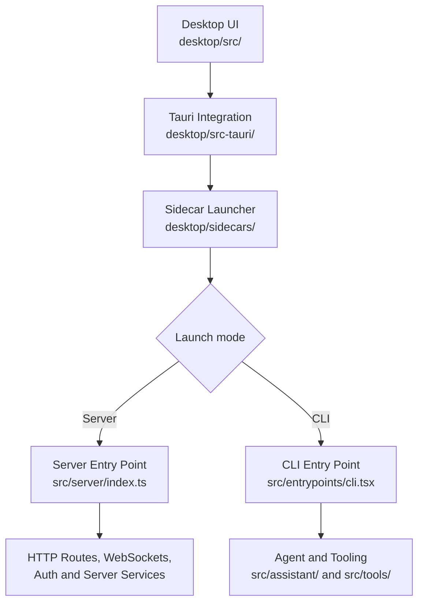

# Codebase Tour

This guide helps new contributors find their way around DreamCoder's source code before making changes. It focuses on where major responsibilities live, how the desktop application starts the backend, and where to look when working on a feature.

You do not need to understand the entire repository before contributing. Start with the area related to your issue and follow the imports and call sites as needed.

## Repository Map

DreamCoder is organized around a few major areas:

- **`desktop/`** — The desktop application, its React-based user interface, and Tauri integration.
- **`desktop/sidecars/`** — Launcher code that prepares the environment and starts either the server or CLI.
- **`desktop/src-tauri/`** — Native desktop integration, including application lifecycle management, terminal operations, window behavior, and Tauri commands exposed to the frontend.
- **`src/`** — The main TypeScript application, organized into areas such as `assistant/`, `tools/`, `commands/`, `services/`, `state/`, and `server/`. The CLI entry point lives under `entrypoints/`.
- **`docs/`** — Project documentation, contribution guidance, and tutorials.
- **`website/`** — The project website and its documentation interface.
- **`scripts/`** — Supporting development and maintenance scripts.
- **`bin/`** — Command-line launcher entry points.

Some responsibilities span multiple directories. For example, the desktop UI lives under `desktop/`, while much of the agent, tooling, CLI, and server implementation lives under `src/`.

## How the Main Pieces Fit Together

The desktop application can launch the DreamCoder server or CLI through the sidecar entry point. The sidecar prepares the environment and command-line arguments before loading the selected entry point.

This is a high-level orientation diagram, not a complete call graph. The exact path through the application depends on the launch mode and the feature being used. The server entry point connects HTTP routing and WebSocket handling with middleware and supporting services.

## Where to Start When Contributing

- **Desktop UI or interaction:** Start in `desktop/src/`. Explore the relevant pages, components, API modules, hooks, or stores.
- **Native desktop behavior:** Start in `desktop/src-tauri/` for Tauri commands, window behavior, terminal integration, and other native functionality.
- **Agent behavior or tools:** Start in `src/assistant/` or `src/tools/`, then follow the relevant call sites and supporting modules.
- **CLI behavior:** Start at `src/entrypoints/cli.tsx` and trace into the command or feature being changed.
- **Server endpoints or connections:** Start in `src/server/`, then follow the router, WebSocket handlers, middleware, and services relevant to the endpoint.
- **Documentation:** Start in `docs/` and check how the website loads and presents the relevant page.

These are starting points, not strict boundaries. A single feature may involve the frontend, server, and shared application code.

## Continue Reading

For a deeper explanation of how the agent executes a code change, read [How a coding agent completes a code change](./00-overview.en.md).

For this guide, prefer inspecting the current source code and following imports and call sites over assuming that older walkthroughs still describe the current implementation.
