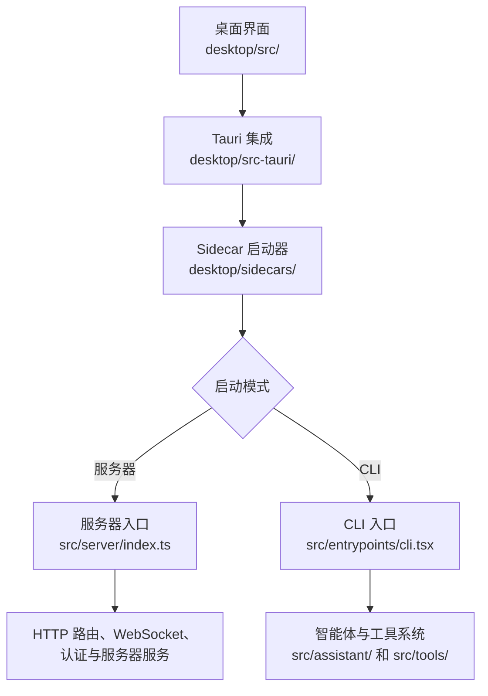

# 代码库导览

本指南帮助新贡献者在修改代码前快速了解 DreamCoder 的代码结构。我们将介绍主要功能所在的目录、桌面应用如何启动后端，以及开发不同功能时可以从哪里入手。

开始贡献代码前，不需要理解整个仓库。可以先找到与你当前任务相关的模块，再沿着导入关系和调用位置继续阅读。

## 仓库目录概览

DreamCoder 主要由以下几个部分组成：

- **`desktop/`** — 桌面应用，包括基于 React 的用户界面和 Tauri 集成。
- **`desktop/sidecars/`** — 启动器代码，负责准备运行环境并启动服务器或 CLI。
- **`desktop/src-tauri/`** — 桌面端原生集成，包括应用生命周期管理、终端操作、窗口行为，以及提供给前端调用的 Tauri 命令。
- **`src/`** — 主要的 TypeScript 应用代码，按功能组织在 `assistant/`、`tools/`、`commands/`、`services/`、`state/` 和 `server/` 等目录中。CLI 入口位于 `entrypoints/`。
- **`docs/`** — 项目文档、贡献指南和教程。
- **`website/`** — 项目网站及其文档展示界面。
- **`scripts/`** — 开发和维护过程中使用的辅助脚本。
- **`bin/`** — 命令行启动入口。

部分功能会跨越多个目录。例如，桌面用户界面位于 `desktop/`，而智能体、工具系统、CLI 和服务器的大部分实现位于 `src/`。

## 主要模块如何协作

桌面应用可以通过 sidecar 启动 DreamCoder 服务器或 CLI。Sidecar 会先准备运行环境和命令行参数，然后加载对应的入口。

这是一张用于快速理解代码结构的高层示意图，并不代表完整的函数调用链。实际执行路径取决于启动模式和具体功能。服务器入口将 HTTP 路由、WebSocket 处理、中间件及相关服务连接起来。

## 开始贡献代码时从哪里入手

- **桌面界面或交互：** 从 `desktop/src/` 开始，根据任务查看相关页面、组件、API 模块、hooks 或 stores。
- **桌面原生行为：** 从 `desktop/src-tauri/` 开始，查找 Tauri 命令、窗口行为、终端集成及其他原生功能。
- **智能体行为或工具：** 从 `src/assistant/` 或 `src/tools/` 开始，然后追踪相关调用位置和辅助模块。
- **CLI 行为：** 从 `src/entrypoints/cli.tsx` 开始，再追踪到需要修改的命令或功能模块。
- **服务器接口或连接：** 从 `src/server/` 开始，根据具体接口继续查看路由、WebSocket 处理器、中间件和服务。
- **文档：** 从 `docs/` 开始，并检查网站如何加载和展示相应页面。

这些目录只是推荐的起点，并非严格的功能边界。同一个功能可能同时涉及前端、服务器和共享应用代码。

## 继续阅读

如需深入了解智能体如何完成一次代码修改，请阅读[编程智能体如何完成一次代码修改](./00-overview.zh.md)。

阅读本指南时，建议优先检查当前源码，并沿着导入关系和调用位置理解实现，而不要假设旧版代码导览仍然准确描述当前代码。
